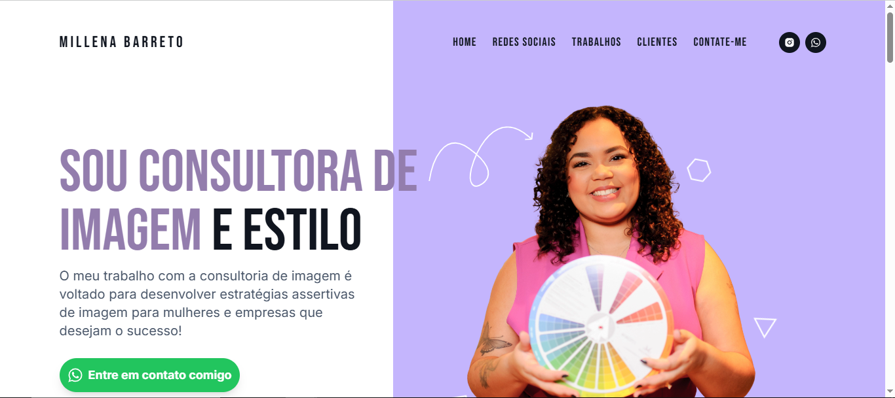
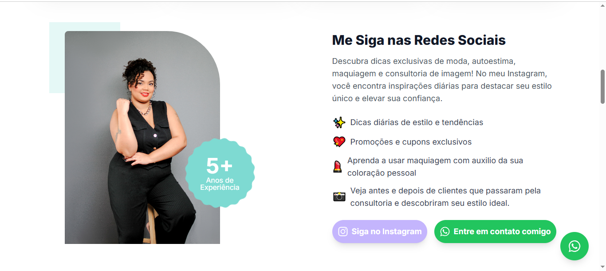
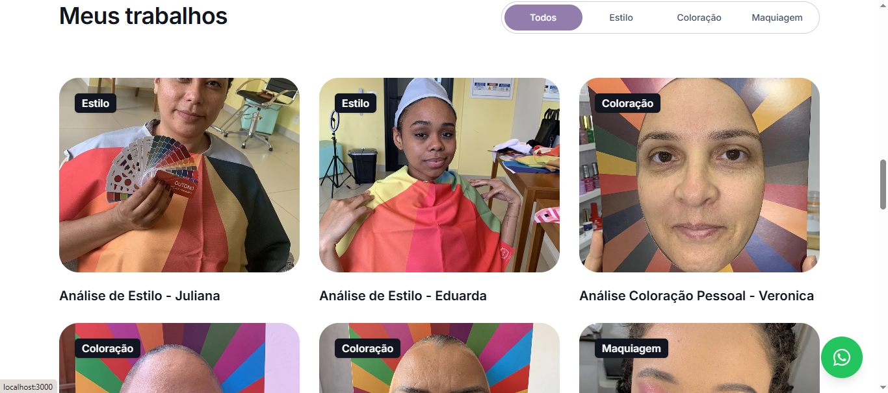

Millena Barreto Portfolio Website
This is a portfolio website developed by Jhon Everton for Millena Barreto, focusing on style consulting services.

Technologies Used:
Next.js: A React framework used for server-side rendering and static site generation.
Tailwind CSS: A utility-first CSS framework for rapid UI development.
Features:
Responsive Design: The website is fully responsive, ensuring a great user experience on all devices.
Interactive UI: Dynamic elements and smooth animations enhance user engagement.
View Website:
You can view the live website by visiting the link below: Website URL

Screenshots:
Here are some screenshots from the website:

Setup & Installation:
To run this project locally, follow the steps below:

Clone this repository:

bash
Copy
Edit
git clone https://github.com/your-username/portfolio-website.git
Install the required dependencies:

bash
Copy
Edit
cd portfolio-website
npm install
Run the development server:

bash
Copy
Edit
npm run dev
Open the website in your browser:

arduino
Copy
Edit
http://localhost:3000
Diagnóstico de estilo: setup
The diagnosis lives under /diagnostico-estilo and needs a local Supabase.

1. Start Docker Desktop.
2. Copy .env.example to .env.local and set APP_PORT (for example 3001).
3. Run npx supabase start and paste the printed API URL, anon key and service_role key into SUPABASE_URL, SUPABASE_ANON_KEY and SUPABASE_SERVICE_ROLE_KEY in .env.local.
4. Run npm run db:reset to apply the migrations, then npm run db:types to refresh lib/diagnostico/database.types.ts.
5. Tests: npm run test (unit) and npm run test:integration (needs the local Supabase running).

Credentials to provide before going live (none is stored in the repository):
- Supabase: project URL, anon key and service role key.
- AbacatePay: API key and webhook secret.
- Resend: API key and a sending domain verified in DNS.
- Admin e-mail, privacy-policy contact e-mail, and (optional) Millena's WhatsApp number for the message signature.

License:
This project is licensed under the MIT License.