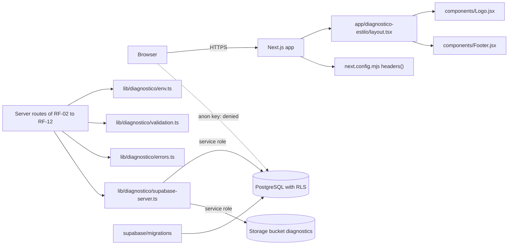

# RF-01. Platform Foundation and Data Model: Technical Specification

PRD: docs/prd/PRD-Descubra-Seu-Estilo.md · Scope covered: full feature (no Core/Full split in the PRD) · Complexity: complex

## 1. Technical Overview

**What.** RF-01 builds the shared infrastructure of the "Descubra Seu Estilo" diagnosis, which lives under `/diagnostico-estilo` inside the existing Next.js 14 portfolio. It delivers: a local Supabase project with versioned SQL migrations (the full data model of 18 tables, row-level security on all of them and a private Storage bucket), server-only modules (typed environment configuration, Supabase clients, error format and input validation helpers, shared constants), the Vitest test setup, security headers for the new routes, and the diagnosis layout shell that reuses the site's own design.

**Why.** Every later feature (RF-02 to RF-12) stores or reads customer data, and the PRD requires that browsers never reach the tables directly and that nothing is delivered without an approved payment. Creating the schema, the access lockdown and the rule "results and deliveries only for paid orders" once, in one place, avoids each feature inventing its own. The project has no database, no validation library and no tests today, so this feature also fixes those conventions for the rest of the PRD.

**Scope**

**Included:**
- Local Supabase project (Supabase CLI) and SQL migrations for all PRD entities: customers, purchase attempts, consents, questionnaire versions, questions, alternatives, answers, results, orders, payments, webhook events, deliveries, result tokens, content versions, content templates, automation errors, deletion requests and rate limits.
- Row-level security enabled on every table, with no policies and all privileges revoked from `anon` and `authenticated`; only the service role, used on the server, reaches data.
- Private Storage bucket `diagnostics` for PDFs, with no public access.
- Database rule: a result, or a delivery, can only be created for an order that is `APPROVED`, `PROCESSING` or `DELIVERED` (PRD RF-07 Capabilities, "Hard guard").
- Server-only modules under `lib/diagnostico/`: environment configuration per group, payment-simulation guard, Supabase clients, API error format, input validation helper, shared constants.
- Vitest setup for unit and integration tests; Zod for server-side validation.
- Security headers on `/diagnostico-estilo/*` and `/api/*`.
- Diagnosis layout shell (`app/diagnostico-estilo/layout.tsx`) reusing `Logo` and `Footer`, plus a placeholder entry page that RF-02 replaces.
- `.env.example`, a dev script that honors `APP_PORT`, and the list of credentials someone must provide before go-live (PRD RF-01 Capabilities).
- Cross-cutting concerns integrated here: the order and delivery states and the "paid before result" rule (shared with RF-06, RF-07, RF-08); the idempotency key on webhook events (RF-06, RF-07); the retention fields used by the daily job (RF-09); versioned questionnaire and content tables (RF-03, RF-07, RF-12).
- Input contracts (Consumes): none.
- Output contracts (Provides): none in the PRD sense (no functional data flows). The schema, the server modules and the layout are infrastructure that every other feature depends on through the dependency table.

**Deferred:** none.

**Excluded:**
- Seed data: the 15 questions and alternatives (RF-03) and the content templates (RF-07, edited by RF-12).
- Any API route, business rule, payment call, e-mail, PDF or admin screen (RF-02 to RF-12).
- SQL functions for atomic operations such as approving an order once or deduplicating a webhook (decided: they are created by the features that use them, RF-06 and RF-07).
- The registration form and its field validation schemas (RF-02).
- The daily retention job itself (RF-09); RF-01 only provides the columns it needs.
- A new color or font set (the site design is reused as is).
- Changes to the existing portfolio pages, to `app/sitemap.ts` and to the `Footer` component.

### Requirements / Business Rules (PRD RF-01 Capabilities)

- New code lives under `app/diagnostico-estilo/` and `app/api/` of the existing project, in TypeScript (the project already has `allowJs` and `strict: false` in `tsconfig.json`, so TypeScript and JSX files coexist). Server logic is in `lib/diagnostico/`; UI components in `components/Diagnostico/` (inferred, following `components/Coloracao/`).
- One Supabase project; PostgreSQL schema in `public`. Conventions (inferred): `snake_case` names, `uuid` primary keys with `gen_random_uuid()`, `timestamptz` dates with `created_at` and `updated_at`, money in cents as integer.
- Fields with fixed values are `text` with a `CHECK` constraint; the same values exist as constants and types in `lib/diagnostico/constants.ts`, and a test proves both agree.
- Row-level security is enabled on every table with no policies; privileges on all tables are revoked from `anon` and `authenticated`. The browser never queries a table. All reads and writes use the service role key, which exists only in server environment variables and is read only by `lib/diagnostico/supabase-server.ts` (marked `server-only`).
- Storage bucket `diagnostics`: private, PDF only (`application/pdf`), at most 2 MB per file (the PRD's PDF limit), no policies for `anon` or `authenticated`.
- Environment values are validated with Zod, per group, only when a group is used. A missing or invalid variable raises a `ConfigError` that names every missing variable of the group and never prints a value. No credential has a default or is hard-coded.
- Variables (inferred names): database group `SUPABASE_URL`, `SUPABASE_ANON_KEY`, `SUPABASE_SERVICE_ROLE_KEY`; payment group `ABACATEPAY_API_KEY`, `ABACATEPAY_WEBHOOK_SECRET`; e-mail group `RESEND_API_KEY`, `EMAIL_FROM`; admin group `ADMIN_EMAIL`; app group `APP_URL`, `PRIVACY_CONTACT_EMAIL`; development only `APP_PORT`, `ENABLE_PAYMENT_SIMULATION`.
- Payment simulation: `paymentSimulationEnabled()` returns `true` only when `NODE_ENV !== "production"` and `ENABLE_PAYMENT_SIMULATION === "true"`. In production it returns `false` whatever the variables say. No simulation route exists in this feature.
- Security headers (inferred values) on `/diagnostico-estilo/:path*` and `/api/:path*`: `Strict-Transport-Security: max-age=63072000; includeSubDomains`, `X-Content-Type-Options: nosniff`, `X-Frame-Options: DENY`, `Content-Security-Policy: frame-ancestors 'none'`, `Referrer-Policy: strict-origin-when-cross-origin`.
- Design reuse: the diagnosis pages use the existing Tailwind theme (`primary` #10151f, `secondary` #475467, `accent` #937dad), `font-primary` (Bebas Neue) and `font-secondary` (Inter) from `app/layout.jsx`, the global classes in `app/globals.css`, the 0.5rem radius and the `custom` shadow. No second font or color set is loaded and `tailwind.config.js` gets no new token in this feature.
- Credentials to be supplied before go-live, documented in `.env.example` and in the repository README (nothing invented): Supabase URL, anon key and service role key; AbacatePay API key and webhook secret; Resend API key and a verified sending domain (DNS records); admin e-mail; contact e-mail for the privacy policy; Millena's WhatsApp number for the message signature (optional).
- Test and dev configuration: AbacatePay runs in its development mode in non-production environments (consumed by RF-05 and RF-06); RF-01 only supplies the guard above.

### Requirements / UX Flows (PRD RF-01 Experience)

- Shell for every customer page: header with the existing `Logo` component ("Millena Barreto") and no navigation menu (decided); content area with at least 24 px side padding on a 360 px screen; footer using the existing `Footer`, with a "Política de Privacidade" link above it (the existing `Footer` has no such link and is not changed).
- The only visible page of this feature is a placeholder at `/diagnostico-estilo` with the title "Descubra o seu estilo" and the line "Em breve." It is marked `noindex` and is replaced by RF-02, which owns the route (inferred).
- `/diagnostico-estilo/privacidade` does not exist yet (RF-09); the footer link points to it and may return the site's default 404 until RF-09 is implemented (inferred, accepted).

### Error Handling

- **Missing or invalid environment variable:** `ConfigError` with the message `Missing or invalid environment variable(s): NAME_1, NAME_2 (group: database)`; thrown at first use of the group, never at build time; the message lists names only. API routes that call it return the error body below with code `CONFIG_ERROR` and HTTP 500, and log the names without values.
- **Invalid input:** `parseInput` returns field errors; routes answer HTTP 400 with `VALIDATION_ERROR` and the per-field messages.
- **Browser reaches a table directly:** the database answers with a permission error or zero rows; no data and no write is possible (proven by the integration tests).
- **Result or delivery for an unpaid order:** the insert is rejected by the database trigger with error code `P0001` and the message `order must be APPROVED, PROCESSING or DELIVERED`; the calling feature records an automation error.
- **Migration failure:** `supabase db reset` aborts on the first failing statement and leaves the previous state; each migration file is atomic (a single transaction).

## 2. Architecture Impact

**Affected components**
- `package.json` (modified), `vitest.config.ts`, `vitest.integration.config.ts`, `tests/` (new), `scripts/dev.mjs` (new)
- `supabase/config.toml`, `supabase/migrations/*.sql` (new)
- `lib/diagnostico/` (new): `env.ts`, `payment-simulation.ts`, `supabase-server.ts`, `errors.ts`, `validation.ts`, `constants.ts`, `database.types.ts`
- `next.config.mjs` (modified)
- `app/diagnostico-estilo/layout.tsx`, `app/diagnostico-estilo/page.tsx` (new), `components/Diagnostico/PrivacyLink.tsx` (new)
- `.env.example` (new), `README.md` (modified), `docs/STATUS.md` (new)

**Diagram**



**Patterns followed**
- Next.js 14 App Router with route folders under `app/` (`app/analise-de-coloracao-pessoal-online/page.jsx`, `app/layout.jsx`).
- Feature components grouped in `components/<Feature>/` (`components/Coloracao/`).
- `@/*` import alias for the repository root (`tsconfig.json`, `jsconfig.json`).
- Tailwind theme tokens and font variables (`tailwind.config.js`, `app/layout.jsx`) and global classes (`app/globals.css`).
- TypeScript already accepted next to JSX (`app/sitemap.ts`, `tsconfig.json` with `allowJs`).
- `.env*.local` ignored by git (`.gitignore`).
- No existing API, validation, test or error-format pattern was observed: those are introduced here (see Section 3).
- `next.config.mjs` already contains an `i18n` block that the App Router ignores; it is left untouched.

## 3. Technical Decisions

| Decision | Chosen Approach | Alternative Considered | Trade-off |
|---|---|---|---|
| Dev and test database | Supabase CLI local (`supabase start`), migrations in `supabase/migrations/` | Hosted dev project; plain Postgres container | Requires Docker running, but RLS, roles and Storage are tested for real |
| Test framework | Vitest (unit and integration) | Jest; `node:test` | One more dev dependency, in exchange for native TypeScript and fast runs |
| Input validation | Zod | Valibot; hand-written | Bigger than Valibot, but best-known and gives types from schemas |
| Fixed-value fields | `text` + `CHECK`, mirrored in TypeScript constants | Postgres `ENUM`; reference tables | Two places to update, guarded by a parity test |
| Data access | `supabase-js` with service role in a `server-only` module; atomic operations as SQL functions made by the features that need them | ORM (Drizzle); `supabase-js` only | Less typed queries than an ORM, but one schema source and no extra tool |
| Layout shell | Own layout with `Logo` and `Footer`, no navigation menu, privacy link | Site header and menu; no chrome | The logo still links to the portfolio home (existing `Logo` behavior) |
| Access control | RLS on, no policies, privileges revoked, service role only on the server | Per-user policies with the anon key | All authorization is in server code; a bug there is not caught by the database |
| Env validation | Lazy, per group | Single validation at startup | A missing payment key does not block work that only needs the database |

**Assumptions** (everything not decided by the user nor observed is `(inferred)`)
- Convention for names, ids, dates and cents (above) (inferred).
- Table list and columns in Section 6 beyond what the PRD names (inferred); `result_tokens` is a separate table because a customer may hold several valid links (PRD RF-08 Capabilities) (inferred).
- Payment statuses `PENDING`, `PAID`, `EXPIRED`, `FAILED` are generic until the AbacatePay documentation is checked in RF-06 (inferred).
- `failure_reason` values `PIX_EXPIRED`, `GENERATION_FAILED`, `DELIVERY_FAILED`, `INVALID_ANSWERS`, `MISSING_CONTENT` come from the PRD (RF-05, RF-07).
- Variable names, header values, the PDF size limit of 2 MB on the bucket, the `tests/` folder layout, `APP_PORT` handled by `scripts/dev.mjs`, dev port 3001 (first free port above 3000, per the owner's rule) (inferred).
- Integration tests read the local Supabase keys from `.env.local` through `@next/env` (inferred).
- `.env.local` is created from `.env.example` and never committed; no real key is written anywhere in the repository.
- `ENABLE_PAYMENT_SIMULATION` exists only to let later features turn a simulation on in development (inferred).

**Traceability:** PRD RF-01 Capabilities feed Sections 1 (rules), 2, 4, 6; Experience feeds the shell and placeholder; the four Section 9 acceptance criteria of RF-01 feed Section 7. RF-01 has no Consumes or Provides block, so there are no hand-off tests. Structural decisions with trade-offs (service-role-only access, `CHECK` constraints instead of enums) are candidates for an ADR.

## 4. Component Overview

### Tooling and configuration

| File Path | New/Modified | Purpose | Key Responsibilities |
|---|---|---|---|
| `package.json` | Modified | Dependencies and scripts | Add `@supabase/supabase-js`, `zod`, `server-only`; dev: `vitest`, `supabase`; scripts `dev`, `test`, `test:integration`, `db:start`, `db:reset`, `db:types` |
| `vitest.config.ts` | New | Unit test run | Include `tests/unit/**/*.test.ts`; alias `@/*`; node environment |
| `vitest.integration.config.ts` | New | Integration test run | Include `tests/integration/**/*.test.ts`; setup file loads `.env.local`; single worker, 30 s timeout |
| `tests/setup/load-env.ts` | New | Test environment | Load `.env.local` with `@next/env` |
| `scripts/dev.mjs` | New | Dev server on the configured port | Read `APP_PORT` (default 3000) and start `next dev -p <port>` |
| `.env.example` | New | Documents settings | List every variable with a placeholder and a one-line description; no real value |
| `README.md` | Modified | Setup guide | Add "Diagnóstico de estilo: setup" with Docker, `supabase start`, env file and the credentials checklist |
| `next.config.mjs` | Modified | Security headers | Add `headers()` for the two source patterns, keep the existing `i18n` block |

### Backend (server modules)

| File Path | New/Modified | Purpose | Key Responsibilities |
|---|---|---|---|
| `lib/diagnostico/env.ts` | New | Typed configuration | Zod schemas per group, `getDatabaseEnv`, `getPaymentEnv`, `getEmailEnv`, `getAdminEnv`, `getAppEnv`, `ConfigError` |
| `lib/diagnostico/payment-simulation.ts` | New | Production guard | `paymentSimulationEnabled()` |
| `lib/diagnostico/supabase-server.ts` | New | Database and Storage access | `import "server-only"`; `getSupabaseAdmin()` (service role, no session persistence) and `getSupabaseAnon()` (anon key, server side, for the admin login of RF-10) |
| `lib/diagnostico/errors.ts` | New | API error format | `apiError(code, message, status, fields?)`, error codes |
| `lib/diagnostico/validation.ts` | New | Input validation helper | `parseInput(schema, input)` returning data or field errors; `readJson(request)` with a 64 KB body limit (inferred) |
| `lib/diagnostico/constants.ts` | New | Shared fixed values | `STYLES`, `ORDER_STATUSES`, `PAYMENT_STATUSES`, `DELIVERY_PREFERENCES`, `DELIVERY_CHANNELS`, `DELIVERY_STATUSES`, `FAILURE_REASONS`, `PRICE_CENTS = 990` |
| `lib/diagnostico/database.types.ts` | New (generated) | Table types | Output of `supabase gen types typescript --local` |

### Data

| File Path | New/Modified | Purpose | Key Responsibilities |
|---|---|---|---|
| `supabase/config.toml` | New | Local Supabase project | Project id, default ports, Storage enabled |
| `supabase/migrations/20260101000001_core_schema.sql` | New | Customers to answers | Tables, indexes, constraints for customers, attempts, consents, questionnaire, answers |
| `supabase/migrations/20260101000002_orders_and_delivery.sql` | New | Commerce tables | Orders, payments, webhook events, results, deliveries, result tokens |
| `supabase/migrations/20260101000003_content_ops.sql` | New | Content and operations | Content versions and templates, automation errors, deletion requests, rate limits |
| `supabase/migrations/20260101000004_integrity_and_lockdown.sql` | New | Rules and access | `updated_at` trigger, paid-order trigger, RLS on, privileges revoked, bucket `diagnostics` |

### Frontend

| File Path | New/Modified | Purpose | Key Responsibilities |
|---|---|---|---|
| `app/diagnostico-estilo/layout.tsx` | New | Shell | `Logo` header, container with 24 px padding, privacy link, `Footer` |
| `app/diagnostico-estilo/page.tsx` | New | Placeholder entry | Title, "Em breve.", `noindex` metadata; replaced by RF-02 |
| `components/Diagnostico/PrivacyLink.tsx` | New | Footer link | "Política de Privacidade" link to `/diagnostico-estilo/privacidade` |

### Tests

| File Path | New/Modified | Purpose | Key Responsibilities |
|---|---|---|---|
| `tests/unit/diagnostico/env.test.ts` | New | Configuration | Missing variable, group isolation, no value in message |
| `tests/unit/diagnostico/payment-simulation.test.ts` | New | Production guard | Production, development, flag cases |
| `tests/unit/diagnostico/validation.test.ts` | New | Validation and errors | `parseInput`, `apiError` body shape, body size limit |
| `tests/unit/diagnostico/constants.test.ts` | New | Fixed values | Six styles without Sexy, five order states, price |
| `tests/unit/diagnostico/security-headers.test.ts` | New | Headers | Both sources carry the five headers |
| `tests/unit/diagnostico/design-tokens.test.ts` | New | Design reuse | Theme tokens, fonts, no new font or color set |
| `tests/unit/diagnostico/no-hardcoded-secrets.test.ts` | New | Secrets | No key-like literal in new source files |
| `tests/integration/diagnostico/rls.test.ts` | New | Access lockdown | Anon and authenticated roles cannot read or write |
| `tests/integration/diagnostico/schema.test.ts` | New | Constraints | Fixed values, uniqueness, cascade, paid-order rule, `updated_at` |
| `tests/integration/diagnostico/storage.test.ts` | New | Bucket | Private, PDF only, size limit, no anon access |

## 5. API Contracts

RF-01 exposes no HTTP endpoint. The contracts below are the public signatures of the server modules and the error body that every later route uses (no earlier API in the project, so this format is introduced here; inferred).

**`lib/diagnostico/env.ts`**
```ts
class ConfigError extends Error { group: string; missing: string[] }
function getDatabaseEnv(): { SUPABASE_URL: string; SUPABASE_ANON_KEY: string; SUPABASE_SERVICE_ROLE_KEY: string }
function getPaymentEnv(): { ABACATEPAY_API_KEY: string; ABACATEPAY_WEBHOOK_SECRET: string }
function getEmailEnv(): { RESEND_API_KEY: string; EMAIL_FROM: string }
function getAdminEnv(): { ADMIN_EMAIL: string }
function getAppEnv(): { APP_URL: string; PRIVACY_CONTACT_EMAIL: string }
```
Each throws `ConfigError` when a variable of the group is missing or invalid.

**`lib/diagnostico/payment-simulation.ts`**
```ts
function paymentSimulationEnabled(): boolean
```

**`lib/diagnostico/supabase-server.ts`**
```ts
function getSupabaseAdmin(): SupabaseClient<Database>   // service role, server only
function getSupabaseAnon(): SupabaseClient<Database>    // anon key, server side only
```

**`lib/diagnostico/validation.ts`**
```ts
type ParseResult<T> = { ok: true; data: T } | { ok: false; fields: Record<string, string[]> }
function parseInput<T>(schema: z.ZodType<T>, input: unknown): ParseResult<T>
function readJson(request: Request, maxBytes?: number): Promise<unknown>   // throws ApiError PAYLOAD_TOO_LARGE or INVALID_JSON
```

**`lib/diagnostico/errors.ts`**
```ts
function apiError(code: ErrorCode, message: string, status: number, fields?: Record<string, string[]>): Response
type ErrorCode = "VALIDATION_ERROR" | "INVALID_JSON" | "PAYLOAD_TOO_LARGE" | "NOT_FOUND" | "FORBIDDEN"
               | "RATE_LIMITED" | "CONFIG_ERROR" | "UPSTREAM_ERROR" | "INTERNAL_ERROR"
```

Error body example (HTTP 400):
```json
{
  "error": {
    "code": "VALIDATION_ERROR",
    "message": "Dados inválidos.",
    "fields": { "email": ["Informe um e-mail válido"] }
  }
}
```

Error body example (HTTP 500, configuration):
```json
{ "error": { "code": "CONFIG_ERROR", "message": "Configuração do servidor incompleta." } }
```
The response never contains variable names or values; the names go only to the server log.

## 6. Data Model

All tables are in schema `public`. Every table has `id uuid primary key default gen_random_uuid()`, `created_at timestamptz not null default now()` and, where mutable, `updated_at timestamptz not null default now()` kept by the `set_updated_at()` trigger. Style keys: `esportivo_natural`, `tradicional`, `elegante`, `romantico`, `criativo`, `dramatico`.

### Migration 1: core schema (`20260101000001_core_schema.sql`)

```sql
create function public.set_updated_at() returns trigger language plpgsql as $$
begin new.updated_at = now(); return new; end $$;

create table customers (
  id uuid primary key default gen_random_uuid(),
  name text not null check (char_length(name) between 3 and 120),
  email text not null check (char_length(email) <= 254 and email = lower(email)),
  whatsapp text not null check (whatsapp ~ '^\+55[1-9][0-9]9[0-9]{8}$'),
  created_at timestamptz not null default now(),
  updated_at timestamptz not null default now()
);
create index customers_email_idx on customers (email);

create table purchase_attempts (
  id uuid primary key default gen_random_uuid(),
  customer_id uuid not null references customers(id) on delete cascade,
  delivery_preference text not null check (delivery_preference in ('email','whatsapp','both')),
  ip_hash text,
  expires_at timestamptz not null default now() + interval '7 days',
  created_at timestamptz not null default now(),
  updated_at timestamptz not null default now()
);
create index purchase_attempts_customer_idx on purchase_attempts (customer_id);
create index purchase_attempts_expires_idx on purchase_attempts (expires_at);

create table consent_records (
  id uuid primary key default gen_random_uuid(),
  attempt_id uuid not null unique references purchase_attempts(id) on delete cascade,
  customer_id uuid not null references customers(id) on delete cascade,
  consent_text_version text not null,
  consent_text text not null,
  accepted_at timestamptz not null default now(),
  created_at timestamptz not null default now()
);

create table questionnaire_versions (
  id uuid primary key default gen_random_uuid(),
  version integer not null unique check (version >= 1),
  status text not null check (status in ('draft','published','archived')),
  published_at timestamptz,
  created_at timestamptz not null default now(),
  updated_at timestamptz not null default now()
);
create unique index questionnaire_one_published_idx on questionnaire_versions ((true)) where status = 'published';

create table questions (
  id uuid primary key default gen_random_uuid(),
  version_id uuid not null references questionnaire_versions(id) on delete cascade,
  position smallint not null check (position >= 1),
  text text not null,
  unique (version_id, position)
);

create table alternatives (
  id uuid primary key default gen_random_uuid(),
  question_id uuid not null references questions(id) on delete cascade,
  position smallint not null check (position between 1 and 4),
  text text not null,
  style text not null check (style in ('esportivo_natural','tradicional','elegante','romantico','criativo','dramatico')),
  weight smallint not null default 1 check (weight between 1 and 3),
  unique (question_id, position)
);

create table answers (
  id uuid primary key default gen_random_uuid(),
  attempt_id uuid not null references purchase_attempts(id) on delete cascade,
  version_id uuid not null references questionnaire_versions(id) on delete restrict,
  question_id uuid not null references questions(id) on delete restrict,
  alternative_id uuid not null references alternatives(id) on delete restrict,
  answered_at timestamptz not null default now(),
  unique (attempt_id, question_id)
);
create index answers_attempt_idx on answers (attempt_id);
```

### Migration 2: orders and delivery (`20260101000002_orders_and_delivery.sql`)

```sql
create table orders (
  id uuid primary key default gen_random_uuid(),
  attempt_id uuid not null references purchase_attempts(id) on delete cascade,
  amount_cents integer not null check (amount_cents > 0),
  status text not null default 'PENDING' check (status in ('PENDING','APPROVED','PROCESSING','DELIVERED','FAILED')),
  failure_reason text check (failure_reason in ('PIX_EXPIRED','GENERATION_FAILED','DELIVERY_FAILED','INVALID_ANSWERS','MISSING_CONTENT')),
  approved_at timestamptz,
  delivered_at timestamptz,
  created_at timestamptz not null default now(),
  updated_at timestamptz not null default now(),
  check ((status = 'FAILED') or failure_reason is null)
);
create index orders_attempt_idx on orders (attempt_id);
create index orders_status_created_idx on orders (status, created_at);

create table payments (
  id uuid primary key default gen_random_uuid(),
  order_id uuid not null references orders(id) on delete cascade,
  provider text not null default 'abacatepay',
  provider_charge_id text not null unique,
  status text not null default 'PENDING' check (status in ('PENDING','PAID','EXPIRED','FAILED')),
  amount_cents integer not null check (amount_cents > 0),
  pix_br_code text,
  pix_qr_image text,
  expires_at timestamptz not null,
  paid_at timestamptz,
  created_at timestamptz not null default now(),
  updated_at timestamptz not null default now()
);
create index payments_order_idx on payments (order_id);

create table webhook_events (
  id uuid primary key default gen_random_uuid(),
  provider text not null default 'abacatepay',
  event_id text not null,
  event_type text not null,
  payload jsonb not null,
  received_at timestamptz not null default now(),
  processed_at timestamptz,
  unique (provider, event_id)
);

create table results (
  id uuid primary key default gen_random_uuid(),
  order_id uuid not null unique references orders(id) on delete cascade,
  version_id uuid not null references questionnaire_versions(id) on delete restrict,
  points jsonb not null,
  predominant_style text not null check (predominant_style in ('esportivo_natural','tradicional','elegante','romantico','criativo','dramatico')),
  secondary_style text not null check (secondary_style in ('esportivo_natural','tradicional','elegante','romantico','criativo','dramatico')),
  content jsonb not null,
  pdf_path text,
  created_at timestamptz not null default now(),
  check (predominant_style <> secondary_style)
);

create table deliveries (
  id uuid primary key default gen_random_uuid(),
  order_id uuid not null references orders(id) on delete cascade,
  channel text not null check (channel in ('email','whatsapp')),
  status text not null default 'PENDING' check (status in ('PENDING','SENT','FAILED')),
  attempts smallint not null default 0 check (attempts >= 0),
  last_error text,
  next_attempt_at timestamptz,
  sent_at timestamptz,
  marked_by text,
  created_at timestamptz not null default now(),
  updated_at timestamptz not null default now(),
  unique (order_id, channel)
);

create table result_tokens (
  id uuid primary key default gen_random_uuid(),
  order_id uuid not null references orders(id) on delete cascade,
  token_hash text not null unique,
  expires_at timestamptz not null,
  revoked_at timestamptz,
  created_at timestamptz not null default now()
);
create index result_tokens_order_idx on result_tokens (order_id);
```

### Migration 3: content and operations (`20260101000003_content_ops.sql`)

```sql
create table content_versions (
  id uuid primary key default gen_random_uuid(),
  version integer not null unique check (version >= 1),
  status text not null check (status in ('draft','published','archived')),
  published_at timestamptz,
  created_at timestamptz not null default now(),
  updated_at timestamptz not null default now()
);
create unique index content_one_published_idx on content_versions ((true)) where status = 'published';

create table content_templates (
  id uuid primary key default gen_random_uuid(),
  version_id uuid not null references content_versions(id) on delete cascade,
  kind text not null check (kind in ('style_block','pair_paragraph','piece','accessory')),
  style text check (style in ('esportivo_natural','tradicional','elegante','romantico','criativo','dramatico')),
  secondary_style text check (secondary_style in ('esportivo_natural','tradicional','elegante','romantico','criativo','dramatico')),
  block text check (block in ('result','pieces','accessories','guidance')),
  position smallint not null default 1 check (position >= 1),
  body text not null,
  created_at timestamptz not null default now(),
  updated_at timestamptz not null default now()
);
create unique index content_templates_key_idx on content_templates
  (version_id, kind, coalesce(style,''), coalesce(secondary_style,''), coalesce(block,''), position);

create table automation_errors (
  id uuid primary key default gen_random_uuid(),
  order_id uuid references orders(id) on delete set null,
  step text not null,
  message text not null,
  context jsonb,
  resolved_at timestamptz,
  created_at timestamptz not null default now()
);
create index automation_errors_open_idx on automation_errors (created_at) where resolved_at is null;

create table deletion_requests (
  id uuid primary key default gen_random_uuid(),
  email text,
  token_hash text not null unique,
  expires_at timestamptz not null,
  confirmed_at timestamptz,
  completed_at timestamptz,
  created_at timestamptz not null default now()
);

create table rate_limits (
  key text not null,
  window_start timestamptz not null,
  count integer not null default 1 check (count >= 0),
  primary key (key, window_start)
);
```

### Migration 4: integrity and lockdown (`20260101000004_integrity_and_lockdown.sql`)

```sql
-- updated_at triggers on every table that has the column
create trigger set_updated_at before update on customers for each row execute function set_updated_at();
-- (same statement for purchase_attempts, questionnaire_versions, orders, payments, deliveries,
--  content_versions, content_templates)

-- Results and deliveries only for paid orders
create function public.require_paid_order() returns trigger language plpgsql as $$
declare s text;
begin
  select status into s from orders where id = new.order_id;
  if s is null or s not in ('APPROVED','PROCESSING','DELIVERED') then
    raise exception 'order must be APPROVED, PROCESSING or DELIVERED' using errcode = 'P0001';
  end if;
  return new;
end $$;
create trigger results_require_paid before insert on results for each row execute function require_paid_order();
create trigger deliveries_require_paid before insert on deliveries for each row execute function require_paid_order();

-- Lockdown: RLS on, no policies, no privileges for browser roles
alter table customers enable row level security;
-- (same statement for every table created in migrations 1 to 3)
revoke all on all tables in schema public from anon, authenticated;
revoke all on all functions in schema public from anon, authenticated;
alter default privileges in schema public revoke all on tables from anon, authenticated;

-- Private bucket for PDFs
insert into storage.buckets (id, name, public, file_size_limit, allowed_mime_types)
values ('diagnostics', 'diagnostics', false, 2097152, array['application/pdf'])
on conflict (id) do nothing;
```

**Relationships:** `customers` 1 to N `purchase_attempts`; `purchase_attempts` 1 to 1 `consent_records`; `purchase_attempts` 1 to N `answers` (15 per attempt, enforced by RF-04 and RF-05, not by the schema) and 1 to N `orders` (a new order is created when a Pix expires); `orders` 1 to N `payments`, 1 to 1 `results`, 1 to N `deliveries` (one per channel) and 1 to N `result_tokens`; `questionnaire_versions` 1 to N `questions` 1 to N `alternatives`; `content_versions` 1 to N `content_templates`.

**Deletion:** deleting a `customers` row cascades to attempts, consent, answers, orders, payments, results, deliveries and tokens (PRD RF-09). Anonymized payment records required by the PRD are kept by RF-09 before deleting, by copying order id, amount and date to its own record; RF-01 does not model that (inferred).

**Retention:** `purchase_attempts.expires_at` (7 days) serves the unpaid-data cleanup of RF-09; paid data is deleted by age of `orders.created_at` (12 months).

## 7. Testing Strategy

**Acceptance tests** (PRD Section 9, RF-01). Criteria are numbered in the order of the PRD.

| # | Criterion | Test file :: function |
|---|---|---|
| 1 | Given the database is set up, when any table is queried from a browser with the public key, then no rows are returned and no write is possible | `tests/integration/diagnostico/rls.test.ts` :: `anon role cannot read any diagnostico table`, `anon role cannot insert update or delete`, `authenticated role cannot read or write`; `tests/integration/diagnostico/storage.test.ts` :: `anon cannot list or download from diagnostics`, `bucket diagnostics is private` |
| 2 | Given a missing required credential, when the application starts or a dependent route is called, then it fails with a clear message naming the missing setting and never uses a hard-coded value | `tests/unit/diagnostico/env.test.ts` :: `throws ConfigError naming every missing variable of the database group`, `does not require payment variables to read the database group`, `never includes variable values in the message`, `reads a complete database group`; `tests/unit/diagnostico/no-hardcoded-secrets.test.ts` :: `new source files contain no key-like literal` |
| 3 | Given the site design tokens, when a diagnosis page renders, then it uses the existing theme tokens, Bebas Neue for headings and Inter for body text, and loads no additional font or color set | `tests/unit/diagnostico/design-tokens.test.ts` :: `theme keeps primary secondary and accent values`, `font families are the existing primary and secondary variables`, `diagnosis files import no additional font`, `diagnosis files define no new hex color`; plus the verification script below |
| 4 | Given the production configuration, when any route is called, then no payment simulation is available | `tests/unit/diagnostico/payment-simulation.test.ts` :: `is disabled in production even when the flag is true`, `is disabled by default in development`, `is enabled only outside production with the flag true`; `tests/unit/diagnostico/no-hardcoded-secrets.test.ts` :: `no simulation route exists under app/api` |

**Supporting tests** (rules in Section 1 and the data model):
- `tests/integration/diagnostico/schema.test.ts` :: `accepts every style key and rejects an unknown one`, `rejects a second published questionnaire version`, `rejects secondary equal to predominant`, `rejects a result for a PENDING order`, `accepts a result for an APPROVED order`, `rejects a delivery for a PENDING order`, `rejects a duplicate webhook event id`, `deleting a customer cascades to attempts answers consent and orders`, `updated_at changes on update`, `accepts every order status and rejects an unknown one`, `failure_reason only allowed when status is FAILED`.
- `tests/integration/diagnostico/storage.test.ts` :: `rejects a non-PDF upload`, `rejects a file larger than 2 MB`.
- `tests/unit/diagnostico/constants.test.ts` :: `has exactly six styles and no sexy`, `order statuses are the five defined`, `price is 990 cents`.
- `tests/unit/diagnostico/validation.test.ts` :: `parseInput returns data for valid input`, `parseInput returns field errors for invalid input`, `apiError builds the documented body`, `readJson rejects a body over the limit`, `readJson rejects invalid JSON`.
- `tests/unit/diagnostico/security-headers.test.ts` :: `diagnostico routes get the five security headers`, `api routes get the five security headers`.

**Proof (how each criterion is proven):** criterion 1 `fake` (runs against the local Supabase, which is a real database, not a fake provider; no external provider is involved); criterion 2 `fake`; criterion 3 `fake` plus the browser verification script; criterion 4 `fake`.

**Live checks:** not applicable. No criterion depends on a model provider or on an agent under test.

**Verification script** (criterion 3, the only one that depends on the DOM; run by `verify-feature` in a real browser against the running app, local Supabase running):
1. Start at the portfolio home page `/` on a 360 px wide screen and note the heading typeface and the accent color of the main button. Proves criterion 3 (reference).
2. Open `/diagnostico-estilo`. Expected: the "Millena Barreto" logo at the top, the title "Descubra o seu estilo" in the same display typeface as the home headings, the line "Em breve." in the body typeface, a "Política de Privacidade" link, and the existing site footer. No horizontal scroll at 360 px. Proves criterion 3.
3. Compare the text color of the line "Em breve." with the home page body text, and the title color with the home headings. Expected: same colors. Proves criterion 3.
4. Look at the page source or the network list. Expected: no font other than the site's Bebas Neue and Inter is requested. Proves criterion 3.
5. Check the response headers of `/diagnostico-estilo`. Expected: HTTP 200 and the five security headers. Also check that `/` does not get `Strict-Transport-Security` from this feature (existing pages are untouched).
6. Open `/diagnostico-estilo/privacidade`. Expected: the site's default "page not found" until RF-09 exists (empty and error state, accepted).
7. Open `/diagnostico-estilo/qualquer-coisa`. Expected: the same default "page not found", with no stack trace. Error state.

**Hand-off tests (cross-feature):** none. RF-01 has no Consumes entry, so no Section 9 integration criterion has RF-01 as consumer. Where RF-01 is a dependency of later features, their own plans own those tests.

**Test data and fixtures:** integration tests use the local Supabase started with `supabase start`; each test creates its own rows through the service role client and removes them afterwards (or runs against a database reset by `supabase db reset` before the suite). The local anon and service role keys are printed by `supabase start`, copied into `.env.local` (never committed), and loaded by `tests/setup/load-env.ts`. The authenticated-role test creates a throwaway user through the service role admin API and deletes it afterwards.

**Not tested here:**
- Seed data, questionnaire and content editing (RF-03, RF-07, RF-12).
- Atomic SQL functions for approval and webhook deduplication (RF-06, RF-07).
- Retention and deletion jobs (RF-09); only the columns and the cascade are tested.
- Production deployment on Vercel and the real Supabase project (needs credentials).
