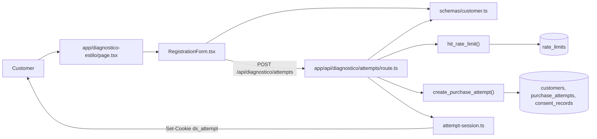

# RF-02. Customer Identification: Technical Specification

PRD: docs/prd/PRD-Descubra-Seu-Estilo.md · Scope covered: full feature (no Core/Full split in the PRD) · Complexity: medium

Written in batch mode (Auto-Accept policy). Codebase facts come from `docs/research.md`.

## 1. Technical Overview

**What.** RF-02 is the entry page of the diagnosis at `/diagnostico-estilo`. It replaces the placeholder created by RF-01 with the registration form (full name, e-mail, WhatsApp with area code, receiving preference, consent) and a route `POST /api/diagnostico/attempts` that validates the data on the server, creates the customer, the purchase attempt and the consent record in one database transaction, and sets a signed HTTP-only cookie that identifies the attempt for the rest of the flow.

**Why.** Every later step (questionnaire, checkout, payment, delivery) hangs on the purchase attempt. The PRD requires explicit, recorded consent, backend validation, an unguessable link between the browser and the attempt, protection against double submission and against abuse (10 registrations per IP per hour). Doing creation in one SQL function makes the three inserts atomic and idempotent.

**Scope**

**Included:**
- The form, its client-side validation (same Zod schema as the server) and its messages in Brazilian Portuguese.
- The route that validates, rate-limits, creates and replies.
- A migration with one new column (`idempotency_key`), the atomic function `create_purchase_attempt` and the rate-limit function `hit_rate_limit`.
- The signed attempt cookie and the helpers other routes use to read the attempt from a request.
- A new environment group `session` with `SESSION_SECRET` (used to sign the cookie and to hash IPs).
- The consent text and its version constant.
- Cross-cutting concerns integrated: consent recording shared with RF-09 (deletion), the delivery preference shared with RF-07 and RF-11, the attempt cookie shared with RF-04 and RF-05, the IP hash and the 7-day `expires_at` shared with RF-09 (retention).
- Input contracts (Consumes): none.
- Output contracts (Provides), as in the PRD: purchase attempt record with attempt identifier, customer name, e-mail, WhatsApp number, delivery preference and consent record (used by RF-04, RF-05, RF-07, RF-09, RF-10, RF-11).

**Deferred:** none.

**Excluded:**
- The questionnaire page and answer saving (RF-04); after a successful registration the browser goes to `/diagnostico-estilo/perguntas`, which returns the default 404 until RF-04 exists.
- The privacy policy page (RF-09); the consent text links to `/diagnostico-estilo/privacidade`.
- Merging customers by e-mail: every submission creates a new customer and a new attempt (PRD decision).
- Sending any e-mail or WhatsApp message.
- Reading or resuming an attempt from the questionnaire (RF-04 uses the cookie helpers provided here).

### Requirements / Business Rules (PRD RF-02 Capabilities)

- Fields, all required: full name, e-mail, WhatsApp with area code, receiving preference (E-mail, WhatsApp or Both; no default selected), consent checkbox (unchecked by default).
- Full name: trimmed, at least 2 words, 3 to 120 characters.
- E-mail: trimmed, lower-cased, valid format, at most 254 characters.
- WhatsApp: digits only after removing mask characters and an optional leading `55`; exactly 11 digits: a 2-digit DDD from 11 to 99, then a mobile number of 9 digits starting with 9; stored as E.164 `+55<11 digits>`. This matches the database check `^\+55[1-9][0-9]9[0-9]{8}$`.
- Receiving preference: one of `email`, `whatsapp`, `both`.
- Consent text, stored with its version and the acceptance time: "Autorizo o tratamento dos meus dados pessoais para gerar e receber o meu diagnóstico de estilo, conforme a Política de Privacidade." The words "Política de Privacidade" link to `/diagnostico-estilo/privacidade`. Version constant `consent-v1` `(inferred)`.
- Submit creates a customer, a purchase attempt (UUID identifier, default `expires_at` = now + 7 days from RF-01) and a consent record, atomically. Every submission creates a new attempt.
- Access to the attempt afterwards is through a cookie named `ds_attempt` `(inferred)` with value `<attemptId>.<signature>`, the signature being HMAC-SHA-256 of the attempt id with `SESSION_SECRET`, base64url. Attributes: `HttpOnly`, `SameSite=Lax`, `Path=/`, `Max-Age=604800` (7 days, same as `expires_at`), `Secure` when `NODE_ENV` is `production`. The attempt identifier alone, without a valid signature, never grants access.
- Rate limit: at most 10 registrations per IP per hour (fixed window of 3,600 s), counted only for new attempts, not for replays of the same idempotency key. The IP is read from the first value of `x-forwarded-for` (Vercel sets it), falling back to `x-real-ip`, then `unknown`; it is stored only as an HMAC-SHA-256 hash (hex) in `purchase_attempts.ip_hash`.
- Double submit: the form generates a UUID idempotency key when it loads; the server stores it on the attempt (`idempotency_key`, unique) and answers a repeated key with the original attempt and a new cookie, HTTP 200 instead of 201.
- Selecting only "WhatsApp" does not stop the e-mail: it is always sent by RF-08 because the e-mail is mandatory.

### Requirements / UX Flows (PRD RF-02 Experience)

- Entry page of the diagnosis, reached from the existing landing page. Above the form a short line: "15 perguntas · R$ 9,90 no Pix · resultado após a confirmação do pagamento" `(inferred)`.
- A single short screen titled "Antes de começar, vamos nos conhecer" `(inferred)`, conversational tone, using the site design (`font-primary` heading, `font-secondary` text, `.input`, `.btn`, `.btn-accent`, accent color; no new font or color literal).
- Validation runs when a field loses focus and on submit; the first invalid field receives focus on submit. Messages: "Informe seu nome completo", "Informe um e-mail válido", "Informe o WhatsApp com DDD", "Escolha como quer receber", "Precisamos do seu consentimento para continuar".
- The WhatsApp field is masked as `(11) 91234-5678` while typing.
- The receiving preference is a group of three radio cards: "E-mail", "WhatsApp", "Os dois" `(inferred label for Both)`.
- The button "COMEÇAR O QUESTIONÁRIO" is disabled and shows a loading label while the request runs.
- On success the browser navigates to `/diagnostico-estilo/perguntas`.
- Mobile-first: one column, side padding 24 px (from the RF-01 layout), tap targets at least 48 px, no horizontal scroll at 360 px.

### Error Handling (PRD RF-02 Error Handling)

- **Backend validation fails** (a request that bypasses the form): HTTP 400 `VALIDATION_ERROR` with the same field messages; the form shows them without losing typed data.
- **Network failure on submit:** "Não conseguimos enviar seus dados. Tente novamente." The form keeps its values and the same idempotency key, so a retry cannot create a second attempt.
- **Rate limit exceeded:** HTTP 429 `RATE_LIMITED` with `Retry-After` (seconds until the window ends); the form shows "Muitas tentativas. Aguarde alguns minutos e tente de novo."
- **Double submit:** the second request with the same key returns the original attempt (HTTP 200), nothing new is created.
- **Server or database failure:** HTTP 500 `INTERNAL_ERROR` with a generic message ("Não foi possível concluir agora. Tente novamente."); the cause is logged without personal data.
- **Missing `SESSION_SECRET`:** `ConfigError` (group `session`), answered as HTTP 500 `CONFIG_ERROR`.

## 2. Architecture Impact

**Affected components:** `app/diagnostico-estilo/page.tsx` (replaced), `components/Diagnostico/RegistrationForm.tsx`, `app/api/diagnostico/attempts/route.ts`, `lib/diagnostico/` modules (`env.ts` modified; `consent.ts`, `phone.ts`, `schemas/customer.ts`, `attempt-session.ts`, `attempts.ts`, `request-ip.ts` new), the migration, `.env.example`, `lib/diagnostico/database.types.ts` (regenerated) and the tests of Section 4.

**Diagram**



**Patterns followed** (from `docs/research.md`)
- Zod schemas and `parseInput` (`lib/diagnostico/validation.ts`); error body built with `apiError` and `ApiError` (`lib/diagnostico/errors.ts`).
- Per-group lazy environment readers (`lib/diagnostico/env.ts`), documented in `.env.example`.
- Service-role access in a `server-only` module (`lib/diagnostico/supabase-server.ts`).
- Atomic operations as SQL functions created by the feature that needs them (RF-01 decision), numbered migrations with `public.` prefix (`supabase/migrations/20260101000001_core_schema.sql`).
- Design tokens and global classes only; the design-token test forbids hex literals and extra fonts in diagnosis files (`tests/unit/diagnostico/design-tokens.test.ts`).
- Integration tests with the helpers in `tests/integration/diagnostico/helpers.ts`.

## 3. Technical Decisions

| Decision | Chosen Approach | Alternative Considered | Trade-off |
|---|---|---|---|
| Creating customer, attempt and consent | One SQL function `create_purchase_attempt` (atomic) | Three inserts from code | A function to maintain, but no half-created attempts |
| Idempotency | `idempotency_key` column, unique, set by the form | A separate idempotency table | One column on an existing table; replay returns the original attempt |
| Rate limiting | Fixed window in `rate_limits` via `hit_rate_limit` | In-memory counter; external service | Fixed windows allow a burst at the boundary; works across serverless instances without a new service |
| Attempt identification | Signed HTTP-only cookie (HMAC-SHA-256, `SESSION_SECRET`) | Opaque id in the URL; JWT | Needs one new secret; no id in URLs or logs |
| Schema sharing | One Zod schema in `lib/diagnostico/schemas/customer.ts`, imported by the form and the route | Separate client and server rules | The schema file must stay free of server-only code |
| IP storage | HMAC hash only | Raw IP | Cannot be reversed; still groups requests of one IP |
| Cookie path | `/` | `/diagnostico-estilo` | API routes under `/api` also need the cookie |

**Assumptions** (every inference is `(inferred)`; interview answers were taken from the recommendation: policy rows "Any interview question" and "Anything the PRD and the code leave open")
- Cookie name `ds_attempt`, `SESSION_SECRET` (at least 32 characters), consent version `consent-v1`, route paths `/api/diagnostico/attempts` and `/diagnostico-estilo/perguntas`.
- Fixed-window rate limit and the IP source (`x-forwarded-for` first value).
- Page title, offer line and the label "Os dois" for the Both preference.
- DDD validity follows the PRD (11 to 99) and is not checked against the real list of Brazilian area codes.
- The `server-only` Vitest alias (needed to import the route in tests) is created by the first of RF-02 and RF-03 to be implemented; the other reuses it (`docs/research.md` item 1).
- Migration number `20260101000005`; RF-03 uses `...06`.
- Traceability: PRD RF-02 Capabilities feed Section 1 (rules) and Section 6; Experience feeds the UX flows; Error Handling feeds the error list; Provides feed the Scope; the seven Section 9 criteria feed Section 7; cross-feature criteria where RF-02 is provider are pointers in Section 7.

## 4. Component Overview

### Frontend

| File Path | New/Modified | Purpose | Key Responsibilities |
|---|---|---|---|
| `app/diagnostico-estilo/page.tsx` | Modified | Entry page | Replaces the RF-01 placeholder: title, offer line, the form; the `noindex` of the placeholder is removed because this is the real entry page of the diagnosis `(inferred)` |
| `components/Diagnostico/RegistrationForm.tsx` | New | The form (client component) | Fields, masks, blur and submit validation, focus on first error, idempotency key, submit state, messages, navigation on success |

### Backend

| File Path | New/Modified | Purpose | Key Responsibilities |
|---|---|---|---|
| `app/api/diagnostico/attempts/route.ts` | New | `POST` handler | Read JSON, validate, replay by idempotency key, rate limit, create, set cookie, error bodies |
| `lib/diagnostico/schemas/customer.ts` | New | Shared Zod schema | Name, e-mail, WhatsApp, preference, consent rules and messages; types |
| `lib/diagnostico/phone.ts` | New | Phone helpers (pure) | `maskWhatsapp`, `normalizeWhatsapp` |
| `lib/diagnostico/consent.ts` | New | Consent constants | `CONSENT_TEXT`, `CONSENT_VERSION` |
| `lib/diagnostico/attempt-session.ts` | New | Cookie signing | `attemptCookie`, `readAttemptId(request)`, `signAttemptId`, `ATTEMPT_COOKIE` |
| `lib/diagnostico/attempts.ts` | New | Database access (server-only) | `findAttemptByIdempotencyKey`, `createAttempt`, `hitRateLimit` |
| `lib/diagnostico/request-ip.ts` | New | IP helper | `clientIpHash(request)` |
| `lib/diagnostico/env.ts` | Modified | Configuration | Add `getSessionEnv()` |
| `.env.example` | Modified | Documents settings | Add `SESSION_SECRET` |

### Data

| File Path | New/Modified | Purpose | Key Responsibilities |
|---|---|---|---|
| `supabase/migrations/20260101000005_attempt_creation_and_rate_limit.sql` | New | Atomic creation and limit | `idempotency_key` column, `create_purchase_attempt`, `hit_rate_limit` |
| `lib/diagnostico/database.types.ts` | Modified (generated) | Types | Regenerated with `npm run db:types` |

### Tests and configuration

| File Path | New/Modified | Purpose | Key Responsibilities |
|---|---|---|---|
| `vitest.config.mts`, `vitest.integration.config.mts`, `tests/setup/server-only-stub.ts` | Modified / New (if not yet) | Import server modules in tests | Alias `server-only` to an empty stub |
| `tests/unit/diagnostico/customer-schema.test.ts` | New | Schema rules | Name, e-mail, phone, preference, consent |
| `tests/unit/diagnostico/phone.test.ts` | New | Phone helpers | Mask and normalization |
| `tests/unit/diagnostico/attempt-session.test.ts` | New | Cookie | Sign, verify, tamper, attributes |
| `tests/integration/diagnostico/attempts-route.test.ts` | New | Route and database | Creation, consent, idempotency, rate limit, bypass |

## 5. API Contracts

### `POST /api/diagnostico/attempts`

Request body (JSON, at most 64 KB):

| Field | Type | Validation |
|---|---|---|
| `fullName` | string | trimmed, 3 to 120 chars, at least 2 words |
| `email` | string | trimmed, lower-cased, valid, at most 254 chars |
| `whatsapp` | string | normalizes to 11 digits (DDD 11-99, then 9 and 8 digits) |
| `deliveryPreference` | `"email" \| "whatsapp" \| "both"` | required |
| `consent` | `true` | literal `true` |
| `idempotencyKey` | string | UUID |

```json
{
  "fullName": "Maria Souza",
  "email": "maria@example.com",
  "whatsapp": "(11) 91234-5678",
  "deliveryPreference": "both",
  "consent": true,
  "idempotencyKey": "5b1c1f0e-8a38-4a3c-9d1c-3d6a1f5e2b10"
}
```

Responses:
- **201 Created** (new attempt): `{ "attemptId": "uuid" }` and `Set-Cookie: ds_attempt=<attemptId>.<signature>; HttpOnly; SameSite=Lax; Path=/; Max-Age=604800` (`; Secure` in production).
- **200 OK** (same idempotency key again): same body and cookie, nothing created.
- **400** `VALIDATION_ERROR` with `fields`, or `INVALID_JSON`, or `PAYLOAD_TOO_LARGE` (413).
- **429** `RATE_LIMITED` with header `Retry-After`.
- **500** `INTERNAL_ERROR` or `CONFIG_ERROR`.

Error example (400):
```json
{ "error": { "code": "VALIDATION_ERROR", "message": "Dados inválidos.", "fields": {
  "whatsapp": ["Informe o WhatsApp com DDD"], "consent": ["Precisamos do seu consentimento para continuar"] } } }
```
Success example (201): `{ "attemptId": "0f3c2f7e-5d0a-4c53-9a65-8c2f9e0a7b11" }`.

### Module signatures

```ts
// schemas/customer.ts
const customerFormSchema: z.ZodType<CustomerFormInput>;   // fullName, email, whatsapp (normalized +55), deliveryPreference, consent: true, idempotencyKey
// phone.ts
function maskWhatsapp(value: string): string                 // "11912345678" -> "(11) 91234-5678"
function normalizeWhatsapp(value: string): string | null     // -> "+5511912345678" or null
// attempt-session.ts
const ATTEMPT_COOKIE = "ds_attempt";
function signAttemptId(attemptId: string): string            // "<id>.<hmac>"
function attemptCookie(attemptId: string): string            // full Set-Cookie value
function readAttemptId(request: Request): string | null      // null when missing, malformed or signature invalid
// attempts.ts (server-only)
function findAttemptByIdempotencyKey(db, key: string): Promise<string | null>
function createAttempt(db, input: CreateAttemptInput): Promise<string>   // calls create_purchase_attempt
function hitRateLimit(db, key: string, windowSeconds: number, max: number): Promise<boolean>  // false = limit exceeded
// request-ip.ts
function clientIpHash(request: Request): string
// env.ts
function getSessionEnv(): { SESSION_SECRET: string }         // at least 32 characters
```

Provided to other features (PRD Provides): `readAttemptId(request)` (RF-04, RF-05) and the rows created in `customers`, `purchase_attempts` and `consent_records` (RF-04, RF-05, RF-07, RF-09, RF-10, RF-11).

## 6. Data Model

Migration `20260101000005_attempt_creation_and_rate_limit.sql` (one transaction):

```sql
alter table public.purchase_attempts add column idempotency_key text unique;

create function public.create_purchase_attempt(
  p_name text, p_email text, p_whatsapp text, p_preference text, p_ip_hash text,
  p_idempotency_key text, p_consent_version text, p_consent_text text
) returns uuid
language plpgsql as $$
declare
  v_customer uuid;
  v_attempt uuid;
begin
  insert into public.customers (name, email, whatsapp)
    values (p_name, p_email, p_whatsapp) returning id into v_customer;
  insert into public.purchase_attempts (customer_id, delivery_preference, ip_hash, idempotency_key)
    values (v_customer, p_preference, p_ip_hash, p_idempotency_key) returning id into v_attempt;
  insert into public.consent_records (attempt_id, customer_id, consent_text_version, consent_text)
    values (v_attempt, v_customer, p_consent_version, p_consent_text);
  return v_attempt;
end $$;

create function public.hit_rate_limit(p_key text, p_window_seconds integer, p_max integer)
returns boolean
language plpgsql as $$
declare
  v_window timestamptz := to_timestamp(floor(extract(epoch from now()) / p_window_seconds) * p_window_seconds);
  v_count integer;
begin
  insert into public.rate_limits (key, window_start, count) values (p_key, v_window, 1)
    on conflict (key, window_start) do update set count = public.rate_limits.count + 1
    returning count into v_count;
  return v_count <= p_max;
end $$;
```

Both functions are executable only by the service role: RF-01 already revoked default function privileges from `anon` and `authenticated`, and the migration ends with `revoke all on function ... from anon, authenticated, public` for these two. Existing columns, indexes and the 7-day default of `expires_at` are unchanged. If a unique violation happens on `idempotency_key` (two concurrent requests), `createAttempt` catches it and returns the existing attempt.

## 7. Testing Strategy

**Acceptance tests** (PRD Section 9, RF-02; numbered in PRD order)

| # | Criterion | Test file :: function |
|---|---|---|
| 1 | Given an empty form, when the customer submits, then every field shows its error and no attempt is created | `tests/unit/diagnostico/customer-schema.test.ts` :: `empty input yields an error for every field`; `tests/integration/diagnostico/attempts-route.test.ts` :: `empty body creates no attempt`; plus the verification script (UI) |
| 2 | Given the name "Maria", when the customer leaves the field, then "Informe seu nome completo" is shown | `customer-schema.test.ts` :: `a single word name is rejected with the name message`; plus the verification script |
| 3 | Given the WhatsApp "(11) 1234-5678", when the customer submits, then the number is rejected for not being a 9-digit mobile number | `tests/unit/diagnostico/phone.test.ts` :: `normalizeWhatsapp rejects a landline-length number`; `customer-schema.test.ts` :: `whatsapp without the ninth digit is rejected`; plus the verification script |
| 4 | Given all fields valid but the consent unchecked, when the customer submits, then submission is blocked with the consent message | `customer-schema.test.ts` :: `consent false is rejected with the consent message`; plus the verification script |
| 5 | Given valid data and consent, when the customer submits, then an attempt with a UUID identifier, the consent text version and a timestamp is stored and the questionnaire opens | `attempts-route.test.ts` :: `valid submission creates customer attempt and consent`, `consent stores text version and accepted_at`, `response sets a signed HttpOnly cookie`; the "questionnaire opens" navigation is checked by the verification script (URL becomes `/diagnostico-estilo/perguntas`) |
| 6 | Given a request that bypasses the browser with invalid data, when it reaches the server, then the server rejects it with field errors | `attempts-route.test.ts` :: `invalid data sent directly gets 400 with field errors`, `non-JSON body gets INVALID_JSON`, `oversized body gets PAYLOAD_TOO_LARGE` |
| 7 | Given 11 registrations from one IP within an hour, when the 11th is sent, then it is refused with the rate-limit message | `attempts-route.test.ts` :: `the eleventh registration from one IP in an hour gets 429 with Retry-After`, `replaying an idempotency key does not count against the limit` |

**Supporting tests:** `customer-schema.test.ts` :: `email is trimmed and lower-cased`, `name over 120 characters is rejected`, `preference must be one of the three values`; `phone.test.ts` :: `maskWhatsapp formats while typing`, `normalizeWhatsapp accepts +55 and 55 prefixes`, `DDD below 11 is rejected`; `attempt-session.test.ts` :: `signature verifies for the same id`, `a tampered id fails`, `a cookie without signature is rejected`, `Secure is set only in production`; `attempts-route.test.ts` :: `same idempotency key returns the original attempt with 200 and creates nothing`, `two concurrent requests with one key create one attempt`, `ip is stored only as a hash`, `every submission with a new key creates a new attempt`, `missing SESSION_SECRET returns CONFIG_ERROR`.

**Proof:** all criteria `fake` (the route runs against the real local Supabase; no external provider). Criteria 1 to 5 also have the verification script because they are phrased on what the user sees or does.

**Live checks:** not applicable. No criterion depends on a model provider or an agent.

**Verification script** (run in a real browser against the running app and the local Supabase; viewport 360 x 740 unless stated):
1. Start: open `/diagnostico-estilo` with no cookies. Expected: the title "Antes de começar, vamos nos conhecer", the offer line, the fields name, e-mail, WhatsApp, three preference cards, an unchecked consent box with the link "Política de Privacidade", and the button "COMEÇAR O QUESTIONÁRIO"; no horizontal scroll; fonts and colors as the rest of the site. Proves criterion 1 (starting state).
2. Press the button with the form empty. Expected: the messages "Informe seu nome completo", "Informe um e-mail válido", "Informe o WhatsApp com DDD", "Escolha como quer receber", "Precisamos do seu consentimento para continuar" are visible, the first field is focused, and the page stays on the same URL; the database has no new attempt. Proves criterion 1.
3. Type "Maria" in the name field and leave it. Expected: "Informe seu nome completo" appears under the field. Proves criterion 2.
4. Fill everything validly except the WhatsApp "(11) 1234-5678", with consent checked, and submit. Expected: "Informe o WhatsApp com DDD" under the WhatsApp field and no navigation. Proves criterion 3.
5. Fix the WhatsApp, uncheck consent and submit. Expected: "Precisamos do seu consentimento para continuar" and no navigation. Proves criterion 4.
6. Check consent and submit. Expected: the button is disabled while sending, then the URL becomes `/diagnostico-estilo/perguntas` (the site's default 404 page is acceptable until RF-04 exists); the cookie `ds_attempt` exists and is not readable from page scripts; the database has one customer, one attempt (preference as chosen) and one consent record with version `consent-v1`. Proves criterion 5.
7. Double click the submit button quickly on a fresh valid form. Expected: exactly one attempt exists for that e-mail. Proves criterion 5 (double submit).
8. With the network blocked for `/api/diagnostico/attempts`, submit a valid form. Expected: "Não conseguimos enviar seus dados. Tente novamente." and all fields keep their values; restore the network and submit again: one attempt is created. Error state.
9. With the route answering 429, submit a valid form. Expected: "Muitas tentativas. Aguarde alguns minutos e tente de novo." The 11th-request rule itself is proven by the integration test (criterion 7). Error state.
10. Resize to 1280 px wide. Expected: the layout stays centered and readable. Boundary state.

**Hand-off tests (cross-feature):** RF-02 has no Consumes entry, so it owns none. Where RF-02 is the **provider**:
- "Given a customer registered through RF-02, when the questionnaire in RF-04 opens, then it uses that attempt identifier and saves answers only to that attempt": covered by the hand-off test of RF-04, implemented after this feature.
- "Given 15 answers saved by RF-04, when RF-05 opens the checkout, then it accepts the attempt and carries the customer's name and e-mail registered in RF-02 into the charge": covered by the hand-off test of RF-05, implemented after this feature.
- "Given an order approved by RF-06, when RF-07 starts, then it uses the saved answers from RF-04, the customer name and preference from RF-02, and the scoring function from RF-03": covered by the hand-off test of RF-07, implemented after this feature.
- "Given the consent record created in RF-02, when RF-09 processes a deletion request, then the customer data and the consent are removed": covered by the hand-off test of RF-09, implemented after this feature.
- "Given customers, answers, payments, diagnoses and deliveries produced by RF-02, RF-04, RF-06, RF-07 and RF-08, when RF-10 opens a customer detail, then all of them appear for the same order": covered by the hand-off test of RF-10, implemented after this feature.
- "Given a diagnosis from RF-07, a secure link from RF-08 and a WhatsApp number from RF-02, when RF-11 prepares the message, then it contains that customer's name, both styles and link": covered by the hand-off test of RF-11, implemented after this feature.

**Test data and fixtures:** the route tests call the exported `POST` with `new Request(...)` against the local Supabase, with `SESSION_SECRET` set in the test process; each test creates its own e-mail (`teste-<uuid>@example.com`) and removes the created customers in `afterAll` (attempts and consents cascade); rate-limit keys use a random IP per test and the limit rows are deleted afterwards; the integration tests need `npm run db:reset` so the new functions exist.

**Not tested here:** the questionnaire page and the privacy page (RF-04, RF-09); the real list of Brazilian DDDs; behavior behind a proxy other than the `x-forwarded-for` header; browser autofill quirks.
