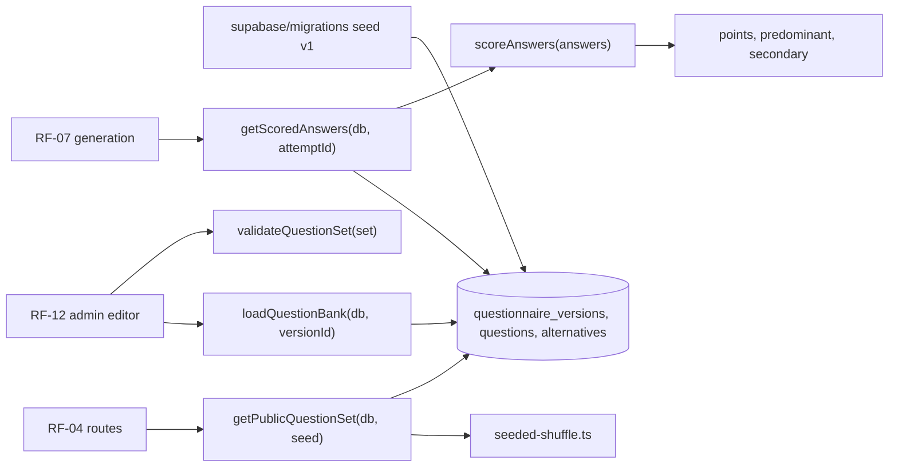

# RF-03. Question Bank and Scoring Engine: Technical Specification

PRD: docs/prd/PRD-Descubra-Seu-Estilo.md · Scope covered: full feature (no Core/Full split in the PRD) · Complexity: medium

Written in batch mode (Auto-Accept policy). Codebase facts come from `docs/research.md`. The source text of the questionnaire is in `docs/RF-03-question-bank-and-scoring-engine/questionnaire-source.md`.

## 1. Technical Overview

**What.** RF-03 delivers the questionnaire content and the logic that turns answers into a style result: (a) the first questionnaire version (15 questions, 4 alternatives each, six styles, rotated so every style appears in exactly 10 questions) stored in the database through a seed migration; (b) a pure scoring module that computes points, the predominant style and the secondary style with an explicit, deterministic tie-break; (c) pure rules that validate a question set (reused by the admin editor of RF-12); (d) server helpers that serve a question set to the customer without style or weight, shuffled per attempt, and that read stored answers back as scoring input.

**Why.** The PRD requires that the scoring is an independent module, that results are precise and reproducible, that questions and weights can change without rewriting the application, and that the customer never sees the style behind an alternative. Keeping scoring pure (no database, no network) makes it testable to 100% of its branches, and keeping the question set versioned (RF-01 tables) guarantees that editing questions never changes a past result.

**Scope**

**Included:**
- Seed migration with version 1 of the questionnaire, published (15 questions, 60 alternatives, weights 1), built from `questionnaire-source.md`.
- Scoring module `scoreAnswers` with the tie-break of PRD RF-03 Capabilities.
- Question-set rules `validateQuestionSet` and `styleAppearances` (pure).
- Deterministic seeded shuffle of the alternatives.
- Server helpers `getPublicQuestionSet`, `getScoredAnswers`, `loadQuestionBank`.
- Input contracts (Consumes): none.
- Output contracts (Provides), as in the PRD:
  - Public question set for the active version: question text and alternative text, without style or weight (used by RF-04).
  - Scoring function: a set of answers returns the points of each of the six styles, the predominant style and the secondary style (used by RF-07).
  - Editable question bank with questions, alternatives, style mapping and weights (used by RF-12).
- Cross-cutting concerns integrated: versioned question sets shared with RF-04 (answers store the version), RF-07 (scores the stored version) and RF-12 (publishes a new version); the six style keys and the tie-break order shared with RF-07 and RF-12.

**Deferred:** none.

**Excluded:**
- Any HTTP route for questions or answers (RF-04 owns them and calls the helpers here).
- Saving answers (RF-04) and creating results (RF-07).
- The admin editing screens and the publish workflow (RF-12); RF-03 only supplies the validation rules.
- Diagnosis text (RF-07) and its templates.
- A schema change: all tables used already exist from RF-01.

### Requirements / Business Rules (PRD RF-03 Capabilities)

- Six styles: Esportivo/Natural (`esportivo_natural`), Tradicional (`tradicional`), Elegante (`elegante`), Romântico (`romantico`), Criativo (`criativo`), Dramático (`dramatico`). No Sexy.
- 15 questions, 4 alternatives each, exactly one selectable. Each alternative stores one style and a weight (integer 1 to 3, default 1).
- Balance rule of version 1: every question shows 4 of the 6 styles; the 15 questions omit the 15 different pairs of styles, one pair per question; each style appears in exactly 10 of the 15 questions. The matrix and the texts are in `questionnaire-source.md`.
- Content origin: Millena's text for Esportivo/Natural, Tradicional, Elegante and Romântico; the alternatives for Criativo and Dramático, and the dropped originals, are team drafts `(inferred)` reviewed by Millena before go-live.
- On-screen order of the 4 alternatives is shuffled per attempt with a seed derived from the attempt identifier, so the same order shows when the customer returns to a question.
- Scoring: points of a style = sum of the weights of the chosen alternatives of that style. Predominant = highest score. Secondary = highest score among the other styles. Because each style appears in at most 10 questions, at least 5 answers go to other styles, so with weights of at least 1 the secondary style always has at least 1 point in a balanced set.
- Tie-break (explicit, deterministic), applied separately for the predominant pick and for the secondary pick, among the styles tied at the top score of that pick: (1) the style with more chosen alternatives (a count of answers, not of weights) in questions 11 to 15 wins; (2) if still tied, the fixed order Elegante, Tradicional, Romântico, Esportivo/Natural, Criativo, Dramático decides (inferred).
- The scoring module is pure: no database, no network, no clock, no randomness.
- Question sets are versioned. Each saved answer references its question, its alternative and the questionnaire version, so scoring a past attempt uses the version stored with its answers even after a new version is published.
- Rules for a question set (used by RF-12 at publish time, also run on version 1 in tests): exactly 15 questions; 4 alternatives per question; every alternative has one of the six styles; no repeated style inside a question; weight 1 to 3; across the 15 questions the number of appearances of the most frequent style minus that of the least frequent is at most 2 (inferred, from PRD RF-12 Capabilities).

### Requirements / UX Flows (PRD RF-03 Experience)

- No direct user interface. The customer never sees styles, weights or scores while answering: the public question set never includes the `style` or `weight` columns (they are not even selected).

### Error Handling

The PRD has no Error Handling block for this feature. Technical cases:
- No published questionnaire version exists: `getPublicQuestionSet` throws `QuestionBankError` with code `NO_PUBLISHED_VERSION`; the calling route answers `INTERNAL_ERROR` and logs the code.
- Fewer or more than 15 answers, a repeated question position, an unknown style or a weight outside 1 to 3 reaches `scoreAnswers`: it throws `ScoringError` with code `INVALID_ANSWERS`; RF-07 turns this into an order `FAILED` with reason `INVALID_ANSWERS` (PRD RF-07 Error Handling).
- `getScoredAnswers` finds an attempt with no answers: it returns an empty list, so `scoreAnswers` raises `INVALID_ANSWERS`.

## 2. Architecture Impact

**Affected components:** `lib/diagnostico/scoring.ts`, `question-set-rules.ts`, `seeded-shuffle.ts`, `question-types.ts`, `question-bank.ts`, the seed migration, the two Vitest configs (alias for `server-only`) and the tests listed in Section 4.

**Diagram**



**Patterns followed** (from `docs/research.md`)
- Server code in `lib/diagnostico/` with `import "server-only"` on modules that use the service role (`lib/diagnostico/supabase-server.ts`).
- Fixed values as constants mirrored from `CHECK` constraints (`lib/diagnostico/constants.ts`: `STYLES`).
- Migrations as numbered SQL files, `text` + `CHECK`, `public.` prefix (`supabase/migrations/20260101000001_core_schema.sql`).
- Tests: unit under `tests/unit/diagnostico/`, integration under `tests/integration/diagnostico/` with the helpers of `helpers.ts`.
- Types from `database.types.ts` (no regeneration needed: no schema change).

## 3. Technical Decisions

| Decision | Chosen Approach | Alternative Considered | Trade-off |
|---|---|---|---|
| Where version 1 lives | A seed **migration** (applies to local and production databases) | `supabase/seed.sql` (local only) | The content is versioned in migrations; later edits go through the admin editor, not new migrations |
| Scoring input | Plain list of `{ questionPosition, style, weight }`, independent of the database | Passing database rows | One more mapping step in `getScoredAnswers`, but the engine stays pure and easy to test |
| Tie-break scope | Applied separately to the predominant pick and to the secondary pick | Single ranking of all six styles | Slightly more code; matches the PRD wording (secondary = second highest) |
| Shuffle | Seeded Fisher-Yates over a SHA-256 derived 32-bit seed (`attemptId` + question id) | Random per request; fixed order | Stable per attempt, differs between attempts, no state to store |
| Public data | Select only `id, position, text` of alternatives | Select all and strip fields | Impossible to leak the style by a later mistake in stripping |
| Validation rules | Pure function in `question-set-rules.ts`, reused by RF-12 | Rules written in RF-12 | RF-12 depends on RF-03 (already in the dependency table) |

**Assumptions** (everything not decided by the user nor observed is `(inferred)`; all interview answers were taken from the recommendation, policy row "Any interview question" and "Anything the PRD and the code leave open")
- The tie-break order of last resort and the imbalance limit of 2 `(inferred)`; weights 1 to 3 `(inferred)`, all 1 in version 1.
- Late-answer count uses answers, not weights `(inferred)` from "more chosen alternatives in questions 11 to 15".
- Alternatives for Criativo and Dramático, the dropped originals and the rotation matrix are drafts `(inferred)`.
- Seed migration number `20260101000006` `(inferred)`; wave-2 sibling RF-02 uses `...05`.
- Vitest alias for `server-only` is needed `(observed: research.md item 1)`; whichever of RF-02 and RF-03 is implemented first creates it, the other reuses it.
- `getScoredAnswers` reads the answers' stored `alternative_id` and `version_id`, so a published edit never changes a past result.
- Traceability: PRD RF-03 Capabilities feed Section 1 and Section 6; Provides feed the Scope and Section 5; the seven Section 9 criteria feed Section 7; cross-feature criteria where RF-03 is provider are pointers in Section 7.

## 4. Component Overview

### Backend (server and pure modules)

| File Path | New/Modified | Purpose | Key Responsibilities |
|---|---|---|---|
| `lib/diagnostico/scoring.ts` | New | Scoring engine (pure) | `scoreAnswers`, `ScoringError`, `FIXED_ORDER`, tie-break levels |
| `lib/diagnostico/question-set-rules.ts` | New | Question-set rules (pure) | `validateQuestionSet`, `styleAppearances` |
| `lib/diagnostico/seeded-shuffle.ts` | New | Deterministic shuffle (pure) | `shuffleWithSeed(items, seed)` |
| `lib/diagnostico/question-types.ts` | New | Shared types | `PublicQuestionSet`, `EditableQuestionSet`, `ScoredAnswer`, issue types |
| `lib/diagnostico/question-bank.ts` | New | Database access (server-only) | `getPublicQuestionSet`, `getScoredAnswers`, `loadQuestionBank`, `QuestionBankError` |

### Data

| File Path | New/Modified | Purpose | Key Responsibilities |
|---|---|---|---|
| `supabase/migrations/20260101000006_seed_questionnaire_v1.sql` | New | First questionnaire version | Insert version 1 as published, 15 questions, 60 alternatives |

### Tests and configuration

| File Path | New/Modified | Purpose | Key Responsibilities |
|---|---|---|---|
| `vitest.config.mts` | Modified (if not yet) | Unit test run | Alias `server-only` to the stub |
| `vitest.integration.config.mts` | Modified (if not yet) | Integration run | Same alias |
| `tests/setup/server-only-stub.ts` | New (if not yet) | Stub module | Empty module replacing `server-only` in tests |
| `tests/unit/diagnostico/scoring.test.ts` | New | Scoring | Ranking, tie-break levels, determinism, invalid input |
| `tests/unit/diagnostico/question-set-rules.test.ts` | New | Rules | Valid and invalid sets |
| `tests/unit/diagnostico/seeded-shuffle.test.ts` | New | Shuffle | Stability and variation |
| `tests/integration/diagnostico/question-bank.test.ts` | New | Seed and helpers | Version 1 shape, no style leak, versioned scoring |

## 5. API Contracts

RF-03 exposes no HTTP endpoint. Public signatures:

**`lib/diagnostico/scoring.ts`**
```ts
type ScoredAnswer = { questionPosition: number; style: Style; weight: number };
type TieBreakLevel = "none" | "late_answers" | "fixed_order";
type ScoringResult = {
  points: Record<Style, number>;          // all six styles, 0 when never chosen
  predominant: Style;
  secondary: Style;                        // always different from predominant
  tieBreaks: { predominant: TieBreakLevel; secondary: TieBreakLevel };
};
const FIXED_ORDER: readonly Style[];       // elegante, tradicional, romantico, esportivo_natural, criativo, dramatico
class ScoringError extends Error { code: "INVALID_ANSWERS" }
function scoreAnswers(answers: readonly ScoredAnswer[]): ScoringResult
```
Example result:
```json
{
  "points": { "esportivo_natural": 1, "tradicional": 4, "elegante": 6, "romantico": 2, "criativo": 1, "dramatico": 1 },
  "predominant": "elegante",
  "secondary": "tradicional",
  "tieBreaks": { "predominant": "none", "secondary": "none" }
}
```

**`lib/diagnostico/question-set-rules.ts`**
```ts
type QuestionSetIssue = { code: string; message: string; questionPosition?: number };
function validateQuestionSet(set: EditableQuestionSet): QuestionSetIssue[]   // empty = valid
function styleAppearances(set: EditableQuestionSet): Record<Style, number>
```
Example issue: `{ "code": "REPEATED_STYLE", "message": "Pergunta 7 tem duas alternativas do estilo elegante.", "questionPosition": 7 }`. Codes: `QUESTION_COUNT`, `ALTERNATIVE_COUNT`, `UNKNOWN_STYLE`, `REPEATED_STYLE`, `INVALID_WEIGHT`, `STYLE_IMBALANCE`.

**`lib/diagnostico/seeded-shuffle.ts`**
```ts
function shuffleWithSeed<T>(items: readonly T[], seed: string): T[]   // same input and seed, same output
```

**`lib/diagnostico/question-bank.ts`** (`import "server-only"`)
```ts
type PublicQuestionSet = {
  versionId: string;
  version: number;
  questions: { id: string; position: number; text: string; alternatives: { id: string; text: string }[] }[];
};
type EditableQuestionSet = {
  versionId: string; version: number; status: "draft" | "published" | "archived";
  questions: { id: string; position: number; text: string;
    alternatives: { id: string; position: number; text: string; style: Style; weight: number }[] }[];
};
class QuestionBankError extends Error { code: "NO_PUBLISHED_VERSION" | "VERSION_NOT_FOUND" }
function getPublicQuestionSet(db: SupabaseClient<Database>, seed: string): Promise<PublicQuestionSet>
function getScoredAnswers(db: SupabaseClient<Database>, attemptId: string): Promise<ScoredAnswer[]>
function loadQuestionBank(db: SupabaseClient<Database>, versionId?: string): Promise<EditableQuestionSet>
```
Example public question (no `style`, no `weight`):
```json
{ "id": "0b9e...", "position": 1, "text": "Como você gostaria que as pessoas percebessem sua imagem?",
  "alternatives": [ { "id": "7c1a...", "text": "Original, criativa e cheia de personalidade." }, { "id": "a3f0...", "text": "Natural, descontraída e acessível." } ] }
```
`getPublicQuestionSet` uses the published version, orders questions by position, and orders each question's alternatives with `shuffleWithSeed(alternatives, seed + ":" + questionId)`. `getScoredAnswers` joins the attempt's answers with their alternative (style, weight) and question (position), using the stored ids, so it is independent of the currently published version.

## 6. Data Model

No new table, column or index. Tables used (from RF-01): `questionnaire_versions`, `questions`, `alternatives`, `answers`.

**Seed migration** `20260101000006_seed_questionnaire_v1.sql`: one transaction; if a published version already exists, do nothing (`where not exists (select 1 from questionnaire_versions where version = 1)`); then insert version 1 with `status = 'published'` and `published_at = now()`, the 15 questions with `position` 1 to 15, and for each question its 4 alternatives with `position` 1 to 4, the text from `questionnaire-source.md`, the style key and `weight = 1`. A `DO $$` block with a `jsonb` literal holding the 15 questions and a loop with `insert ... returning id` keeps the file readable.

```sql
do $$
declare
  v_id uuid;
  q jsonb;
  q_id uuid;
  a jsonb;
  questions jsonb := '[
    {"position":1,"text":"Como você gostaria que as pessoas percebessem sua imagem?","alternatives":[
      {"position":1,"style":"esportivo_natural","text":"Natural, descontraída e acessível."},
      {"position":2,"style":"tradicional","text":"Discreta, organizada e confiável."},
      {"position":3,"style":"elegante","text":"Sofisticada, refinada e bem-arrumada."},
      {"position":4,"style":"criativo","text":"Original, criativa e cheia de personalidade."}]}
    /* ... the other 14 questions from questionnaire-source.md ... */
  ]';
begin
  if exists (select 1 from public.questionnaire_versions where version = 1) then return; end if;
  insert into public.questionnaire_versions (version, status, published_at)
    values (1, 'published', now()) returning id into v_id;
  for q in select * from jsonb_array_elements(questions) loop
    insert into public.questions (version_id, position, text)
      values (v_id, (q->>'position')::smallint, q->>'text') returning id into q_id;
    for a in select * from jsonb_array_elements(q->'alternatives') loop
      insert into public.alternatives (question_id, position, text, style, weight)
        values (q_id, (a->>'position')::smallint, a->>'text', a->>'style', 1);
    end loop;
  end loop;
end $$;
```
The stored `position` of the alternatives follows the order in `questionnaire-source.md` (original letter order, new drafts last); the screen order is shuffled by `getPublicQuestionSet`. No database constraint enforces 15 questions or the balance (that is the job of `validateQuestionSet` at publish time and of the seed test).

## 7. Testing Strategy

**Acceptance tests** (PRD Section 9, RF-03; criteria numbered in PRD order)

| # | Criterion | Test file :: function |
|---|---|---|
| 1 | Given the active question set, when it is inspected, then it has 15 questions with 4 alternatives each, six styles in total, and each style appears in exactly 10 questions | `tests/integration/diagnostico/question-bank.test.ts` :: `active set has 15 questions with 4 alternatives each`, `each style appears in exactly 10 questions`, `six styles in total and no sexy`; `tests/unit/diagnostico/question-set-rules.test.ts` :: `accepts a balanced set of 15 questions` |
| 2 | Given any browser request for the questions, when the response is inspected, then it contains no style or weight | `tests/integration/diagnostico/question-bank.test.ts` :: `public question set contains no style or weight` (checks the keys of every question and alternative and the serialized JSON). The HTTP response check is owned by RF-04 (see hand-off pointers) |
| 3 | Given answers that give Elegante 6 points and Tradicional 4, when scoring runs, then Elegante is predominant and Tradicional secondary | `tests/unit/diagnostico/scoring.test.ts` :: `elegante with 6 points and tradicional with 4 gives that order` |
| 4 | Given a tie in points between two styles, when the tie-break runs, then the style with more choices in questions 11-15 wins | `tests/unit/diagnostico/scoring.test.ts` :: `tie is broken by more answers in questions 11 to 15`, `tie-break applies to the secondary pick too` |
| 5 | Given a tie that is still equal after question 11-15, when the tie-break runs, then the fixed order decides | `tests/unit/diagnostico/scoring.test.ts` :: `tie still equal falls to the fixed order`, `fixed order is elegante tradicional romantico esportivo criativo dramatico` |
| 6 | Given the same answers scored 100 times, when results are compared, then all results are identical | `tests/unit/diagnostico/scoring.test.ts` :: `same answers scored 100 times give identical results`, `answer order does not change the result` |
| 7 | Given the question set is edited and published as a new version, when a past answer set is scored, then it is scored with the version stored with it | `tests/integration/diagnostico/question-bank.test.ts` :: `past answers are scored with the version stored on them` (creates two throwaway versions with different style mappings, saves answers on the first, reads `getScoredAnswers` after the second exists) |

**Supporting tests:** `scoring.test.ts` :: `weights above 1 add up`, `all answers of one style still returns a different secondary`, `rejects fewer than 15 answers`, `rejects a repeated question position`, `rejects an unknown style or weight outside 1 to 3`; `question-set-rules.test.ts` :: `rejects a repeated style in a question`, `rejects an imbalance greater than 2`, `rejects fewer than 15 questions`, `rejects a question without 4 alternatives`; `seeded-shuffle.test.ts` :: `same seed gives the same order`, `different seeds give different orders for most seeds`, `keeps every item exactly once`; `question-bank.test.ts` :: `shuffle is stable per attempt and varies between attempts`, `version 1 passes validateQuestionSet`, `seeded original alternatives match questionnaire-source.md`, `getPublicQuestionSet fails with NO_PUBLISHED_VERSION when none is published` (inside a transaction-like cleanup: archives version 1 and restores it).

**Proof:** all criteria `fake`: no external provider is involved (the integration tests use the real local database, the unit tests are pure).

**Live checks:** not applicable. No criterion depends on a model provider or an agent.

**Verification script:** not applicable. No criterion depends on the DOM; the feature has no user interface.

**Hand-off tests (cross-feature):** RF-03 has no Consumes entry, so it owns none. Where RF-03 is the **provider**:
- Criterion "Given the active question set from RF-03, when RF-04 shows a question, then it displays the texts without style or weight": covered by the hand-off test of RF-04, implemented after this feature.
- Criterion "Given an order approved by RF-06, when RF-07 starts, then it uses the saved answers from RF-04, the customer name and preference from RF-02, and the scoring function from RF-03": covered by the hand-off test of RF-07, implemented after this feature.
- Criterion "Given a question edited and published in RF-12, when RF-03 serves the questions, then the new version is served to new attempts": covered by the hand-off test of RF-12, implemented after this feature.

**Test data and fixtures:** integration tests use the local Supabase (version 1 comes from the seed migration after `npm run db:reset`) and the helpers in `tests/integration/diagnostico/helpers.ts` (`createVersion`, `createQuestion`, `createCustomer`, `createAttempt`); the scoring unit tests build answer lists in a local helper. Throwaway versions use `uniqueVersion()` and are deleted in `afterAll`.

**Not tested here:** HTTP exposure of the questions and answer saving (RF-04); creation of results (RF-07); publishing and editing in the admin panel (RF-12); quality and tone of the drafted Criativo and Dramático texts (human review by Millena).
