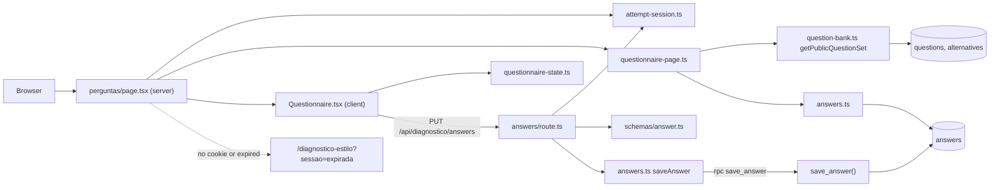

# RF-04. Interactive Questionnaire: Technical Specification

PRD: docs/prd/PRD-Descubra-Seu-Estilo.md · Scope covered: full feature (no Core/Full split in the PRD) · Complexity: medium

Interview mode: three decisions were taken with the owner (data loading, questionnaire version, navigation); everything else is marked `(inferred)`. The earlier `docs/research.md` was written at commit 941d34a; the facts below were re-read from the current code (commit 5eb149d).

## 1. Technical Overview

**What.** RF-04 is the questionnaire page, `/diagnostico-estilo/perguntas`. A Server Component reads the signed attempt cookie, loads the public question set and the answers already saved, and hands them to a client component that shows one question per screen: four alternative cards, a progress bar ("Pergunta N de 15"), "Anterior" and "Próxima" ("Concluir" on question 15), and a 300 ms slide-and-fade transition. Each selection is saved at once by `PUT /api/diagnostico/answers`, which calls an atomic SQL function. Reloading restores the first unanswered question.

**Why.** The diagnosis needs 15 reliable, individually stored answers tied to one attempt, and the customer must never lose progress or see the scoring behind the alternatives. Loading the data on the server keeps style and weight out of every browser payload and makes the page fast on a phone; saving each answer as it is chosen is what lets a reload resume, and the atomic function keeps an attempt on one questionnaire version.

**Scope**

**Included:**
- The questionnaire page (server) and the questionnaire component (client) with state, retries, transition, progress and accessibility.
- `PUT /api/diagnostico/answers` and the SQL function `save_answer` (migration).
- Server helpers for answers: saving, reading saved answers, the version of an attempt, progress, and "active attempt from the cookie".
- Version pinning of an attempt (decision): the attempt keeps the questionnaire version of its first saved answer; an attempt with no answers gets the published version.
- Small changes to files of earlier features: `attempt-session.ts` (verify a cookie value, read it from Next's cookie store), `question-bank.ts` (optional `versionId` when serving the question set), and the registration page (a "session expired" notice).
- Cross-cutting concerns integrated: the attempt cookie shared with RF-02; the public question set shared with RF-03 (style and weight never reach the browser); the saved answers and version contract consumed by RF-05 (completeness), RF-07 (scoring input through RF-03's `getScoredAnswers`) and RF-10 (admin detail).
- Input contracts (Consumes): the purchase attempt identifier from RF-02 (through the cookie); the public question set from RF-03 (`getPublicQuestionSet`).
- Output contracts (Provides), as in the PRD: saved answers, the 15 chosen alternatives of an attempt and the questionnaire version (used by RF-05, RF-07, RF-10).

**Deferred:** none.

**Excluded:**
- The completion screen, the checkout and everything after "Concluir" (RF-05); "Concluir" only navigates to `/diagnostico-estilo/concluido`, which returns the default 404 until RF-05 exists.
- Scoring (RF-03 module, used by RF-07) and any result.
- A per-question URL or browser-history integration (decision: one address; the browser "Voltar" leaves the questionnaire).
- A rate limit on the save route (the signed cookie protects it) `(inferred)`.
- Editing questions (RF-12).

### Requirements / Business Rules (PRD RF-04 Capabilities)

- Title "Vamos descobrir o seu estilo?" and description "Responda com sinceridade. Escolha a alternativa que mais representa você, não aquela que você acredita que deveria escolher." Both are shown above the progress on every question `(inferred)`.
- One question per screen; 4 alternatives as selectable cards; exactly one selectable.
- Progress bar and the label "Pergunta N de 15" (N = position of the question on screen).
- "Anterior" is hidden on question 1. "Próxima" (on question 15 the label is "Concluir") is disabled until the current question has an answer that is saved on the server.
- Every selection is saved immediately. Going back shows the stored choice; changing it replaces the stored answer (one row per attempt and question).
- Reloading or reopening within 7 days restores the attempt at the first unanswered question (the attempt lives 7 days, `purchase_attempts.expires_at`). When all 15 are answered, the last question is shown with "Concluir" enabled `(inferred)`.
- The page is reachable only with a valid attempt cookie for an attempt that exists and has not expired; otherwise the visitor is redirected to `/diagnostico-estilo?sessao=expirada` (decision for the notice, `(inferred)` for the query name).
- Version pinning (owner decision): if the attempt already has saved answers, the page serves the version of those answers, even if it is no longer published; with no answers it serves the published version. A save that mixes versions is rejected.
- Alternatives are shown in the per-attempt order produced by `getPublicQuestionSet` (seed = attempt id), so the same order returns after a reload.
- The save accepts only: an alternative that belongs to the question, in the attempt's version, for an active attempt.
- The first saved answer of an attempt must use the published version.
- Saving is serialized per attempt with an advisory lock inside the SQL function `(inferred)`; the last write for a question wins.
- Retry policy `(inferred)`: a failed save is retried up to 3 times, waiting 500 ms, 1,500 ms and 3,000 ms (4 requests in total). A newer selection for the same question cancels the older pending save, so an old response never overwrites a newer choice.
- "Concluir" is enabled only when the 15 questions have a saved answer; it navigates to `/diagnostico-estilo/concluido`.

### Requirements / UX Flows (PRD RF-04 Experience)

- Slide-and-fade transition of 300 ms between questions (24 px horizontal movement and opacity, direction follows forward or back); disabled (instant change) when the system asks for reduced motion.
- Alternative cards at least 48 px tall, text readable at 16 px; selected state shown at once with an accent border and a light tint of the accent color (`border-accent bg-accent/10`), no new color literal.
- Fully keyboard accessible with radio-group semantics: a `radiogroup` with native radio inputs (visually hidden), arrow keys move the selection, Space selects, Tab reaches the buttons.
- Progress bar with `role="progressbar"` (`aria-valuemin` 1, `aria-valuemax` 15, `aria-valuenow` N) and the visible label.
- On every question change the focus moves to the question heading (`tabIndex={-1}`) `(inferred)`.
- Mobile-first, one column, side padding from the RF-01 layout (24 px), buttons at least 48 px, no horizontal scroll at 360 px; site fonts and tokens only.
- Messages (pt-BR): saving problem "Não conseguimos salvar sua resposta. Tentando de novo…"; after the last retry "Sem conexão. Suas respostas já salvas estão seguras. Tente novamente." with a button "Tentar novamente"; expired session on the registration page "Sua sessão expirou. Vamos recomeçar rapidinho?".
- Conversational tone, no technical wording.

### Error Handling (PRD RF-04 Error Handling)

- **Save fails (network or server error):** the choice stays selected locally and the message "Não conseguimos salvar sua resposta. Tentando de novo…" is shown while the 3 retries run.
- **Still failing after the retries:** "Sem conexão. Suas respostas já salvas estão seguras. Tente novamente." and the button "Tentar novamente"; "Próxima" and "Concluir" stay disabled until that answer is saved; "Anterior" stays available and the failed answer is kept in memory.
- **Attempt cookie missing, tampered, expired or the attempt deleted:** the page redirects to the registration with the notice "Sua sessão expirou. Vamos recomeçar rapidinho?"; the API answers 403 `FORBIDDEN` and the component navigates to the same address.
- **Invalid save (alternative of another question, unknown ids, version mismatch):** HTTP 400 `VALIDATION_ERROR` with `fields`; the component treats it like a failed save but does not retry it (retrying cannot help) `(inferred)`.
- **Configuration or database error:** HTTP 500 `CONFIG_ERROR` or `INTERNAL_ERROR`, generic message, the cause is logged without personal data; the page fails with Next's default error page `(inferred)`.

## 2. Architecture Impact

**Affected components:** `app/diagnostico-estilo/perguntas/page.tsx`, `components/Diagnostico/Questionnaire.tsx`, `app/api/diagnostico/answers/route.ts`, `lib/diagnostico/answers.ts`, `lib/diagnostico/questionnaire-page.ts`, `lib/diagnostico/questionnaire-state.ts`, `lib/diagnostico/schemas/answer.ts`, the migration `20260101000007_save_answer.sql`, regenerated `lib/diagnostico/database.types.ts`; modified: `lib/diagnostico/attempt-session.ts`, `lib/diagnostico/question-bank.ts`, `app/diagnostico-estilo/page.tsx`; and the tests of Section 4.

**Diagram**



**Patterns followed** (re-read from the current code)
- Server modules start with `import "server-only"`; the Vitest alias to an empty stub exists (`tests/setup/server-only-stub.ts`, `vitest.config.mts`).
- Routes: JSON body read with `readJson`, validated with a shared Zod schema through `parseInput`, errors built with `apiError`, `ApiError` and `ConfigError` caught in one `try/catch` (`app/api/diagnostico/attempts/route.ts`).
- Atomic operations as SQL functions created by the feature that needs them, revoked from `anon` and `authenticated` (`supabase/migrations/20260101000005_attempt_creation_and_rate_limit.sql`).
- The attempt cookie `ds_attempt` is signed with `SESSION_SECRET` (`lib/diagnostico/attempt-session.ts`).
- Design tokens and global classes only; hex literals and extra fonts are rejected by `tests/unit/diagnostico/design-tokens.test.ts` in `app/diagnostico-estilo` and `components/Diagnostico`.
- Client components use `"use client"` and `framer-motion` (`components/Cards/Cards.jsx`, `AnimatePresence`).
- Route tests call the exported handler with `new Request(...)` against the local Supabase (`tests/integration/diagnostico/attempts-route.test.ts`); helpers in `tests/integration/diagnostico/helpers.ts`.
- Question set served with a per-attempt shuffle and no style or weight (`lib/diagnostico/question-bank.ts`).

## 3. Technical Decisions

| Decision | Chosen Approach | Alternative Considered | Trade-off |
|---|---|---|---|
| Data loading (owner) | Server Component loads questions and saved answers; save by `PUT` only | `GET` questions API plus `PUT` | No read endpoint to protect and a faster first paint; the page needs a dynamic server render |
| Version during an attempt (owner) | Pinned to the version of the first saved answer, derived from `answers.version_id` | Discard answers when the version changes; ignore the case | A new optional parameter in `getPublicQuestionSet` and a version check in SQL; no progress is lost |
| Navigation (owner) | One address; the question lives in component state | `?pergunta=N` with history entries | Browser "Voltar" leaves the questionnaire; far fewer edge cases |
| Saving | One SQL function `save_answer` (validation, version pin, upsert, count) with an advisory lock per attempt | Several queries from code | One more function to maintain; the checks and the write are atomic |
| Transition | `framer-motion` `AnimatePresence`, 300 ms, `useReducedMotion` | CSS transitions | One more client dependency already in the bundle |
| Failure of a save | Keep the choice locally, 3 timed retries, then a manual retry button | Fail silently; block selection | More state in the component; the customer never loses a choice |
| Cookie in a Server Component | `readAttemptIdFromCookies(cookies())` sharing `verifyAttemptCookieValue` with the route | Duplicate the verification | Small refactor of RF-02's file |

**Assumptions** (everything not decided by the owner nor observed is `(inferred)`)
- Interview answers: data loading A, version pinning A, navigation A.
- Migration `20260101000007`; error messages of the SQL function: `ATTEMPT_NOT_FOUND`, `ALTERNATIVE_MISMATCH`, `VERSION_MISMATCH`, raised with SQLSTATE `P0001` as the RF-01 trigger does.
- Retry delays 500 ms, 1,500 ms, 3,000 ms; transition 24 px; query `?sessao=expirada`; title and description on every question; focus moves to the question heading; no rate limit on the save route.
- The first unanswered question is the lowest position without an answer in the attempt's version; with 15 answers the page opens on question 15.
- An attempt whose `expires_at` has passed, or that no longer exists (deleted by RF-09), counts as an expired session.
- Traceability: PRD RF-04 Capabilities feed Section 1 (rules), Experience feeds the UX flows, Error Handling feeds the error list, Consumes and Provides feed the Scope and Section 5, the six per-feature criteria and the two cross-feature criteria where RF-04 is the consumer feed Section 7, and the cross-feature criteria where RF-04 is the provider are pointers in Section 7.

## 4. Component Overview

### Frontend

| File Path | New/Modified | Purpose | Key Responsibilities |
|---|---|---|---|
| `app/diagnostico-estilo/perguntas/page.tsx` | New | Questionnaire page (server) | Read the cookie, redirect when there is no active attempt, load the initial state, render the client component |
| `components/Diagnostico/Questionnaire.tsx` | New | Questionnaire (client) | Question screen, radiogroup, progress, buttons, transition, save with retries, error messages, navigation on "Concluir" |
| `app/diagnostico-estilo/page.tsx` | Modified | Registration page | Read `searchParams.sessao` and show the notice "Sua sessão expirou. Vamos recomeçar rapidinho?" |

### Backend

| File Path | New/Modified | Purpose | Key Responsibilities |
|---|---|---|---|
| `app/api/diagnostico/answers/route.ts` | New | `PUT` handler | Authenticate by cookie, validate, save, answer 200 / 400 / 403 / 500 |
| `lib/diagnostico/answers.ts` | New | Answer data access (server-only) | `saveAnswer`, `getSavedAnswers`, `getAttemptVersionId`, `getAnswerProgress`, `getActiveAttemptId`, `AnswerError` |
| `lib/diagnostico/questionnaire-page.ts` | New | Initial state for the page (server-only) | `loadQuestionnaire(db, attemptId)` returning the public set, saved answers and start index |
| `lib/diagnostico/questionnaire-state.ts` | New | Pure state helpers | `firstUnansweredIndex`, `progressPercent`, `canAdvance`, `RETRY_DELAYS_MS`, `TRANSITION_MS` |
| `lib/diagnostico/schemas/answer.ts` | New | Shared Zod schema | `answerBodySchema` (question id, alternative id) |
| `lib/diagnostico/attempt-session.ts` | Modified | Cookie helpers | Add `verifyAttemptCookieValue`, `readAttemptIdFromCookies`; `readAttemptId` reuses the first |
| `lib/diagnostico/question-bank.ts` | Modified | Question set | `getPublicQuestionSet(db, seed, versionId?)` serves a given version regardless of its status |

### Data

| File Path | New/Modified | Purpose | Key Responsibilities |
|---|---|---|---|
| `supabase/migrations/20260101000007_save_answer.sql` | New | Atomic save | Function `save_answer` |
| `lib/diagnostico/database.types.ts` | Modified (generated) | Types | Regenerated with `npm run db:types` (write to a temporary file first) |

### Tests

| File Path | New/Modified | Purpose | Key Responsibilities |
|---|---|---|---|
| `tests/unit/diagnostico/questionnaire-state.test.ts` | New | State helpers | First unanswered, progress, advance rule, retry and transition constants |
| `tests/unit/diagnostico/answer-schema.test.ts` | New | Body schema | Valid and invalid bodies |
| `tests/unit/diagnostico/attempt-session.test.ts` | Modified | Cookie | `verifyAttemptCookieValue`, cookie store reading |
| `tests/integration/diagnostico/answers-route.test.ts` | New | Save route and SQL function | Save, replace, count, errors, version pin, isolation |
| `tests/integration/diagnostico/answers-lib.test.ts` | New | Helpers | Progress, saved answers, pinned version, active attempt |
| `tests/integration/diagnostico/questionnaire-handoff.test.ts` | New | Hand-off tests (consumer) | RF-02 cookie to RF-04 save; RF-03 set without style or weight |
| `tests/integration/diagnostico/question-bank.test.ts` | Modified | Question set | `getPublicQuestionSet` with a version id |

## 5. API Contracts

### `PUT /api/diagnostico/answers`

Authentication: the signed cookie `ds_attempt` (from RF-02). Body (JSON, at most 64 KB):

| Field | Type | Validation |
|---|---|---|
| `questionId` | string | UUID |
| `alternativeId` | string | UUID |

```json
{ "questionId": "0b9e5f0e-3a8e-4f3b-9d5a-6c1c3f2a8b10", "alternativeId": "7c1a4d62-91a0-4f6e-8a47-2b5d9c3e7f11" }
```

Responses:
- **200 OK** `{ "answeredCount": 3 }` (number of questions answered by the attempt after this save; unchanged when an answer is replaced).
- **400** `VALIDATION_ERROR` with `fields` (`questionId`, `alternativeId`), `INVALID_JSON`, or `PAYLOAD_TOO_LARGE` (413).
- **403** `FORBIDDEN`: no cookie, invalid signature, attempt not found or expired.
- **500** `INTERNAL_ERROR` or `CONFIG_ERROR`.

```json
{ "error": { "code": "FORBIDDEN", "message": "Sua sessão expirou." } }
```
```json
{ "error": { "code": "VALIDATION_ERROR", "message": "Dados inválidos.",
  "fields": { "alternativeId": ["Alternativa inválida para esta pergunta."] } } }
```

### Module signatures

```ts
// schemas/answer.ts
const answerBodySchema: z.ZodType<{ questionId: string; alternativeId: string }>;

// attempt-session.ts (added)
function verifyAttemptCookieValue(value: string): string | null
function readAttemptIdFromCookies(store: { get(name: string): { value: string } | undefined }): string | null

// question-bank.ts (changed)
function getPublicQuestionSet(db, seed: string, versionId?: string): Promise<PublicQuestionSet>

// answers.ts (server-only)
class AnswerError extends Error { code: "ATTEMPT_NOT_FOUND" | "ALTERNATIVE_MISMATCH" | "VERSION_MISMATCH" }
function saveAnswer(db, attemptId: string, questionId: string, alternativeId: string): Promise<number>   // answered count
function getSavedAnswers(db, attemptId: string): Promise<Record<string, string>>                          // questionId -> alternativeId
function getAttemptVersionId(db, attemptId: string): Promise<string | null>                               // from its first answer
type AnswerProgress = { versionId: string | null; answeredCount: number; firstUnansweredPosition: number | null };
function getAnswerProgress(db, attemptId: string): Promise<AnswerProgress>
function getActiveAttemptId(db, store: CookieStore): Promise<string | null>                               // valid cookie + attempt exists + not expired

// questionnaire-page.ts (server-only)
type QuestionnaireInitialState = { questionSet: PublicQuestionSet; answers: Record<string, string>; startIndex: number };
function loadQuestionnaire(db, attemptId: string): Promise<QuestionnaireInitialState>

// questionnaire-state.ts (pure)
const RETRY_DELAYS_MS: readonly [500, 1500, 3000];
const TRANSITION_MS = 300;
function firstUnansweredIndex(questions: { id: string }[], answers: Record<string, string>): number
function progressPercent(index: number, total: number): number
function canAdvance(questionId: string, saved: Record<string, string>): boolean
```

Provided to other features (PRD Provides): the rows of `answers` (15 per attempt, with `version_id`) and `getAnswerProgress` / `getSavedAnswers` (RF-05 checks completeness and redirects an incomplete attempt back to `/diagnostico-estilo/perguntas`); RF-07 scores them with RF-03's `getScoredAnswers`; RF-10 reads them for the admin detail.

Initial state example passed to the client (no style, no weight):
```json
{ "questionSet": { "versionId": "…", "version": 1, "questions": [
    { "id": "0b9e…", "position": 1, "text": "Como você gostaria que as pessoas percebessem sua imagem?",
      "alternatives": [ { "id": "7c1a…", "text": "Original, criativa e cheia de personalidade." } ] } ] },
  "answers": { "0b9e…": "7c1a…" }, "startIndex": 1 }
```

## 6. Data Model

No new table or column. `answers` (RF-01) already has `unique (attempt_id, question_id)`, `version_id`, `question_id`, `alternative_id`, `answered_at`. Migration `20260101000007_save_answer.sql` (one transaction):

```sql
create function public.save_answer(p_attempt uuid, p_question uuid, p_alternative uuid)
returns integer
language plpgsql as $$
declare
  v_expires timestamptz;
  v_version uuid;
  v_pinned uuid;
  v_count integer;
begin
  perform pg_advisory_xact_lock(hashtext(p_attempt::text));

  select expires_at into v_expires from public.purchase_attempts where id = p_attempt;
  if v_expires is null or v_expires <= now() then
    raise exception 'ATTEMPT_NOT_FOUND' using errcode = 'P0001';
  end if;

  select q.version_id into v_version
    from public.alternatives a join public.questions q on q.id = a.question_id
    where a.id = p_alternative and q.id = p_question;
  if v_version is null then
    raise exception 'ALTERNATIVE_MISMATCH' using errcode = 'P0001';
  end if;

  select version_id into v_pinned from public.answers where attempt_id = p_attempt limit 1;
  if v_pinned is null then
    if not exists (select 1 from public.questionnaire_versions where id = v_version and status = 'published') then
      raise exception 'VERSION_MISMATCH' using errcode = 'P0001';
    end if;
  elsif v_pinned <> v_version then
    raise exception 'VERSION_MISMATCH' using errcode = 'P0001';
  end if;

  insert into public.answers (attempt_id, version_id, question_id, alternative_id)
    values (p_attempt, v_version, p_question, p_alternative)
    on conflict (attempt_id, question_id)
    do update set alternative_id = excluded.alternative_id, answered_at = now();

  select count(*) into v_count from public.answers where attempt_id = p_attempt;
  return v_count;
end $$;

revoke all on function public.save_answer(uuid, uuid, uuid) from public, anon, authenticated;
```

The pinned version is read from the attempt's existing answers, so no column is added. An attempt's answers always share one `version_id`. RF-01 already set default privileges so browser roles cannot call functions; the explicit `revoke` repeats it.

## 7. Testing Strategy

**Acceptance tests** (PRD Section 9, RF-04; six per-feature criteria and two cross-feature criteria where RF-04 is the consumer; numbered here for reference)

| # | Criterion | Test file :: function |
|---|---|---|
| 1 | Given question 1, when the screen loads, then "Anterior" is hidden, "Próxima" is disabled and the label reads "Pergunta 1 de 15" | `tests/unit/diagnostico/questionnaire-state.test.ts` :: `canAdvance is false until the question has a saved answer`, `progressPercent for question 1 of 15`; verification script steps 2, 3 |
| 2 | Given an alternative is selected, when "Próxima" is tapped, then the next question appears with a 300 ms transition and the progress bar advances | `questionnaire-state.test.ts` :: `transition is 300 ms`, `progressPercent grows by one fifteenth per question`; verification script steps 4, 5 |
| 3 | Given the customer returns to question 3, when it shows, then the previously chosen alternative is selected, and changing it replaces the saved answer | `tests/integration/diagnostico/answers-route.test.ts` :: `changing an answer replaces the saved one`, `answeredCount does not grow when an answer is replaced`; verification script step 6 |
| 4 | Given the customer reloads at question 8, when the page reopens, then the first unanswered question is shown with earlier answers kept | `tests/integration/diagnostico/answers-lib.test.ts` :: `firstUnansweredPosition is the first gap, not the count`; `tests/integration/diagnostico/questionnaire-handoff.test.ts` :: `loadQuestionnaire starts at the first unanswered question and returns the saved answers`; `questionnaire-state.test.ts` :: `firstUnansweredIndex returns the first question without an answer`, `firstUnansweredIndex returns the last index when all are answered`; verification script step 7 |
| 5 | Given a save failure, when the customer selects an alternative, then the message "Não conseguimos salvar sua resposta. Tentando de novo…" is shown and 3 retries run | `questionnaire-state.test.ts` :: `retry delays are 500 1500 and 3000 ms`; verification script step 8 (counts 4 requests: 1 save and 3 retries) |
| 6 | Given no attempt cookie, when `/perguntas` is opened, then the visitor is sent to the registration | `tests/integration/diagnostico/answers-lib.test.ts` :: `no cookie yields no active attempt`, `a tampered cookie yields no active attempt`, `an expired attempt yields no active attempt`; `answers-route.test.ts` :: `request without cookie gets 403`; verification script steps 1, 10 |
| H1 (consumer, RF-02 to RF-04) | Given a customer registered through RF-02, when the questionnaire in RF-04 opens, then it uses that attempt identifier and saves answers only to that attempt | `tests/integration/diagnostico/questionnaire-handoff.test.ts` :: `answers saved with the cookie of a real registration belong only to that attempt` |
| H2 (consumer, RF-03 to RF-04) | Given the active question set from RF-03, when RF-04 shows a question, then it displays the texts without style or weight | `questionnaire-handoff.test.ts` :: `the page state carries the public question set without style or weight`; verification script step 11 |

**Supporting tests**
- `answers-route.test.ts`: `first answer is saved for the attempt of the cookie`, `answeredCount grows with each new question`, `tampered cookie gets 403`, `expired attempt gets 403`, `alternative from another question gets 400`, `unknown ids get 400`, `invalid JSON gets INVALID_JSON`, `answers of one attempt never touch another attempt`, `attempt is pinned to the version of its first answer`, `first answer on a non-published version is rejected`, `concurrent saves for one attempt keep one row per question`, `missing SESSION_SECRET returns CONFIG_ERROR`.
- `answers-lib.test.ts`: `progress is empty for a new attempt`, `all answered gives no unanswered position`, `the version of an attempt comes from its first answer`, `a pinned archived version is still served`, `getSavedAnswers maps question to alternative`.
- `answer-schema.test.ts`: `accepts two uuids`, `rejects non-uuid values`, `rejects missing fields`.
- `attempt-session.test.ts`: `verifyAttemptCookieValue accepts a signed value and rejects a tampered one`, `readAttemptIdFromCookies reads from a cookie store`.
- `question-bank.test.ts`: `getPublicQuestionSet serves a given version even when it is archived`, `getPublicQuestionSet fails with VERSION_NOT_FOUND for an unknown version`.

**Proof (how each criterion is proven):** all criteria `fake`: the integration tests use the real local database, and there is no external provider. Criteria 1, 2, 3, 4, 5, 6 and H2 also have the browser verification script because they depend on what the customer sees or does.

**Live checks:** not applicable. No criterion depends on a model provider or an agent.

**Verification script** (real browser against the running app and the local Supabase; viewport 360 x 740 unless stated; use this session's own port from `.env.local`):
1. With no cookies, open `/diagnostico-estilo/perguntas`. Expected: the address becomes `/diagnostico-estilo?sessao=expirada` and the page shows "Sua sessão expirou. Vamos recomeçar rapidinho?" above the registration form. Proves criterion 6.
2. Register through the form (valid data, consent) and land on the questionnaire. Expected: the title "Vamos descobrir o seu estilo?", the description, "Pergunta 1 de 15", a progress bar at about one fifteenth, no "Anterior" button, "Próxima" disabled, four alternative cards and none selected. Proves criterion 1.
3. Check the cards. Expected: each card is at least 48 px tall; Tab reaches the group, the arrow keys change the selection, no horizontal scroll. Proves criterion 1 (accessibility part of PRD Experience).
4. Select an alternative. Expected: the card shows the accent border and tint at once, "Próxima" becomes enabled, and the database has one answer for the attempt. Proves criteria 2 and 3.
5. Press "Próxima". Expected: question 2 appears with a slide-and-fade that lasts about 300 ms (sample the position and opacity during the first 300 ms and see them settle by about 350 ms), "Pergunta 2 de 15" and a wider progress bar; with reduced motion emulated the change is instant. Proves criterion 2.
6. Answer questions 2 and 3, then press "Anterior" until question 1. Expected: each question shows the alternative chosen before; choose a different one on question 1 and the database still has 3 answers, with question 1's alternative replaced. Proves criterion 3.
7. Answer up to question 7, leave question 8 unanswered and reload. Expected: question 8 is shown ("Pergunta 8 de 15"), "Anterior" leads to question 7 with its answer selected, and the database has 7 answers. Proves criterion 4.
8. Block the save route in the browser and select an alternative on question 8. Expected: "Não conseguimos salvar sua resposta. Tentando de novo…" appears, 4 requests are made in total (1 save and 3 retries), then "Sem conexão. Suas respostas já salvas estão seguras. Tente novamente." and a "Tentar novamente" button appear, and "Próxima" stays disabled. Unblock and press the button: the answer is saved and "Próxima" is enabled. Proves criterion 5 (error state).
9. Answer up to question 15. Expected: the forward button reads "Concluir"; with all 15 saved it is enabled and leads to `/diagnostico-estilo/concluido` (the site's default 404 is acceptable until RF-05). Boundary state.
10. In the middle of the questionnaire clear the cookies and select an alternative. Expected: the page returns to the registration with the "Sua sessão expirou." notice. Proves criterion 6 (error state).
11. Open the page source of the questionnaire with a valid session. Expected: none of the six style keys (`esportivo_natural`, `tradicional`, `elegante`, `romantico`, `criativo`, `dramatico`) and no `weight` field appear in the page data. Proves criterion H2.
12. Resize to 1280 px wide. Expected: the question stays centered and readable. Boundary state.

**Hand-off tests (cross-feature, owned by RF-04 as consumer)**
- H1: `questionnaire-handoff.test.ts` :: `answers saved with the cookie of a real registration belong only to that attempt`. It calls the real `POST` route of RF-02 with valid data, takes the `Set-Cookie` from the response, calls the `PUT` route of this feature with that cookie, and asserts that the row in `answers` has the `attempt_id` returned by RF-02, and that a second registration's attempt has no answers. No mocking of the contract between the two.
- H2: `questionnaire-handoff.test.ts` :: `the page state carries the public question set without style or weight`. It registers through RF-02, calls `loadQuestionnaire`, and asserts that the serialized state has no `style` or `weight` key and none of the six style keys.
- Where RF-04 is the **provider** (consumers are implemented later, so no test here): "Given 15 answers saved by RF-04, when RF-05 opens the checkout, then it accepts the attempt and carries the customer's name and e-mail registered in RF-02 into the charge" and "Given an incomplete answer set from RF-04, when RF-05 is opened, then it redirects back to RF-04": covered by the hand-off tests of RF-05, implemented after this feature. "Given an order approved by RF-06, when RF-07 starts, then it uses the saved answers from RF-04, …": covered by the hand-off test of RF-07, implemented after this feature. "Given customers, answers, payments, diagnoses and deliveries produced by RF-02, RF-04, RF-06, RF-07 and RF-08, when RF-10 opens a customer detail, then all of them appear for the same order": covered by the hand-off test of RF-10, implemented after this feature.

**Test data and fixtures:** the integration tests use the local Supabase with the seeded questionnaire version 1 (run `npm run db:reset` first so migration `…07` exists); each test registers its own customer through the helpers (`createCustomer`, `createAttempt`) or through the real RF-02 route, builds a signed cookie with `signAttemptId` and `SESSION_SECRET`, and removes its customers in `afterAll` (answers cascade). Version-pin tests create throwaway questionnaire versions and always restore the published version 1 in `finally`. The verification script uses throwaway e-mails (`verif-rf04-…@example.com`) and deletes them afterwards.

**Not tested here:** the completion screen and checkout (RF-05); scoring of the saved answers (RF-03 unit tests and RF-07); the privacy page; automated browser tests in CI (the script is a manual plan for the evaluator).
