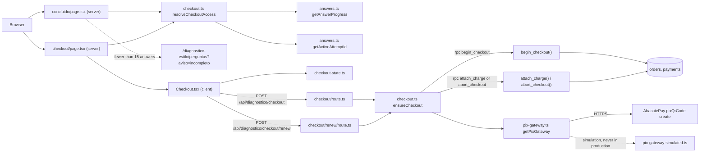

# RF-05. Questionnaire Completion and Pix Checkout: Technical Specification

PRD: docs/prd/PRD-Descubra-Seu-Estilo.md · Scope covered: full feature (no Core/Full split in the PRD) · Complexity: medium

Interview mode: four decisions were taken with the owner (charge without customer data, creation by an idempotent `POST`, lazy expiry, gateway interface with a simulated implementation); everything else is marked `(inferred)`. Code facts were re-read from the current code (branch `feat/pagina-coloracao-pessoal-online`, after commit 61403be). The AbacatePay request and response shapes come from its public reference (docs.abacatepay.com, "Criar QRCode PIX") and a web search, not from a real call: they are marked `(inferred)` and must be confirmed by the live check of Section 7.

## 1. Technical Overview

**What.** RF-05 adds three things. (1) The completion screen `/diagnostico-estilo/concluido`, a server page that is open only for an attempt with all 15 answers saved, with the summary and the button "RECEBER MEU DIAGNÓSTICO". (2) The checkout page `/diagnostico-estilo/checkout`, a server page that validates the attempt and hands over to a client component. On mount the component calls `POST /api/diagnostico/checkout`, which returns the Pix of the attempt: the existing valid one, or a new order in `PENDING` with a new charge created at AbacatePay for 990 cents. The screen shows the product, price, benefits, QR Code, "Copiar código Pix", a countdown, the steps to pay and a "Já paguei" button whose behavior belongs to RF-06. (3) `POST /api/diagnostico/checkout/renew`, behind "Gerar novo Pix", which creates a new order for the same attempt after the previous Pix expired, with no new questions.

**Why.** The diagnosis must be generated only after a valid payment, so an order and a charge that the application can later match (RF-06) have to exist, be unique per attempt, and never be left half created. The gateway is hidden behind an interface so the whole flow can be built and tested without a key and without real charges, while the real HTTP client stays small and checked by a live check. Creation by an explicit `POST` keeps page loads and prefetches free of side effects. Expiry is decided lazily in one atomic SQL function, so no scheduler is needed and two tabs cannot create two orders.

**Scope**

**Included:**
- The completion page and the checkout page (server) and the checkout component (client): countdown, copy button, expired state, error state with retry, "Gerar novo Pix".
- `POST /api/diagnostico/checkout` and `POST /api/diagnostico/checkout/renew`.
- SQL functions `begin_checkout`, `attach_charge` and `abort_checkout`, a partial unique index that allows one `PENDING` order per attempt (migration).
- The `PixGateway` interface with the AbacatePay implementation and a simulated implementation that exists only outside production (RF-01 `paymentSimulationEnabled`).
- Server helpers for access (all 15 answers saved) and for orchestrating the checkout.
- Small changes to files of earlier features: `lib/diagnostico/env.ts` (a group with only `ABACATEPAY_API_KEY`), `lib/diagnostico/paths.ts` (checkout path and the incomplete notice), `app/diagnostico-estilo/perguntas/page.tsx` and `components/Diagnostico/Questionnaire.tsx` (show "Faltam algumas respostas para concluir.").
- Cross-cutting concerns integrated: the attempt cookie and active-attempt check shared with RF-02 and RF-04; the saved answers contract from RF-04 (completeness); the fixed price `PRICE_CENTS` and the payment status values from RF-01; the rate limit function from RF-02; the order and charge contract consumed by RF-06.
- Input contracts (Consumes): the attempt of the cookie with the customer registered by RF-02 (name and e-mail stay in our database and are reached through the attempt); the 15 saved answers from RF-04 (`getAnswerProgress`).
- Output contracts (Provides), as in the PRD: an order in `PENDING` with its Pix charge, that is, order identifier, charge identifier (`payments.provider_charge_id`), amount in cents, QR Code, copy-and-paste code and expiry time (`payments.expires_at`), used by RF-06.

**Deferred:** none.

**Excluded:**
- Confirming a payment, the "Já paguei" action, the webhook and any change of an order to `APPROVED` (RF-06). The button is rendered disabled until RF-06 enables it `(inferred)`.
- Generation of the diagnosis, PDF, e-mail (RF-07, RF-08) and the cleanup of old attempts (RF-09).
- Card payment, refund, any payment instrument data (out of scope of the product).
- Sending customer name, e-mail or CPF to AbacatePay (owner decision: the charge carries only the order identifier).
- A scheduled job to expire orders (owner decision: lazy expiry).

### Requirements / Business Rules (PRD RF-05 Capabilities)

- **Access.** The completion and checkout pages are open only to an active attempt (valid cookie, attempt exists, not expired) with `answeredCount = 15` and no unanswered position, as returned by `getAnswerProgress`. No cookie, tampered cookie or expired attempt: redirect to `EXPIRED_PATH`. Fewer than 15 answers: redirect to `/diagnostico-estilo/perguntas?aviso=incompleto`, where the questionnaire opens on the first unanswered question and shows "Faltam algumas respostas para concluir." `(inferred: query name)`.
- **Completion screen.** Title "Você está a um passo de descobrir sua essência!"; text "Suas respostas foram registradas. Agora, vamos transformar suas escolhas em um diagnóstico personalizado para revelar seus estilos predominantes."; the lines "Questionário concluído", "15 de 15 perguntas respondidas", "Produto: Diagnóstico de Estilo Pessoal" and "Valor: R$ 9,90"; the button "RECEBER MEU DIAGNÓSTICO" is a link to `/diagnostico-estilo/checkout`. The questionnaire's "Concluir" (RF-04) already navigates to `/diagnostico-estilo/concluido`.
- **Checkout page.** Product "Diagnóstico de Estilo Pessoal — Millena Barreto"; price "R$ 9,90 — pagamento único via Pix"; benefits (six): identification of the predominant style; identification of the secondary style; description of the identified styles; suggestions of clothes and combinations; guidance to express your personality through your image; personalized PDF report. Reassurance line "Pagamento processado com segurança pela AbacatePay."
- **Fixed price.** 990 cents is `PRICE_CENTS` (RF-01). No endpoint reads an amount from the request. A body field `amountCents` that differs from 990 is ignored and the event is logged without personal data.
- **One active order per attempt.** `begin_checkout` runs under an advisory lock per attempt and the partial unique index guarantees at most one `PENDING` order per attempt. Opening or reloading the checkout while the Pix is valid returns the same order and payment; it never creates a second charge.
- **Validity.** The charge is created with `expiresIn` = 1,800 seconds `(inferred: unit to confirm in the live check)`. `payments.expires_at` is the expiry returned by the gateway, or `now() + 30 minutes` if the response has none `(inferred)`.
- **Charge without customer (owner decision).** The request to AbacatePay carries the amount, `expiresIn`, a fixed description and `metadata.externalId` = order id, and no `customer` block. The order is tied to the customer through `orders.attempt_id`. The PRD sentence "carries the customer's name and e-mail registered in RF-02 into the charge" is therefore met as "the order of the charge belongs to the attempt of the customer with that name and e-mail"; the hand-off test asserts exactly this. Review this reading before implementing if the charge must show the customer.
- **Lazy expiry (owner decision).** When `begin_checkout` finds a `PENDING` order whose payment `expires_at` has passed, it sets the order to `FAILED` with reason `PIX_EXPIRED` and the payment to `EXPIRED`, in the same transaction. `POST /checkout` then answers `expired` and creates nothing; only `POST /checkout/renew` creates the new order, reusing the stored answers (no new questions). The answers live as long as the attempt (7 days, `purchase_attempts.expires_at`).
- **Paid orders.** If the attempt already has an order whose payment is `PAID`, or an order in `APPROVED`, `PROCESSING` or `DELIVERED`, no new charge is created; both endpoints answer `paid` with the order status. The screen then says "Seu pagamento já foi identificado." and shows no QR `(inferred)`.
- **No order without a charge.** The order is created first (needed for the external id), then the charge, then the payment row. If the gateway fails, `abort_checkout` deletes the order (only if it is `PENDING` and has no payment). A concurrent request that finds a `PENDING` order with no payment younger than 60 seconds answers `in_progress`; an older one is a leftover of a crashed request and is deleted before a new order is created `(inferred: 60 s)`.
- **Rate limit.** `hit_rate_limit` with key `checkout:<attemptId>`, 30 calls per hour `(inferred)`, answered 429 `RATE_LIMITED` with `Retry-After`.
- **No payment data.** No card field exists. The database stores only identifiers, status, amount, the copy-and-paste code, the QR image and times (`payments`).
- **Simulation.** `getPixGateway()` returns the simulated gateway only when `paymentSimulationEnabled()` is true (never in production); otherwise it returns the AbacatePay gateway, which needs `ABACATEPAY_API_KEY`. The simulated gateway never approves a payment and can be made to fail with `PAYMENT_SIMULATION_FAIL=true` for the failure path `(inferred)`.

### Requirements / UX Flows (PRD RF-05 Experience)

- Centered card on both pages, using only the site's tokens and classes (accent, primary, white; `.btn`, `.btn-accent`, `.h1`); no new color literal or font.
- Checkout states: `loading` ("Gerando seu Pix…"), `pending` (QR, copy button directly under it, countdown "Seu Pix expira em MM:SS", the steps to pay, "Já paguei" disabled), `expired` ("Seu Pix expirou" and "Gerar novo Pix"), `paid`, `error` (message and "Tentar novamente"), `in_progress` (retries the call after 2 seconds, up to 5 times, then shows the error state `(inferred)`).
- Steps to pay (three lines) `(inferred)`: "Abra o app do seu banco e escolha pagar com Pix." / "Escaneie o QR Code ou cole o código copiado." / "Confirme o pagamento e volte aqui para clicar em Já paguei."
- Copy: the button "Copiar código Pix" copies the code and shows "Código Pix copiado!" for 3 seconds `(inferred)`; if the Clipboard API is unavailable it selects the code in a read-only field so it can be copied by hand `(inferred)`.
- Countdown computed from `expiresAt` with a 1-second timer; at zero the client calls `POST /checkout` once, which expires the order and returns `expired`.
- Mobile: QR Code at least 220 px wide, the copy button directly under it, buttons at least 48 px, no horizontal scroll at 360 px.
- The QR Code has the alternative text "QR Code do Pix"; the countdown is announced politely (`aria-live="polite"` updated at most every 30 seconds) `(inferred)`; state changes move focus to the state heading.
- Messages in pt-BR, conversational, no technical wording.

### Error Handling (PRD RF-05 Error Handling)

- **AbacatePay unavailable, slow (10 s timeout) or returning an error:** no order is left `PENDING`; the API answers 502 `PIX_UNAVAILABLE` "Não conseguimos gerar o Pix agora. Tente novamente em instantes."; the screen shows it with "Tentar novamente". The cause is logged without personal data and without the key.
- **Charge created but not stored (the `attach_charge` call fails):** one retry, then `abort_checkout` and the same 502 answer; the identifiers are logged so an unpaid orphan charge can be traced. The charge cannot be paid after it expires in 30 minutes `(inferred)`.
- **Incomplete questionnaire:** pages redirect to the questionnaire with the notice; the API answers 409 `ANSWERS_INCOMPLETE` and the client navigates to the same address.
- **Cookie missing, tampered or attempt expired:** pages redirect to `EXPIRED_PATH`; the API answers 403 `FORBIDDEN` and the client navigates to the same address.
- **Amount sent by the browser differs from 990:** ignored, server value used, event logged.
- **Concurrent calls:** the loser either receives the same order (`existing`) or `in_progress`; never two orders.
- **Missing key (`ABACATEPAY_API_KEY`) outside simulation:** 500 `CONFIG_ERROR` naming no secret, as the other routes do.
- **Unexpected error:** 500 `INTERNAL_ERROR`, generic message, nothing personal logged.

## 2. Architecture Impact

**Affected components:** new `app/diagnostico-estilo/concluido/page.tsx`, `app/diagnostico-estilo/checkout/page.tsx`, `components/Diagnostico/Checkout.tsx`, `app/api/diagnostico/checkout/route.ts`, `app/api/diagnostico/checkout/renew/route.ts`, `lib/diagnostico/checkout.ts`, `lib/diagnostico/checkout-state.ts`, `lib/diagnostico/pix-gateway.ts`, `lib/diagnostico/abacatepay.ts`, `lib/diagnostico/pix-gateway-simulated.ts`, `lib/diagnostico/schemas/checkout.ts`, migration `20260101000008_checkout.sql`, regenerated `lib/diagnostico/database.types.ts`; modified `lib/diagnostico/env.ts`, `lib/diagnostico/paths.ts`, `app/diagnostico-estilo/perguntas/page.tsx`, `components/Diagnostico/Questionnaire.tsx`, `.env.example`; and the tests of Section 4.

**Diagram**



**Patterns followed** (re-read from the current code)
- Server modules start with `import "server-only"` and use the Vitest alias stub (`lib/diagnostico/answers.ts`, `tests/setup/server-only-stub.ts`).
- Routes: JSON read with `readJson`, validation with a Zod schema through `parseInput`, errors with `apiError`, `ApiError` and `ConfigError` caught in one `try/catch`, `export const dynamic = "force-dynamic"` (`app/api/diagnostico/attempts/route.ts`).
- Atomic operations as SQL functions revoked from `anon` and `authenticated` (`supabase/migrations/20260101000005_attempt_creation_and_rate_limit.sql`, `…07_save_answer.sql`); errors raised as `P0001` with a code in the message and mapped in code by `message.includes` (`lib/diagnostico/answers.ts`).
- Rate limit through `hitRateLimit` (`lib/diagnostico/attempts.ts`) and the `hit_rate_limit` function.
- Env readers per group with `ConfigError` (`lib/diagnostico/env.ts`); today `getPaymentEnv` requires both the API key and the webhook secret, which RF-06 needs, so RF-05 adds a group that needs only the key.
- Server pages are `force-dynamic`, read the cookie through `getActiveAttemptId(db, cookies())` and `redirect(EXPIRED_PATH)` (`app/diagnostico-estilo/perguntas/page.tsx`).
- Fixed values live in `lib/diagnostico/constants.ts` (`PRICE_CENTS`, `ORDER_STATUSES`, `FAILURE_REASONS` already include `PIX_EXPIRED`); paths in `lib/diagnostico/paths.ts`.
- Design tokens and global classes only, checked by `tests/unit/diagnostico/design-tokens.test.ts`.
- Route tests call the exported handler with `new Request(...)` against the local Supabase; helpers in `tests/integration/diagnostico/helpers.ts`.
- Security headers on `/diagnostico-estilo/:path*` and `/api/:path*` come from `next.config.mjs` and only set `frame-ancestors`, so a `data:` QR image is allowed.

## 3. Technical Decisions

| Decision | Chosen Approach | Alternative Considered | Trade-off |
|---|---|---|---|
| Customer data in the charge (owner) | No `customer` block; only `metadata.externalId` = order id | Ask the CPF at checkout or at registration | No CPF is collected (LGPD, RF-02 untouched); the charge does not show the customer's name, and the live check must confirm AbacatePay accepts it |
| When the charge is created (owner) | Pages have no side effect; the client calls an idempotent `POST` on mount | Create during the server render of the page | A short loading state; no charge from prefetch or crawlers; a natural retry button |
| Expiry (owner) | Lazy: `begin_checkout` expires a stale order; a separate `renew` creates the next one | Scheduled job | No scheduler to configure; an expired order stays `PENDING` in the database until someone opens the checkout (RF-06 must still approve a paid late charge) |
| Gateway (owner) | `PixGateway` interface with an AbacatePay client and a simulated client (never in production) | Only the real client with mocked `fetch` | One more file; the flow runs and is tested without a key |
| Atomicity | Order created by SQL first, charge called outside the transaction, payment attached by SQL; failure deletes the unpaid order | One transaction around the HTTP call | A small window with an order without payment, covered by `in_progress` and the 60 s rule |
| One active order | Advisory lock per attempt plus a partial unique index on `orders (attempt_id) where status = 'PENDING'` | Lock only | The index is the last line of defense if code ever skips the function |
| Idempotency key | The order id is the key: sent as `metadata.externalId` and as an `Idempotency-Key` header `(inferred)`, and enforced locally by the single `PENDING` order | A random key per call | The provider may ignore the header; local uniqueness is what prevents duplicates |
| QR image storage | Store the `brCodeBase64` image returned by the gateway in `payments.pix_qr_image` | Generate the QR from the code in the browser | No QR library; depends on the gateway response `(inferred)` |

**Assumptions** (everything not decided by the owner nor observed is `(inferred)`)
- Interview answers: charge without customer A, creation by `POST` A, lazy expiry A, gateway interface A.
- Migration `20260101000008_checkout.sql`; SQL error codes `ATTEMPT_NOT_FOUND`, `ANSWERS_INCOMPLETE`; the function returns `jsonb` with a `state`.
- AbacatePay request: `POST https://api.abacatepay.com/v1/pixQrCode/create`, `Authorization: Bearer <key>`, body `{ amount, expiresIn, description, metadata: { externalId } }`; response `{ data: { id, brCode, brCodeBase64, expiresAt, status }, error }`. All of it is inferred from the public reference and confirmed only by the live check.
- 60 s rule for a stuck order, 30 calls per hour, `in_progress` retry every 2 s up to 5 times, 10 s gateway timeout, copy confirmation for 3 seconds, the three steps to pay, the disabled "Já paguei", `?aviso=incompleto`, `PAYMENT_SIMULATION_FAIL`, `Cache-Control: no-store` on the API answers.
- Complexity `medium`: two endpoints, one migration with three functions and an index, one external integration behind an interface, three new screens' worth of UI.
- Traceability: PRD RF-05 Consumes and Provides feed the Scope and Section 5; Capabilities feed the business rules; Experience feeds the UX flows; Error Handling feeds the error list; the six per-feature criteria and the two cross-feature criteria where RF-05 is the consumer feed Section 7; the cross-feature criterion where RF-05 is the provider is a pointer in Section 7.
- Structural decisions with trade-offs (the gateway interface and the no-customer charge) are candidates for an ADR.

## 4. Component Overview

### Frontend

| File Path | New/Modified | Purpose | Key Responsibilities |
|---|---|---|---|
| `app/diagnostico-estilo/concluido/page.tsx` | New | Completion screen (server) | Resolve access, redirect, render the summary and the link "RECEBER MEU DIAGNÓSTICO" |
| `app/diagnostico-estilo/checkout/page.tsx` | New | Checkout page (server) | Resolve access, redirect, render the product, price, benefits and the client component |
| `components/Diagnostico/Checkout.tsx` | New | Checkout (client) | Call the endpoints, show states, QR, copy button, countdown, expired and error states, "Gerar novo Pix" |
| `app/diagnostico-estilo/perguntas/page.tsx` | Modified | Questionnaire page | Read `searchParams.aviso` and pass the notice to the component |
| `components/Diagnostico/Questionnaire.tsx` | Modified | Questionnaire (client) | Show "Faltam algumas respostas para concluir." when a notice is passed |

### Backend

| File Path | New/Modified | Purpose | Key Responsibilities |
|---|---|---|---|
| `app/api/diagnostico/checkout/route.ts` | New | `POST` handler | Authenticate by cookie, rate limit, call `ensureCheckout`, map results and errors |
| `app/api/diagnostico/checkout/renew/route.ts` | New | `POST` handler | Same as above with renewal allowed |
| `lib/diagnostico/checkout.ts` | New | Checkout orchestration (server-only) | `resolveCheckoutAccess`, `ensureCheckout`, `CheckoutError`, result mapping |
| `lib/diagnostico/pix-gateway.ts` | New | Gateway contract (server-only) | `PixGateway`, `PixCharge`, `PixGatewayError`, `getPixGateway` |
| `lib/diagnostico/abacatepay.ts` | New | AbacatePay client (server-only) | Create a Pix charge over HTTPS with timeout, map the response and errors, never log the key |
| `lib/diagnostico/pix-gateway-simulated.ts` | New | Simulated gateway (server-only) | Return a fake charge, optionally fail, never approve |
| `lib/diagnostico/checkout-state.ts` | New | Pure helpers | `secondsLeft`, `formatCountdown`, `formatPrice`, `PIX_VALIDITY_SECONDS`, `IN_PROGRESS_RETRY_MS` |
| `lib/diagnostico/schemas/checkout.ts` | New | Zod schema | Optional request body with an `amountCents` that is ignored |
| `lib/diagnostico/env.ts` | Modified | Env readers | Add `getPaymentApiEnv` (only `ABACATEPAY_API_KEY`) |
| `lib/diagnostico/paths.ts` | Modified | Addresses | Add `CHECKOUT_PATH`, `INCOMPLETE_PATH`, `INCOMPLETE_NOTICE` |
| `.env.example` | Modified | Documentation | Document `ABACATEPAY_API_KEY` usage and `PAYMENT_SIMULATION_FAIL` |

### Data

| File Path | New/Modified | Purpose | Key Responsibilities |
|---|---|---|---|
| `supabase/migrations/20260101000008_checkout.sql` | New | Atomic checkout | Partial unique index, functions `begin_checkout`, `attach_charge`, `abort_checkout` |
| `lib/diagnostico/database.types.ts` | Modified (generated) | Types | Regenerate with `npm run db:types` (write to a temporary file first) |

### Tests

| File Path | New/Modified | Purpose | Key Responsibilities |
|---|---|---|---|
| `tests/unit/diagnostico/checkout-state.test.ts` | New | Pure helpers | Countdown, price format, constants |
| `tests/unit/diagnostico/checkout-schema.test.ts` | New | Body schema | Empty body, extra amount |
| `tests/unit/diagnostico/abacatepay-gateway.test.ts` | New | Real client with a fake `fetch` | Request shape, auth header, response mapping, errors, timeout, no key in errors |
| `tests/unit/diagnostico/pix-gateway.test.ts` | New | Gateway selection | Simulated only when simulation is enabled, never in production |
| `tests/unit/diagnostico/env.test.ts` | Modified | Env readers | `getPaymentApiEnv` names the missing key |
| `tests/integration/diagnostico/checkout-sql.test.ts` | New | SQL functions and index | Create, reuse, expire, renew, abort, concurrency, one `PENDING` per attempt |
| `tests/integration/diagnostico/checkout-route.test.ts` | New | Both routes | Acceptance criteria 2 to 6, errors, rate limit, amount ignored |
| `tests/integration/diagnostico/checkout-handoff.test.ts` | New | Hand-off tests (consumer) | RF-02 and RF-04 real output into RF-05 |
| `tests/live/abacatepay-pix.live.test.ts` | New | Live check | Real dev-mode charge; never part of the default runs |

## 5. API Contracts

Authentication for both endpoints: the signed cookie `ds_attempt` (RF-02). Body: optional JSON, at most 64 KB; the only recognized field is `amountCents`, which is never used. Every answer carries `Cache-Control: no-store`.

### `POST /api/diagnostico/checkout`

Returns the Pix of the attempt; creates the first order if the attempt has none; never creates one after an expiry.

```json
{ "amountCents": 1 }
```

Responses:
- **201 Created** (a new order and charge) or **200 OK** (the existing valid one):

```json
{
  "state": "pending",
  "orderId": "5d7f0c1e-2b4a-4c8e-9a31-0f6b7e2d9a44",
  "amountCents": 990,
  "expiresAt": "2026-11-20T15:30:00.000Z",
  "pixCode": "00020126580014br.gov.bcb.pix0136…",
  "qrImage": "data:image/png;base64,iVBORw0KGgo…"
}
```

- **200 OK** `{ "state": "expired" }`: the previous Pix expired (the order is now `FAILED / PIX_EXPIRED`); nothing was created.
- **200 OK** `{ "state": "paid", "orderStatus": "APPROVED" }`: the attempt already has a paid order.
- **409** `CHECKOUT_IN_PROGRESS` with `Retry-After: 2`: another request is creating the charge.
- **409** `ANSWERS_INCOMPLETE`: fewer than 15 answers.
- **403** `FORBIDDEN`: no cookie, invalid signature, attempt not found or expired.
- **429** `RATE_LIMITED` with `Retry-After`.
- **502** `PIX_UNAVAILABLE`: "Não conseguimos gerar o Pix agora. Tente novamente em instantes."
- **500** `CONFIG_ERROR` or `INTERNAL_ERROR`.
- Invalid JSON or a body over 64 KB: 400 `INVALID_JSON` / 413 `PAYLOAD_TOO_LARGE`, as in the other routes.

```json
{ "error": { "code": "PIX_UNAVAILABLE", "message": "Não conseguimos gerar o Pix agora. Tente novamente em instantes." } }
```

### `POST /api/diagnostico/checkout/renew`

Same request, same answers. Difference: when the previous Pix expired it creates a new `PENDING` order (state `pending`, status 201); when a valid Pix exists it returns that one (200), so double clicks create nothing.

### Module signatures

```ts
// pix-gateway.ts (server-only)
type PixCharge = { chargeId: string; pixCode: string; qrImage: string; expiresAt: string | null };
interface PixGateway {
  createCharge(input: { orderId: string; amountCents: number; expiresInSeconds: number; description: string }): Promise<PixCharge>;
}
class PixGatewayError extends Error { code: "GATEWAY_UNAVAILABLE" | "GATEWAY_REJECTED" | "GATEWAY_BAD_RESPONSE" }
function getPixGateway(): PixGateway   // simulated only when paymentSimulationEnabled(), else AbacatePay

// abacatepay.ts (server-only)
function createAbacatePayGateway(options?: { fetch?: typeof fetch; timeoutMs?: number }): PixGateway   // reads getPaymentApiEnv()

// checkout.ts (server-only)
type CheckoutAccess =
  | { ok: true; attemptId: string }
  | { ok: false; redirectTo: string };      // EXPIRED_PATH or INCOMPLETE_PATH
function resolveCheckoutAccess(db, store: CookieStore): Promise<CheckoutAccess>

type CheckoutResult =
  | { state: "pending"; created: boolean; orderId: string; amountCents: number; expiresAt: string; pixCode: string; qrImage: string }
  | { state: "expired" }
  | { state: "paid"; orderStatus: OrderStatus };
class CheckoutError extends Error { code: "ATTEMPT_NOT_FOUND" | "ANSWERS_INCOMPLETE" | "CHECKOUT_IN_PROGRESS" | "PIX_UNAVAILABLE" }
function ensureCheckout(db, gateway: PixGateway, attemptId: string, options: { renew: boolean }): Promise<CheckoutResult>

// checkout-state.ts (pure)
const PIX_VALIDITY_SECONDS = 1800;
const IN_PROGRESS_RETRY_MS = 2000;
function secondsLeft(expiresAtIso: string, nowMs: number): number     // never negative
function formatCountdown(seconds: number): string                      // "MM:SS"
function formatPrice(cents: number): string                            // 990 -> "R$ 9,90"

// schemas/checkout.ts
const checkoutBodySchema: z.ZodType<{ amountCents?: number }>
```

Provided to RF-06 (PRD Provides): the rows `orders` (status `PENDING`, `amount_cents` 990, `attempt_id`) and `payments` (`order_id`, `provider_charge_id`, `amount_cents`, `pix_br_code`, `pix_qr_image`, `expires_at`, status `PENDING`). RF-06 matches a notification to the order by `provider_charge_id`. Note for RF-06: an order may already be `FAILED / PIX_EXPIRED` when a late payment for its charge arrives; RF-06 decides from the real charge status and must be able to approve such an order.

## 6. Data Model

No new table or column. `orders` and `payments` (RF-01, `20260101000002_orders_and_delivery.sql`) already hold the data: `orders (id, attempt_id, amount_cents, status, failure_reason, …)` and `payments (id, order_id, provider, provider_charge_id unique, status, amount_cents, pix_br_code, pix_qr_image, expires_at, …)`. Migration `20260101000008_checkout.sql` (one transaction):

```sql
-- At most one order waiting for payment per attempt.
create unique index orders_one_pending_per_attempt
  on public.orders (attempt_id) where status = 'PENDING';

-- Decides what the checkout of an attempt must do. Never calls the gateway.
-- Returns jsonb: { state, order_id?, order_status?, payment? }
--   state 'existing'    a PENDING order with a valid payment (payment holds the Pix data)
--   state 'created'     a new PENDING order without payment; the caller must create the charge
--   state 'expired'     the previous Pix expired and renewal was not requested
--   state 'paid'        the attempt already has a paid order
--   state 'in_progress' a PENDING order without payment younger than 60 seconds exists
create function public.begin_checkout(p_attempt uuid, p_amount integer, p_renew boolean)
returns jsonb
language plpgsql as $$
declare
  v_expires timestamptz;
  v_version uuid;
  v_questions integer;
  v_answers integer;
  v_order public.orders%rowtype;
  v_payment public.payments%rowtype;
begin
  perform pg_advisory_xact_lock(hashtext('checkout:' || p_attempt::text));

  select expires_at into v_expires from public.purchase_attempts where id = p_attempt;
  if v_expires is null or v_expires <= now() then
    raise exception 'ATTEMPT_NOT_FOUND' using errcode = 'P0001';
  end if;

  select version_id, count(*) into v_version, v_answers
    from public.answers where attempt_id = p_attempt group by version_id;
  select count(*) into v_questions from public.questions where version_id = v_version;
  if v_version is null or v_questions = 0 or v_answers <> v_questions then
    raise exception 'ANSWERS_INCOMPLETE' using errcode = 'P0001';
  end if;

  -- Already paid: never open a second charge.
  select o.* into v_order from public.orders o
    where o.attempt_id = p_attempt
      and (o.status in ('APPROVED', 'PROCESSING', 'DELIVERED')
           or exists (select 1 from public.payments p where p.order_id = o.id and p.status = 'PAID'))
    order by o.created_at desc limit 1;
  if found then
    return jsonb_build_object('state', 'paid', 'order_id', v_order.id, 'order_status', v_order.status);
  end if;

  select o.* into v_order from public.orders o
    where o.attempt_id = p_attempt and o.status = 'PENDING';
  if found then
    select * into v_payment from public.payments where order_id = v_order.id;
    if not found then
      if v_order.created_at > now() - interval '60 seconds' then
        return jsonb_build_object('state', 'in_progress');
      end if;
      delete from public.orders where id = v_order.id;        -- leftover of a crashed request
    elsif v_payment.expires_at > now() then
      return jsonb_build_object('state', 'existing', 'order_id', v_order.id,
        'payment', jsonb_build_object('amount_cents', v_payment.amount_cents,
          'pix_br_code', v_payment.pix_br_code, 'pix_qr_image', v_payment.pix_qr_image,
          'expires_at', v_payment.expires_at));
    else
      update public.orders set status = 'FAILED', failure_reason = 'PIX_EXPIRED', updated_at = now()
        where id = v_order.id;
      update public.payments set status = 'EXPIRED', updated_at = now() where id = v_payment.id;
    end if;
  end if;

  -- An expired Pix is only replaced when the customer asks for it.
  if not p_renew and exists (
    select 1 from public.orders where attempt_id = p_attempt and failure_reason = 'PIX_EXPIRED'
  ) then
    return jsonb_build_object('state', 'expired');
  end if;

  insert into public.orders (attempt_id, amount_cents) values (p_attempt, p_amount)
    returning * into v_order;
  return jsonb_build_object('state', 'created', 'order_id', v_order.id);
end $$;

-- Stores the charge of a PENDING order that has none yet.
create function public.attach_charge(
  p_order uuid, p_charge_id text, p_br_code text, p_qr_image text, p_expires_at timestamptz
) returns void
language plpgsql as $$
declare v_amount integer;
begin
  select amount_cents into v_amount from public.orders where id = p_order and status = 'PENDING';
  if v_amount is null then raise exception 'ORDER_NOT_PENDING' using errcode = 'P0001'; end if;
  insert into public.payments (order_id, provider_charge_id, amount_cents, pix_br_code, pix_qr_image, expires_at)
    values (p_order, p_charge_id, v_amount, p_br_code, p_qr_image, p_expires_at);
end $$;

-- Removes an order that never got a charge. Never touches an order with a payment.
create function public.abort_checkout(p_order uuid) returns void
language sql as $$
  delete from public.orders o
   where o.id = p_order and o.status = 'PENDING'
     and not exists (select 1 from public.payments p where p.order_id = o.id);
$$;

revoke all on function public.begin_checkout(uuid, integer, boolean) from public, anon, authenticated;
revoke all on function public.attach_charge(uuid, text, text, text, timestamptz) from public, anon, authenticated;
revoke all on function public.abort_checkout(uuid) from public, anon, authenticated;
```

Notes: `FAILED` requires `failure_reason` to be allowed only for `FAILED` (RF-01 check), which the update respects; a `FAILED / PIX_EXPIRED` order does not conflict with the partial unique index. The `answers` completeness rule uses the version pinned by the attempt's answers (RF-04), so a newer published version does not break an attempt in progress. The `paid` branch also covers an order that was paid and later failed in generation, so a customer who paid is never charged again. The code constants `PRICE_CENTS`, statuses and reasons already exist in `lib/diagnostico/constants.ts`.

## 7. Testing Strategy

**Acceptance tests** (PRD Section 9, RF-05: six per-feature criteria; two cross-feature criteria where RF-05 is the consumer; numbered here for reference)

| # | Criterion | Test file :: function |
|---|---|---|
| 1 | Given 15 answers saved, when the questionnaire ends, then the completion screen shows "15 de 15 perguntas respondidas" and "R$ 9,90" | `tests/unit/diagnostico/checkout-state.test.ts` :: `formatPrice formats 990 cents as R$ 9,90`; `tests/integration/diagnostico/checkout-route.test.ts` :: `resolveCheckoutAccess allows an attempt with 15 answers`; verification script steps 4, 5 |
| 2 | Given fewer than 15 answers, when the checkout is opened, then the visitor is redirected to the first unanswered question | `checkout-route.test.ts` :: `resolveCheckoutAccess redirects an attempt with 14 answers to the questionnaire`, `POST checkout with 14 answers gets 409 ANSWERS_INCOMPLETE`, `resolveCheckoutAccess redirects without a cookie to the expired path`; verification script step 3 |
| 3 | Given the checkout opens, when the Pix is created, then exactly one order in PENDING and one charge of 990 cents exist, and reloading creates no second charge | `checkout-sql.test.ts` :: `first call creates one PENDING order and the charge is attached`, `second call returns the existing Pix without a new order`, `two concurrent calls create one order`, `a second PENDING order for the same attempt is rejected by the index`; `checkout-route.test.ts` :: `first POST creates one order and one payment of 990 cents`, `reloading returns the same order and does not call the gateway again`, `an amount sent by the browser is ignored`; live check `L1`; verification script steps 5, 6 |
| 4 | Given the Pix is displayed, when the customer taps "Copiar código Pix", then the code is copied and a confirmation appears | `checkout-state.test.ts` :: `copy confirmation text is Código Pix copiado!` (constant); verification script step 7 |
| 5 | Given the Pix is older than 30 minutes, when the screen updates, then "Seu Pix expirou" shows, the old order is FAILED (PIX_EXPIRED), and "Gerar novo Pix" creates a new PENDING order without asking the questions again | `checkout-sql.test.ts` :: `an expired Pix marks the order FAILED with PIX_EXPIRED and the payment EXPIRED`, `begin_checkout does not create after expiry unless renewal is requested`, `renew creates a new PENDING order for the same attempt`; `checkout-route.test.ts` :: `POST checkout after expiry answers expired`, `POST renew after expiry creates a new order and keeps the answers`, `POST renew with a valid Pix returns the same order`, `secondsLeft never returns a negative value` (in `checkout-state.test.ts`); verification script step 8 |
| 6 | Given the checkout page, when it is inspected, then it has no card fields and no payment data is stored by the application | `checkout-route.test.ts` :: `the payments table holds identifiers, amount, code, image and times only`, `the checkout answer carries no payment instrument data`; `tests/unit/diagnostico/abacatepay-gateway.test.ts` :: `the request body has no customer or card data`; verification script step 5 (no input of type card or autocomplete cc-*) |
| H1 (consumer, RF-02 + RF-04 to RF-05) | Given 15 answers saved by RF-04, when RF-05 opens the checkout, then it accepts the attempt and carries the customer's name and e-mail registered in RF-02 into the charge | `tests/integration/diagnostico/checkout-handoff.test.ts` :: `a real registration with 15 saved answers opens a checkout whose order belongs to that customer` |
| H2 (consumer, RF-04 to RF-05) | Given an incomplete answer set from RF-04, when RF-05 is opened, then it redirects back to RF-04 | `checkout-handoff.test.ts` :: `answers saved by the RF-04 route with one question missing send RF-05 back to the questionnaire` |
| P1 (provider, RF-05 to RF-06) | Given an order and charge created by RF-05, when the AbacatePay notification arrives in RF-06, then it is matched to that order by charge identifier and the order becomes APPROVED | Covered by the hand-off test of RF-06, implemented after this feature |

**Supporting tests**
- `checkout-sql.test.ts`: `incomplete answers raise ANSWERS_INCOMPLETE`, `an expired attempt raises ATTEMPT_NOT_FOUND`, `a PENDING order without payment younger than 60 seconds answers in_progress`, `a PENDING order without payment older than 60 seconds is replaced`, `an attempt with a paid order answers paid and creates nothing`, `abort_checkout deletes an order without payment`, `abort_checkout keeps an order that has a payment`, `attach_charge rejects an order that is not PENDING`, `the amount of the payment is the amount of the order`.
- `checkout-route.test.ts`: `request without cookie gets 403`, `tampered cookie gets 403`, `a gateway failure leaves no PENDING order and answers 502 PIX_UNAVAILABLE`, `the next call after a gateway failure succeeds`, `the thirty-first call in an hour gets 429 with Retry-After`, `invalid JSON gets INVALID_JSON`, `missing ABACATEPAY_API_KEY outside simulation returns CONFIG_ERROR`, `answers never expose the charge identifier`, `the answer has Cache-Control no-store`, `the simulated gateway is used only when simulation is enabled`.
- `abacatepay-gateway.test.ts`: `sends the amount expiresIn description and externalId`, `sends the bearer key and never puts it in an error`, `maps a successful response to a PixCharge`, `a non-2xx answer becomes GATEWAY_REJECTED`, `a network failure becomes GATEWAY_UNAVAILABLE`, `a response without code or id becomes GATEWAY_BAD_RESPONSE`, `a slow answer is aborted at the timeout`.
- `pix-gateway.test.ts`: `returns the simulated gateway when simulation is enabled outside production`, `returns the real gateway when simulation is off`, `never returns the simulated gateway in production`, `the simulated gateway never reports a payment`, `PAYMENT_SIMULATION_FAIL makes the simulated gateway fail`.
- `checkout-state.test.ts`: `formatCountdown shows MM:SS`, `secondsLeft counts down from expiresAt`, `PIX_VALIDITY_SECONDS is 1800`, `IN_PROGRESS_RETRY_MS is 2000`.
- `checkout-schema.test.ts`: `accepts an empty body`, `accepts and discards amountCents`, `rejects a non-numeric amountCents`.
- `env.test.ts`: `getPaymentApiEnv names the missing ABACATEPAY_API_KEY`, `getPaymentApiEnv does not require the webhook secret`.
- `design-tokens.test.ts` (existing) must keep passing for the new pages and component.

**Proof (how each criterion is proven):** criteria 1, 2, 4, 5, 6, H1 and H2 are `fake` (real local database, simulated gateway, no external provider). Criterion 3 is `both`: the database rules are proven with the simulated gateway, and the real AbacatePay answer (one charge of 990 cents, accepted without a `customer` block, expiry unit) is proven by the live check L1. Criteria 1 to 6 also have the browser verification script because they depend on what the customer sees or does.

**Live checks:**
- **L1** (criterion 3): `tests/live/abacatepay-pix.live.test.ts` :: `creates a dev-mode Pix charge of 990 cents with only an external id`. It calls the real AbacatePay gateway once, with a **development-mode key** (never a production key), the same request that `createAbacatePayGateway` sends, for a throwaway order id. Model: not applicable (no AI model). Cost cap: none expected in dev mode; the run stops after one charge. Minimal assertions: the answer has a charge id, a non-empty copy-and-paste code, a QR image and an expiry; the gateway accepted a request with no `customer` block; the expiry is about 30 minutes after the call, which confirms the unit of `expiresIn`. Evidence to show: the status code, the field names returned (never the key), the observed expiry offset, the commit. It never runs without the owner's explicit approval for that run, reads the key from `ABACATEPAY_API_KEY` in the environment and never prints it. If the account rejects a charge without `customer`, the spec must be revised (see decision 1).
- Until the owner approves and provides a development key, L1 is `live pending` and criterion 3 stays `— (live pending)`.

**Verification script** (real browser against the running app and the local Supabase; viewport 360 x 740 unless stated; this session's own port from `.env.local`; simulation enabled with `ENABLE_PAYMENT_SIMULATION=true`; throwaway e-mails `verif-rf05-…@example.com` deleted afterwards):
1. With no cookies open `/diagnostico-estilo/concluido`, then `/diagnostico-estilo/checkout`. Expected: both end at `/diagnostico-estilo?sessao=expirada` with the "Sua sessão expirou." notice. Proves criterion 2 (access, no-cookie case).
2. Register through the form and answer only 5 questions, then open `/diagnostico-estilo/concluido` and `/diagnostico-estilo/checkout`. Expected: each ends at the questionnaire on "Pergunta 6 de 15" with the notice "Faltam algumas respostas para concluir."; the database has no order for the attempt. Proves criterion 2.
3. Answer the remaining 10 questions and press "Concluir" on question 15. Expected: the address is `/diagnostico-estilo/concluido` and shows the title "Você está a um passo de descobrir sua essência!", the text, "Questionário concluído", "15 de 15 perguntas respondidas", "Produto: Diagnóstico de Estilo Pessoal", "Valor: R$ 9,90" and the button "RECEBER MEU DIAGNÓSTICO"; no horizontal scroll. Proves criterion 1.
4. Press "RECEBER MEU DIAGNÓSTICO". Expected: `/diagnostico-estilo/checkout` shows "Gerando seu Pix…" and then the product "Diagnóstico de Estilo Pessoal — Millena Barreto", "R$ 9,90 — pagamento único via Pix", the six benefits, "Pagamento processado com segurança pela AbacatePay.", a QR image at least 220 px wide with "Copiar código Pix" directly under it, a countdown near 30:00, the steps to pay and a disabled "Já paguei". The database has exactly one `PENDING` order of 990 cents and one payment. Proves criteria 3 and 6 (screen part).
5. Inspect the page. Expected: no input for card number, expiry or security code, and no field named amount; the page source has no price field the browser could change. Proves criterion 6.
6. Reload the page and open the checkout in a second tab. Expected: the same QR image and code appear and the countdown continues from the same time; the database still has one order and one payment. Proves criterion 3.
7. Press "Copiar código Pix" (grant the clipboard permission). Expected: "Código Pix copiado!" appears and the clipboard holds the displayed code. Proves criterion 4.
8. In the database set the payment's `expires_at` to a past time and reload (or wait for the countdown to reach zero). Expected: "Seu Pix expirou" and "Gerar novo Pix" show, the old order is `FAILED / PIX_EXPIRED` and its payment `EXPIRED`. Press "Gerar novo Pix": a new QR and countdown appear without any question screen; the database has two orders (one `FAILED`, one `PENDING`) and the answers are unchanged. Proves criterion 5.
9. Failure state: with the simulated gateway set to fail (`PAYMENT_SIMULATION_FAIL=true`, restart the dev server) open the checkout of a new complete attempt. Expected: "Não conseguimos gerar o Pix agora. Tente novamente em instantes." and a "Tentar novamente" button; the database has no `PENDING` order for the attempt. Switch the variable off and press the button: the Pix appears. Error state.
10. Boundary states: at 1280 px wide the card stays centered; at 360 px there is no horizontal scroll and the buttons are at least 48 px tall. With `prefers-reduced-motion` nothing breaks.

**Hand-off tests (cross-feature, owned by RF-05 as consumer)**
- H1: `checkout-handoff.test.ts` :: `a real registration with 15 saved answers opens a checkout whose order belongs to that customer`. It calls the real `POST` route of RF-02, takes the `Set-Cookie`, saves the 15 answers through the real `PUT` route of RF-04 (using `createFullVersion`/the seeded version), calls `POST /api/diagnostico/checkout` with that cookie and a recording simulated gateway, and asserts: state `pending`; the order's `attempt_id` is the one returned by RF-02; following `attempt_id` to the customer gives the exact name and e-mail typed in the registration; the gateway received that order id as the external id and 990 cents; a second registration's attempt has no order. No mocking of the contract between the three features. Note: because of the owner's decision, the charge itself does not carry name or e-mail; the assertion is the link through the attempt.
- H2: `checkout-handoff.test.ts` :: `answers saved by the RF-04 route with one question missing send RF-05 back to the questionnaire`. It registers through RF-02, saves 14 answers through RF-04's route, and asserts that `resolveCheckoutAccess` returns the questionnaire redirect with the incomplete notice, that `POST /checkout` answers 409 `ANSWERS_INCOMPLETE` and that no order exists; then it saves the 15th answer and asserts access is granted.
- P1 (RF-05 is the **provider**; no test here): "Given an order and charge created by RF-05, when the AbacatePay notification arrives in RF-06, then it is matched to that order by charge identifier and the order becomes APPROVED": covered by the hand-off test of RF-06, implemented after this feature.

**Test data and fixtures:** integration tests use the local Supabase with the seeded questionnaire version 1 (run `npm run db:reset` first so migration `…08` exists), the helpers of `tests/integration/diagnostico/helpers.ts` (`createCustomer`, `createAttempt`, `createFullVersion`) and a helper that fills the 15 answers of an attempt; a recording simulated gateway (an object implementing `PixGateway` that counts calls and can fail) is passed to `ensureCheckout`; routes read the gateway through `getPixGateway()` with `ENABLE_PAYMENT_SIMULATION=true` set in the test process. Expiry is simulated by updating `payments.expires_at` in the test database. Every test removes its customers in `afterAll` (orders and payments cascade). The unit tests of the real client pass a fake `fetch` and never use a key.

**Not tested here:** payment confirmation, the "Já paguei" action and the webhook (RF-06); the delivery steps (RF-07, RF-08); the retention job (RF-09); real AbacatePay behavior until L1 runs; automated browser tests in CI (the script is a manual plan for the evaluator).
