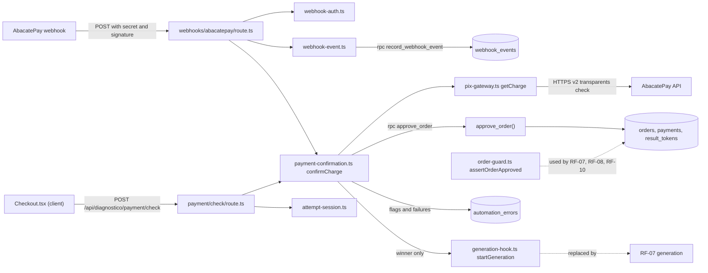

# RF-06. Payment Confirmation: Technical Specification

PRD: docs/prd/PRD-Descubra-Seu-Estilo.md · Scope covered: full feature (no Core/Full split in the PRD) · Complexity: medium

Interview mode: four decisions were taken with the owner (AbacatePay API version, generation hook, result token, late payment); everything else is marked `(inferred)`. Code facts were re-read from the current code (branch `feat/pagina-coloracao-pessoal-online`, after commit b8290d5). AbacatePay facts come from its public documentation read during the interview (pages "Segurança dos webhooks", "Webhooks" and "Checar status", plus the transparent-checkout event page); they were not exercised against the real service and are confirmed only by the live checks of Section 7.

## 1. Technical Overview

**What.** RF-06 turns a paid Pix into an approved order, by two paths that run the same verification. (1) The webhook `POST /api/diagnostico/webhooks/abacatepay` receives `transparent.completed` events, authenticates them, stores the event id once, finds the order by charge identifier, asks AbacatePay for the charge status, checks the amount and approves the order. (2) `POST /api/diagnostico/payment/check` is called by the "Já paguei" button and by an automatic check every 5 seconds from the checkout screen; it runs the same verification for the order of the cookie's attempt. Approval is one SQL function (`approve_order`) with a conditional update, so concurrent calls approve once; the winner also gets a result access token and triggers diagnosis generation through a hook (`startGeneration`). The checkout screen of RF-05 gains the waiting and approved states. A server guard (`assertOrderApproved`) and the existing database trigger keep results, PDFs and e-mails from unpaid orders.

**Why.** The diagnosis may be generated only for a payment that the provider confirms. The webhook alone cannot be trusted, and the customer may close the page after paying, so the system needs a server-side verification that works with or without the browser. Exactly-once approval is what prevents duplicate diagnoses and duplicate e-mails when AbacatePay retries (up to 7 times) and the customer taps "Já paguei" at the same time.

**Scope**

**Included:**
- The webhook route, its authentication (secret header plus HMAC signature), event storage with idempotency, and processing.
- The payment check route used by "Já paguei" and the automatic check, with a per-order throttle of 1 provider call every 5 seconds.
- SQL functions `record_webhook_event` and `approve_order` (migration), including the result token row created in the approval transaction.
- Moving the gateway to the AbacatePay **v2** API (owner decision): `createCharge` on `/v2/transparents/create`, new `getCharge` on `/v2/transparents/check`. This changes `lib/diagnostico/abacatepay.ts`, its simulated twin and their unit tests, which belong to RF-05.
- The generation hook `startGeneration(orderId, token)` (owner decision) and the order guard `assertOrderApproved`.
- The checkout screen changes: "Já paguei" enabled, automatic check every 5 seconds, messages, approved and preparing states.
- Cross-cutting concerns integrated: the order and charge contract from RF-05 (`orders`, `payments.provider_charge_id`); the attempt cookie shared with RF-02; the rate limit function from RF-02; `automation_errors` and `result_tokens` from RF-01; the approved-order contract consumed by RF-07, RF-08 and RF-10.
- Input contracts (Consumes): order identifier, charge identifier (`payments.provider_charge_id`), amount (`payments.amount_cents` = 990) and expiry (`payments.expires_at`) from RF-05.
- Output contracts (Provides), as in the PRD: an approved order (`orders.status` `APPROVED`, `approved_at`), its payment record (`payments.status` `PAID`, `paid_at`) and the result access token (`result_tokens` row; the plain value goes only to `startGeneration`), used by RF-07, RF-08 and RF-10.

**Deferred:** none.

**Excluded:**
- Generating the diagnosis, the transition to `PROCESSING` and `DELIVERED`, the PDF and e-mail (RF-07, RF-08). `startGeneration` is only the hook; its default implementation does nothing but record that the order is ready.
- The result screen and the navigation to it (RF-08); the "Reprocessar" action and the admin view of flagged cases (RF-10).
- Refunds and any status other than `PAID` for approval (out of scope of the product).
- Creating or editing the webhook in the AbacatePay dashboard (a manual setup step listed in the plan's prerequisites).
- A scheduled job: no cron is used.

### Requirements / Business Rules (PRD RF-06 Capabilities)

- **Order states** are those of RF-01: `PENDING`, `APPROVED`, `PROCESSING`, `DELIVERED`, `FAILED`. This feature owns only `PENDING` to `APPROVED`.
- **Webhook authentication.** Every delivery carries two proofs: the secret (header `X-Webhook-Secret`, also sent as `?webhookSecret=`) and the signature (header `X-Webhook-Signature`, HMAC-SHA256 of the raw body in base64, key = AbacatePay's public webhook key). The route requires both. The secret is compared with `ABACATEPAY_WEBHOOK_SECRET`, the signature with an HMAC computed with `ABACATEPAY_WEBHOOK_PUBLIC_KEY`, both with a constant-time comparison. The body is read raw before any JSON parsing. A failed proof answers 401 and the attempt is logged without the body `(inferred: log content)`. The public key is not written in the repository by this spec: the implementer copies it from the official security page into the environment `(inferred)`.
- **Events.** Only `transparent.completed` whose `data.transparent.status` is `PAID` is processed. Any other event or status is acknowledged with 200 and ignored. Parsing is tolerant (only the fields below are read; unknown fields are never rejected). An event with `devMode: true` is ignored (200) when `NODE_ENV` is `production` `(inferred)`.
- **Payload alone is never trusted.** Fields read from the event: envelope `id`, `event`, `devMode`; `data.transparent.id` (the charge id), `.amount`, `.status`, `.externalId`, `.metadata`. The charge id must match `payments.provider_charge_id` of an order; the server then asks AbacatePay for the charge (`getCharge`) and requires status `PAID`; the amount of the event and of our payment record must both equal 990 (`PRICE_CENTS`). The status endpoints return no amount (documented), so the amount comes from the event and from our own record `(owner decision 1, assumption)`.
- **Idempotency.** `record_webhook_event` inserts the envelope `id` into `webhook_events` (`unique (provider, event_id)`). A repeated id whose `processed_at` is set answers 200 and changes nothing. A repeated id whose `processed_at` is null (a previous run failed before finishing) is processed again. `processed_at` is set after the order is handled.
- **Single approval.** `approve_order` takes an advisory lock per order and runs one conditional update from `PENDING` (or the late case below) to `APPROVED`; it returns whether this call approved. Only that call creates the token and calls the hook.
- **Late payment (owner decision 4).** If the provider says `PAID` and the order is `FAILED` with reason `PIX_EXPIRED`, and the attempt has no other paid order, the order is approved, `failure_reason` is cleared, and a `LATE_PAYMENT_APPROVED` record is written to `automation_errors` for review. This changes the PRD text "not auto-approved", which was marked `(inferred)` in the PRD. A `FAILED` order with another reason is never approved.
- **Second payment.** If the attempt already has a paid order and another charge of the same attempt is paid, the second order is not approved; its payment is marked `PAID`, and a `DUPLICATE_PAYMENT` record goes to `automation_errors` `(inferred)`.
- **Unknown charge or different amount.** 200, no state change, and an `automation_errors` record (step `WEBHOOK_UNKNOWN_CHARGE` or `WEBHOOK_AMOUNT_MISMATCH`).
- **Result token (owner decision 3).** In the approval transaction a random token (32 bytes, base64url) is created by the server, only its SHA-256 hash and `expires_at = now() + 30 days` go to `result_tokens`. The plain value exists in memory and goes only to `startGeneration`; it is never stored, logged or returned by RF-06 routes.
- **Generation hook (owner decision 2).** After a winning approval, `startGeneration(orderId, token)` is awaited inside the request. If it throws, the error is stored in `automation_errors` (step `START_GENERATION`), the order stays `APPROVED`, and the route still answers success. RF-07 replaces the default implementation.
- **"Já paguei" and automatic check.** One route, `POST /api/diagnostico/payment/check`, for the latest order of the cookie's attempt. If the order is already `APPROVED`, `PROCESSING` or `DELIVERED` it only reports the status (no provider call, no throttle). If it is `PENDING`, at most one provider call per order every 5 seconds (`hit_rate_limit` key `paycheck:<orderId>`, window 5 s, max 1); a call over the limit answers "pending" without calling the provider and without error `(inferred)`. The screen also checks by itself every 5 seconds while the Pix is valid, and every 5 seconds after approval to follow the status (RF-08 extends it).
- **Hard guard.** `assertOrderApproved(db, orderId)` throws unless the order is `APPROVED`, `PROCESSING` or `DELIVERED`; RF-07, RF-08 and RF-10 call it before creating results, PDFs or e-mails. The database trigger `require_paid_order` (RF-01, `20260101000004_integrity_and_lockdown.sql`) already enforces it on `results` and `deliveries`; RF-06 adds tests for both.
- **Gateway v2 (owner decision 1).** `createCharge` and the new `getCharge(chargeId)` use the v2 transparent-checkout endpoints; `getCharge` returns the provider status mapped to `PENDING`, `PAID`, `EXPIRED`, `CANCELLED`, `REFUNDED` or `OTHER`. The exact v2 create request fields are not known to this spec: the implementer reads the official v2 reference and keeps what RF-05 sends (amount in cents, 1,800 seconds, description) plus the order id as external id and in metadata `(inferred)`. Confirmed only by live check L1.

### Requirements / UX Flows (PRD RF-06 Experience)

- On the pending Pix screen the button "Já paguei" is enabled. It shows "Verificando…" while the call runs and is disabled during it.
- Not paid yet: "Ainda não identificamos seu pagamento. Pode levar alguns instantes — tente novamente." (below the button, `role="status"`).
- Approved: the card changes to "Pagamento confirmado!" and then, after about 2 seconds `(inferred)`, "Estamos preparando seu diagnóstico…" with a status check every 5 seconds. The navigation to the result is RF-08; until then the screen stays on this state.
- The automatic check is silent: it never shows the "not paid yet" message; it only moves the screen forward.
- If the customer closes the page after paying, the webhook still approves; reopening the checkout shows the confirmed state, not a QR Code.
- Focus moves to the state heading when the state changes (as in RF-05).

### Error Handling (PRD RF-06 Error Handling)

- **Webhook with invalid authentication:** 401, attempt logged, nothing changed; AbacatePay does not retry a 4xx.
- **Unknown charge or different amount:** 200, no state change, `automation_errors` record.
- **Provider status query fails** (network, timeout 10 s, 5xx, bad body): the webhook answers 503 so AbacatePay retries (the event row stays with `processed_at` null); the check route answers 502 `PAYMENT_CHECK_UNAVAILABLE` and the screen shows "Não conseguimos verificar agora. Tente novamente."
- **Duplicate notification:** 200, no second approval, no second hook call.
- **Late payment:** approved and flagged (see rules); **second payment:** flagged, not approved.
- **Hook failure:** recorded in `automation_errors`, order stays `APPROVED`, success is still returned.
- **Cookie missing, tampered or attempt expired** (check route): 403 `FORBIDDEN`, the screen goes to `EXPIRED_PATH`. **No order for the attempt:** 404 `NOT_FOUND`, the screen goes back to the checkout flow `(inferred)`.
- **Missing configuration** (secret, public key or API key): 500 `CONFIG_ERROR` naming no value. A webhook with a missing secret never accepts a request.
- **Unexpected error:** 500 `INTERNAL_ERROR`; for the webhook this makes AbacatePay retry. Nothing personal and no key is logged.

## 2. Architecture Impact

**Affected components:** new `app/api/diagnostico/webhooks/abacatepay/route.ts`, `app/api/diagnostico/webhooks/abacatepay/handler.ts`, `app/api/diagnostico/payment/check/route.ts`, `app/api/diagnostico/payment/check/handler.ts`, `lib/diagnostico/payment-confirmation.ts`, `lib/diagnostico/webhook-auth.ts`, `lib/diagnostico/webhook-event.ts`, `lib/diagnostico/generation-hook.ts`, `lib/diagnostico/order-guard.ts`, `lib/diagnostico/schemas/webhook.ts`, migration `20260101000009_payment_confirmation.sql`, regenerated `lib/diagnostico/database.types.ts`; modified `lib/diagnostico/abacatepay.ts`, `lib/diagnostico/pix-gateway.ts`, `lib/diagnostico/pix-gateway-simulated.ts`, `lib/diagnostico/env.ts`, `lib/diagnostico/checkout-state.ts`, `components/Diagnostico/Checkout.tsx`, `.env.example`, `tests/live/abacatepay-pix.live.test.ts`; and the tests of Section 4.

**Diagram**



**Patterns followed** (re-read from the current code)
- Server modules start with `import "server-only"` and use the Vitest alias stub (`lib/diagnostico/checkout.ts`, `tests/setup/server-only-stub.ts`).
- Route handlers keep logic in a `handler.ts` next to `route.ts` and call the shared helpers, with one `try/catch` mapping `ApiError`, `ConfigError` and domain errors to `apiError` bodies and `Cache-Control: no-store` (`app/api/diagnostico/checkout/handler.ts`, `app/api/diagnostico/attempts/route.ts`).
- Atomic operations as SQL functions revoked from `anon` and `authenticated`, domain errors raised as `P0001` and mapped in code (`supabase/migrations/20260101000008_checkout.sql`).
- The gateway is an interface chosen by `getPixGateway()` (simulated only when `paymentSimulationEnabled()`), with a recording fake in tests (`lib/diagnostico/pix-gateway.ts`, `tests/integration/diagnostico/checkout-sql.test.ts`).
- Rate limit through `hitRateLimit` (`lib/diagnostico/attempts.ts`).
- Env readers per group with `ConfigError` (`lib/diagnostico/env.ts`); `getPaymentEnv` already requires `ABACATEPAY_API_KEY` and `ABACATEPAY_WEBHOOK_SECRET`.
- Errors are recorded in `automation_errors` (`order_id`, `step`, `message`, `context`, `resolved_at`) created in RF-01.
- Fixed values and status lists in `lib/diagnostico/constants.ts` (`PRICE_CENTS`, `ORDER_STATUSES`, `PAYMENT_STATUSES`).
- Tests: integration against the local Supabase with helpers in `tests/integration/diagnostico/helpers.ts` (`createCustomer`, `createAttempt`, `createOrder`, `fillAnswers`); route tests build `new Request(...)`; the real registration and save routes feed hand-off tests (`checkout-handoff.test.ts`).
- Design tokens and global classes only, checked by `tests/unit/diagnostico/design-tokens.test.ts`.

## 3. Technical Decisions

| Decision | Chosen Approach | Alternative Considered | Trade-off |
|---|---|---|---|
| API version (owner) | AbacatePay v2 end to end (create, check, `transparent.completed`) | Mixed or all v1 | The RF-05 client changes now; v1 webhooks are announced as discontinued. The v2 create fields are confirmed only by a live check |
| Generation trigger (owner) | `startGeneration(orderId, token)` hook, awaited in the request, only for the winning approval, failures recorded | Outbox table plus scheduled job | No scheduler; the webhook has up to 30 s; a slow generation must be handled by RF-07 |
| Result token (owner) | Created in the approval transaction, hash stored, plain value in memory to the hook | Created later by RF-08 | RF-08 must issue a new token if the value is lost; tokens never leave the server in RF-06 |
| Late payment (owner) | Provider `PAID` is authoritative: also approve `FAILED/PIX_EXPIRED`, flag it | Do not approve, flag only (PRD text) | The customer who paid always gets the diagnosis; differs from the PRD sentence |
| Webhook proof | Require both the secret and the signature | Secret only | One more env value (the public key); defense in depth because the secret alone does not prove origin |
| Idempotency | Envelope `id` unique in `webhook_events`, `processed_at` set when done | Dedupe only by order state | A crashed run is retried; the order state also protects against double approval |
| One check route | `payment/check` for "Já paguei", polling and status after approval | Separate routes | One throttle and one verification path |
| Throttle | `hit_rate_limit` window 5 s, max 1 per order | In-memory timer | Fixed windows allow a call just after the window changes; works across serverless instances |
| Amount check | Event amount and our payment record must both equal 990 | Read the amount from the provider | The documented status endpoints return no amount |
| Test control of the simulated gateway | Simulated charges become `PAID` after `PAYMENT_SIMULATION_PAID_AFTER_SECONDS` (charge id carries its creation time); `PAYMENT_SIMULATION_CHECK_FAIL` makes the check fail | A dev-only route | No route under `app/api` (a test forbids simulation routes); the browser flow can be followed without a key |

**Assumptions** (everything not decided by the owner nor observed is `(inferred)`)
- Interview answers: API version a, generation hook a, token a, late payment a.
- Migration `20260101000009_payment_confirmation.sql`; SQL result values `approved`, `already_approved`, `duplicate_payment`, `unknown_charge`, `not_approvable`.
- The v2 webhook shape: envelope `id`, `event`, `apiVersion`, `devMode`, `data.transparent` with `id`, `externalId`, `amount`, `status`, `metadata`. The amount unit is assumed to be cents; the docs do not say.
- `ABACATEPAY_WEBHOOK_PUBLIC_KEY` is a new environment variable; the webhook secret must have 32 or more characters (a documented AbacatePay rule).
- Timeouts of 10 s for the provider call; throttle 5 s; the 2 s delay between "Pagamento confirmado!" and "Estamos preparando seu diagnóstico…".
- `NOT_FOUND` for a check with no order; `PAYMENT_CHECK_UNAVAILABLE` as the 502 code; new error codes in `errors.ts`.
- Complexity `medium`: two endpoints, one migration with two functions, an external integration changed to a new API version, a small screen change.
- Traceability: PRD RF-06 Consumes and Provides feed the Scope and Section 5; Capabilities feed the business rules; Experience the UX flows; Error Handling the error list; the seven per-feature criteria and the cross-feature criterion where RF-06 consumes RF-05 feed Section 7; the cross-feature criteria where RF-06 is the provider (RF-07, RF-08) are pointers.
- Structural decisions with trade-offs (the v2 move, the generation hook, the authoritative-provider rule) are candidates for an ADR.

## 4. Component Overview

### Frontend

| File Path | New/Modified | Purpose | Key Responsibilities |
|---|---|---|---|
| `components/Diagnostico/Checkout.tsx` | Modified | Checkout (client) | Enable "Já paguei", call the check route, automatic check every 5 s, message "Ainda não identificamos…", states "Pagamento confirmado!" and "Estamos preparando seu diagnóstico…", error message |
| `lib/diagnostico/checkout-state.ts` | Modified | Pure helpers | Add `PAYMENT_CHECK_INTERVAL_MS`, the message constants and `nextView` rules used by the screen |

### Backend

| File Path | New/Modified | Purpose | Key Responsibilities |
|---|---|---|---|
| `app/api/diagnostico/webhooks/abacatepay/route.ts` | New | `POST` entry | Delegate to the handler |
| `app/api/diagnostico/webhooks/abacatepay/handler.ts` | New | Webhook logic | Read raw body, authenticate, parse tolerantly, store the event, confirm the charge, map results and errors to 200 / 401 / 503 / 500 |
| `app/api/diagnostico/payment/check/route.ts` | New | `POST` entry | Delegate to the handler |
| `app/api/diagnostico/payment/check/handler.ts` | New | "Já paguei" logic | Cookie auth, latest order, throttle, confirm, map the answer |
| `lib/diagnostico/payment-confirmation.ts` | New | Shared verification (server-only) | `confirmCharge`: match, query the provider, check amount, call `approve_order`, create the token, call the hook, record flags |
| `lib/diagnostico/webhook-auth.ts` | New | Authentication (server-only) | `verifyWebhookRequest` (secret and signature, constant-time) |
| `lib/diagnostico/webhook-event.ts` | New | Event store (server-only) | `recordWebhookEvent`, `markWebhookProcessed` |
| `lib/diagnostico/generation-hook.ts` | New | Hook (server-only) | `startGeneration` default implementation |
| `lib/diagnostico/order-guard.ts` | New | Guard (server-only) | `assertOrderApproved`, `OrderNotApprovedError` |
| `lib/diagnostico/schemas/webhook.ts` | New | Zod schema | Tolerant envelope for `transparent.completed` |
| `lib/diagnostico/abacatepay.ts` | Modified | Real gateway | v2 `createCharge`, new `getCharge` with timeout and error mapping |
| `lib/diagnostico/pix-gateway.ts` | Modified | Gateway contract | Add `getCharge` and `ChargeStatus` to `PixGateway` |
| `lib/diagnostico/pix-gateway-simulated.ts` | Modified | Simulated gateway | `getCharge` with `PAYMENT_SIMULATION_PAID_AFTER_SECONDS` and `PAYMENT_SIMULATION_CHECK_FAIL` |
| `lib/diagnostico/env.ts` | Modified | Env readers | Add `getWebhookEnv` (secret and public key) |
| `lib/diagnostico/errors.ts` | Modified | Error codes | Add `PAYMENT_CHECK_UNAVAILABLE` and `UNAUTHORIZED` |
| `.env.example` | Modified | Documentation | Document the public key, the simulation variables |

### Data

| File Path | New/Modified | Purpose | Key Responsibilities |
|---|---|---|---|
| `supabase/migrations/20260101000009_payment_confirmation.sql` | New | Atomic confirmation | Functions `record_webhook_event`, `approve_order` |
| `lib/diagnostico/database.types.ts` | Modified (generated) | Types | Regenerate with `npm run db:types` (write to a temporary file first) |

### Tests

| File Path | New/Modified | Purpose | Key Responsibilities |
|---|---|---|---|
| `tests/unit/diagnostico/webhook-auth.test.ts` | New | Authentication | Secret, signature, constant time, raw body |
| `tests/unit/diagnostico/webhook-schema.test.ts` | New | Envelope schema | Valid event, unknown fields, other events |
| `tests/unit/diagnostico/abacatepay-gateway.test.ts` | Modified | Real client with a fake `fetch` | v2 create shape, `getCharge` mapping, errors, timeout |
| `tests/unit/diagnostico/pix-gateway.test.ts` | Modified | Gateway selection | Simulated `getCharge` rules |
| `tests/unit/diagnostico/checkout-state.test.ts` | Modified | Pure helpers | Interval, messages, view rules |
| `tests/unit/diagnostico/env.test.ts` | Modified | Env readers | `getWebhookEnv` |
| `tests/integration/diagnostico/payment-sql.test.ts` | New | SQL functions | Approval once, token, late payment, second payment, event idempotency |
| `tests/integration/diagnostico/webhook-route.test.ts` | New | Webhook | Criteria 1 to 3 and 6, error table |
| `tests/integration/diagnostico/payment-check-route.test.ts` | New | "Já paguei" | Criteria 4 to 6, throttle, errors |
| `tests/integration/diagnostico/order-guard.test.ts` | New | Hard guard | Criterion 7, trigger and server guard |
| `tests/integration/diagnostico/payment-handoff.test.ts` | New | Hand-off (consumer) | RF-05 order and charge into RF-06 |
| `tests/live/abacatepay-pix.live.test.ts` | Modified | Live checks | L1 v2 create and check, L2 paid after dashboard simulation |

## 5. API Contracts

### `POST /api/diagnostico/webhooks/abacatepay`

Called by AbacatePay. Authentication: headers `X-Webhook-Secret` and `X-Webhook-Signature` (the query `webhookSecret` is accepted as the secret when the header is absent `(inferred)`). Body: the raw JSON event, at most 64 KB.

```json
{
  "id": "log_Qw8eR2tY4uI6oP1aS3dF5gH7",
  "event": "transparent.completed",
  "apiVersion": 2,
  "devMode": false,
  "data": { "transparent": { "id": "pix_char_mXq2Lk7vB9nR4sT8yW1zC6dF", "externalId": "5d7f0c1e-2b4a-4c8e-9a31-0f6b7e2d9a44",
    "amount": 990, "status": "PAID", "metadata": { "orderId": "5d7f0c1e-2b4a-4c8e-9a31-0f6b7e2d9a44" } } }
}
```

Responses:
- **200 OK** `{ "received": true, "result": "approved" }` (also `already_approved`, `duplicate_event`, `ignored`, `unknown_charge`, `amount_mismatch`, `duplicate_payment`).
- **401** `UNAUTHORIZED` (no valid proof). Body `{ "error": { "code": "UNAUTHORIZED", "message": "Não autorizado." } }`.
- **413** `PAYLOAD_TOO_LARGE`, **400** `INVALID_JSON` (only after authentication).
- **503** `PAYMENT_CHECK_UNAVAILABLE`: the provider query failed; AbacatePay retries.
- **500** `CONFIG_ERROR` or `INTERNAL_ERROR`.

### `POST /api/diagnostico/payment/check`

Authentication: the signed cookie `ds_attempt`. Body: none. Every answer carries `Cache-Control: no-store`.

```json
{ "state": "pending" }
```
```json
{ "state": "approved", "orderStatus": "APPROVED" }
```
```json
{ "state": "expired" }
```

- **200 OK** `state` is `pending` (not paid, or throttled), `approved` (`orderStatus` is `APPROVED`, `PROCESSING` or `DELIVERED`) or `expired` (the provider reports `EXPIRED` or `CANCELLED`, or the latest order is `FAILED` with `PIX_EXPIRED`; nothing is changed by this call).
- **403** `FORBIDDEN`: no cookie, invalid signature, attempt not found or expired.
- **404** `NOT_FOUND`: the attempt has no order.
- **502** `PAYMENT_CHECK_UNAVAILABLE`: "Não conseguimos verificar agora. Tente novamente."
- **500** `CONFIG_ERROR` or `INTERNAL_ERROR`.

### Module signatures

```ts
// pix-gateway.ts (added)
type ChargeStatus = "PENDING" | "PAID" | "EXPIRED" | "CANCELLED" | "REFUNDED" | "OTHER";
interface PixGateway {
  createCharge(input: {...}): Promise<PixCharge>;                          // unchanged contract, now v2
  getCharge(chargeId: string): Promise<{ status: ChargeStatus; expiresAt: string | null }>;
}

// webhook-auth.ts (server-only)
function verifyWebhookRequest(input: { rawBody: string; secretHeader: string | null; secretQuery: string | null; signature: string | null }): boolean

// webhook-event.ts (server-only)
type EventRecord = "new" | "duplicate_processed" | "duplicate_unprocessed";
function recordWebhookEvent(db, event: { id: string; type: string; payload: unknown }): Promise<EventRecord>
function markWebhookProcessed(db, eventId: string): Promise<void>

// payment-confirmation.ts (server-only)
type ConfirmResult =
  | { result: "approved"; orderId: string; late: boolean }
  | { result: "already_approved"; orderId: string; orderStatus: OrderStatus }
  | { result: "pending" }
  | { result: "expired" }
  | { result: "unknown_charge" }
  | { result: "amount_mismatch" }
  | { result: "duplicate_payment"; orderId: string };
function confirmCharge(db, gateway: PixGateway, input: { chargeId: string; eventAmountCents?: number }): Promise<ConfirmResult>
class PaymentCheckError extends Error {}    // the provider query failed

// generation-hook.ts (server-only)
function startGeneration(orderId: string, token: string): Promise<void>

// order-guard.ts (server-only)
class OrderNotApprovedError extends Error { orderId: string; status: OrderStatus | null }
function assertOrderApproved(db, orderId: string): Promise<void>     // APPROVED, PROCESSING or DELIVERED
```

Provided to other features (PRD Provides): the `orders` row with `status` `APPROVED` and `approved_at`; the `payments` row with `status` `PAID` and `paid_at`; the `result_tokens` row (hash); the plain token only as the second argument of `startGeneration`; `assertOrderApproved` for RF-07, RF-08, RF-10.

## 6. Data Model

No new table or column. Used: `webhook_events (id, provider, event_id, event_type, payload, received_at, processed_at, unique (provider, event_id))`, `orders`, `payments`, `result_tokens (order_id, token_hash unique, expires_at, revoked_at)` and `automation_errors (order_id, step, message, context, resolved_at)`, all from RF-01. Migration `20260101000009_payment_confirmation.sql` (one transaction):

```sql
-- Stores a provider event once. Returns 'new', 'duplicate_processed' or 'duplicate_unprocessed'.
create function public.record_webhook_event(p_event_id text, p_event_type text, p_payload jsonb)
returns text
language plpgsql as $$
declare
  v_processed timestamptz;
begin
  insert into public.webhook_events (event_id, event_type, payload)
    values (p_event_id, p_event_type, p_payload)
    on conflict (provider, event_id) do nothing;
  if found then
    return 'new';
  end if;
  select processed_at into v_processed from public.webhook_events
    where provider = 'abacatepay' and event_id = p_event_id;
  return case when v_processed is null then 'duplicate_unprocessed' else 'duplicate_processed' end;
end $$;

-- Approves the order of a paid charge exactly once. The caller already verified the
-- provider status and the amount. Returns jsonb { result, order_id?, late?, order_status? }.
create function public.approve_order(p_charge_id text, p_token_hash text)
returns jsonb
language plpgsql as $$
declare
  v_payment public.payments%rowtype;
  v_order public.orders%rowtype;
  v_late boolean;
begin
  select * into v_payment from public.payments where provider_charge_id = p_charge_id;
  if not found then
    return jsonb_build_object('result', 'unknown_charge');
  end if;

  perform pg_advisory_xact_lock(hashtext('approve:' || v_payment.order_id::text));
  select * into v_order from public.orders where id = v_payment.order_id;

  if v_order.status in ('APPROVED', 'PROCESSING', 'DELIVERED') then
    return jsonb_build_object('result', 'already_approved', 'order_id', v_order.id, 'order_status', v_order.status);
  end if;

  -- Another order of the same attempt is already paid: do not approve a second one.
  if exists (
    select 1 from public.orders o
     where o.attempt_id = v_order.attempt_id and o.id <> v_order.id
       and o.status in ('APPROVED', 'PROCESSING', 'DELIVERED')
  ) then
    update public.payments set status = 'PAID', paid_at = coalesce(paid_at, now()) where id = v_payment.id;
    return jsonb_build_object('result', 'duplicate_payment', 'order_id', v_order.id);
  end if;

  v_late := v_order.status = 'FAILED' and v_order.failure_reason = 'PIX_EXPIRED';
  if v_order.status <> 'PENDING' and not v_late then
    return jsonb_build_object('result', 'not_approvable', 'order_id', v_order.id);
  end if;

  update public.orders
     set status = 'APPROVED', failure_reason = null, approved_at = now()
   where id = v_order.id and (status = 'PENDING' or (status = 'FAILED' and failure_reason = 'PIX_EXPIRED'));
  update public.payments set status = 'PAID', paid_at = now() where id = v_payment.id;
  insert into public.result_tokens (order_id, token_hash, expires_at)
    values (v_order.id, p_token_hash, now() + interval '30 days');

  return jsonb_build_object('result', 'approved', 'order_id', v_order.id, 'late', v_late);
end $$;

revoke all on function public.record_webhook_event(text, text, jsonb) from public, anon, authenticated;
revoke all on function public.approve_order(text, text) from public, anon, authenticated;
```

Notes: the `orders` check `status = 'FAILED' or failure_reason is null` is respected because `failure_reason` is cleared when the status changes. The partial unique index `orders_one_pending_per_attempt` (RF-05) is not affected, since an approved order is no longer `PENDING`. Setting `processed_at` is a plain update done by code after handling. The `provider` default of `webhook_events` is `'abacatepay'`.

## 7. Testing Strategy

**Acceptance tests** (PRD Section 9, RF-06: seven per-feature criteria; one cross-feature criterion where RF-06 is the consumer; numbered here for reference)

| # | Criterion | Test file :: function |
|---|---|---|
| 1 | Given a PENDING order whose Pix is paid, when the AbacatePay notification arrives, then the server verifies the charge status and amount and the order becomes APPROVED | `tests/integration/diagnostico/webhook-route.test.ts` :: `a paid notification approves the PENDING order after verifying status and amount`, `the order is not approved when the provider says PENDING`, `an event amount different from 990 is not approved`; `payment-sql.test.ts` :: `approve_order approves a PENDING order and sets paid_at`; live check L1 and L2 |
| 2 | Given a notification without valid authentication, when it arrives, then it returns 401 and the order is unchanged | `webhook-route.test.ts` :: `a notification without proof returns 401 and changes nothing`, `a wrong secret returns 401`, `a wrong signature returns 401`, `a signature over a different body returns 401`, `a missing secret configuration never accepts a request`; `tests/unit/diagnostico/webhook-auth.test.ts` :: `accepts a valid secret and signature`, `rejects when either proof is missing or wrong`, `uses the raw body for the signature` |
| 3 | Given the same notification sent 5 times, when processed, then the order is approved once and exactly one generation starts | `webhook-route.test.ts` :: `the same notification sent five times approves once and starts one generation`; `payment-sql.test.ts` :: `record_webhook_event answers duplicate_processed for a repeated id`, `a duplicate_unprocessed event is processed again`, `approve_order called twice approves once and creates one token` |
| 4 | Given the customer taps "Já paguei" before paying, when the server checks, then "Ainda não identificamos seu pagamento" is shown and the order stays PENDING | `payment-check-route.test.ts` :: `an unpaid charge answers pending and leaves the order PENDING`, `a second call within 5 seconds does not call the provider`; `checkout-state.test.ts` :: `the not-paid message matches the PRD text`; verification script steps 1, 2 |
| 5 | Given the customer taps "Já paguei" after paying, when the server checks, then the order becomes APPROVED and the screen moves forward | `payment-check-route.test.ts` :: `a paid charge approves the order and answers approved`, `an already approved order answers approved without calling the provider`; `checkout-state.test.ts` :: `the view moves to confirmed on an approved answer`; live check L2; verification script steps 3, 4, 5 |
| 6 | Given a notification and a "Já paguei" click at the same moment, when both run, then the order is approved once | `payment-check-route.test.ts` :: `a notification and a check at the same moment approve once`; `payment-sql.test.ts` :: `concurrent approve_order calls approve once and create one token` |
| 7 | Given an order that is not APPROVED, when any generation or delivery is requested, then it is refused | `tests/integration/diagnostico/order-guard.test.ts` :: `assertOrderApproved refuses PENDING and FAILED orders`, `assertOrderApproved accepts APPROVED PROCESSING and DELIVERED`, `a result cannot be inserted for a PENDING order`, `a delivery cannot be inserted for a FAILED order` |
| H1 (consumer, RF-05 to RF-06) | Given an order and charge created by RF-05, when the AbacatePay notification arrives in RF-06, then it is matched to that order by charge identifier and the order becomes APPROVED | `tests/integration/diagnostico/payment-handoff.test.ts` :: `a real registration, saved answers and checkout produce a charge whose notification approves that order` |
| P1, P2 (provider, RF-06 to RF-07 and RF-08) | "Given an order approved by RF-06, when RF-07 starts, then it uses the saved answers…"; "Given an order that is not approved in RF-06, when RF-07 is asked to generate, then it is refused"; "…RF-08 opens the result link…" | Covered by the hand-off tests of RF-07 and RF-08, implemented after this feature |

**Supporting tests**
- `payment-sql.test.ts`: `a late payment on a FAILED PIX_EXPIRED order is approved and reported as late`, `a FAILED order with another reason is not approvable`, `a second paid order of the same attempt is not approved`, `an unknown charge id answers unknown_charge`, `approve_order stores only the token hash and a 30 day expiry`, `approve_order clears failure_reason of a late order`.
- `webhook-route.test.ts`: `an unknown charge answers 200 and records an automation error`, `a different event type answers 200 and is ignored`, `an event with status other than PAID is ignored`, `a devMode event is ignored in production`, `a provider failure answers 503 and leaves the event unprocessed`, `the retry after a provider failure approves the order`, `a start generation failure is recorded and the order stays APPROVED`, `a late payment is approved and recorded as LATE_PAYMENT_APPROVED`, `invalid JSON after authentication gets 400`, `an oversized body gets 413`, `the plain token is passed to the hook and never stored`, `responses and logs never contain the secret`.
- `payment-check-route.test.ts`: `request without cookie gets 403`, `tampered cookie gets 403`, `an attempt without an order gets 404`, `a provider failure gets 502 PAYMENT_CHECK_UNAVAILABLE`, `an expired charge answers expired and changes nothing`, `another attempt's order is never read`, `the answer has Cache-Control no-store`.
- `abacatepay-gateway.test.ts` (changed): `createCharge uses the v2 endpoint and sends amount expiry description and the order id`, `getCharge maps PAID PENDING EXPIRED CANCELLED REFUNDED and unknown statuses`, `getCharge sends the id as a query parameter and the bearer key`, `a failing check becomes GATEWAY_UNAVAILABLE`, `the key never appears in an error`.
- `pix-gateway.test.ts` (changed): `a simulated charge is PENDING before PAYMENT_SIMULATION_PAID_AFTER_SECONDS`, `a simulated charge is PAID after it`, `PAYMENT_SIMULATION_CHECK_FAIL makes getCharge fail`, `without the variable a simulated charge is never PAID`.
- `checkout-state.test.ts` (changed): `payment check interval is 5000 ms`, `the not-paid message matches the PRD text`, `the view moves to confirmed on an approved answer`, `the view moves to preparing after the confirmation delay`.
- `webhook-schema.test.ts`: `accepts a transparent.completed event`, `ignores unknown fields`, `rejects an event without a charge id`.
- `env.test.ts` (changed): `getWebhookEnv names both missing variables`.
- `design-tokens.test.ts` (existing) must keep passing for the changed component.

**Proof (how each criterion is proven):** criteria 2, 3, 4, 6, 7 and H1 are `fake` (real local database, recording fake gateway, no external provider). Criteria 1 and 5 are `both`: the logic is proven with the fake gateway, and the real provider answers (the v2 charge shape and a charge that really turns `PAID`) are proven by live checks. Criteria 4 and 5 also have the browser verification script because they depend on what the customer sees or does.

**Live checks** (never run without the owner's approval for that run; a development-mode key in `ABACATEPAY_API_KEY`, never a production key; the key is read from the environment and never printed; no AI model; cost cap: no charge is expected in development mode):
- **L1** (criterion 1): `tests/live/abacatepay-pix.live.test.ts` :: `creates a dev-mode v2 Pix charge and reads it back as PENDING`. Creates one charge through `createAbacatePayGateway().createCharge` and reads it with `getCharge`. Minimal assertions: a charge id, a pix code, a QR image and an expiry about 30 minutes ahead; `getCharge` answers status `PENDING`. Evidence: status code, field names, the expiry offset, the commit. This also replaces RF-05's live check (its v1 form is retired by this feature).
- **L2** (criteria 1 and 5): same file :: `a dev-mode charge reads PAID after the owner simulates the payment`. Owner-assisted: the test creates a charge, prints its id (never the key), waits for the owner to simulate the payment in the AbacatePay development dashboard, then asserts `getCharge` answers `PAID`. Evidence: the status read and the charge id prefix. The delivery of a real webhook to a public URL is not automated here; it is checked by hand once the webhook is registered in the dashboard (plan prerequisites).
- Until the owner approves and provides the key, both stay `live pending` and criteria 1 and 5 stay `— (live pending)`.

**Verification script** (real browser against the running app and the local Supabase; viewport 360 x 740 unless stated; this session's own port from `.env.local`; simulation enabled with `ENABLE_PAYMENT_SIMULATION=true` and `PAYMENT_SIMULATION_PAID_AFTER_SECONDS=20`; throwaway e-mails `verif-rf06-…@example.com` deleted afterwards):
1. Register, answer the 15 questions and open the checkout so the Pix is shown. Click "Já paguei" at once. Expected: the button briefly reads "Verificando…", then the message "Ainda não identificamos seu pagamento. Pode levar alguns instantes — tente novamente." appears, the QR Code stays and the database order is still `PENDING`. Proves criterion 4.
2. Click "Já paguei" again within 5 seconds. Expected: the same message and no error; the page does not break. Proves criterion 4 (throttle).
3. After 20 seconds from the Pix creation click "Já paguei". Expected: the card changes to "Pagamento confirmado!" and, after about 2 seconds, to "Estamos preparando seu diagnóstico…"; the QR Code and the button are gone; the database has the order `APPROVED`, the payment `PAID` and exactly one `result_tokens` row. Proves criterion 5.
4. Reload the page. Expected: the confirmed or preparing state shows, no QR Code, and the database still has one token. Proves criterion 5 (paying once).
5. With a new attempt and a new Pix, do not click anything and wait about 30 seconds. Expected: the screen moves to "Pagamento confirmado!" by itself (automatic check). Proves criterion 5.
6. Error state: restart the server with `PAYMENT_SIMULATION_CHECK_FAIL=true`, open a Pix and click "Já paguei". Expected: "Não conseguimos verificar agora. Tente novamente." and the button stays usable; no state change. Error state.
7. Boundary: expire the payment in the database and reload. Expected: "Seu Pix expirou" and "Gerar novo Pix" as in RF-05, with no "Já paguei". At 1280 px the card stays centered; at 360 px no horizontal scroll and buttons at least 48 px.

**Hand-off tests (cross-feature, owned by RF-06 as consumer)**
- H1: `payment-handoff.test.ts` :: `a real registration, saved answers and checkout produce a charge whose notification approves that order`. It calls the real registration route (RF-02), saves the 15 answers through the real save route (RF-04), opens the real checkout route (RF-05) with a gateway whose charges report `PAID`, reads the charge id from `payments`, sends a signed `transparent.completed` event for that charge id to the real webhook handler, and asserts that the order created by RF-05 is now `APPROVED`, its payment `PAID`, one token exists, and no other order changed. No mocking of the contract between the three features.
- P1, P2 (RF-06 is the **provider**; no test here): the RF-07 and RF-08 criteria listed above are covered by the hand-off tests of RF-07 and RF-08, implemented after this feature.

**Test data and fixtures:** integration tests use the local Supabase (run `npm run db:reset` first so migration `…09` exists), the helpers of `tests/integration/diagnostico/helpers.ts` plus a helper that creates an attempt with a `PENDING` order and a payment, and a recording fake gateway whose `getCharge` status is set per test. Webhook tests set `ABACATEPAY_WEBHOOK_SECRET` and `ABACATEPAY_WEBHOOK_PUBLIC_KEY` to test values and sign bodies with the same HMAC code path. The generation hook is replaced in tests through the handler's dependency argument (the handlers take `{ gateway, startGeneration }`, defaulting to the real ones), which is test-friendly and does not put stubs in production modules. Every test removes its customers in `afterAll` (orders, payments, tokens cascade) and its `webhook_events` rows. The unit tests of the real client use a fake `fetch` and never use a key.

**Not tested here:** generation, PDF and e-mail (RF-07, RF-08); the result screen (RF-08); the admin view of flagged cases and "Reprocessar" (RF-10); a real webhook delivery to a public URL until the owner registers it; automated browser tests in CI (the script is a manual plan for the evaluator).
