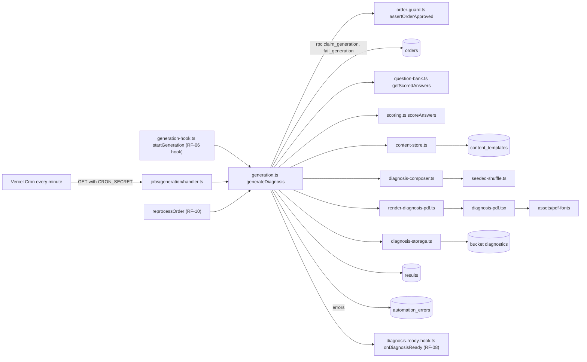

# RF-07. Diagnosis Content and PDF Generation: Technical Specification

PRD: docs/prd/PRD-Descubra-Seu-Estilo.md · Scope covered: full feature (no Core/Full split in the PRD) · Complexity: complex

Interview mode: two decisions were taken with the owner (PDF library, retry mechanism); everything else is marked `(inferred)`. Code facts were re-read from the current code (branch `feat/pagina-coloracao-pessoal-online`, after commit c581eac). The diagnosis texts are written by the team (owner decision of the PRD interview) and reviewed later by Millena through RF-12. The Vercel plan must be **Pro**: the cron of decision 2 runs every minute.

## 1. Technical Overview

**What.** RF-07 turns an approved order into a stored diagnosis and a PDF. `startGeneration(orderId, token)` (the RF-06 hook) now runs the generation. A SQL function reserves the order (`APPROVED` to `PROCESSING`, one attempt counted, a 2-minute lease). The generation reads the 15 saved answers with the questionnaire version of the attempt, scores them with the RF-03 engine, loads the published content templates, composes the four text blocks deterministically, renders an A4 PDF with `@react-pdf/renderer`, uploads it to the private bucket `diagnostics` as `<order id>.pdf`, and only then inserts the `results` row (so a result is never "ready" without its file). On a failure that can be retried, the order stays `PROCESSING` with `generation_next_at` set to 30 seconds, 2 minutes and 10 minutes ahead; a Vercel Cron job calling `GET /api/diagnostico/jobs/generation` every minute picks up the due orders. After the third retry (four attempts) the order becomes `FAILED` with reason `GENERATION_FAILED` and an automation error is recorded. A seed migration publishes content version 1 (24 style blocks, 30 pair paragraphs, 8 pieces and 6 accessories per style) drafted by the team.

**Why.** The customer paid for a personal diagnosis; it must be correct (same answers, same result), individual (not one text for everybody), safe to repeat (webhook retries, cron overlaps and "Reprocessar" must never produce two results or two PDFs) and recoverable (a storage or rendering problem of a few minutes must not lose a paid order). Deterministic composition from editable templates keeps results reproducible and lets Millena edit the text without code (RF-12). A scheduled job is the only way to honor retries spaced in minutes on a serverless platform.

**Scope**

**Included:**
- The generation pipeline: reservation, scoring, content loading, composition, PDF rendering, upload, result saving, success and failure transitions.
- The pure composer (percentages, deterministic picks, the four blocks) and the content store (published templates, completeness check).
- The PDF document (8 parts, A4, 6 to 8 pages, site colors and fonts, wordmark signature) and its renderer with a 10-second limit.
- Private storage upload of the PDF and the stored file reference (`results.pdf_path`).
- Migration `20260101000010_generation_state.sql` (columns on `orders`, functions `claim_generation`, `fail_generation`, `reset_generation`) and migration `20260101000011_seed_content_v1.sql` (the drafted content; generated from a readable source file).
- The cron route `GET /api/diagnostico/jobs/generation`, `vercel.json` with the cron entry, and `CRON_SECRET`.
- `reprocessOrder(orderId)` for RF-10's "Reprocessar" (no screen here), and the hook `onDiagnosisReady` for RF-08.
- Cross-cutting concerns integrated: the approved-order contract and the hook from RF-06 (`startGeneration`, `assertOrderApproved`, `result_tokens`); the scoring engine and score-ready answers from RF-03 (`scoreAnswers`, `getScoredAnswers`); the saved answers and the pinned version from RF-04; customer name and delivery preference from RF-02; `automation_errors` and the paid-order trigger from RF-01; the seeded shuffle from RF-03.
- Input contracts (Consumes): customer name and delivery preference (RF-02, through the attempt of the order); scoring function and style keys (RF-03); saved answers and questionnaire version (RF-04); approved order (RF-06).
- Output contracts (Provides): the diagnosis, that is the `results` row (six points, predominant and secondary style, `content` with the four blocks, `pdf_path`), used by RF-08, RF-09, RF-10 and RF-11; and the editable content templates (`content_versions`, `content_templates`), used by RF-12.

**Deferred:** none.

**Excluded:**
- The result screen, the e-mail, the secure link and `DELIVERED` (RF-08). RF-07 leaves the order `PROCESSING` with the result and the PDF ready.
- The admin screens: "Reprocessar" button and the review of generation errors (RF-10); editing, previewing and publishing templates (RF-12). RF-07 provides the functions and the data.
- Deleting stored PDFs when a customer asks for erasure (RF-09 deletes the file the path points to).
- Any generative AI at request time (PRD: composition is deterministic).
- The text of the customer-facing preparing state (RF-06).

### Requirements / Business Rules (PRD RF-07 Capabilities)

- **Start.** `startGeneration(orderId, token)` calls `assertOrderApproved` and `claim_generation`. Only an order in `APPROVED`, or in `PROCESSING` with `generation_next_at` due, can be claimed; anything else is refused (`OrderNotApprovedError`) or skipped. The claim moves the order to `PROCESSING`, adds 1 to `generation_attempts` and sets `generation_next_at` to now + 2 minutes (the lease); a second claim before the lease ends gets "not claimed".
- **Scoring.** The answers are read with `getScoredAnswers` (the questionnaire version stored on the answers) and scored with `scoreAnswers`. Fewer than 15 answers, or a scoring error, is `INVALID_ANSWERS`: the order becomes `FAILED / INVALID_ANSWERS` at once, without retries, and an automation error is recorded.
- **Content.** The templates of the published `content_versions` row are loaded. For the ordered pair (predominant, secondary) the generation needs: the four `style_block` rows (`result`, `pieces`, `accessories`, `guidance`) of the predominant style, the `result` block of the secondary style, the `pair_paragraph` of the ordered pair, at least 4 `piece` and 3 `accessory` templates in the predominant pool and at least 1 and 1 in the secondary pool. Anything missing is `MISSING_CONTENT`: the order becomes `FAILED / MISSING_CONTENT` at once, without retries; fixing the template and using `reprocessOrder` completes it. The version id used is stored in `results.content.contentVersionId`.
- **Composition (deterministic, no randomness except the seeded pick).**
  - Percentages: each style's share of the total points, rounded by the largest-remainder method so the six values sum to exactly 100.
  - Picks: `shuffleWithSeed(pool, seed)` with seed `<attempt id>:<kind>:<style>` takes 3 pieces and 2 accessories from the predominant pool and 1 and 1 from the secondary pool, in that order, without repeating an item. The same attempt always gets the same picks.
  - Blocks (the reference layout), saved in `results.content.blocks` in this order: "Seu resultado" (predominant text, secondary text, the pair paragraph and the six percentages), "Peças que combinam com você" (the intro text and the 4 pieces), "Acessórios e complementos" (the intro text and the 3 accessories), "Uma orientação especial" (the guidance text of the predominant style).
  - The first name is the first word of `customers.name`. Texts may contain the placeholder `{nome}`, replaced by the first name; an unknown placeholder is a `MISSING_CONTENT` error `(inferred)`.
- **PDF.** `@react-pdf/renderer`, A4 portrait, 6 to 8 pages, at most 2 MB, rendered in at most 10 seconds (a longer render is aborted and counts as a failed attempt). Parts in this order: 1 cover with the customer's name; 2 predominant style result; 3 secondary style result; 4 description of the identified styles and the points distribution; 5 piece suggestions; 6 outfit combinations (the pair paragraph); 7 practical guidance; 8 closing page with Millena Barreto's visual signature. Colors and fonts of the site: tokens `#10151f`, `#475467`, `#937dad`, Bebas Neue for headings, Inter for text (TTF files under `assets/pdf-fonts/`) `(inferred: file names)`. The visual signature is the site wordmark "Millena Barreto" in Bebas Neue with letter spacing, as in the site header (the project has no logo image) `(inferred)`.
- **Storage.** Upload to the private bucket `diagnostics` at path `<order id>.pdf` with upsert, content type `application/pdf`. `results` is inserted only after the upload succeeded, with `pdf_path` = the path, `on conflict (order_id) do nothing`.
- **Idempotency.** Running the generation twice for an order gives one `results` row and one file: the claim blocks overlap; a finished order (`results` exists and the file exists) is never regenerated; a re-run after a crash between upload and insert re-uploads with upsert and inserts once.
- **Retries.** After a retryable failure (rendering error or timeout, storage failure, unexpected error) `fail_generation` sets `generation_next_at` to now + 30 seconds after the 1st attempt, + 2 minutes after the 2nd, + 10 minutes after the 3rd. The 4th failure sets `FAILED / GENERATION_FAILED`. The cron route claims due orders in batches of 5 and runs them one after the other.
- **After success.** The order stays `PROCESSING`, `generation_next_at` is cleared, and `onDiagnosisReady(orderId, token)` is called (`token` is the plain token on the first attempt and `null` when the generation ran from the cron or from `reprocessOrder`; RF-08 then issues a new token). A failure of that hook is recorded in `automation_errors` and does not undo the result.
- **Reprocess.** `reprocessOrder(orderId)` accepts only a `FAILED` order whose reason is `GENERATION_FAILED`, `INVALID_ANSWERS` or `MISSING_CONTENT` and that has a `PAID` payment; it resets the attempts and the schedule, moves the order to `APPROVED` and runs the generation once.
- **Style names (pt-BR)**, in `STYLE_LABELS` of `constants.ts`, shared with RF-08: Esportivo/Natural, Tradicional, Elegante, Romântico, Criativo, Dramático.

### Requirements / UX Flows (PRD RF-07 Experience)

- Internal process. The customer keeps seeing "Estamos preparando seu diagnóstico…" (RF-06), typically under 30 seconds, because the first attempt runs inside the request that approved the order.
- Cron route: an unauthorized call answers 401 and runs nothing.

### Error Handling (PRD RF-07 Error Handling)

- **PDF rendering fails or exceeds 10 seconds:** counted as an attempt, retried per the schedule; the error is recorded in `automation_errors` with the order id and the step `RENDER_PDF`.
- **Fewer than 15 answers or scoring error:** `FAILED / INVALID_ANSWERS`, no retries, error `SCORE_ANSWERS` recorded (flagged to the admin by RF-10).
- **Missing template for a style or pair, or an unknown placeholder:** `FAILED / MISSING_CONTENT`, no retries, error `LOAD_CONTENT` recorded with what is missing (style or pair keys, no personal data).
- **Storage upload fails:** retried per the schedule, error `UPLOAD_PDF` recorded; `results` is not inserted until the file exists.
- **All retries used:** `FAILED / GENERATION_FAILED`, error `GENERATION_FAILED` recorded; `reprocessOrder` can recover it.
- **Hook failure** (`onDiagnosisReady`): recorded as `DIAGNOSIS_READY`; the result stays.
- **Order not approved:** the generation is refused and nothing is created (`OrderNotApprovedError`); the paid-order trigger also blocks `results` and `deliveries` inserts.
- **Concurrent runs:** the loser is not claimed and does nothing.
- **Missing `CRON_SECRET`:** the cron route answers 500 `CONFIG_ERROR` and never runs jobs.
- **Nothing logged:** no answers, names, e-mails, tokens or keys in logs or in `automation_errors` context.

## 2. Architecture Impact

**Affected components:** new `lib/diagnostico/generation.ts`, `lib/diagnostico/diagnosis-composer.ts`, `lib/diagnostico/content-store.ts`, `lib/diagnostico/diagnosis-pdf.tsx`, `lib/diagnostico/render-diagnosis-pdf.ts`, `lib/diagnostico/diagnosis-storage.ts`, `lib/diagnostico/diagnosis-ready-hook.ts`, `lib/diagnostico/schemas/diagnosis-content.ts`, `app/api/diagnostico/jobs/generation/route.ts`, `app/api/diagnostico/jobs/generation/handler.ts`, `assets/pdf-fonts/` (3 TTF files and their license texts), `vercel.json`, migrations `20260101000010_generation_state.sql` and `20260101000011_seed_content_v1.sql`, the content source `docs/RF-07-diagnosis-content-and-pdf-generation/content-source.md`, regenerated `lib/diagnostico/database.types.ts`; modified `lib/diagnostico/generation-hook.ts`, `lib/diagnostico/constants.ts`, `lib/diagnostico/env.ts`, `next.config.mjs`, `package.json`, `.env.example`, and the route files of the webhook and of the payment check (a `maxDuration` export); and the tests of Section 4.

**Diagram**



**Patterns followed** (re-read from the current code)
- Server modules start with `import "server-only"` and use the Vitest alias stub (`lib/diagnostico/generation-hook.ts`, `tests/setup/server-only-stub.ts`); route logic lives in a `handler.ts` next to `route.ts`, with injectable dependencies for tests (`app/api/diagnostico/webhooks/abacatepay/handler.ts`).
- Atomic state changes as SQL functions revoked from `anon` and `authenticated` (`supabase/migrations/20260101000009_payment_confirmation.sql`); domain errors as text codes mapped in code.
- Seed migrations generated from a readable source (`20260101000006_seed_questionnaire_v1.sql` from `docs/RF-03-question-bank-and-scoring-engine/questionnaire-source.md`).
- The pure scoring engine and the score-ready reader (`lib/diagnostico/scoring.ts`, `lib/diagnostico/question-bank.ts`); the seeded shuffle `shuffleWithSeed(items, seed)` (`lib/diagnostico/seeded-shuffle.ts`).
- Failures flagged in `automation_errors` through `recordAutomationError` (`lib/diagnostico/payment-confirmation.ts`).
- Private bucket `diagnostics` (PDF only, at most 2 MB, no policies for browser roles) from `20260101000004_integrity_and_lockdown.sql`.
- Env readers per group with `ConfigError` (`lib/diagnostico/env.ts`); fixed values and status lists in `lib/diagnostico/constants.ts`.
- Integration tests against the local Supabase with the helpers of `tests/integration/diagnostico/helpers.ts`; hand-off tests drive the real routes of earlier features (`tests/integration/diagnostico/payment-handoff.test.ts`).
- The project has no PDF library, no scheduled job and no `vercel.json` (observed); `sharp` is installed but not used here.

## 3. Technical Decisions

| Decision | Chosen Approach | Alternative Considered | Trade-off |
|---|---|---|---|
| PDF library (owner) | `@react-pdf/renderer` with TTF fonts in the repository | `pdf-lib`, `pdfkit` | Declarative layout and quick to maintain; one new dependency and a Next config entry for server external packages |
| Retries (owner) | Vercel Cron every minute plus columns on `orders` and SQL reservation | Immediate retries only; hybrid | The exact schedule of the PRD; needs the Pro plan and a `CRON_SECRET` |
| Content storage | Existing `content_templates` rows (no schema change) seeded by a migration | A code file of texts | Millena can edit through RF-12; the seed is a large generated migration |
| Composition | Pure function: percentages by largest remainder, seeded picks | Random picks | Reproducible results and testable; two customers with the same pair differ only through percentages and picks |
| Result ready | Upload first, then insert `results` | Insert first | A crash between the two leaves a file without a row (harmless, re-uploaded) instead of a row without a file |
| Order after success | Stays `PROCESSING` until RF-08 sets `DELIVERED` | RF-07 sets another state | RF-08 owns the delivery transition |
| Token across retries | Plain token only on the first attempt, `null` afterwards; RF-08 issues a new one | Store the plain token | Nothing secret is stored; RF-08 has two code paths |
| Fatal vs retryable | `INVALID_ANSWERS` and `MISSING_CONTENT` fail at once | Retry everything | No wasted attempts on errors a retry cannot fix; they need a person |
| Duration | Routes that can generate declare `maxDuration = 60` | Default limits | Needs a platform that allows it (Pro) |

**Assumptions** (everything not decided by the owner nor observed is `(inferred)`)
- Interview answers: PDF library a, retries a (Vercel Pro).
- The cron request is a `GET` (Vercel Cron sends GET) authenticated by `Authorization: Bearer <CRON_SECRET>`.
- 8 pieces and 6 accessories per style; a lease of 2 minutes; batches of 5 orders per cron run; the template key layout (`style_block` blocks `result`, `pieces`, `accessories`, `guidance` at position 1; `piece` positions 1 to 8; `accessory` positions 1 to 6; `pair_paragraph` position 1); the placeholder `{nome}`.
- Font files: `BebasNeue-Regular.ttf`, `Inter-Regular.ttf`, `Inter-SemiBold.ttf`, with their SIL Open Font License texts, obtained from the font projects at implementation time.
- Part titles of the PDF: "Seu estilo predominante", "Seu estilo secundário", "Seus estilos em números", "Peças que combinam com você", "Combinações para o seu dia a dia", "Uma orientação especial", closing line "Com carinho, Millena Barreto".
- `outputFileTracingIncludes` is used so the font files are packaged with the routes that render.
- Complexity `complex`: a new library, a job runner, two migrations (one large seed), a multi-step pipeline with retries and recovery.
- Traceability: PRD RF-07 Consumes and Provides feed the Scope and Section 5; Capabilities feed the business rules; Experience the UX flows; Error Handling the error list; the six per-feature criteria and the two cross-feature criteria where RF-07 is the consumer feed Section 7; the cross-feature criteria where RF-07 is the provider (RF-08, RF-09, RF-10, RF-11 and RF-12) are pointers.
- Structural decisions with trade-offs (the cron, the upload-before-insert order, the PDF library) are candidates for an ADR. Gates that `verify-feature` will fire: `dependencies` (new packages) and `schema` (migrations and columns).

## 4. Component Overview

### Backend

| File Path | New/Modified | Purpose | Key Responsibilities |
|---|---|---|---|
| `lib/diagnostico/generation.ts` | New | Pipeline (server-only) | `generateDiagnosis`, `runDueGenerations`, `reprocessOrder`, `GenerationError`; claim, score, load, compose, render, upload, save, fail or retry |
| `lib/diagnostico/diagnosis-composer.ts` | New | Pure composer | `composeDiagnosis`, `percentShares`, deterministic picks, placeholder replacement |
| `lib/diagnostico/content-store.ts` | New | Templates (server-only) | `loadPublishedContent`, completeness check for a style pair, `ContentError` |
| `lib/diagnostico/diagnosis-pdf.tsx` | New | PDF document | The 8 parts with site colors and fonts |
| `lib/diagnostico/render-diagnosis-pdf.ts` | New | Renderer (server-only) | Register fonts, render to bytes, 10 s limit |
| `lib/diagnostico/diagnosis-storage.ts` | New | Storage (server-only) | `diagnosisPdfPath`, `uploadDiagnosisPdf` (upsert) |
| `lib/diagnostico/diagnosis-ready-hook.ts` | New | Hook (server-only) | `onDiagnosisReady(orderId, token)` default that does nothing; replaced by RF-08 |
| `lib/diagnostico/schemas/diagnosis-content.ts` | New | Zod schema | The shape of `results.content` |
| `lib/diagnostico/generation-hook.ts` | Modified | RF-06 hook | `startGeneration` runs `generateDiagnosis` with the plain token |
| `lib/diagnostico/constants.ts` | Modified | Fixed values | `STYLE_LABELS`, generation constants (`MAX_GENERATION_ATTEMPTS`, retry delays) |
| `lib/diagnostico/env.ts` | Modified | Env readers | `getCronEnv` (`CRON_SECRET`) |
| `app/api/diagnostico/webhooks/abacatepay/route.ts`, `app/api/diagnostico/payment/check/route.ts` | Modified | Routes that can run the first attempt | Add `export const maxDuration = 60` |
| `app/api/diagnostico/jobs/generation/route.ts` | New | `GET` entry | Delegate to the handler; `maxDuration = 60` |
| `app/api/diagnostico/jobs/generation/handler.ts` | New | Cron logic | Authenticate `CRON_SECRET`, run due generations, answer a summary |
| `next.config.mjs` | Modified | Build config | `serverComponentsExternalPackages` for the PDF library, `outputFileTracingIncludes` for fonts |
| `vercel.json` | New | Cron schedule | One cron entry every minute for the generation route |
| `package.json` | Modified | Dependencies | `@react-pdf/renderer` (runtime), `pdfjs-dist` (dev, tests), `react` types as needed |
| `.env.example` | Modified | Documentation | `CRON_SECRET` |
| `assets/pdf-fonts/*.ttf`, `assets/pdf-fonts/OFL-*.txt` | New | Fonts | Bebas Neue and Inter with licenses |

### Data

| File Path | New/Modified | Purpose | Key Responsibilities |
|---|---|---|---|
| `supabase/migrations/20260101000010_generation_state.sql` | New | Generation state | Columns on `orders`, index, `claim_generation`, `fail_generation`, `reset_generation` |
| `supabase/migrations/20260101000011_seed_content_v1.sql` | New (generated) | Seed | Content version 1 published with all templates |
| `docs/RF-07-diagnosis-content-and-pdf-generation/content-source.md` | New | Readable source of the seed | Style texts, 30 pair paragraphs, piece and accessory pools, for Millena's review |
| `lib/diagnostico/database.types.ts` | Modified (generated) | Types | Regenerate with `npm run db:types` (write to a temporary file first) |

### Tests

| File Path | New/Modified | Purpose | Key Responsibilities |
|---|---|---|---|
| `tests/unit/diagnostico/diagnosis-composer.test.ts` | New | Composer | Percentages, picks, blocks, placeholders, determinism |
| `tests/unit/diagnostico/diagnosis-content-schema.test.ts` | New | Content shape | Valid and invalid `content` |
| `tests/unit/diagnostico/generation-schedule.test.ts` | New | Constants | Retry delays, attempt limit, style labels |
| `tests/unit/diagnostico/env.test.ts` | Modified | Env | `getCronEnv` |
| `tests/integration/diagnostico/generation-sql.test.ts` | New | SQL functions | Claim, lease, schedule, failure, reset |
| `tests/integration/diagnostico/content-store.test.ts` | New | Seed and loading | Seed completeness, missing-template detection |
| `tests/integration/diagnostico/generation-pdf.test.ts` | New | PDF | Pages, A4, size, parts in order, name on cover |
| `tests/integration/diagnostico/generation.test.ts` | New | Pipeline | Criteria 1, 2, 4, 5, 6, retries, idempotency, errors |
| `tests/integration/diagnostico/generation-job.test.ts` | New | Cron route | Authentication, due orders, batch, overlap |
| `tests/integration/diagnostico/generation-handoff.test.ts` | New | Hand-off (consumer) | RF-02, RF-03, RF-04, RF-06 into RF-07 |
| `tests/integration/diagnostico/schema.test.ts` | Modified | Schema | New columns and seed counts |

## 5. API Contracts

### `GET /api/diagnostico/jobs/generation`

Called by Vercel Cron every minute. Authentication: header `Authorization: Bearer <CRON_SECRET>`. No body. Every answer carries `Cache-Control: no-store`.

```json
{ "processed": 2, "succeeded": 1, "retrying": 1, "failed": 0 }
```

- **200 OK** with the counts above (zeros when nothing is due).
- **401** `UNAUTHORIZED`: missing or wrong secret; nothing runs.
- **500** `CONFIG_ERROR` (no `CRON_SECRET`) or `INTERNAL_ERROR`.

### Module signatures

```ts
// generation.ts (server-only)
type GenerationOutcome =
  | { result: "generated"; orderId: string }
  | { result: "already_generated"; orderId: string }
  | { result: "retry_scheduled"; orderId: string; nextAt: string }
  | { result: "failed"; orderId: string; reason: "GENERATION_FAILED" | "INVALID_ANSWERS" | "MISSING_CONTENT" }
  | { result: "not_claimed"; orderId: string };
type GenerationDeps = {
  renderPdf?: (content: DiagnosisContent) => Promise<Uint8Array>;
  onDiagnosisReady?: (orderId: string, token: string | null) => Promise<void>;
};
function generateDiagnosis(db, orderId: string, options?: { token?: string | null; deps?: GenerationDeps }): Promise<GenerationOutcome>
function runDueGenerations(db, options?: { limit?: number; deps?: GenerationDeps }): Promise<GenerationOutcome[]>
function reprocessOrder(db, orderId: string, options?: { deps?: GenerationDeps }): Promise<GenerationOutcome>
class GenerationError extends Error { code: "INVALID_ANSWERS" | "MISSING_CONTENT" | "RENDER_PDF" | "UPLOAD_PDF" | "UNEXPECTED"; retryable: boolean }

// diagnosis-composer.ts (pure)
type DiagnosisContent = z.infer<typeof diagnosisContentSchema>;   // see Section 6
function percentShares(points: Record<Style, number>): Record<Style, number>   // integers summing to 100
function composeDiagnosis(input: {
  firstName: string; deliveryPreference: DeliveryPreference; attemptId: string; contentVersionId: string;
  scoring: ScoringResult; content: ContentSet;
}): DiagnosisContent

// content-store.ts (server-only)
type ContentSet = { versionId: string; templates: ContentTemplate[] };
function loadPublishedContent(db): Promise<ContentSet>
function assertContentComplete(content: ContentSet, predominant: Style, secondary: Style): void   // throws ContentError
class ContentError extends Error { missing: string[] }

// render-diagnosis-pdf.ts (server-only)
function renderDiagnosisPdf(content: DiagnosisContent, options?: { timeoutMs?: number }): Promise<Uint8Array>

// diagnosis-storage.ts (server-only)
function diagnosisPdfPath(orderId: string): string                       // "<orderId>.pdf"
function uploadDiagnosisPdf(db, orderId: string, bytes: Uint8Array): Promise<string>   // returns the path

// generation-hook.ts (changed) and diagnosis-ready-hook.ts
function startGeneration(orderId: string, token: string): Promise<void>
function onDiagnosisReady(orderId: string, token: string | null): Promise<void>
```

Provided to other features (PRD Provides): the `results` row and `getDiagnosis`-style reads by RF-08 (`results.content`, `predominant_style`, `secondary_style`, `points`, `pdf_path`), RF-09 (deletes `pdf_path`), RF-10 (`reprocessOrder`, `automation_errors`), RF-11 (styles for the message), and `content_versions` / `content_templates` for RF-12.

## 6. Data Model

`results`, `content_versions`, `content_templates` and `automation_errors` already exist (RF-01). New: two columns, one index and three functions (`20260101000010_generation_state.sql`, one transaction):

```sql
alter table public.orders
  add column generation_attempts smallint not null default 0 check (generation_attempts between 0 and 4),
  add column generation_next_at timestamptz;
create index orders_generation_due_idx on public.orders (generation_next_at)
  where status = 'PROCESSING' and generation_next_at is not null;

-- Reserves an order for one generation run. Returns jsonb { claimed, attempt?, reason? }.
-- Claimable: APPROVED, or PROCESSING whose generation_next_at is due (a retry or an expired lease).
create function public.claim_generation(p_order uuid) returns jsonb
language plpgsql as $$
declare
  v_order public.orders%rowtype;
begin
  perform pg_advisory_xact_lock(hashtext('generate:' || p_order::text));
  select * into v_order from public.orders where id = p_order;
  if not found then
    return jsonb_build_object('claimed', false, 'reason', 'not_found');
  end if;
  if v_order.status = 'APPROVED'
     or (v_order.status = 'PROCESSING' and v_order.generation_next_at is not null
         and v_order.generation_next_at <= now()) then
    if v_order.generation_attempts >= 4 then
      return jsonb_build_object('claimed', false, 'reason', 'attempts_exhausted');
    end if;
    update public.orders
       set status = 'PROCESSING',
           generation_attempts = generation_attempts + 1,
           generation_next_at = now() + interval '2 minutes'
     where id = p_order;
    return jsonb_build_object('claimed', true, 'attempt', v_order.generation_attempts + 1);
  end if;
  return jsonb_build_object('claimed', false, 'reason', 'not_claimable');
end $$;

-- Records a failed run. p_retry = false fails the order at once with p_reason; with p_retry = true
-- the next attempt is scheduled (30 s, 2 min, 10 min) or, after the 4th attempt, the order fails
-- with GENERATION_FAILED. Returns jsonb { state: 'retry' | 'failed', next_at?, reason? }.
create function public.fail_generation(p_order uuid, p_reason text, p_retry boolean) returns jsonb
language plpgsql as $$
declare
  v_attempts smallint;
  v_next timestamptz;
begin
  perform pg_advisory_xact_lock(hashtext('generate:' || p_order::text));
  select generation_attempts into v_attempts from public.orders where id = p_order and status = 'PROCESSING';
  if v_attempts is null then
    return jsonb_build_object('state', 'ignored');
  end if;
  if p_retry and v_attempts < 4 then
    v_next := now() + case v_attempts when 1 then interval '30 seconds'
                                      when 2 then interval '2 minutes'
                                      else interval '10 minutes' end;
    update public.orders set generation_next_at = v_next where id = p_order;
    return jsonb_build_object('state', 'retry', 'next_at', v_next);
  end if;
  update public.orders
     set status = 'FAILED',
         failure_reason = case when p_retry then 'GENERATION_FAILED' else p_reason end,
         generation_next_at = null
   where id = p_order;
  return jsonb_build_object('state', 'failed',
    'reason', case when p_retry then 'GENERATION_FAILED' else p_reason end);
end $$;

-- Puts a paid order that failed in generation back to APPROVED with a clean schedule.
create function public.reset_generation(p_order uuid) returns boolean
language plpgsql as $$
begin
  perform pg_advisory_xact_lock(hashtext('generate:' || p_order::text));
  update public.orders o
     set status = 'APPROVED', failure_reason = null, generation_attempts = 0, generation_next_at = null
   where o.id = p_order and o.status = 'FAILED'
     and o.failure_reason in ('GENERATION_FAILED', 'INVALID_ANSWERS', 'MISSING_CONTENT')
     and exists (select 1 from public.payments p where p.order_id = o.id and p.status = 'PAID');
  return found;
end $$;

revoke all on function public.claim_generation(uuid) from public, anon, authenticated;
revoke all on function public.fail_generation(uuid, text, boolean) from public, anon, authenticated;
revoke all on function public.reset_generation(uuid) from public, anon, authenticated;
```

A successful run clears the lease with a plain update (`generation_next_at = null`) and leaves the status `PROCESSING`. The `orders` check `status = 'FAILED' or failure_reason is null` is respected: the reason is set only together with `FAILED` and cleared by `reset_generation`.

**`results.content` shape** (JSON, saved by the pipeline; validated by `diagnosisContentSchema`, read by RF-08):

```json
{
  "contentVersionId": "…",
  "customer": { "firstName": "Maria", "deliveryPreference": "both" },
  "predominant": { "style": "elegante", "label": "Elegante", "percent": 40 },
  "secondary": { "style": "romantico", "label": "Romântico", "percent": 27 },
  "percentages": { "elegante": 40, "romantico": 27, "tradicional": 13, "esportivo_natural": 7, "criativo": 7, "dramatico": 6 },
  "blocks": [
    { "id": "result", "title": "Seu resultado", "paragraphs": ["…predominant text…", "…secondary text…", "…pair paragraph…"] },
    { "id": "pieces", "title": "Peças que combinam com você", "intro": "…", "items": ["…", "…", "…", "…"] },
    { "id": "accessories", "title": "Acessórios e complementos", "intro": "…", "items": ["…", "…", "…"] },
    { "id": "guidance", "title": "Uma orientação especial", "paragraphs": ["…"] }
  ]
}
```

**Seed migration** `20260101000011_seed_content_v1.sql` (generated from `content-source.md`, like the questionnaire seed): creates `content_versions` version 1 with status `published`, and inserts 138 `content_templates` rows: 24 `style_block` (6 styles x blocks `result`, `pieces`, `accessories`, `guidance`, position 1), 30 `pair_paragraph` (every ordered pair of two different styles, position 1), 48 `piece` (6 styles x positions 1 to 8) and 36 `accessory` (6 styles x positions 1 to 6). The texts are drafted by the team and marked as a draft in `content-source.md` for Millena's review through RF-12. Placeholders use `{nome}`.

## 7. Testing Strategy

**Acceptance tests** (PRD Section 9, RF-07: six per-feature criteria; two cross-feature criteria where RF-07 is the consumer; numbered here for reference)

| # | Criterion | Test file :: function |
|---|---|---|
| 1 | Given an approved order, when generation runs, then the order moves to PROCESSING, a result with six scores, a predominant and a secondary style is saved, and a PDF is stored | `tests/integration/diagnostico/generation.test.ts` :: `an approved order is generated: PROCESSING, six scores, both styles saved and the PDF stored`, `results is not inserted before the PDF exists`; `generation-sql.test.ts` :: `claim_generation moves an APPROVED order to PROCESSING and counts the attempt` |
| 2 | Given two customers with the same style pair and different answers, when their diagnoses are compared, then the percentages and the picked pieces and accessories are not identical for both | `tests/unit/diagnostico/diagnosis-composer.test.ts` :: `two answer sets with the same pair give different percentages`, `two attempts with the same pair do not always get the same picks`, `the same attempt always gets the same picks`, `percentages always sum to 100`; `generation.test.ts` :: `two customers with the same pair get different diagnoses` |
| 3 | Given a generated PDF, when it is opened, then it has the customer's name on the cover and the eight required parts in order, at most 2 MB, on A4 | `tests/integration/diagnostico/generation-pdf.test.ts` :: `the PDF has the customer name on the cover`, `the PDF has the eight parts in order`, `the PDF is A4 with 6 to 8 pages`, `the PDF is at most 2 MB`, `the PDF renders in at most 10 seconds`, `a render over the limit is aborted`; `generation.test.ts` :: `the stored file is the PDF of the order` |
| 4 | Given generation runs twice for the same order, when finished, then one result and one PDF exist | `generation.test.ts` :: `generating twice leaves one result and one PDF`, `two overlapping runs generate once`, `a crash between upload and insert is recovered without a second result`; `generation-sql.test.ts` :: `a second claim before the lease ends is not claimed` |
| 5 | Given a failure in PDF rendering, when it occurs, then generation is retried up to 3 times and, if still failing, the order is FAILED (GENERATION_FAILED) with an automation error | `generation.test.ts` :: `a rendering failure schedules a retry in 30 seconds`, `the retries are scheduled at 30 seconds 2 minutes and 10 minutes`, `after the third retry the order is FAILED with GENERATION_FAILED and an automation error`, `a storage failure is retried like a rendering failure`; `generation-sql.test.ts` :: `fail_generation follows the schedule and fails on the fourth attempt`; `generation-job.test.ts` :: `the job runs due retries and skips orders that are not due` |
| 6 | Given a missing template, when generation runs, then it stops with reason MISSING_CONTENT and the error is recorded | `generation.test.ts` :: `a missing template stops with MISSING_CONTENT without retries and records the error`, `fixing the template and reprocessing completes the order`, `fewer than 15 answers stops with INVALID_ANSWERS without retries`; `content-store.test.ts` :: `assertContentComplete names what is missing` |
| C1 (consumer, RF-02 + RF-03 + RF-04 + RF-06 to RF-07) | Given an order approved by RF-06, when RF-07 starts, then it uses the saved answers from RF-04, the customer name and preference from RF-02, and the scoring function from RF-03 | `tests/integration/diagnostico/generation-handoff.test.ts` :: `an order approved through the real RF-06 webhook is generated from the real answers name and scoring` |
| C2 (consumer, RF-06 to RF-07) | Given an order that is not approved in RF-06, when RF-07 is asked to generate, then it is refused | `generation-handoff.test.ts` :: `a PENDING order is refused by startGeneration and creates nothing`; `generation.test.ts` :: `generateDiagnosis refuses a FAILED order that was never paid` |
| P1 to P5 (provider) | RF-08 opens the result link with that diagnosis and PDF; RF-09 deletes the stored file; RF-10 shows answers, points and statuses together; RF-11 builds the message from name, both styles and link; RF-12 publishes edited templates used by new orders | Covered by the hand-off tests of RF-08, RF-09, RF-10, RF-11 and RF-12, implemented after this feature |

**Supporting tests**
- `diagnosis-composer.test.ts`: `percentShares uses the largest remainder`, `percentShares of equal points sums to 100`, `the predominant text comes first then the secondary text then the pair paragraph`, `three pieces and two accessories come from the predominant pool and one and one from the secondary`, `no item repeats`, `{nome} is replaced by the first name`, `an unknown placeholder is rejected`, `the four blocks come in the order of the layout`, `composition does not use randomness or the clock`.
- `diagnosis-content-schema.test.ts`: `accepts the documented content`, `rejects percentages that do not sum to 100`, `rejects fewer than 4 pieces or 3 accessories`.
- `generation-schedule.test.ts`: `the retry delays are 30 seconds 2 minutes and 10 minutes`, `the attempt limit is 4`, `every style has a label`.
- `generation-sql.test.ts`: `claim_generation refuses an order that is not APPROVED or due`, `an expired lease can be claimed again`, `claim_generation refuses after four attempts`, `fail_generation with retry false fails at once with the given reason`, `reset_generation only resets a paid order that failed in generation`.
- `content-store.test.ts`: `the seed publishes version 1 with 24 style blocks 30 pair paragraphs 48 pieces and 36 accessories`, `every ordered pair of two different styles has a paragraph`, `every style pool has at least 8 pieces and 6 accessories`, `no template is empty`, `loadPublishedContent loads the published version only`, `a deleted pair paragraph is reported as missing`.
- `generation.test.ts`: `an unexpected error is retried`, `INVALID_ANSWERS and MISSING_CONTENT are not retried`, `onDiagnosisReady receives the plain token on the first attempt and null on a retry`, `a hook failure is recorded and the result stays`, `the order stays PROCESSING after success`, `answers are scored with the version stored on them`, `no personal data in automation error context`, `reprocessOrder runs the generation once for a failed paid order`.
- `generation-job.test.ts`: `the job without the secret returns 401 and runs nothing`, `a wrong secret returns 401`, `the job without CRON_SECRET configured returns CONFIG_ERROR`, `the job processes at most five orders per run`, `overlapping job runs do not double-generate`.
- `schema.test.ts` (changed): `orders has generation_attempts and generation_next_at`, `the generation functions are not callable by browser roles`.
- `env.test.ts` (changed): `getCronEnv names the missing CRON_SECRET`.
- Existing suites (RF-05, RF-06) must keep passing: the RF-06 hand-off tests pass an injected `startGeneration`.

**Proof (how each criterion is proven):** all criteria `fake`: the real local database and the real storage of the local Supabase are used, with the real PDF renderer; there is no external provider and no AI model. The PDF is inspected by parsing it with `pdfjs-dist` (page count, page size, text per page, size on disk).

**Live check: not applicable.** No criterion depends on an external provider or an AI model; Vercel Cron and the production storage are not exercised by a test (see "Not tested here").

**Verification script: not applicable.** No criterion depends on the DOM: generation is an internal process and the customer-facing state belongs to RF-06. The structure of the PDF is checked by tests. **Manual check for the owner (not part of the verdict):** generate one PDF locally from a sample answer set and look at it, to review layout, colors and the drafted texts with Millena.

**Hand-off tests (cross-feature, owned by RF-07 as consumer)**
- C1: `generation-handoff.test.ts` :: `an order approved through the real RF-06 webhook is generated from the real answers name and scoring`. It registers a customer through the real RF-02 route (name, delivery preference), saves the 15 answers through the real RF-04 route, opens the real RF-05 checkout, sends a signed notification to the real RF-06 webhook handler with the real `startGeneration` hook (a fake gateway reporting the charge as paid), and asserts: the order is `PROCESSING`; `results` exists for it; its `points`, `predominant_style` and `secondary_style` equal what `scoreAnswers(getScoredAnswers(...))` gives for those exact answers; `content.customer.firstName` is the first name typed in the registration and `deliveryPreference` the one chosen; the PDF exists in the bucket and its cover text contains the name. No mocking of the contracts between the features.
- C2: `generation-handoff.test.ts` :: `a PENDING order is refused by startGeneration and creates nothing`. It creates the order through the real checkout and calls `startGeneration` without approval; it asserts `OrderNotApprovedError`, no `results` row, no file in the bucket, order still `PENDING`.
- P1 to P5 (RF-07 is the **provider**; no test here): covered by the hand-off tests of RF-08 to RF-12, implemented after this feature.

**Test data and fixtures:** integration tests use the local Supabase (run `npm run db:reset` first so migrations `…10` and `…11` exist), the helpers of `tests/integration/diagnostico/helpers.ts` (`createCustomer`, `createAttempt`, `fillAnswers`, `createOrderWithPayment`, `recordingGateway`) plus a helper that creates an `APPROVED` order with 15 answers and a name; templates for missing-content tests are deleted inside the test and restored in `finally` (or a throwaway content version is used); the PDF renderer is replaced through `GenerationDeps.renderPdf` in failure tests, and the storage failure is produced with an order id the bucket rejects or an injected uploader `(inferred)`. Time is simulated by updating `generation_next_at` in the database. Every test removes its customers (orders, results cascade) and its uploaded files in `afterAll`.

**Not tested here:** the e-mail and the result screen (RF-08); Vercel Cron actually firing and `maxDuration` on the platform; the production storage; deletion of stored PDFs (RF-09); the admin "Reprocessar" button and template editing screens (RF-10, RF-12); the quality and tone of the drafted texts (the owner's review).
