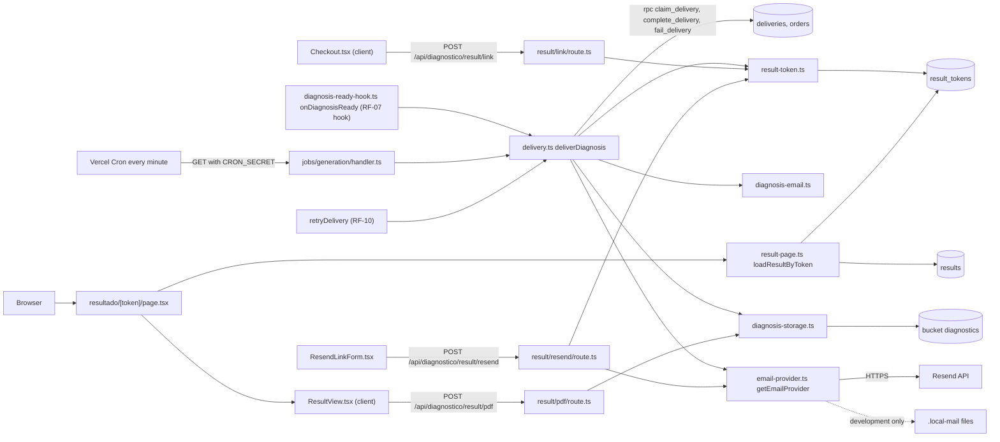

# RF-08. Result Screen and E-mail Delivery: Technical Specification

PRD: docs/prd/PRD-Descubra-Seu-Estilo.md · Scope covered: full feature (no Core/Full split in the PRD) · Complexity: complex

Interview mode: two decisions were taken with the owner (editorial images, how e-mails are seen locally); everything else is marked `(inferred)`. Code facts were re-read from the current code (branch `feat/pagina-coloracao-pessoal-online`, after commit 80be8c9). The e-mail provider (Resend) was never exercised against the real service: it is confirmed only by the live check of Section 7, which needs the owner's approval, a test key and a verified sender.

## 1. Technical Overview

**What.** RF-08 closes the customer journey. (1) The result screen `/diagnostico-estilo/resultado/[token]` shows the stored diagnosis (RF-07) to whoever holds a valid link. (2) The e-mail delivery: when the diagnosis is ready, the RF-07 hook `onDiagnosisReady` sends one e-mail through an `EmailProvider` (Resend in production, local files in development) with the secure link and the PDF attached; the order becomes `DELIVERED` when the provider accepts it; a failed send is retried at 1, 5 and 15 minutes by the cron job that already runs the generations, and after the last failure the delivery is `FAILED` and the order `FAILED / DELIVERY_FAILED`. (3) The link re-request page `/diagnostico-estilo/resultado`, where a customer types the e-mail and receives a new link. (4) The bridge from the waiting screen: the payment check route reports `resultReady`, and the checkout screen then asks for a fresh link (`POST /api/diagnostico/result/link`) and moves the customer to the result screen by itself. A PDF download route creates a signed storage URL (5 minutes) at the click.

**Why.** The customer paid for a diagnosis and must receive it even if the browser tab was closed (e-mail with retries), see it right away when the tab is open (result screen), and recover it if the e-mail is lost (re-request). Tokens are random, stored only as hashes and bound to one order, so a link grants access to exactly one diagnosis and can expire or be revoked. Every delivery attempt is recorded so failures are visible to the admin (RF-10) and recoverable (RF-10 "Reprocessar", RF-11).

**Scope**

**Included:**
- The result page (server) and its client parts (soft entry animation, PDF button, automatic refresh while preparing), with the states ready, preparing, unpaid and invalid link.
- The link re-request page and form, and `POST /api/diagnostico/result/resend`.
- `POST /api/diagnostico/result/pdf` (signed URL) and `POST /api/diagnostico/result/link` (fresh token for the cookie's attempt).
- The `EmailProvider` interface with the Resend implementation and the development implementation (files in `.local-mail/`), the pure e-mail template (HTML and plain text), and the delivery pipeline with retries and its SQL functions (migration).
- The real `onDiagnosisReady` (replaces the RF-07 default), the cron extension (the same job now also runs due deliveries), `retryDelivery` for RF-10.
- The result token helpers (generate, hash, mint, look up) and the style-image map `STYLE_IMAGES` (all empty: owner decision, a reserved placeholder is shown).
- Changes to files of earlier features: the payment check handler (adds `resultReady`), `Checkout.tsx` (moves to the result), the cron handler of RF-07, `env.ts`, `.env.example`, `.gitignore`, `paths.ts`, `constants.ts`.
- Cross-cutting concerns integrated: the approved order and the result token contract of RF-06 (`result_tokens`, `hashToken`); the diagnosis, the `results.content` shape and the PDF of RF-07 (`diagnosisContentSchema`, `diagnostics` bucket, `onDiagnosisReady`); the cron route and `CRON_SECRET` of RF-07; `deliveries` and `automation_errors` of RF-01; `hit_rate_limit` and `clientIpHash` of RF-02; the attempt cookie of RF-02.
- Input contracts (Consumes): the approved order, its status and the result access token (RF-06); the diagnosis (styles, points, text blocks) and the PDF (RF-07).
- Output contracts (Provides), as in the PRD: delivery records (`deliveries` row of channel `email`: status, `attempts`, `last_error`, `sent_at`, `next_attempt_at`) and the secure result link (the token mechanism and `resultLinkUrl`), used by RF-10 and RF-11.

**Deferred:** none.

**Excluded:**
- The editorial images themselves (owner decision: a reserved placeholder is shown until the owner supplies six images).
- The WhatsApp delivery and its queue (RF-11): RF-08 creates only the e-mail delivery row `(inferred)`.
- Admin screens: listing deliveries, "Reprocessar", "Reenviar e-mail" (RF-10); the privacy page and retention jobs (RF-09, RF-08 only honors expiry).
- Real sending until the owner provides the Resend account, a verified domain and the sender (`EMAIL_FROM`).
- An unsubscribe flow or marketing e-mail (the e-mail is transactional).

### Requirements / Business Rules (PRD RF-08 Capabilities)

- **Result token.** 32 random bytes, base64url (`generateResultToken`); only `sha256` hex of the token is stored in `result_tokens` (same `hashToken` as RF-06); valid 30 days; bound to one order; revocable (`revoked_at`). An order may have several valid tokens (the e-mail link, the link for the waiting screen, re-requested links) `(inferred)`.
- **Result page.** `/diagnostico-estilo/resultado/[token]` is rendered on the server (`force-dynamic`, no index, `referrer: no-referrer` so the token never leaves in a Referer header). Resolution of the token, in this order:
  1. unknown, expired (`expires_at` passed) or revoked token: no data, only "Este link expirou ou não é válido. Peça um novo link." with a link to `/diagnostico-estilo/resultado`;
  2. the order has no `PAID` payment and is not `APPROVED`, `PROCESSING`, `DELIVERED` (or `FAILED / DELIVERY_FAILED`): only "Pagamento ainda não confirmado";
  3. the order is paid but the `results` row does not exist yet: the preparing state ("Estamos preparando seu diagnóstico…"), refreshed by the client every 5 seconds;
  4. otherwise the result screen from `results.content`.
  A paid order whose delivery failed (`FAILED / DELIVERY_FAILED`) still shows the result `(inferred)`.
- **Result screen content** (the reference layout): "MILLENA BARRETO"; "SEU DIAGNÓSTICO DE ESTILO"; the editorial image of the predominant style, or, while `STYLE_IMAGES[style]` is empty (owner decision), a reserved block with the accent color and the style name in Bebas Neue; "SEU ESTILO PREDOMINANTE" with the style name in large type and its percentage; "Seu segundo estilo: <name>"; the four blocks "Seu resultado", "Peças que combinam com você", "Acessórios e complementos", "Uma orientação especial" with their paragraphs and lists; the button "Baixar meu diagnóstico em PDF", always visible (fixed at the bottom on small screens); the note "Também enviamos uma cópia para o seu e-mail."
- **PDF download.** `POST /api/diagnostico/result/pdf` with `{ token }` validates the token like the page, requires an existing `results` row with `pdf_path`, creates a **signed storage URL valid 300 seconds** at that moment and returns it; the browser navigates to it. At most 20 calls per hour per token hash (`hit_rate_limit`) `(inferred)`.
- **E-mail.** Always sent to `customers.email`, whatever the delivery preference (`email`, `whatsapp` or `both`). Subject "Seu diagnóstico de estilo chegou!". Sender name "Millena Barreto" (`EMAIL_FROM`, a verified domain). HTML (table layout, inline styles, colors `#10151f`, `#937dad`, white) and a plain-text alternative: greeting with the first name, the predominant and secondary style names, a short result text (the first paragraph of the "Seu resultado" block cut at a sentence end, up to about 280 characters `(inferred)`), the button "Ver meu diagnóstico completo" pointing to the secure link, and the PDF attached (`diagnostico-de-estilo.pdf`). If the PDF is larger than 2 MB the e-mail goes with the link only and the event is logged (`automation_errors`, step `EMAIL_ATTACHMENT`).
- **Secure link.** `<APP_URL>/diagnostico-estilo/resultado/<token>`. On the first run the plain token comes from RF-06 through `onDiagnosisReady(orderId, token)`; when it is `null` (cron retry, reprocess) RF-08 mints a new token for the e-mail `(inferred)`.
- **Delivery pipeline.** `onDiagnosisReady` calls `deliverDiagnosis(orderId, token)`: `claim_delivery` creates the `deliveries` row (channel `email`) if missing and reserves it for one send (lease of 2 minutes, `attempts + 1`); the e-mail is built and sent; on provider acceptance `complete_delivery` sets the delivery `SENT` (`sent_at`) and the order `DELIVERED` (`delivered_at`); on failure `fail_delivery` records `last_error` (technical message only) and schedules the next attempt at 1, 5 and 15 minutes (four attempts in total) or, after the fourth failure, sets the delivery `FAILED`, the order `FAILED / DELIVERY_FAILED` and records `automation_errors` step `DELIVERY_FAILED`. The job route also picks up deliveries whose retry is due, expired leases, and `PROCESSING` orders that have a result but no delivery row (the hook never ran) after one minute. An order is never `DELIVERED` before the result exists.
- **Retry by an admin.** `retryDelivery(orderId)` (for RF-10): a `FAILED` delivery of an order `FAILED / DELIVERY_FAILED` that has a result goes back to `PENDING`, attempts 0, the order to `PROCESSING`, and one send runs.
- **Link re-request.** `/diagnostico-estilo/resultado` has a form with the e-mail. `POST /api/diagnostico/result/resend` always answers "Se existir um diagnóstico para este e-mail, enviaremos um novo link." (HTTP 200, same body and similar timing). If a customer with that e-mail has an order with a result within retention (latest by `created_at`), a new token is minted and the e-mail (link and PDF) is sent through the provider. At most 3 requests per e-mail per hour (key `resendlink:email:<sha256 of the lower-cased e-mail>`) and 10 per hour per IP (`resendlink:ip:<ip hash>`) `(inferred)`; over the limit the answer is the same and nothing is sent. The re-request does not change the original `deliveries` row; a send failure is recorded in `automation_errors` (step `RESEND_LINK`).
- **Waiting screen bridge.** `POST /api/diagnostico/payment/check` also returns `resultReady: true` when the order is paid and its `results` row exists. The checkout screen then calls `POST /api/diagnostico/result/link` (cookie required), which mints a new token for the latest paid order with a result of the cookie's attempt and returns `{ path: "/diagnostico-estilo/resultado/<token>" }`; the screen navigates there once. At most 5 calls per hour per attempt `(inferred)`.
- **Providers.** `getEmailProvider()` returns the development provider only when `emailSimulationEnabled()` is true (`ENABLE_EMAIL_SIMULATION=true` and `NODE_ENV` not `production`); otherwise the Resend provider, which needs `RESEND_API_KEY` and `EMAIL_FROM`. The development provider writes `<timestamp>-<recipient>.html`, `.txt` and `.pdf` to `.local-mail/` (git-ignored) and never sends anything; `EMAIL_SIMULATION_FAIL=true` makes it fail. The Resend provider calls `POST https://api.resend.com/emails` with `Authorization: Bearer <key>`, `from`, `to`, `subject`, `html`, `text` and `attachments: [{ filename, content (base64) }]`, with a 10-second timeout `(inferred: request shape, confirmed by the live check)`.
- **WhatsApp.** The delivery preference does not stop the e-mail. RF-08 does not create the `whatsapp` delivery row (RF-11 owns that queue).

### Requirements / UX Flows (PRD RF-08 Experience)

- The result screen is mobile-first (one column, 24 px side padding, no horizontal scroll at 360 px), with a soft entry animation (fade and 16 px rise, 400 ms, disabled for reduced motion `(inferred)`), the download button always visible (fixed bar at the bottom on small screens), and the note about the e-mail copy.
- The preparing state: heading "Estamos preparando seu diagnóstico…", refreshed every 5 seconds without a visible reload; when the result appears it replaces the state.
- The expired-link state: the message "Este link expirou ou não é válido. Peça um novo link." and a button "Pedir novo link" to the re-request page; nothing else about the order.
- The re-request page: title "Pedir novo link", one field (e-mail), the button "Enviar novo link"; after submitting, the neutral message "Se existir um diagnóstico para este e-mail, enviaremos um novo link." replaces the form; while sending the button shows "Enviando…".
- Download button: "Baixar meu diagnóstico em PDF"; while the URL is requested "Preparando PDF…"; if the request fails "Não conseguimos gerar o PDF agora. Tente novamente." `(inferred)`.
- Waiting screen: after approval and `resultReady` the screen goes to the result without a click.
- Messages in pt-BR, conversational, no technical wording; site tokens and classes only (`font-primary`, `.btn`, `.btn-accent`, `.input`).

### Error Handling (PRD RF-08 Error Handling)

- **E-mail provider rejects or times out:** counted as an attempt, `last_error` recorded, retried at 1, 5 and 15 minutes; the customer can still read the result on screen. After the last failure the delivery is `FAILED`, the order `FAILED / DELIVERY_FAILED`, an automation error recorded, and `retryDelivery` recovers it.
- **Invalid, expired or revoked token:** no data, only the expired-link message (page) and `404 NOT_FOUND` with no details (PDF route).
- **Order not approved:** only "Pagamento ainda não confirmado".
- **Attachment larger than 2 MB:** the e-mail goes with the link only; the event is logged in `automation_errors` (`EMAIL_ATTACHMENT`).
- **PDF missing in storage** when the e-mail is built: the e-mail goes with the link only and the event is recorded `(inferred)`; on the PDF route the answer is `404`.
- **Result link route without a valid cookie:** 403 `FORBIDDEN`; the screen goes to `EXPIRED_PATH`. Without a paid order with a result yet: 409 `RESULT_NOT_READY`.
- **Rate limits:** the PDF and link routes answer 429 `RATE_LIMITED` with `Retry-After`; the re-request always answers the neutral message.
- **Missing configuration** (`APP_URL`, `RESEND_API_KEY`, `EMAIL_FROM`) outside simulation: the delivery attempt fails as a retryable error with a message that names the variable and no value; routes answer 500 `CONFIG_ERROR`.
- **Nothing sensitive logged:** no tokens, no e-mail addresses, no names in logs or in `automation_errors` context; only the order id and codes.

## 2. Architecture Impact

**Affected components:** new `app/diagnostico-estilo/resultado/[token]/page.tsx`, `app/diagnostico-estilo/resultado/page.tsx`, `components/Diagnostico/ResultView.tsx`, `components/Diagnostico/ResendLinkForm.tsx`, `app/api/diagnostico/result/pdf/route.ts`, `app/api/diagnostico/result/link/route.ts`, `app/api/diagnostico/result/resend/route.ts` (each with a `handler.ts`), `lib/diagnostico/result-token.ts`, `lib/diagnostico/result-page.ts`, `lib/diagnostico/diagnosis-email.ts`, `lib/diagnostico/email-provider.ts`, `lib/diagnostico/resend.ts`, `lib/diagnostico/email-provider-simulated.ts`, `lib/diagnostico/email-simulation.ts`, `lib/diagnostico/delivery.ts`, `lib/diagnostico/style-images.ts`, `lib/diagnostico/schemas/result-requests.ts`, migration `20260101000012_delivery.sql`, regenerated `lib/diagnostico/database.types.ts`; modified `lib/diagnostico/diagnosis-ready-hook.ts`, `lib/diagnostico/diagnosis-storage.ts`, `app/api/diagnostico/jobs/generation/handler.ts` (the due-delivery selection lives in `delivery.ts`), `app/api/diagnostico/payment/check/handler.ts`, `components/Diagnostico/Checkout.tsx`, `lib/diagnostico/checkout-state.ts`, `lib/diagnostico/paths.ts`, `lib/diagnostico/constants.ts`, `lib/diagnostico/env.ts`, `lib/diagnostico/errors.ts`, `.env.example`, `.gitignore`; and the tests of Section 4.

**Diagram**



**Patterns followed** (re-read from the current code)
- Server modules start with `import "server-only"` and use the Vitest alias stub; route logic lives in a `handler.ts` next to `route.ts` with injectable dependencies (`app/api/diagnostico/webhooks/abacatepay/handler.ts`, `app/api/diagnostico/jobs/generation/handler.ts`).
- Provider interfaces with a real and a development implementation selected by a simulation switch that is false in production (`lib/diagnostico/pix-gateway.ts`, `lib/diagnostico/payment-simulation.ts`); recording fakes in tests (`tests/integration/diagnostico/helpers.ts` `recordingGateway`).
- Atomic state changes as SQL functions revoked from browser roles, errors recorded in `automation_errors` through `recordAutomationError` (`lib/diagnostico/automation-errors.ts`, migrations `…09` and `…10`).
- Tokens: `hashToken` (sha256 hex) and the `result_tokens` table (`lib/diagnostico/payment-confirmation.ts`, `supabase/migrations/20260101000002_orders_and_delivery.sql`).
- Neutral, rate-limited answers for flows that must not reveal whether an e-mail exists use `hit_rate_limit` (`lib/diagnostico/attempts.ts`); the IP is hashed by `clientIpHash` (`lib/diagnostico/request-ip.ts`).
- Server pages are `force-dynamic`, `noindex`, use `redirect` and client components for interaction (`app/diagnostico-estilo/checkout/page.tsx`, `components/Diagnostico/Checkout.tsx`).
- Design tokens and global classes only, checked by `tests/unit/diagnostico/design-tokens.test.ts`; fonts Bebas Neue and Inter.
- Env readers per group with `ConfigError` (`lib/diagnostico/env.ts`): `getEmailEnv` (`RESEND_API_KEY`, `EMAIL_FROM`) exists; `getAppEnv` also demands `PRIVACY_CONTACT_EMAIL`, so RF-08 adds a reader for `APP_URL` alone.
- Storage signed URLs: the bucket is private with no policies (`supabase/migrations/20260101000004_integrity_and_lockdown.sql`); the service role creates them.
- Security headers on `/diagnostico-estilo/:path*` and `/api/:path*` come from `next.config.mjs`.

## 3. Technical Decisions

| Decision | Chosen Approach | Alternative Considered | Trade-off |
|---|---|---|---|
| Editorial image (owner) | A reserved placeholder block plus a `STYLE_IMAGES` map, empty until six images exist | Provisional portfolio photos; images supplied now | No unlicensed or unrelated photo; the screen is plainer until the images arrive |
| E-mail in development (owner) | The development provider writes HTML, TXT and PDF to `.local-mail/` | SMTP to the Inbucket mail catcher; a dev viewer page | No new dependency and no change to the shared Supabase; the owner opens files instead of a mailbox UI |
| Provider contract | `EmailProvider` interface, Resend by `fetch`, development implementation | Resend SDK only | Same pattern as the payment gateway; no new package; the request shape is confirmed only by a live check |
| Retries | The existing per-minute cron also runs due deliveries; schedule 1, 5, 15 minutes | A separate cron, in-request retries | One scheduler; needs the Pro plan already required by RF-07 |
| Order after a failed delivery | `FAILED / DELIVERY_FAILED`, the result stays viewable | Keep `PROCESSING` | Matches the failure reasons of RF-01 and RF-10; a paid order in `FAILED` still shows its result |
| Token for the waiting screen | A fresh token minted from the cookie's attempt | Passing the plain token to the browser; a cookie-based result page | The plain token never reaches the browser outside an e-mail or a mint; several valid tokens per order |
| Token for the e-mail | The plain token from RF-06 on the first run, a new one on retries | Store the plain token | Nothing secret is stored |
| Re-request | Always the same answer, limits per e-mail and per IP, no change to `deliveries` | Different answers per case | No e-mail enumeration; the re-request is not shown in the original delivery record |
| PDF access | A signed URL created at the click, 300 seconds | A public URL; streaming through our server | Short-lived access straight from storage; the route is rate limited |
| Referrer | `referrer: no-referrer` on the result page | Default policy | The token never leaves in a Referer header |

**Assumptions** (everything not decided by the owner nor observed is `(inferred)`)
- Interview answers: images a, local e-mail files a.
- Migration `20260101000012_delivery.sql`; SQL result values `claimed`, `no_result`, `already_sent`, `not_due`, `attempts_exhausted`; delivery attempt limit 4 and delays 1, 5, 15 minutes (`DELIVERY_RETRY_DELAYS_SECONDS`).
- Token lifetime 30 days (`RESULT_TOKEN_DAYS`); limits: 20 PDF calls per hour per token, 5 link calls per hour per attempt, 3 re-requests per hour per e-mail and 10 per hour per IP.
- E-mail layout details (short text of about 280 characters, `diagnostico-de-estilo.pdf` as the file name, button text), the soft entry animation values, the messages that the PRD does not give, and the file naming of `.local-mail/`.
- The re-request looks at the **latest** order with a result of the customers that have that e-mail; "within retention" means that the order and its result still exist (RF-09 deletes them) and the PDF still exists.
- The cron job answer now also reports deliveries (`deliveries` counts).
- Complexity `complex`: an external provider, a retrying pipeline with a migration, three routes with tokens and rate limits, three screens or states, and changes to four earlier features.
- Traceability: PRD RF-08 Consumes and Provides feed the Scope and Section 5; Capabilities feed the business rules; Experience the UX flows; Error Handling the error list; the eight per-feature criteria and the cross-feature criterion where RF-08 is the consumer feed Section 7; the cross-feature criteria where RF-08 is the provider (RF-10, RF-11) are pointers.
- Structural decisions with trade-offs (the failed-delivery state, the token for the waiting screen, sharing the cron) are candidates for an ADR. Gates that `verify-feature` will fire: `schema` (the migration) and `security` (tokens, signed URLs, secrets, rate limits).

## 4. Component Overview

### Frontend

| File Path | New/Modified | Purpose | Key Responsibilities |
|---|---|---|---|
| `app/diagnostico-estilo/resultado/[token]/page.tsx` | New | Result page (server) | Resolve the token, render ready, preparing, unpaid or invalid states, `noindex`, `no-referrer` |
| `app/diagnostico-estilo/resultado/page.tsx` | New | Re-request page (server) | Title, form, link back |
| `components/Diagnostico/ResultView.tsx` | New | Result screen (client) | Layout of the reference, entry animation, PDF button with the signed URL, refresh while preparing |
| `components/Diagnostico/ResendLinkForm.tsx` | New | Re-request form (client) | E-mail field, submit, the neutral message |
| `components/Diagnostico/Checkout.tsx` | Modified | Checkout (client) | When `resultReady`, ask for a link and navigate to the result |
| `lib/diagnostico/style-images.ts` | New | Image map | `STYLE_IMAGES` (empty), `styleImageFor(style)` |
| `lib/diagnostico/checkout-state.ts` | Modified | Pure helpers | Add the `resultReady` rule to the view helpers |
| `lib/diagnostico/paths.ts` | Modified | Addresses | Add `RESULT_PATH`, `resultPathFor(token)` |

### Backend

| File Path | New/Modified | Purpose | Key Responsibilities |
|---|---|---|---|
| `app/api/diagnostico/result/pdf/route.ts`, `handler.ts` | New | `POST` signed PDF URL | Validate the token, rate limit, create the 300-second URL |
| `app/api/diagnostico/result/link/route.ts`, `handler.ts` | New | `POST` fresh link | Authenticate by cookie, rate limit, mint a token, answer the path |
| `app/api/diagnostico/result/resend/route.ts`, `handler.ts` | New | `POST` re-request | Neutral answer, limits, mint and send |
| `lib/diagnostico/result-token.ts` | New | Tokens (server-only) | `generateResultToken`, `mintResultToken`, `findResultToken`, `resultLinkUrl` |
| `lib/diagnostico/result-page.ts` | New | Page data (server-only) | `loadResultByToken` returning the four states |
| `lib/diagnostico/diagnosis-email.ts` | New | Pure template | `renderDiagnosisEmail` (subject, HTML, text) |
| `lib/diagnostico/email-provider.ts` | New | Provider contract (server-only) | `EmailProvider`, `EmailMessage`, `EmailProviderError`, `getEmailProvider` |
| `lib/diagnostico/resend.ts` | New | Resend client (server-only) | Send over HTTPS with timeout and error mapping, never log the key |
| `lib/diagnostico/email-provider-simulated.ts` | New | Development provider (server-only) | Write HTML, TXT and PDF to `.local-mail/`, optional failure |
| `lib/diagnostico/email-simulation.ts` | New | Guard | `emailSimulationEnabled` (false in production) |
| `lib/diagnostico/delivery.ts` | New | Pipeline (server-only) | `deliverDiagnosis`, `runDueDeliveries`, `retryDelivery`, `sendResultLinkEmail`, `DeliveryError` |
| `lib/diagnostico/diagnosis-ready-hook.ts` | Modified | RF-07 hook | `onDiagnosisReady` runs `deliverDiagnosis` |
| `lib/diagnostico/diagnosis-storage.ts` | Modified | Storage | Add `createSignedPdfUrl` (300 seconds) and `pdfSize` |
| `lib/diagnostico/schemas/result-requests.ts` | New | Zod schemas | Token body, e-mail body |
| `app/api/diagnostico/jobs/generation/handler.ts` | Modified | Cron job | Also run due deliveries; report both counts |
| `app/api/diagnostico/payment/check/handler.ts` | Modified | Payment check | Add `resultReady` to the approved answer |
| `lib/diagnostico/env.ts` | Modified | Env readers | Add `getAppUrlEnv` (`APP_URL` only) |
| `lib/diagnostico/constants.ts` | Modified | Fixed values | `RESULT_TOKEN_DAYS`, `DELIVERY_RETRY_DELAYS_SECONDS`, `MAX_DELIVERY_ATTEMPTS`, `PDF_SIGNED_URL_SECONDS` |
| `lib/diagnostico/errors.ts` | Modified | Error codes | Add `RESULT_NOT_READY` |
| `.env.example`, `.gitignore` | Modified | Documentation and hygiene | `ENABLE_EMAIL_SIMULATION`, `EMAIL_SIMULATION_FAIL`, `APP_URL`; ignore `.local-mail/` |

### Data

| File Path | New/Modified | Purpose | Key Responsibilities |
|---|---|---|---|
| `supabase/migrations/20260101000012_delivery.sql` | New | Atomic delivery state | Functions `claim_delivery`, `complete_delivery`, `fail_delivery`, `reset_delivery` |
| `lib/diagnostico/database.types.ts` | Modified (generated) | Types | Regenerate with `npm run db:types` (write to a temporary file first) |

### Tests

| File Path | New/Modified | Purpose | Key Responsibilities |
|---|---|---|---|
| `tests/unit/diagnostico/diagnosis-email.test.ts` | New | Template | Subject, name, styles, link, text version, escaping, trimmed text |
| `tests/unit/diagnostico/resend-provider.test.ts` | New | Resend client with a fake `fetch` | Request shape, attachment, errors, timeout, key never in errors |
| `tests/unit/diagnostico/email-provider.test.ts` | New | Selection and development provider | Simulation only outside production, files written, failure switch |
| `tests/unit/diagnostico/result-token.test.ts` | New | Pure token helpers | Length, encoding, hash, link URL |
| `tests/unit/diagnostico/result-requests-schema.test.ts` | New | Schemas | Token and e-mail bodies |
| `tests/unit/diagnostico/env.test.ts`, `checkout-state.test.ts` | Modified | Env and helpers | `getAppUrlEnv`, the `resultReady` rule |
| `tests/integration/diagnostico/delivery-sql.test.ts` | New | SQL functions | Claim, lease, schedule, completion, failure, reset |
| `tests/integration/diagnostico/delivery.test.ts` | New | Pipeline | E-mail contents, DELIVERED, retries, attachment limit, preferences, tokens |
| `tests/integration/diagnostico/result-page.test.ts` | New | Page data | Ready, preparing, unpaid, invalid, expired, revoked |
| `tests/integration/diagnostico/result-routes.test.ts` | New | PDF, link and resend routes | Signed URL, limits, neutral answer, cookie rules |
| `tests/integration/diagnostico/result-handoff.test.ts` | New | Hand-off (consumer) | RF-06 and RF-07 into RF-08 |
| `tests/integration/diagnostico/payment-check-route.test.ts`, `generation-job.test.ts` | Modified | Existing routes | `resultReady`, the job also runs deliveries |
| `tests/live/resend-email.live.test.ts` | New | Live check | One real e-mail with the PDF |

## 5. API Contracts

### `POST /api/diagnostico/result/pdf`

Public (the token is the credential). Body (JSON, at most 64 KB): `{ "token": "<43 URL-safe characters>" }`. `Cache-Control: no-store`.

```json
{ "url": "http://127.0.0.1:54321/storage/v1/object/sign/diagnostics/5d7f….pdf?token=…", "expiresInSeconds": 300 }
```

- **200 OK** the signed URL, valid 300 seconds from the call.
- **404** `NOT_FOUND` (no details): unknown, expired or revoked token, no result or no stored PDF.
- **429** `RATE_LIMITED` with `Retry-After` (20 per hour per token).
- **400** `VALIDATION_ERROR` or `INVALID_JSON`; **500** `INTERNAL_ERROR`.

### `POST /api/diagnostico/result/link`

Authentication: the signed cookie `ds_attempt`. No body. Mints a token for the latest paid order of the attempt that has a result.

```json
{ "path": "/diagnostico-estilo/resultado/Zk3p…" }
```

- **200 OK** the path of the result screen.
- **403** `FORBIDDEN`: no cookie, invalid signature, attempt not found or expired.
- **409** `RESULT_NOT_READY`: no paid order with a result yet.
- **429** `RATE_LIMITED` (5 per hour per attempt); **500** `INTERNAL_ERROR`.

### `POST /api/diagnostico/result/resend`

Public. Body: `{ "email": "maria@example.com" }` (valid e-mail, at most 254 characters, lower-cased).

```json
{ "message": "Se existir um diagnóstico para este e-mail, enviaremos um novo link." }
```

- **200 OK** always the same body, for a known e-mail, an unknown one and an over-limit one.
- **400** `VALIDATION_ERROR` only for a malformed body (not an e-mail), `INVALID_JSON`, `PAYLOAD_TOO_LARGE`.
- **500** `INTERNAL_ERROR`.

### `POST /api/diagnostico/payment/check` (changed, RF-06)

The approved answer gains a field:

```json
{ "state": "approved", "orderStatus": "PROCESSING", "resultReady": true }
```

`resultReady` is `true` when the order is paid and its `results` row exists, `false` otherwise.

### `GET /api/diagnostico/jobs/generation` (changed, RF-07)

The same cron route now also runs due deliveries:

```json
{ "processed": 2, "succeeded": 1, "retrying": 1, "failed": 0, "deliveries": { "processed": 1, "sent": 1, "retrying": 0, "failed": 0 } }
```

### Module signatures

```ts
// result-token.ts (server-only)
function generateResultToken(): string                                   // 32 random bytes, base64url
function mintResultToken(db, orderId: string): Promise<string>           // stores the hash, 30 days, returns the plain token
function findResultToken(db, token: string): Promise<{ orderId: string } | null>   // null when unknown, expired or revoked
function resultLinkUrl(token: string): string                            // <APP_URL>/diagnostico-estilo/resultado/<token>

// result-page.ts (server-only)
type ResultPageState =
  | { state: "invalid" }
  | { state: "unpaid" }
  | { state: "preparing"; orderId: string }
  | { state: "ready"; orderId: string; content: DiagnosisContent; hasPdf: boolean };
function loadResultByToken(db, token: string): Promise<ResultPageState>

// diagnosis-email.ts (pure)
function renderDiagnosisEmail(input: { firstName: string; predominantLabel: string; secondaryLabel: string; resultText: string; link: string }):
  { subject: string; html: string; text: string }
function shortResultText(paragraph: string, maxChars?: number): string   // cut at a sentence end

// email-provider.ts (server-only)
type EmailMessage = { to: string; subject: string; html: string; text: string; attachments?: { filename: string; content: Uint8Array }[] };
interface EmailProvider { send(message: EmailMessage): Promise<{ providerId: string }> }
class EmailProviderError extends Error { code: "EMAIL_UNAVAILABLE" | "EMAIL_REJECTED" | "EMAIL_BAD_RESPONSE" }
function getEmailProvider(): EmailProvider                               // development provider only when emailSimulationEnabled()
function emailSimulationEnabled(): boolean                               // email-simulation.ts; false in production

// delivery.ts (server-only)
type DeliveryOutcome =
  | { result: "sent"; orderId: string }
  | { result: "already_sent"; orderId: string }
  | { result: "retry_scheduled"; orderId: string; nextAt: string }
  | { result: "failed"; orderId: string }
  | { result: "not_claimed"; orderId: string };
type DeliveryDeps = { provider?: EmailProvider; loadPdf?: (db, orderId: string) => Promise<Uint8Array | null> };
function deliverDiagnosis(db, orderId: string, options?: { token?: string | null; deps?: DeliveryDeps }): Promise<DeliveryOutcome>
function runDueDeliveries(db, options?: { limit?: number; deps?: DeliveryDeps }): Promise<DeliveryOutcome[]>
function retryDelivery(db, orderId: string, options?: { deps?: DeliveryDeps }): Promise<DeliveryOutcome>
function sendResultLinkEmail(db, orderId: string, options?: { deps?: DeliveryDeps }): Promise<void>   // used by the re-request; never touches `deliveries`

// diagnosis-storage.ts (added)
function createSignedPdfUrl(db, orderId: string, seconds?: number): Promise<string>   // default 300
```

Provided to other features (PRD Provides): the `deliveries` rows of channel `email` (`status` `PENDING`, `SENT`, `FAILED`; `attempts`; `last_error`; `sent_at`; `next_attempt_at`) and the order status `DELIVERED` / `FAILED / DELIVERY_FAILED` for RF-10; `mintResultToken` and `resultLinkUrl` for RF-11 (the link in the WhatsApp message); `retryDelivery` for the admin "Reprocessar".

## 6. Data Model

No new table or column. Used: `deliveries (order_id, channel, status, attempts, last_error, next_attempt_at, sent_at, marked_by, unique (order_id, channel))`, `result_tokens (order_id, token_hash unique, expires_at, revoked_at)`, `results`, `orders`, `automation_errors` (all RF-01). The paid-order trigger of RF-01 allows a `deliveries` insert only for an order in `APPROVED`, `PROCESSING` or `DELIVERED`. Migration `20260101000012_delivery.sql` (one transaction):

```sql
-- Reserves the e-mail delivery of an order for one send; creates the row on the first call.
-- Returns jsonb { claimed, attempt?, reason? }.
create function public.claim_delivery(p_order uuid) returns jsonb
language plpgsql as $$
declare
  v_delivery public.deliveries%rowtype;
begin
  perform pg_advisory_xact_lock(hashtext('deliver:' || p_order::text));
  if not exists (select 1 from public.results where order_id = p_order) then
    return jsonb_build_object('claimed', false, 'reason', 'no_result');
  end if;
  insert into public.deliveries (order_id, channel) values (p_order, 'email')
    on conflict (order_id, channel) do nothing;
  select * into v_delivery from public.deliveries where order_id = p_order and channel = 'email';
  if v_delivery.status = 'SENT' then
    return jsonb_build_object('claimed', false, 'reason', 'already_sent');
  end if;
  if v_delivery.status = 'FAILED' then
    return jsonb_build_object('claimed', false, 'reason', 'failed');
  end if;
  if v_delivery.next_attempt_at is not null and v_delivery.next_attempt_at > now() then
    return jsonb_build_object('claimed', false, 'reason', 'not_due');
  end if;
  if v_delivery.attempts >= 4 then
    return jsonb_build_object('claimed', false, 'reason', 'attempts_exhausted');
  end if;
  update public.deliveries
     set attempts = attempts + 1, next_attempt_at = now() + interval '2 minutes'
   where id = v_delivery.id;
  return jsonb_build_object('claimed', true, 'attempt', v_delivery.attempts + 1);
end $$;

-- The provider accepted the e-mail: the delivery is SENT and the order DELIVERED.
create function public.complete_delivery(p_order uuid) returns void
language plpgsql as $$
begin
  perform pg_advisory_xact_lock(hashtext('deliver:' || p_order::text));
  update public.deliveries
     set status = 'SENT', sent_at = now(), next_attempt_at = null, last_error = null
   where order_id = p_order and channel = 'email';
  update public.orders set status = 'DELIVERED', delivered_at = now()
   where id = p_order and status = 'PROCESSING';
end $$;

-- A failed send: schedule the next attempt (1, 5, 15 minutes) or end the delivery after the 4th.
-- Returns jsonb { state: 'retry' | 'failed' | 'ignored', next_at? }.
create function public.fail_delivery(p_order uuid, p_error text) returns jsonb
language plpgsql as $$
declare
  v_attempts smallint;
  v_next timestamptz;
begin
  perform pg_advisory_xact_lock(hashtext('deliver:' || p_order::text));
  select attempts into v_attempts from public.deliveries
    where order_id = p_order and channel = 'email' and status = 'PENDING';
  if v_attempts is null then
    return jsonb_build_object('state', 'ignored');
  end if;
  if v_attempts < 4 then
    v_next := now() + case v_attempts when 1 then interval '1 minute'
                                      when 2 then interval '5 minutes'
                                      else interval '15 minutes' end;
    update public.deliveries set last_error = left(p_error, 500), next_attempt_at = v_next
     where order_id = p_order and channel = 'email';
    return jsonb_build_object('state', 'retry', 'next_at', v_next);
  end if;
  update public.deliveries set status = 'FAILED', last_error = left(p_error, 500), next_attempt_at = null
   where order_id = p_order and channel = 'email';
  update public.orders set status = 'FAILED', failure_reason = 'DELIVERY_FAILED'
   where id = p_order and status = 'PROCESSING';
  return jsonb_build_object('state', 'failed');
end $$;

-- A failed delivery of a paid order with a result goes back in line (admin "Reprocessar").
create function public.reset_delivery(p_order uuid) returns boolean
language plpgsql as $$
begin
  perform pg_advisory_xact_lock(hashtext('deliver:' || p_order::text));
  update public.deliveries d
     set status = 'PENDING', attempts = 0, next_attempt_at = null, last_error = null
   where d.order_id = p_order and d.channel = 'email' and d.status = 'FAILED'
     and exists (select 1 from public.results r where r.order_id = p_order)
     and exists (select 1 from public.orders o where o.id = p_order
                 and o.status = 'FAILED' and o.failure_reason = 'DELIVERY_FAILED');
  if not found then
    return false;
  end if;
  update public.orders set status = 'PROCESSING', failure_reason = null where id = p_order;
  return true;
end $$;

revoke all on function public.claim_delivery(uuid) from public, anon, authenticated;
revoke all on function public.complete_delivery(uuid) from public, anon, authenticated;
revoke all on function public.fail_delivery(uuid, text) from public, anon, authenticated;
revoke all on function public.reset_delivery(uuid) from public, anon, authenticated;
```

Notes: the schedule and the limit of four attempts mirror `MAX_DELIVERY_ATTEMPTS` and `DELIVERY_RETRY_DELAYS_SECONDS` in `constants.ts`; a test keeps both in sync. A delivery in `PENDING` whose lease expired (`next_attempt_at` in the past) is claimable again. The `orders` check `status = 'FAILED' or failure_reason is null` is respected because the reason is set only with `FAILED` and cleared when the order leaves it.

## 7. Testing Strategy

**Acceptance tests** (PRD Section 9, RF-08: eight per-feature criteria; one cross-feature criterion where RF-08 is the consumer; numbered here for reference)

| # | Criterion | Test file :: function |
|---|---|---|
| 1 | Given a delivered order, when the customer opens the result link, then the screen shows the predominant style, the secondary style, the four blocks and the PDF button | `tests/integration/diagnostico/result-page.test.ts` :: `a valid token of a delivered order returns the ready state with the diagnosis`, `the ready state carries both styles the percentages and the four blocks`; verification script steps 1, 2 |
| 2 | Given an expired or unknown token, when the link opens, then no result data is shown, only the expired-link message | `result-page.test.ts` :: `an unknown token returns the invalid state`, `an expired token returns the invalid state`, `a revoked token returns the invalid state`, `the invalid state carries no order data`; `result-routes.test.ts` :: `the PDF route answers 404 for an invalid token`; verification script steps 5, 6 |
| 3 | Given the order is PROCESSING, when the result link opens, then the preparing state is shown | `result-page.test.ts` :: `a paid order without a result returns the preparing state`, `an order that was never paid returns the unpaid state`; verification script step 7 |
| 4 | Given a delivered order, when the e-mail is sent, then the subject is "Seu diagnóstico de estilo chegou!", it contains the first name, both style names, the secure link and the PDF | `tests/unit/diagnostico/diagnosis-email.test.ts` :: `the subject is Seu diagnóstico de estilo chegou!`, `the html and the text contain the first name both styles and the link`; `tests/integration/diagnostico/delivery.test.ts` :: `the e-mail has the subject the first name both styles the secure link and the PDF attached`, `a delivered order is DELIVERED and the delivery SENT`; live check L1; verification script step 3 |
| 5 | Given the customer chose WhatsApp only, when the order is approved, then the e-mail is still sent | `delivery.test.ts` :: `a customer who chose whatsapp only still gets the e-mail`, `the e-mail goes to the registered address whatever the preference`; verification script step 4 |
| 6 | Given the e-mail provider fails, when sending, then 3 retries run at 1, 5 and 15 minutes and, if all fail, the delivery is FAILED with an automation error | `delivery.test.ts` :: `a provider failure schedules a retry in 1 minute`, `the retries are scheduled at 1 5 and 15 minutes`, `after the third retry the delivery is FAILED the order FAILED and an automation error recorded`, `the result can still be read after the delivery failed`; `delivery-sql.test.ts` :: `fail_delivery follows the schedule and fails on the fourth attempt`; `generation-job.test.ts` :: `the job also runs due deliveries` |
| 7 | Given the re-request page, when a registered paid e-mail is typed, then a new link is sent, and when an unknown e-mail is typed, then the same message is shown and nothing is sent | `result-routes.test.ts` :: `a registered e-mail with a result gets a new link by e-mail`, `an unknown e-mail gets the same answer and no e-mail`, `the answer body is identical for known unknown and limited e-mails`, `the fourth request in an hour sends nothing and answers the same`, `the per-IP limit sends nothing and answers the same`; verification script step 8 |
| 8 | Given the PDF button is clicked, when the file is requested, then a signed URL valid for 5 minutes is used | `result-routes.test.ts` :: `the PDF route returns a signed URL valid for 300 seconds`, `the signed URL downloads the PDF of the order`, `the signed URL expires`, `the PDF route is rate limited per token`; `tests/unit/diagnostico/result-token.test.ts` :: `the signed URL lifetime is 300 seconds` (constant); verification script step 2 |
| H1 (consumer, RF-06 + RF-07 to RF-08) | Given a diagnosis from RF-07 and an approved order from RF-06, when RF-08 opens the result link, then the screen shows that diagnosis and the PDF of that order | `tests/integration/diagnostico/result-handoff.test.ts` :: `a diagnosis generated through the real RF-06 and RF-07 flow is shown by the result link with its own PDF` |
| P1, P2 (provider) | RF-10 shows delivery status with the order detail; RF-11 builds the WhatsApp message with the secure link | Covered by the hand-off tests of RF-10 and RF-11, implemented after this feature |

**Supporting tests**
- `diagnosis-email.test.ts`: `the text version has no html and carries the link`, `a name with special characters is escaped in the html`, `shortResultText cuts at a sentence end within the limit`, `the button text is Ver meu diagnóstico completo`.
- `resend-provider.test.ts`: `sends from to subject html text and the attachment in base64`, `sends the bearer key and never puts it in an error`, `a 4xx answer becomes EMAIL_REJECTED`, `a 5xx or a network failure becomes EMAIL_UNAVAILABLE`, `an answer without an id becomes EMAIL_BAD_RESPONSE`, `a slow answer is aborted at the timeout`.
- `email-provider.test.ts`: `the development provider is used only when simulation is enabled outside production`, `never in production`, `the development provider writes the html text and pdf files`, `EMAIL_SIMULATION_FAIL makes it fail`, `the Resend provider is used when simulation is off`.
- `result-token.test.ts`: `a token has 43 url-safe characters`, `two tokens differ`, `the hash is sha256 hex`, `resultLinkUrl joins APP_URL and the token`.
- `result-requests-schema.test.ts`: `the token body accepts 43 url-safe characters and rejects the rest`, `the e-mail body lower-cases and rejects invalid addresses`.
- `delivery-sql.test.ts`: `claim_delivery creates the row and counts the attempt`, `a second claim before the lease ends is not claimed`, `claim_delivery refuses an order without a result`, `complete_delivery marks SENT and the order DELIVERED`, `fail_delivery with a failing provider ends in FAILED and the order FAILED with DELIVERY_FAILED`, `reset_delivery only resets a failed delivery of a paid order with a result`, `the retry delays match the constants`.
- `delivery.test.ts`: `the delivery row is created for the e-mail channel only`, `a token from RF-06 is used for the link on the first attempt`, `a null token gets a new token minted`, `a PDF larger than 2 MB goes as a link only and the event is logged`, `a missing PDF goes as a link only`, `two overlapping runs send once`, `a missing APP_URL fails as a retryable error naming the variable`, `no personal data in the delivery error records`, `retryDelivery runs one send for a failed delivery`, `the result link e-mail does not change the delivery row`.
- `result-routes.test.ts`: `the link route without a cookie gets 403`, `the link route before the result exists gets 409 RESULT_NOT_READY`, `the link route returns a path that loads the result`, `the link route is rate limited per attempt`, `a malformed e-mail gets 400`.
- `payment-check-route.test.ts` (changed): `an approved order with a result answers resultReady true`, `an approved order without a result answers resultReady false`.
- `result-page.test.ts`: `a paid order whose delivery failed still shows the result`, `a token of another order never shows this order`.
- `design-tokens.test.ts` and `security-headers.test.ts` (existing) must keep passing for the new pages and components.

**Proof (how each criterion is proven):** criteria 1, 2, 3, 5, 6, 7, 8 and H1 are `fake` (the real local database, storage and signed URLs, the development provider or a recording fake provider; no external service). Criterion 4 is `both`: the e-mail contents and the delivery rules are proven with the fake provider, and the real Resend acceptance (request shape, the sender, the attachment) by live check L1. Criteria 1, 2, 3, 5, 7 and 8 also have the browser verification script because they depend on what the customer sees or does.

**Live checks:**
- **L1** (criterion 4): `tests/live/resend-email.live.test.ts` :: `sends one real e-mail with the PDF attached through Resend`. It builds one e-mail with `renderDiagnosisEmail` and a small sample PDF and sends it through the Resend provider to the address in `LIVE_EMAIL_TO`, from the sender in `EMAIL_FROM`, with a **test or restricted key** in `RESEND_API_KEY`. Model: not applicable. Cost cap: one e-mail, within the free tier. Minimal assertions: the provider answers with a message id; the request was accepted without error. Evidence: the message id prefix, the status, the commit; never the key or the address. It never runs without the owner's approval for that run, reads the key from the environment and never prints it.
- Until the owner approves and provides the account, the verified sender and a recipient, L1 is `live pending` and criterion 4 stays `— (live pending)`.

**Verification script** (real browser against the running app and the local Supabase; viewport 360 x 740 unless stated; this session's own port from `.env.local`; `ENABLE_PAYMENT_SIMULATION=true`, `PAYMENT_SIMULATION_PAID_AFTER_SECONDS=10`, `ENABLE_EMAIL_SIMULATION=true`, `APP_URL` set to the local address; throwaway e-mails `verif-rf08-…@example.com`, deleted afterwards together with `.local-mail/` files):
1. Register (preference "E-mail"), answer the 15 questions, open the checkout and wait for the simulated payment. Expected: after "Pagamento confirmado!" and "Estamos preparando seu diagnóstico…" the screen moves by itself to the result screen at `/diagnostico-estilo/resultado/<token>`, which shows "MILLENA BARRETO", "SEU DIAGNÓSTICO DE ESTILO", a reserved block with the predominant style name, "SEU ESTILO PREDOMINANTE" with the style name in large type and a percentage, "Seu segundo estilo: <name>", the four blocks "Seu resultado", "Peças que combinam com você", "Acessórios e complementos", "Uma orientação especial", the button "Baixar meu diagnóstico em PDF" visible without scrolling, and the note "Também enviamos uma cópia para o seu e-mail."; no horizontal scroll. Proves criterion 1.
2. Press "Baixar meu diagnóstico em PDF". Expected: the button reads "Preparando PDF…" and then a PDF request to the storage signed URL returns 200 with a PDF content type; the URL carries a short-lived token (valid 5 minutes, checked in the database or by the `exp` of the token). Proves criterion 8.
3. Open `.local-mail/`. Expected: one e-mail for the customer, the HTML has the subject "Seu diagnóstico de estilo chegou!", the first name, both style names, the button "Ver meu diagnóstico completo" whose link is the same result address, a plain-text file and the PDF file; the database has the delivery `SENT` and the order `DELIVERED`. Proves criterion 4 (fake part).
4. Repeat steps 1 and 3 with a new customer whose preference is "WhatsApp". Expected: the e-mail file is created anyway. Proves criterion 5.
5. Open the result link in a new private window (no cookies). Expected: the result screen shows (the token alone is the credential). Then change one character of the token in the address. Expected: only "Este link expirou ou não é válido. Peça um novo link." with a button "Pedir novo link"; no style, no name. Proves criterion 2.
6. In the database set `revoked_at` of that token and reload. Expected: the same expired-link message. Then set `expires_at` in the past on another token: the same message. Proves criterion 2.
7. In the database leave an approved order without a `results` row (delete the row of a throwaway order) and open its token link. Expected: "Estamos preparando seu diagnóstico…", refreshed by itself; when the result row is restored, the screen changes to the result without a manual reload within about 10 seconds. Proves criterion 3.
8. Open `/diagnostico-estilo/resultado` and type the e-mail of a customer with a delivered order. Expected: the form is replaced by "Se existir um diagnóstico para este e-mail, enviaremos um novo link." and a new e-mail file appears. Type an unknown e-mail: the same message and no file. Type the first e-mail three more times: the message is the same and only two further files exist in total (3 per hour). Proves criterion 7.
9. Failure and boundary states: restart the server with `EMAIL_SIMULATION_FAIL=true`, run a purchase, and open the result link from the waiting screen. Expected: the result is shown even though the e-mail failed; the database shows the delivery `PENDING` with a next attempt about 1 minute ahead. At 1280 px wide the result screen stays centered and readable; with reduced motion the entry animation is skipped. Proves criterion 6 (screen part).

**Hand-off tests (cross-feature, owned by RF-08 as consumer)**
- H1: `result-handoff.test.ts` :: `a diagnosis generated through the real RF-06 and RF-07 flow is shown by the result link with its own PDF`. It registers through the real RF-02 route, saves the 15 answers through the real RF-04 route, opens the real RF-05 checkout, sends a signed notification to the real RF-06 webhook handler (a fake gateway reports the charge as paid) with the real generation and the real delivery hook (the development provider writes to a temporary folder), then reads the plain token from the `.local-mail` e-mail link and asserts: `loadResultByToken` returns the ready state with the predominant and secondary styles of that order's `results` row; the signed URL of the PDF route downloads exactly the file stored for that order; a second customer's order never appears under this token. No mocking of the contracts between the features.
- P1, P2 (RF-08 is the **provider**; no test here): covered by the hand-off tests of RF-10 and RF-11, implemented after this feature.

**Test data and fixtures:** integration tests use the local Supabase (run `npm run db:reset` first so migration `…12` exists), the helpers of `tests/integration/diagnostico/helpers.ts` (`createApprovedOrder`, `recordingGateway`) plus a helper that generates the diagnosis of an approved order with the real pipeline and a recording fake `EmailProvider`; the development provider writes to a temporary folder set by an option, never to the project folder; time is simulated by updating `next_attempt_at`; tokens are minted with `mintResultToken`; the storage files of each test are removed in `afterAll`. The unit tests of Resend use a fake `fetch` and never a key.

**Not tested here:** real Resend delivery until L1 runs; the admin views of deliveries and "Reprocessar" (RF-10); WhatsApp (RF-11); deletion of data and files (RF-09); the editorial images (not supplied); automated browser tests in CI (the script is a manual plan for the evaluator).
