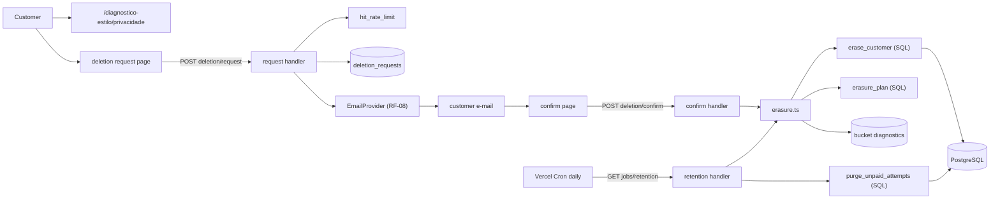

# RF-09. Privacy and LGPD Compliance: Technical Specification

PRD: docs/prd/PRD-Descubra-Seu-Estilo.md · Scope covered: full feature (no Core/Full split in the PRD) · Complexity: medium

Interview mode: four decisions were taken with the owner (how anonymized payments are kept, who triggers the daily job, who the controller is in the policy, what happens to orders in flight); everything else is marked `(inferred)`. Code facts were re-read from the current code (branch `feat/pagina-coloracao-pessoal-online`, after commit 9b1dfbd). The policy text is a draft written by the team: Millena or a legal adviser must review it before go-live (PRD RF-09). The deletion and notice e-mails use the `EmailProvider` of RF-08, whose real provider (Resend) is confirmed only by the live check of RF-08.

Owner decisions that this spec follows:
1. Anonymized payments stay in place: `orders.attempt_id` becomes nullable with `ON DELETE SET NULL`; deleting a customer detaches the paid orders and clears what identifies the person.
2. The daily retention job is a **daily** Vercel Cron entry (allowed on the Hobby plan), protected by `CRON_SECRET`. The per-minute generation cron stays off (owner decision after RF-08).
3. The policy names "Millena Barreto" as controller and the e-mail of `PRIVACY_CONTACT_EMAIL` as the contact channel; no document number.
4. A deletion request that finds an order in flight (`APPROVED` or `PROCESSING`) waits and finishes in a later run; an unpaid order is deleted at once.

One deliberate narrowing of decision 4: an unpaid order is **deleted** (order and payment rows), not kept as an anonymous shell. A payment that arrives for it later is then handled by the code RF-06 already has for a charge that matches no order (`WEBHOOK_UNKNOWN_CHARGE` in `automation_errors`, with the charge id), so the owner still sees it and can refund. No new error step and no change to RF-06 or RF-07 is needed for it.

## 1. Technical Overview

**What.** RF-09 gives the customer control over personal data and makes the platform delete data on schedule. (1) A **privacy policy page** `/diagnostico-estilo/privacidade` in plain language (the footer link and the registration consent text already point to this address; the page does not exist yet), also linked from the footer of the e-mails. (2) A **deletion request flow**: the customer types the e-mail on `/diagnostico-estilo/privacidade/exclusao`, gets a confirmation e-mail with a link valid 24 hours, opens `/diagnostico-estilo/privacidade/exclusao/[token]`, confirms with a button, and the system deletes the customer, attempts, answers, consent, results, tokens, deliveries and stored PDFs, keeping only anonymized payment data, then confirms by e-mail. (3) A **daily retention job** `GET /api/diagnostico/jobs/retention` that finishes pending deletions, deletes unpaid attempts older than 7 days and paid customer data older than 12 months, and removes stale deletion requests. (4) **Scope and log guarantees**: no customer-facing route returns another customer's data, and logs never carry names, e-mails, phone numbers or tokens; both are proven by tests.

**Why.** The platform collects name, e-mail, WhatsApp, questionnaire answers and a diagnosis, so the LGPD requires clear information, a working deletion right and limited retention. Doing the erasure in one atomic SQL function (after the files are removed from storage) makes it complete or retryable, never half done. Keeping the paid order and payment anonymized satisfies the fiscal and audit need without keeping the person.

**Scope**

**Included:**
- The policy page (server component, content in a typed module so the retention numbers come from the same constants the job uses), the footer link of the diagnosis e-mail, and the contact channel from `PRIVACY_CONTACT_EMAIL`.
- The request page and form, the confirmation page and button, `POST /api/diagnostico/privacy/deletion/request` and `POST /api/diagnostico/privacy/deletion/confirm`.
- The deletion e-mails (confirmation link, completion notice) as pure templates sent through the RF-08 `EmailProvider`.
- The erasure pipeline: plan, remove PDFs from storage, atomic SQL erase; shared by the deletion flow and the retention job.
- The retention job (route, handler, `runRetention`) and its daily `vercel.json` entry.
- The migration (nullable `orders.attempt_id`, `deletion_requests.last_error`, erasure and retention functions).
- The scope guarantee test and the no-personal-data-in-logs test.
- Changes to files of earlier features, additive: `lib/diagnostico/diagnosis-email.ts` and `delivery.ts` (footer link), `generation.ts` and `delivery.ts` (an order without an attempt must not crash), `diagnosis-storage.ts` (remove PDFs), `constants.ts`, `paths.ts`, `errors.ts`, `env.ts` (no change expected: `getAppEnv` already reads `PRIVACY_CONTACT_EMAIL`), `.env.example`, `vercel.json`.
- Cross-cutting concerns integrated: the consent record and contact data of RF-02 (`customers`, `purchase_attempts`, `consent_records`); the stored PDF `{orderId}.pdf` in the private bucket `diagnostics` and the `results`, `result_tokens` and `deliveries` rows of RF-07 and RF-08; the e-mail provider, `hit_rate_limit`, `clientIpHash`, `CRON_SECRET` and `recordAutomationError` of RF-02, RF-07 and RF-08.
- Input contracts (Consumes): the consent record and contact data from RF-02 (customer name, e-mail, WhatsApp, delivery preference, `consent_records` row); the stored PDF references from RF-07 (`results.pdf_path`, file name `diagnosisPdfPath(orderId)`).
- Output contracts (Provides): none in the PRD for RF-09.

**Deferred:** none.

**Excluded:**
- Data export or portability (the PRD lists deletion only).
- The admin screens for deletion requests (RF-10); here the owner sees problems as `automation_errors` rows.
- Cookie banner and analytics consent (no analytics in the diagnosis flow `(inferred)`).
- Deleting data held by operators (Supabase, Vercel, AbacatePay, Resend) outside this system: the policy tells the customer which operators exist; the platform deletes only its own database and bucket.
- The legal review of the policy text.

### Requirements / Business Rules (PRD RF-09 Capabilities)

- **Policy page.** `/diagnostico-estilo/privacidade`, server-rendered, indexable, no personal data. Sections `(inferred)`: who we are; data we collect (name, e-mail, WhatsApp, delivery preference, questionnaire answers, diagnosis and PDF, payment status and identifiers); what for; how long we keep it (7 days for an unpaid attempt, 12 months for paid customer data, 30 days for a result link, 24 hours for a deletion link, anonymized payment record kept for fiscal and audit purposes); your rights (access, correction, deletion, information, withdrawal of consent) and how to use them; who processes the data (Supabase, Vercel, AbacatePay, Resend); security; contact and last update date. The controller line reads "Millena Barreto"; the contact line shows `PRIVACY_CONTACT_EMAIL` (owner decision 3). The numbers in the text are read from `constants.ts`.
- **Deletion request.** `POST .../deletion/request` takes `{ email }`. Always answers the neutral message "Se existirem dados para este e-mail, enviaremos um link de confirmação." with HTTP 200. When at least one `customers` row has the e-mail, a `deletion_requests` row is created (token of 32 random bytes in base64url, only `sha256` hex stored, `expires_at = now() + 24 hours`) and the confirmation e-mail with the link is sent. At most 3 requests per e-mail per hour (key `deletionreq:email:<sha256 of the lower-cased e-mail>`) and 10 per hour per IP (`deletionreq:ip:<ip hash>`) `(inferred)`; over the limit the answer is the same and nothing is created or sent. Both limits count every request, so neither can be probed.
- **Confirmation.** The e-mail link opens the confirmation page, which shows a short explanation and the button "Confirmar exclusão". Only the click (`POST .../deletion/confirm` with `{ token }`) deletes; opening the link changes nothing, so a mail scanner that fetches links cannot trigger it `(inferred)`. The confirm call marks the request confirmed (once, idempotent) and runs the erasure at once. The answer is `{ state: "completed" }` when everything was erased, or `{ state: "pending" }` when an order is in flight or a step failed (the daily job finishes it).
- **What is erased** (per customer with the e-mail, all attempts): `consent_records`, `answers`, `purchase_attempts` and `customers` rows; for orders that have a `PAID` payment: `results`, `deliveries` and `result_tokens` rows and the stored PDF are deleted, `payments.pix_br_code` and `payments.pix_qr_image` are cleared, the matching `webhook_events.payload` is replaced by `{"anonymized": true}` `(inferred: the v2 event payload may carry payer data)`, and `orders.attempt_id` becomes `NULL` through the foreign key; what remains is order id, amount, status, `approved_at` and `delivered_at` dates and the payment id, status, charge id and dates (owner decision 1). For orders without a `PAID` payment: the order, its payments, tokens and deliveries are deleted (see the narrowing above). `automation_errors` rows stay: they hold technical messages and ids, never personal data (RF-08 rule).
- **In flight (owner decision 4).** If any order of the customer is `APPROVED` or `PROCESSING`, nothing of that customer is erased in this run (the SQL function checks under a lock and answers `deferred`). The request stays confirmed and not completed, `last_error = 'IN_FLIGHT_ORDER'`, and one `automation_errors` row (step `DELETION_PENDING`, order id only) is recorded the first time so the owner sees it. The daily job tries again until the order leaves the in-flight states. No state is invented for the customer: she is told only after completion.
- **Completion.** When every customer of the e-mail was erased, the request gets `completed_at` (the update that sets it only succeeds once, so only one caller sends the notice), the completion e-mail "Sua exclusão foi concluída" is sent, and `deletion_requests.email` is set to `NULL` after the send. If the send fails, `email` stays, an `automation_errors` row (step `DELETION_NOTICE`) is recorded and the daily job sends the notice again.
- **Retention job** (`runRetention`, once a day): (1) confirmed and not completed deletion requests, oldest first, at most 20 `(inferred)`; (2) completion notices still to send, at most 20; (3) unpaid attempts older than 7 days (`purchase_attempts.expires_at < now()`; the attempt cookie lives exactly as long) that have no order in `APPROVED`, `PROCESSING` or `DELIVERED` and no `PAID` payment: their orders and payments, answers, consent and attempts are deleted, and customers left without attempts are deleted, at most 100 attempts per run `(inferred)`; (4) paid customer data older than 12 months: customers whose every paid order has `approved_at` older than 12 months and who have no order in flight go through the same erasure as a deletion request (PDF, results, tokens, deliveries, attempts, customer; anonymized payments stay), at most 50 customers per run `(inferred)`; (5) `deletion_requests` rows that were never confirmed and expired more than 7 days ago are deleted. The job answers the counts of each step and never returns an identifier or a personal field.
- **Scope of every response.** Customer-facing routes already scope by the attempt cookie (RF-02, RF-04, RF-05, RF-06) or by a result token (RF-08); RF-09 adds a test that proves it for every such route (Section 7) and the two new privacy routes accept only an e-mail (neutral answer) or a deletion token (no data returned).
- **Logs.** No `console.*` call in `app/api/diagnostico` or `lib/diagnostico` may write a name, an e-mail, a phone number or a token; the new code logs messages and order ids only. A static test guards it.

### Requirements / UX Flows (PRD RF-09 Experience)

- The policy is in plain language with short titled sections, a table of contents at the top on large screens is not required `(inferred)`; mobile-first, one column, 24 px side padding, no horizontal scroll at 360 px, using the site's tokens (`font-primary` headings, `text-secondary` body, `.btn`).
- The deletion page has two steps: (1) a form with the e-mail and the button "Enviar link de confirmação"; (2) after the answer, the neutral message in place of the form. The confirmation page shows the title "Confirmar exclusão dos meus dados", one paragraph saying what will be deleted and what is kept, the button "Confirmar exclusão" and, after the click, "Exclusão concluída. Enviamos uma confirmação por e-mail." or "Recebemos sua confirmação. Avisaremos por e-mail quando a exclusão for concluída." (pending).
- The footer link "Política de Privacidade" is already shown on every diagnosis page by the layout (`components/Diagnostico/PrivacyLink.tsx`). The policy page links to the deletion page; the deletion page links back to the policy.

### Error Handling (PRD RF-09 Error Handling)

- **Link expired or unknown:** `POST .../deletion/confirm` answers HTTP 410 `LINK_EXPIRED` "Este link expirou. Faça um novo pedido de exclusão." with a link to the deletion page; an unknown token gives the same answer, so a token cannot be probed. The page shows the same message without a button when the token is expired or unknown (the page reads validity, nothing else).
- **Deletion fails midway** (storage unavailable, database error): the request stays confirmed and not completed, `last_error` records a technical code (`STORAGE` or `DATABASE`), an `automation_errors` row (step `DELETION_FAILED`, the request id only) is recorded, and the daily job retries. The erasure order is "files first, then database", so a retry always finishes (removing a missing file is not an error).
- **Repeated requests:** at most 3 per hour per e-mail and 10 per hour per IP; the same neutral answer, nothing created or sent.
- **E-mail provider failure on the confirmation e-mail:** the request row exists but nobody was told; the answer stays neutral, an `automation_errors` row (step `DELETION_EMAIL`) is recorded, and the customer can ask again (the limit still counts). The row expires by itself.
- **Order without attempt reaching generation or delivery** (a charge paid for an order whose customer was erased while it was unpaid cannot happen, because unpaid orders are deleted; this is a guard): `generation.ts` and `delivery.ts` stop with `INVALID_ANSWERS` / no send instead of crashing on a `NULL` attempt.
- **Rate limit or configuration errors:** the same response shapes as the RF-08 routes (`RATE_LIMITED` 429 only where a caller can see it; `CONFIG_ERROR` 500 when `APP_URL`, `CRON_SECRET` or the e-mail settings are missing, naming variables never values).

## 2. Architecture Impact

**Affected components:**
- New: `app/diagnostico-estilo/privacidade/page.tsx`, `privacidade/exclusao/page.tsx`, `privacidade/exclusao/[token]/page.tsx`; `components/Diagnostico/PrivacyPolicy.tsx`, `DeletionRequestForm.tsx`, `DeletionConfirm.tsx`; `app/api/diagnostico/privacy/deletion/{request,confirm}/{route,handler}.ts`; `app/api/diagnostico/jobs/retention/{route,handler}.ts`; `lib/diagnostico/{privacy-policy-content,deletion,erasure,retention,deletion-email}.ts`, `lib/diagnostico/schemas/privacy-requests.ts`; `supabase/migrations/20260101000013_privacy.sql`.
- Modified: `lib/diagnostico/{constants,paths,errors,diagnosis-email,delivery,generation,diagnosis-storage}.ts`, `lib/diagnostico/database.types.ts` (regenerated), `.env.example`, `vercel.json`, `components/Diagnostico/PrivacyLink.tsx` only if the path constant moves (it does not).

**Diagram:**



**Patterns followed:**
- Route handler plus thin `route.ts`, `apiError` bodies, `parseInput`/`readJson`: `app/api/diagnostico/result/resend/handler.ts`, `lib/diagnostico/errors.ts`, `validation.ts`.
- Neutral answers and per-e-mail plus per-IP limits through `hit_rate_limit`: `result/resend/handler.ts`, `lib/diagnostico/attempts.ts` (`hitRateLimit`), `request-ip.ts` (`clientIpHash`).
- Cron handler with `Authorization: Bearer <CRON_SECRET>` compared in constant time: `app/api/diagnostico/jobs/generation/handler.ts` (`sameSecret`).
- Atomic SQL functions with advisory locks, revoked from `anon`/`authenticated`: migrations `...09`, `...10`, `...12`.
- Tokens: 32 random bytes in base64url, only the sha256 hash stored: `lib/diagnostico/result-token.ts` (`generateResultToken`, `hashToken`, `isResultTokenFormat`).
- Pure e-mail templates with escaping: `lib/diagnostico/diagnosis-email.ts` (`escapeHtml`).
- Server-only modules and `getSupabaseAdmin()`: `lib/diagnostico/supabase-server.ts`; recording failures without personal data: `lib/diagnostico/automation-errors.ts`.
- Integration tests against the local Supabase with helpers and a recording e-mail provider: `tests/integration/diagnostico/helpers.ts`, `tests/setup/email-simulation.ts`.

## 3. Technical Decisions

| Decision | Chosen Approach | Alternative Considered | Trade-off |
|---|---|---|---|
| Keeping anonymized payments | `orders.attempt_id` nullable, FK `ON DELETE SET NULL`; the SQL function clears the Pix code and image and the webhook payload (owner decision 1) | A separate `payment_archive` table copied before the cascade | One FK change in an existing table and null-handling in two modules, in exchange for one source of truth for orders and sales counts (RF-10) |
| Order of erasure | Plan (SQL) → remove PDFs from storage → erase (SQL, one transaction) | Delete rows first, files later | A failed file removal leaves the database untouched and the retry finishes; the opposite order could leave orphan files with no row pointing to them |
| Race with a payment | `erase_customer` takes the `approve:<order>` advisory lock of every order of the customer before it checks the in-flight states | Check status without locking | Briefly serializes with `approve_order` (RF-06), so a payment cannot slip in between the check and the delete |
| Confirm by button, not by opening the link | The link opens a page; `POST` deletes | `GET` link that deletes at once | One extra click, in exchange for immunity to mail scanners and link previews |
| Unpaid orders at deletion | Delete order and payments (the existing `WEBHOOK_UNKNOWN_CHARGE` path reports a late payment) | Keep an anonymous shell and add `PAYMENT_AFTER_DELETION` | No change to RF-06/RF-07 and no orphan rows; the late-payment case still reaches the owner |
| Daily job trigger | One `vercel.json` cron entry, daily, `Bearer CRON_SECRET` (owner decision 2) | Manual or external trigger only | The Hobby plan allows one run a day; the hour can drift inside the day, which does not matter for cleaning |
| Retention clock | Unpaid: `purchase_attempts.expires_at` (7 days from creation, as the cookie); paid: `orders.approved_at` older than 12 months | A new `retention_until` column | No new column; the rules in the PRD map to existing dates |
| Policy numbers | Read from `constants.ts` and shared with the job | Numbers typed in the text | A test fails when the policy and the job disagree |

**Assumptions** (every `(inferred)` item, with the policy or PRD source):
- The confirmation page requires a click (`POST`) to delete `(inferred)`.
- Request limits of 3 per hour per e-mail and 10 per hour per IP; confirm calls limited to 20 per hour per IP `(inferred, the 3 per hour of the PRD is itself inferred)`.
- The retention batches (20 requests, 20 notices, 100 attempts, 50 customers per run) keep one run inside the 60 s `maxDuration`; the rest waits for the next day `(inferred)`.
- The retention cut for paid data uses `approved_at` and requires all paid orders of the customer to be old `(inferred)`.
- The v2 AbacatePay event payload may carry payer data, so it is scrubbed for retained orders (`data.transparent.id` is the charge id as observed in `webhook-schema.test.ts`) `(inferred)`.
- Existing foreign key name `orders_attempt_id_fkey` (the PostgreSQL default for the migration that created it) `(inferred; the migration test checks it)`.
- Daily cron hour `0 7 * * *` (UTC, 04:00 in Brasília) `(inferred)`.
- The consent text version stays `consent-v1`: the text already points to the policy `(inferred)`.
- The policy sections and wording are a draft by the team to be reviewed before go-live (PRD).
- No analytics or tracking cookies exist in the diagnosis flow, so no banner is specified `(inferred)`.

**Traceability (PRD → spec).** Consumes (consent record and contact data, PDF references) → Section 1 scope and Section 6; Capabilities → Section 1 Business Rules and Sections 5 and 6; Experience → Section 1 UX Flows; Error Handling → Section 1 Error Handling; Section 9 criteria → Section 7. Structural decisions with trade-offs (nullable `orders.attempt_id`; files-first erasure) are candidates for an ADR; none was written.

## 4. Component Overview

### Frontend

| File Path | New/Modified | Purpose | Key Responsibilities |
|---|---|---|---|
| `app/diagnostico-estilo/privacidade/page.tsx` | New | Policy page | Server component; reads the contact e-mail with `getAppEnv()`; renders `PrivacyPolicy`; metadata title "Política de Privacidade \| Millena Barreto", indexable |
| `components/Diagnostico/PrivacyPolicy.tsx` | New | Policy body | Renders the sections of `privacy-policy-content.ts`, the controller line, the contact line and the link to the deletion page |
| `app/diagnostico-estilo/privacidade/exclusao/page.tsx` | New | Deletion request page | Explains the two steps and renders `DeletionRequestForm`; `noindex` |
| `components/Diagnostico/DeletionRequestForm.tsx` | New | Request form (client) | E-mail field, validation message, posts to the request route, replaces the form with the neutral message |
| `app/diagnostico-estilo/privacidade/exclusao/[token]/page.tsx` | New | Confirmation page | Server component; reads whether the token is valid (no data shown); shows the button or the expired message; `noindex`, `referrer: no-referrer` |
| `components/Diagnostico/DeletionConfirm.tsx` | New | Confirm button (client) | Posts the token, shows completed, pending or expired states |
| `components/Diagnostico/PrivacyLink.tsx` | Unchanged | Footer link | Already points to `/diagnostico-estilo/privacidade` |

### Backend

| File Path | New/Modified | Purpose | Key Responsibilities |
|---|---|---|---|
| `lib/diagnostico/privacy-policy-content.ts` | New | Policy text as data | Typed sections; retention numbers from `constants.ts`; the operators list; `PRIVACY_POLICY_UPDATED` date |
| `lib/diagnostico/deletion.ts` | New | Deletion requests | `requestDeletion`, `confirmDeletion`, `findDeletionToken`, `processDeletionRequest`, `sendPendingNotices` |
| `lib/diagnostico/erasure.ts` | New | The erasure pipeline | `eraseCustomer(db, customerId, deps)`: plan, remove PDFs, atomic erase; result `erased`, `deferred` or `failed` |
| `lib/diagnostico/retention.ts` | New | The daily job | `runRetention(db, deps)`: the five steps and their counts |
| `lib/diagnostico/deletion-email.ts` | New | Pure templates | `renderDeletionRequestEmail(link)`, `renderDeletionDoneEmail()`; HTML and text, escaping, `<meta charset="utf-8">`, policy link |
| `lib/diagnostico/schemas/privacy-requests.ts` | New | Request bodies | `deletionRequestBodySchema`, `deletionConfirmBodySchema` (reuses the e-mail and token rules of `result-requests.ts`) |
| `lib/diagnostico/diagnosis-storage.ts` | Modified | Storage | `removeDiagnosisPdfs(db, orderIds)` (a missing file is not an error) |
| `lib/diagnostico/diagnosis-email.ts` | Modified | Diagnosis e-mail | Optional `privacyUrl` input adds the footer link in HTML and text |
| `lib/diagnostico/delivery.ts` | Modified | Delivery | Passes the policy URL to the template; an order without an attempt ends the send without a crash |
| `lib/diagnostico/generation.ts` | Modified | Generation | `loadCustomer` treats a `NULL` attempt as `INVALID_ANSWERS` (a guard) |
| `lib/diagnostico/constants.ts` | Modified | Fixed values | `RETENTION_UNPAID_DAYS = 7`, `RETENTION_PAID_MONTHS = 12`, `DELETION_LINK_HOURS = 24`, request limits, batch sizes |
| `lib/diagnostico/paths.ts` | Modified | Addresses and messages | `DELETION_PATH`, `deletionConfirmPathFor(token)`, `DELETION_NEUTRAL_MESSAGE`, `DELETION_EXPIRED_NOTICE` |
| `lib/diagnostico/errors.ts` | Modified | Error codes | Adds `LINK_EXPIRED` to `ErrorCode` if it is not there |
| `app/api/diagnostico/privacy/deletion/request/route.ts` and `handler.ts` | New | Request route | `POST`: validate, limits, create the row, send the e-mail, neutral answer |
| `app/api/diagnostico/privacy/deletion/confirm/route.ts` and `handler.ts` | New | Confirm route | `POST`: validate, limit, confirm, erase, answer `completed` or `pending`, or 410 |
| `app/api/diagnostico/jobs/retention/route.ts` and `handler.ts` | New | Daily job | `GET` with `CRON_SECRET`, `maxDuration = 60`, runs `runRetention`, answers counts |
| `vercel.json` | Modified | Schedule | One daily entry for the retention route |
| `.env.example` | Modified | Documentation | Notes that `PRIVACY_CONTACT_EMAIL` is shown in the policy and must be a monitored address |

### Data

| File Path | New/Modified | Purpose | Key Responsibilities |
|---|---|---|---|
| `supabase/migrations/20260101000013_privacy.sql` | New | Privacy schema | Nullable `orders.attempt_id` with `ON DELETE SET NULL`, `deletion_requests.last_error`, the pending index, and the functions `confirm_deletion_request`, `complete_deletion_request`, `erasure_plan`, `erase_customer`, `purge_unpaid_attempts`, `paid_customers_due` |
| `lib/diagnostico/database.types.ts` | Modified | Types | Regenerated after the migration |

### Tests

| File Path | New/Modified | Purpose | Key Responsibilities |
|---|---|---|---|
| `tests/unit/diagnostico/deletion-email.test.ts` | New | Templates | Link, escaping, policy link, charset |
| `tests/unit/diagnostico/privacy-requests-schema.test.ts` | New | Body schemas | E-mail and token rules |
| `tests/unit/diagnostico/privacy-policy-content.test.ts` | New | Policy content | Required sections, numbers tied to `constants.ts` |
| `tests/unit/diagnostico/no-personal-data-in-logs.test.ts` | New | Log guarantee | Static scan of `console.*` calls |
| `tests/unit/diagnostico/constants.test.ts` | Modified | Constants | The new retention constants |
| `tests/unit/diagnostico/diagnosis-email.test.ts` | Modified | Diagnosis e-mail | The footer carries the policy link in HTML and text |
| `tests/integration/diagnostico/generation.test.ts` | Modified | Generation guard | An order without an attempt fails with `INVALID_ANSWERS` |
| `tests/integration/diagnostico/delivery.test.ts` | Modified | Delivery guard | An order without an attempt ends without a send |
| `tests/integration/diagnostico/privacy-sql.test.ts` | New | SQL functions | Confirm, erase, defer, purge, due customers, the nullable FK |
| `tests/integration/diagnostico/deletion.test.ts` | New | Pipeline | Request, confirm, erase, anonymized remains, in flight, failures |
| `tests/integration/diagnostico/deletion-routes.test.ts` | New | Routes | Request and confirm routes, limits, neutral answers |
| `tests/integration/diagnostico/retention-job.test.ts` | New | Job | Auth, the five steps, batches, idempotence |
| `tests/integration/diagnostico/privacy-scope.test.ts` | New | Scope | Another customer's identifiers return nothing, on every customer-facing route |
| `tests/integration/diagnostico/privacy-handoff.test.ts` | New | Hand-off | Real RF-02 to RF-08 flow, then erasure removes the PDF and the consent |
| `tests/integration/diagnostico/rls.test.ts` | Modified | Lockdown | The new functions are not callable by browser roles |
| `tests/integration/diagnostico/schema.test.ts` | Modified | Schema | `orders.attempt_id` nullable with `SET NULL`; the new column |

## 5. API Contracts

All bodies are JSON. Errors use the project body `{ "error": { "code", "message", "fields"? } }`. All answers carry `Cache-Control: no-store`.

### `POST /api/diagnostico/privacy/deletion/request`

Input `{ "email": string }`: trimmed, lower-cased, at most 254 characters, valid e-mail. No cookie needed.

```json
{ "email": "maria@example.com" }
```

Answer (always, for a known, unknown or over-limit e-mail): `200`

```json
{ "message": "Se existirem dados para este e-mail, enviaremos um link de confirmação." }
```

`400 VALIDATION_ERROR` for an invalid e-mail (`fields.email`). `413`/`400 INVALID_JSON` from `readJson`. `500 CONFIG_ERROR` when `APP_URL` or the e-mail settings are missing. The link in the e-mail is `<APP_URL>/diagnostico-estilo/privacidade/exclusao/<token>`.

### `POST /api/diagnostico/privacy/deletion/confirm`

Input `{ "token": string }`: 43 base64url characters (same rule as RF-08 `tokenBodySchema`).

```json
{ "token": "Zm9vYmFyZm9vYmFyZm9vYmFyZm9vYmFyZm9vYmFyZm9v" }
```

Answers:
- `200 { "state": "completed" }`: everything erased; the completion e-mail was sent or queued for the daily job.
- `200 { "state": "pending" }`: confirmed, waiting for an order in flight or a retry.
- `410 { "error": { "code": "LINK_EXPIRED", "message": "Este link expirou. Faça um novo pedido de exclusão." } }`: expired or unknown token (same body).
- `400 VALIDATION_ERROR` malformed token; `429 RATE_LIMITED` over 20 calls an hour per IP.

### `GET /api/diagnostico/jobs/retention`

Header `Authorization: Bearer <CRON_SECRET>` (`401 UNAUTHORIZED` otherwise). `maxDuration = 60`.

```json
{
  "deletions": { "processed": 2, "completed": 1, "pending": 1 },
  "notices": { "sent": 1, "failed": 0 },
  "unpaidAttemptsPurged": 14,
  "paidCustomersErased": 0,
  "requestsCleaned": 3
}
```

No identifier or personal field is ever returned.

### Module signatures

```ts
// lib/diagnostico/erasure.ts
export type ErasureOutcome =
  | { result: "erased"; orderIds: string[] }
  | { result: "deferred" }
  | { result: "failed"; stage: "STORAGE" | "DATABASE" };
export function eraseCustomer(db: Db, customerId: string, deps?: { removePdfs?: typeof removeDiagnosisPdfs }): Promise<ErasureOutcome>;

// lib/diagnostico/deletion.ts
export function requestDeletion(db: Db, email: string, deps?: DeletionDeps): Promise<void>; // neutral for the caller
export function confirmDeletion(db: Db, token: string, deps?: DeletionDeps): Promise<{ state: "completed" | "pending" | "expired" }>;
export function processDeletionRequest(db: Db, requestId: string, deps?: DeletionDeps): Promise<"completed" | "pending">;
export type DeletionDeps = { emailProvider?: EmailProvider; erase?: typeof eraseCustomer };

// lib/diagnostico/retention.ts
export function runRetention(db: Db, options?: { deps?: DeletionDeps; now?: Date }): Promise<RetentionReport>;

// lib/diagnostico/diagnosis-storage.ts
export function removeDiagnosisPdfs(db: Db, orderIds: string[]): Promise<void>;
```

## 6. Data Model

Migration `supabase/migrations/20260101000013_privacy.sql` (one transaction; naming and revokes as in migrations `...09` to `...12`).

```sql
-- RF-09: paid orders outlive the customer in anonymized form.
alter table public.orders alter column attempt_id drop not null;
alter table public.orders drop constraint orders_attempt_id_fkey;       -- default name (inferred)
alter table public.orders add constraint orders_attempt_id_fkey
  foreign key (attempt_id) references public.purchase_attempts(id) on delete set null;

alter table public.deletion_requests add column last_error text;
create index deletion_requests_pending_idx on public.deletion_requests (confirmed_at)
  where confirmed_at is not null and completed_at is null;
create index deletion_requests_notice_idx on public.deletion_requests (completed_at)
  where completed_at is not null and email is not null;
```

Existing `deletion_requests` columns (migration `...03`): `id`, `email text`, `token_hash text unique`, `expires_at`, `confirmed_at`, `completed_at`, `created_at`. The existing partial unique index `orders_one_pending_per_attempt` and the lookups by `attempt_id` (the `approve_order` duplicate check, the payment check and the result link handlers) never match a `NULL` row.

Functions (all `language plpgsql`, `revoke all ... from public, anon, authenticated` at the end):

1. `confirm_deletion_request(p_token_hash text) returns jsonb` — locks the row (`for update`). Unknown → `{ "result": "unknown" }`; `confirmed_at is null` and `expires_at <= now()` → `{ "result": "expired" }`; otherwise sets `confirmed_at = coalesce(confirmed_at, now())` and returns `{ "result": "confirmed", "request_id": <uuid>, "completed": <boolean> }` (an already confirmed request is idempotent).
2. `complete_deletion_request(p_request uuid) returns boolean` — `update ... set completed_at = now() where id = p_request and completed_at is null`; returns `found`, so exactly one caller wins and sends the notice.
3. `erasure_plan(p_customer uuid) returns jsonb` — `{ "in_flight": boolean, "pdf_orders": [<order uuid>, ...] }`: `in_flight` is true when an order of the customer's attempts is `APPROVED` or `PROCESSING`; `pdf_orders` are the orders with a `results.pdf_path`.
4. `erase_customer(p_customer uuid) returns jsonb` — takes `pg_advisory_xact_lock(hashtext('erase:' || p_customer))`, then the `approve:<order id>` lock of each order of the customer in ascending id order (the same key `approve_order` uses). If any order is `APPROVED` or `PROCESSING` → `{ "result": "deferred" }` with no change. Otherwise: deletes the orders that have no `PAID` payment (cascades payments, tokens, deliveries); for orders with a `PAID` payment deletes `results`, `deliveries`, `result_tokens`, sets `payments.pix_br_code = null` and `pix_qr_image = null`, and replaces the `payload` of the `webhook_events` of those charges (`payload #>> '{data,transparent,id}'` equal to the charge id) by `{"anonymized": true}`; finally `delete from customers where id = p_customer` (cascades attempts, answers and consent; the foreign key sets `orders.attempt_id` to `NULL`). Returns `{ "result": "erased" }`, or `{ "result": "not_found" }` when the customer does not exist (a retry after success).
5. `purge_unpaid_attempts(p_limit integer) returns integer` — selects up to `p_limit` attempts with `expires_at < now()` that have no order in `APPROVED`, `PROCESSING` or `DELIVERED` and no `PAID` payment (`for update skip locked`), deletes their orders (cascades payments), the attempts (cascades answers and consent), then the customers of those attempts that have no attempt left; returns the number of attempts deleted.
6. `paid_customers_due(p_limit integer) returns setof uuid` — customers with at least one `PAID` order, no order in `APPROVED`/`PROCESSING`, and `max(orders.approved_at)` older than `now() - interval '12 months'`; ordered by that date, at most `p_limit`.

Retention periods are mirrored in `constants.ts` (`RETENTION_UNPAID_DAYS = 7`, `RETENTION_PAID_MONTHS = 12`) and checked by `schema.test.ts`/`privacy-sql.test.ts` against the SQL.

## 7. Testing Strategy

### Acceptance tests (PRD Section 9, RF-09)

| # | Criterion | Test (file::function) | Proof |
|---|---|---|---|
| 1 | The footer link opens the policy page with data collected, purposes, retention, rights and operators | `tests/unit/diagnostico/privacy-policy-content.test.ts::the policy lists data collected, purposes, retention, rights and operators` and `::the retention numbers come from the constants`; browser script steps 1 to 3 | fake |
| 2 | A deletion request confirmed within 24 hours deletes customer data, answers, results, tokens and PDFs; only anonymized payment data remains | `tests/integration/diagnostico/deletion.test.ts::confirming within 24 hours erases the customer, answers, results, tokens and PDF and keeps only the anonymized payment`; `::the remaining order and payment carry no personal data`; `::an expired link erases nothing`; `tests/integration/diagnostico/privacy-sql.test.ts::erase_customer keeps paid orders detached and deletes unpaid ones`; browser script steps 4 to 8 | fake |
| 3 | A deletion request for an unknown e-mail shows the same neutral message | `tests/integration/diagnostico/deletion-routes.test.ts::a known, an unknown and an over-limit e-mail get the same answer and only the known one gets an e-mail`; `::the answer body is identical`; browser script step 4 | fake |
| 4 | An unpaid attempt older than 7 days and its answers are deleted by the daily job | `tests/integration/diagnostico/retention-job.test.ts::the job deletes unpaid attempts older than 7 days with their answers and consent`; `::a recent unpaid attempt and a paid one stay`; `tests/integration/diagnostico/privacy-sql.test.ts::purge_unpaid_attempts removes orders without payment and customers left without attempts` | fake |
| 5 | Paid data older than 12 months and its PDF are deleted by the daily job | `tests/integration/diagnostico/retention-job.test.ts::the job erases paid customers whose last paid order is older than 12 months, including the PDF`; `::a customer with a recent paid order is kept`; `tests/integration/diagnostico/privacy-sql.test.ts::paid_customers_due lists only customers whose paid orders are all old` | fake |
| 6 | A customer-facing request made with another customer's identifiers returns no data of that customer | `tests/integration/diagnostico/privacy-scope.test.ts::the answers, checkout, payment check, result link, PDF and resend routes return nothing of another customer`; `tests/unit/diagnostico/no-personal-data-in-logs.test.ts::no console call in the diagnosis code writes a name, e-mail, phone or token` | fake |

Further tests that back the rules above (not one criterion each):
- `tests/unit/diagnostico/deletion-email.test.ts::the confirmation e-mail carries the link and the policy link`, `::the completion e-mail has no personal data`, `::escapes and declares utf-8`.
- `tests/unit/diagnostico/privacy-requests-schema.test.ts::the e-mail is trimmed and lower-cased`, `::a token must have 43 characters`.
- `tests/unit/diagnostico/constants.test.ts::the retention and deletion constants`.
- `tests/integration/diagnostico/privacy-sql.test.ts::confirm_deletion_request is idempotent and detects expiry`, `::complete_deletion_request succeeds once`, `::erase_customer defers while an order is APPROVED or PROCESSING`, `::erase_customer clears the Pix code, the Pix image and the webhook payload of paid orders`, `::erase_customer is idempotent`, `::the orders foreign key sets attempt_id to NULL`.
- `tests/integration/diagnostico/deletion.test.ts::an order in flight defers the erasure and the daily job finishes it`, `::a storage failure keeps the request pending and records DELETION_FAILED`, `::the completion e-mail is sent once and the address is then cleared`, `::a failed completion e-mail is retried by the job`, `::all customers with the same e-mail are erased`.
- `tests/integration/diagnostico/deletion-routes.test.ts::the request limit is 3 an hour per e-mail and 10 per IP`, `::confirm answers 410 for an expired and for an unknown token with the same body`, `::confirm is idempotent for a double click`.
- `tests/integration/diagnostico/retention-job.test.ts::the job requires the cron secret`, `::the job answers only counts`, `::the job respects the batch sizes`, `::stale unconfirmed deletion requests are removed`, `::a second run changes nothing`.
- `tests/integration/diagnostico/rls.test.ts::the privacy functions are not callable by browser roles`.
- Existing RF-06/RF-07/RF-08 suites still pass with the nullable `orders.attempt_id`; the guards are proven by `generation.test.ts::an order without an attempt fails with INVALID_ANSWERS` and `delivery.test.ts::an order without an attempt ends without a send`.
- `tests/unit/diagnostico/diagnosis-email.test.ts::the footer links the privacy policy in the html and the text`.

### Live check

Live check: not applicable. RF-09 depends on no model provider or agent, and the real storage and database are exercised locally. The deletion e-mails use the same `EmailProvider` as RF-08; the real Resend path is proven once by the RF-08 live check L1 (`tests/live/resend-email.live.test.ts`), which this feature does not repeat. The `LINK_EXPIRED` and neutral messages need no live proof.

### Verification script (criteria 1, 2 and 3 depend on the DOM)

Preconditions: local Supabase running, `.env.local` with `APP_PORT`, `APP_URL=http://localhost:<APP_PORT>`, `PRIVACY_CONTACT_EMAIL` set, `ENABLE_PAYMENT_SIMULATION=true`, `ENABLE_EMAIL_SIMULATION=true` (e-mails are written to `.local-mail/`), `CRON_SECRET` set; one purchase completed through the real flow so a customer, a paid order and a PDF exist (the simulated gateway marks it paid after the configured delay). Viewport 360 px first, then 1280 px.

| Step | Start | Action | Expected (what the user sees) | Proves |
|---|---|---|---|---|
| 1 | `/diagnostico-estilo` | Scroll to the bottom and click "Política de Privacidade" | The URL is `/diagnostico-estilo/privacidade`; the page title "Política de Privacidade" is shown | 1 |
| 2 | Policy page | Read the sections | Headings for who we are, data collected (name, e-mail, WhatsApp, answers, diagnosis, payment status), purposes, retention (7 days, 12 months), rights, operators (Supabase, Vercel, AbacatePay, Resend) and contact; "Millena Barreto" and the contact e-mail appear; no horizontal scroll at 360 px | 1 |
| 3 | Policy page | Click the link to the deletion page | The URL is `/diagnostico-estilo/privacidade/exclusao` and the e-mail form is shown | 1 |
| 4 | Deletion page | Type an e-mail that never registered and submit; then type the purchase e-mail and submit | Both show exactly "Se existirem dados para este e-mail, enviaremos um link de confirmação."; `.local-mail/` has a file only for the purchase e-mail | 3 |
| 5 | The e-mail file | Read the confirmation e-mail | The subject names the deletion, the body has a link to `/diagnostico-estilo/privacidade/exclusao/<token>` and a link to the policy | 2 |
| 6 | The link | Open it (do not click anything else) | "Confirmar exclusão dos meus dados", what is deleted and what is kept, the button "Confirmar exclusão"; the data still exists (the result link of the purchase still opens) | 2 |
| 7 | Same page | Click "Confirmar exclusão" | "Exclusão concluída. Enviamos uma confirmação por e-mail."; `.local-mail/` has the completion e-mail | 2 |
| 8 | The old result link and `/diagnostico-estilo/resultado` | Open the result link; ask a new link for the same e-mail | The link shows "Este link expirou ou não é válido. Peça um novo link."; the re-request shows the neutral message and sends nothing | 2 |
| 9 | The confirm link again | Open it and click the button | "Este link expirou. Faça um novo pedido de exclusão." (or the pending/completed state without data), never any personal data | 2 |
| 10 | A link older than 24 hours (edit `expires_at` in the database) | Open it | "Este link expirou. Faça um novo pedido de exclusão." and no button | 2 |
| 11 | Deletion page | Submit the same e-mail 4 times within an hour | Every answer is the same neutral message; only 3 e-mails were written for that address | 3 |

Beyond the happy path, the evaluator also checks: the empty-field and invalid e-mail messages ("Informe um e-mail válido."), keyboard use of the form and button, and that nothing on the privacy pages shows an e-mail, a name or a token.

### Hand-off tests (cross-feature, RF-09 as consumer)

- "Given a PDF stored by RF-07, when RF-09 deletes the customer's data, then the stored file is removed": `tests/integration/diagnostico/privacy-handoff.test.ts::a PDF generated through the real RF-02 to RF-08 flow is removed from storage when the customer's data is deleted`. The test registers through the real RF-02 route, saves 15 answers through the RF-04 route, opens the checkout through the RF-05 route, approves through the RF-06 webhook handler, lets RF-07 generate and RF-08 deliver (development provider), then asks for the deletion through the RF-09 request route, reads the token from the written e-mail, confirms through the RF-09 confirm route, and asserts that `downloadDiagnosisPdf` returns `null`, that the `results` row is gone and that the order and payment remain with no attempt.
- "Given the consent record created in RF-02, when RF-09 processes a deletion request, then the customer data and the consent are removed": `tests/integration/diagnostico/privacy-handoff.test.ts::the consent record created at registration is removed with the customer`. It uses the registration route's real consent row (`consent_records` with the stored text), then asserts that the `customers`, `purchase_attempts`, `answers` and `consent_records` rows of that customer no longer exist.
- Provider criteria (RF-09 as provider): none in PRD Section 9 for RF-09.

### Test data and fixtures

- Helpers in `tests/integration/diagnostico/helpers.ts` (`adminClient`, `createCustomer`, `createAttempt`, `createOrder`, `createApprovedOrder`, `createGeneratedOrder`, `recordingEmailProvider`, `readPdf`); the hand-off test reuses the `purchase` pattern of `result-handoff.test.ts`. New helper `createAgedAttempt(daysOld)` and `createAgedPaidOrder(monthsOld)` set `expires_at` and `approved_at` directly through the service client.
- The development e-mail provider writes to a temporary `LOCAL_MAIL_DIR` set by `tests/setup/email-simulation.ts`; the tests read the confirmation token from the written HTML, never from a fixture.
- Cleanup in `afterAll` deletes the customers, orders, storage objects and `deletion_requests` created by the test (names and e-mails use the `teste-<uuid>@example.com` pattern).

### Not tested here

- The legal adequacy of the policy text (review by Millena or a legal adviser).
- The real Vercel Cron execution of the daily entry (the route is tested directly; the schedule is checked once after deploy).
- Deletion at the operators (Supabase backups, Vercel logs, Resend, AbacatePay): outside this system, stated in the policy.
- Real e-mail delivery of the privacy e-mails (RF-08 live check L1 covers the provider).
