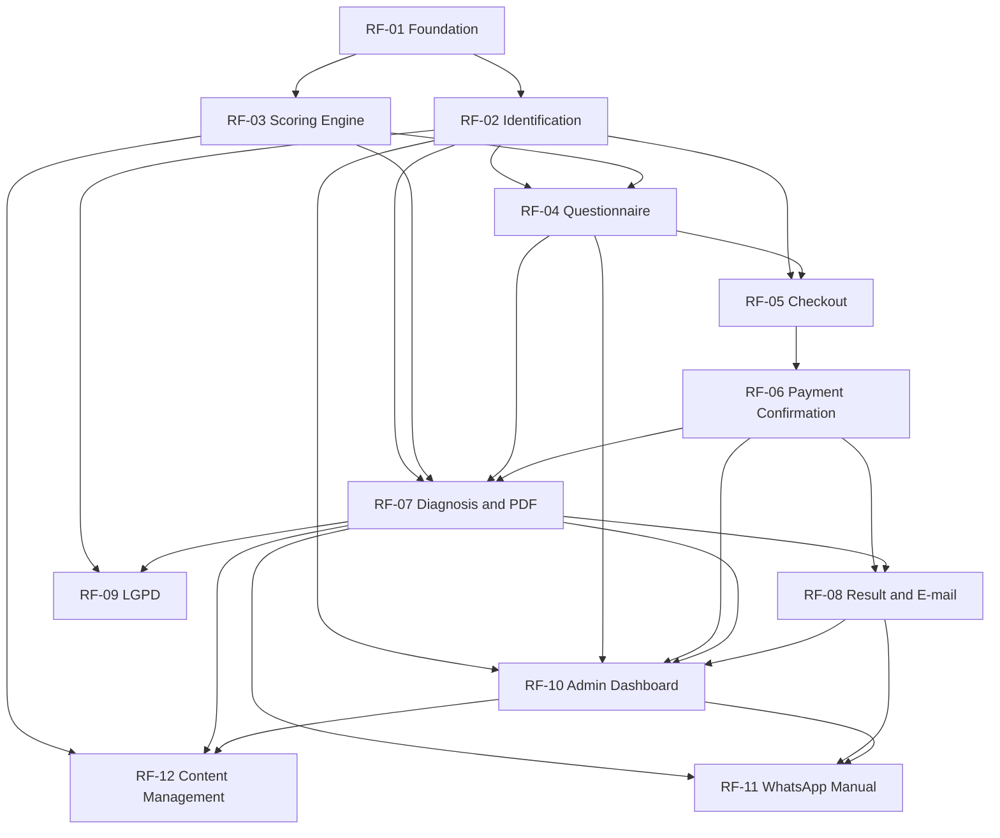

# Descubra Seu Estilo — Millena Barreto

## 1. Executive Summary

Descubra Seu Estilo is a web platform, published under the route `/diagnostico-estilo` of the existing Millena Barreto portfolio (Next.js 14), where women discover their personal style. The existing portfolio landing page is reused as it is and sends visitors to this route. A customer registers, answers a 15-question multiple-choice questionnaire, pays R$ 9,90 once via Pix, and receives a personalized style diagnosis on screen and by e-mail with a PDF attached. The diagnosis identifies a predominant and a secondary style among six: Esportivo/Natural, Tradicional, Elegante, Romântico, Criativo and Dramático.

The product turns Millena Barreto's image consulting expertise into a low-priced, self-service entry offer. After payment is confirmed, everything happens without manual work: the answers are scored by an independent scoring engine, a diagnosis is composed from editable content templates, a PDF is generated, and the e-mail is sent. WhatsApp delivery is manual: the admin panel prepares the message and opens `wa.me`, and Millena marks it as sent.

Payment is processed by AbacatePay (Pix only). The backend runs on Supabase (PostgreSQL, Auth, private Storage) through Next.js API routes hosted on Vercel, and e-mails are sent through Resend. A diagnosis is never generated or delivered before the server has confirmed an approved payment. Millena manages customers, payments, deliveries and all questionnaire and diagnosis content from a protected admin area.

## 2. Problem and Opportunity

### The Problem

**Consulting is manual and does not scale**
- Every style diagnosis done by hand consumes the consultant's time for a result that is mostly pattern-based.
- Reaching many women at a low price point is not viable with one-to-one consulting.
- Delivering results by message depends on Millena being available at the moment of purchase.

**High entry barrier for new audiences**
- Women who follow Millena on social media have no low-commitment way to try her work.
- The existing offer (online personal coloring analysis) is a bigger purchase than a first-time follower is willing to make.
- There is no lead capture that collects consented contact data and a visual-personality profile together.

**Payment and delivery friction creates risk**
- Manually confirming Pix proofs is slow, error-prone and easy to fake.
- Delivering a result before payment is confirmed means lost revenue.
- Duplicate or forged payment notifications can trigger duplicate or unauthorized deliveries.

**Personal data must be handled lawfully**
- The platform collects name, e-mail, WhatsApp number and personal preferences, which fall under LGPD.
- Customers need explicit consent, a privacy policy, secure result links and a way to request deletion.
- One customer must never see another customer's answers or results.

**Content is hard to evolve**
- Hard-coded questions and result texts require a developer for every adjustment.
- An unbalanced questionnaire (some styles with fewer chances to score) produces skewed results.

### The Opportunity

A self-service diagnosis priced at R$ 9,90 solves the scale and entry-barrier problems: the customer answers 15 questions in about 5 minutes (inferred) and gets an individual result immediately after paying. A fully automated, event-driven payment flow (authenticated webhook, status verification, idempotent processing) removes manual Pix checking and blocks delivery without approved payment. A deterministic scoring engine over six styles, with each style appearing in exactly 10 of the 15 questions, makes results precise and fair. Editable questions and content templates in the admin panel let Millena evolve the product without a developer, and the consent, retention and deletion mechanisms keep the platform LGPD-compliant. The manual WhatsApp step removes the need for a WhatsApp Business API while still using the channel her audience prefers.

## 3. Target Audience

### Primary Users

**Customer (woman seeking to understand her personal style)**
- Brazilian woman, typically reached through Millena Barreto's Instagram and the portfolio site, who uses a smartphone as her main device (inferred).
- Wants a quick, enjoyable, non-bureaucratic experience and a result that feels personal, not generic.
- Pays by Pix, expects the result right after payment, and wants to keep it (PDF and e-mail) for later.

**Millena Barreto (consultant and administrator)**
- Sole owner of the product; wants sales and deliveries to run without her intervention.
- Needs to see who bought, what they answered and what they received, and to resend a diagnosis when something fails.
- Wants to adjust questions, alternatives and diagnosis texts in her own voice, and to send results by WhatsApp to customers who prefer it.

### Behavioral Profile

- Both personas value a refined, editorial, minimalist visual identity consistent with the existing Millena Barreto website.
- Both expect clear status feedback (paid, processing, delivered, failed) at every step.
- Both are non-technical and must be able to use every screen on a smartphone.

## 4. Objectives

### Product Objectives

1. **Automate** the path from approved payment to delivered diagnosis, with no manual step for e-mail delivery.
2. **Guarantee** that no diagnosis is generated or delivered without a server-verified approved payment.
3. **Deliver** a smooth, mobile-first experience from the diagnosis entry page to the result, with a questionnaire that feels conversational.
4. **Produce** accurate, deterministic and individualized results across six balanced styles.
5. **Empower** Millena to operate and evolve the product (customers, deliveries, WhatsApp sends, questions and texts) without a developer.

### Success Metrics

| Objective | Metric | Measurement condition |
|---|---|---|
| 1. Automate | At least 95% of approved orders reach DELIVERED (result available and e-mail accepted by the provider) within 2 minutes of payment approval (inferred) | Order timestamps, rolling 30 days |
| 2. Guarantee | 0 results, PDFs or e-mails created for orders whose status was never APPROVED; 100% of duplicate webhook notifications produce exactly 1 result | Monthly audit query on orders vs results; duplicate-webhook integration test in CI |
| 3. Experience | At least 65% of customers who open question 1 answer question 15 (inferred); entry (registration) page Largest Contentful Paint at most 2.5 s | Funnel counts in the database, rolling 30 days; Lighthouse mobile, 4G profile, p75 |
| 3. Experience (conversion) | At least 40% of customers who reach the checkout page pay within 30 minutes (inferred) | Orders PENDING vs APPROVED, rolling 30 days |
| 4. Accuracy | 100% of scoring test cases pass, including every tie-break rule; each style appears in exactly 10 of the 15 questions | Unit tests of the scoring engine; publish-time validation of the question set |
| 5. Empower | Millena can edit and publish a question or a diagnosis text in under 10 minutes without a deploy | Manual acceptance test on the admin panel |

## 5. User Stories

### RF-01. Platform Foundation and Data Model
- As the system, I want a Supabase PostgreSQL schema with row-level security so that customer data is only reachable through server-side code
- As the system, I want the existing site design tokens (colors and fonts) reused so that every screen, e-mail and PDF looks consistent
- As Millena, I want a list of the credentials I need to provide so that I know what to configure before going live

### RF-02. Customer Identification
- As a customer, I want to enter my name, e-mail and WhatsApp with clear validation so that I know right away if something is wrong
- As a customer, I want to choose how I receive my diagnosis so that I get it where I prefer
- As a customer, I want to give explicit consent and read the privacy policy before continuing so that I know how my data is used
- As the system, I want every registration tied to a unique purchase attempt so that answers and payment belong to the right customer

### RF-03. Question Bank and Scoring Engine
- As the system, I want every alternative mapped internally to one of six styles so that scoring is automatic
- As the system, I want a deterministic tie-break rule so that the same answers always give the same result
- As a customer, I want the questionnaire not to reveal the style behind each alternative so that I answer honestly
- As the system, I want versioned question sets so that editing questions never changes past results

### RF-04. Interactive Questionnaire
- As a customer, I want one question per screen with a progress bar and "Pergunta X de 15" so that I know how far I am
- As a customer, I want to go back and see my previous answers preserved so that I can change my mind
- As a customer, I want to be unable to advance without choosing an answer so that I never skip a question by accident
- As a customer, I want my answers saved as I go so that I can resume if my browser reloads

### RF-05. Questionnaire Completion and Pix Checkout
- As a customer, I want a completion screen confirming 15 of 15 answered so that I feel progress and trust the process
- As a customer, I want to see the product, the price (R$ 9,90) and what I will receive so that I know what I am paying for
- As a customer, I want a Pix QR Code and a copy-and-paste code so that I can pay from my banking app
- As a customer, I want to generate a new Pix if mine expires so that I do not redo the questionnaire

### RF-06. Payment Confirmation
- As a customer, I want to click "Já paguei" and get an immediate answer so that I know whether my payment was identified
- As a customer, I want my payment to be recognized even if I close the page so that I always receive what I paid for
- As the system, I want to process each payment notification exactly once so that duplicates never create duplicate results
- As the system, I want to refuse any generation or delivery for an order that is not approved so that nothing is delivered unpaid

### RF-07. Diagnosis Content and PDF Generation
- As a customer, I want my predominant and secondary styles identified from my answers so that the result is mine
- As a customer, I want pieces, outfit combinations, accessories and practical guidance matched to my styles so that I can apply the result
- As a customer, I want a PDF with my name on the cover and Millena's signature so that I can keep and share it
- As the system, I want to retry a failed generation automatically so that a paid customer is not left without a result

### RF-08. Result Screen and E-mail Delivery
- As a customer, I want to see my result on screen right after payment is confirmed so that I get immediate value
- As a customer, I want the diagnosis by e-mail with the PDF so that I keep it in my inbox
- As a customer, I want to request a new access link by e-mail if I lose mine so that I can reach my result again
- As the system, I want to retry failed e-mails and record every attempt so that failures are visible and recoverable

### RF-09. Privacy and LGPD Compliance
- As a customer, I want to read a clear privacy policy so that I understand how my data is treated
- As a customer, I want to request deletion of my data and have it done so that I keep control over my information
- As the system, I want to delete expired data automatically so that data is not kept longer than needed
- As a customer, I want to be sure no one else can see my answers or result so that my privacy is protected

### RF-10. Admin Access and Operations Dashboard
- As Millena, I want to log in with e-mail and password so that only I can reach customer data
- As Millena, I want to see customers, their answers, results, payments and delivery status so that I can support them
- As Millena, I want to see how many sales happened so that I can follow the business
- As Millena, I want to see automation errors and reprocess or resend a diagnosis so that failures are fixed with one click

### RF-11. Manual WhatsApp Delivery
- As Millena, I want a queue of customers who chose WhatsApp so that I know whom to message
- As Millena, I want the message prepared with name, styles and secure link so that I only need to press send in WhatsApp
- As Millena, I want to mark a diagnosis as sent on WhatsApp so that the queue stays accurate

### RF-12. Admin Content Management
- As Millena, I want to edit questions, alternatives and their style mapping so that I can improve the questionnaire without a developer
- As Millena, I want the system to validate balance before publishing so that no style gets an unfair advantage
- As Millena, I want to edit the diagnosis texts, pieces and accessories in my own voice so that results sound like me
- As Millena, I want drafts, a preview and version history so that I can publish safely and roll back

## 6. Functionalities

All user-facing texts are in Brazilian Portuguese; the landing page already exists in the portfolio and is not part of this product; its call to action leads to `/diagnostico-estilo`, which is the entry page of the diagnosis (the registration step). Route names are suggestions (inferred): `/diagnostico-estilo` (registration), `/perguntas`, `/concluido`, `/pagamento`, `/resultado/[token]`, `/meu-link`, `/privacidade`, `/exclusao` and `/admin`, all under `/diagnostico-estilo`.

### RF-01. Platform Foundation and Data Model

**Capabilities**
- New code lives under `app/diagnostico-estilo/` and `app/api/` of the existing Next.js 14 project, written in TypeScript (inferred), reusing Tailwind CSS and framer-motion already installed.
- One Supabase project with PostgreSQL. Entities: customers, purchase attempts, questionnaire versions, questions, alternatives, answers, results, orders, payments, webhook events, deliveries, content templates, automation errors, deletion requests and consent records.
- Row-level security enabled on every table with no public policies: browsers never query tables directly. All reads and writes go through server routes using the service role key, which exists only in server environment variables.
- Private Supabase Storage bucket for PDFs; no public access.
- Design system reuse: the diagnosis pages reuse the design system of the existing portfolio and landing page, with no new palette or fonts. Colors come from the existing Tailwind theme: `primary` `#10151f`, `secondary` `#475467`, `accent` `#937dad` (hover `#937dad`), plus white and the neutral borders already used (`#d0d5dd`, placeholder `#667085`). Fonts come from the existing `next/font` setup: `font-primary` (Bebas Neue) for headings and `font-secondary` (Inter) for body text and buttons. Existing global classes (`.h1` to `.h3`, `.lead`, `.btn`, `.btn-accent`, `.input`), the 0.5rem corner radius and the `custom` shadow are reused instead of recreated. No second font or color set is loaded.
- Any new color or style a screen needs (for example selected state, status chips) is derived from these tokens in the shared Tailwind config, not hard-coded per page.
- The PDF and the e-mail use the same colors and fonts (Bebas Neue and Inter, or web-safe fallbacks in the e-mail, since many mail clients do not load web fonts) (inferred).
- Server-side input validation library applied to every route (all validation repeated on the backend).
- Security headers on all new routes (HSTS, `X-Content-Type-Options`, `frame-ancestors 'none'`) (inferred).
- Credentials to be provided by Millena or the developer before go-live (none are invented): Supabase URL, anon key and service role key; AbacatePay API key and webhook secret; Resend API key and a verified sending domain (DNS records); admin e-mail address; the contact e-mail shown in the privacy policy; Millena's WhatsApp number for the message signature (optional).
- A sandbox/test configuration: in non-production environments AbacatePay runs in its development mode; production code never exposes any payment simulation.

**Experience**
- Shared shell for all customer pages: header with the "Millena Barreto" wordmark, content area with generous spacing (at least 24 px side padding on a 360 px screen), footer with a link to the privacy policy.
- No customer-visible feature of its own; it is the base every other feature builds on.

### RF-02. Customer Identification

**Provides**
- Purchase attempt record: attempt identifier, customer name, e-mail, WhatsApp number, delivery preference and consent record (used by RF-04, RF-05, RF-07, RF-09, RF-10, RF-11)

**Capabilities**
- Fields, all required: full name (at least 2 words, 3-120 characters), e-mail (valid format, lower-cased, at most 254 characters), WhatsApp with area code (2-digit DDD 11-99 plus a 9-digit mobile number starting with 9, stored as +55 E.164), receiving preference (E-mail, WhatsApp or Both; no default selected), consent checkbox (unchecked by default).
- Consent text: "Autorizo o tratamento dos meus dados pessoais para gerar e receber o meu diagnóstico de estilo, conforme a Política de Privacidade." The text links to the privacy policy. The accepted text version and a timestamp are stored.
- Submit creates a customer and a purchase attempt with a UUID v4 identifier. Every submission creates a new attempt (no merging by e-mail) (inferred).
- Access to the attempt afterwards is through an HTTP-only, signed cookie, so the attempt identifier alone is not enough to read it.
- Rate limit: at most 10 registrations per IP per hour (inferred). The IP is stored only as a hash (inferred).
- Selecting "WhatsApp" as the only preference does not stop the e-mail: the e-mail is always sent because it is mandatory (see RF-08).

**Experience**
- This is the entry page of the diagnosis, reached from the existing landing page. A short line above the form reminds the offer: "15 perguntas · R$ 9,90 no Pix · resultado após a confirmação do pagamento" (inferred).
- A single short screen titled "Antes de começar, vamos nos conhecer" (inferred) with a friendly, conversational tone.
- Inline validation when a field loses focus and on submit; the first invalid field receives focus. Messages: "Informe seu nome completo", "Informe um e-mail válido", "Informe o WhatsApp com DDD", "Escolha como quer receber", "Precisamos do seu consentimento para continuar".
- The WhatsApp field is masked as `(11) 91234-5678`.
- The button "COMEÇAR O QUESTIONÁRIO" is disabled while submitting to prevent duplicate attempts.

**Error Handling**
- Backend validation fails: the server returns field-level errors and the form shows the same messages without losing typed data.
- Network failure on submit: "Não conseguimos enviar seus dados. Tente novamente." and the form keeps its values.
- Rate limit exceeded: "Muitas tentativas. Aguarde alguns minutos e tente de novo."
- Double submit: the second request is ignored using an idempotency key generated by the form.

### RF-03. Question Bank and Scoring Engine

**Provides**
- Public question set for the active version: question text and alternative texts, without style or weight (used by RF-04)
- Scoring function: a set of answers returns the points of each of the six styles, the predominant style and the secondary style (used by RF-07)
- Editable question bank with questions, alternatives, style mapping and weights (used by RF-12)

**Capabilities**
- Six styles: Esportivo/Natural, Tradicional, Elegante, Romântico, Criativo, Dramático (Sexy is not included).
- 15 questions, 4 alternatives each, exactly one selectable. Each alternative stores one style and a weight (integer 1-3, default 1) (inferred).
- Balance rule: every question shows 4 of the 6 styles; the 15 questions omit the 15 different possible pairs of styles, one pair per question. As a result each style appears in exactly 10 of the 15 questions.
- Content origin: the 15 questions and the alternatives for Esportivo/Natural, Tradicional, Elegante and Romântico come from the text supplied by Millena. The alternatives for Criativo and Dramático, and the replacement of an original alternative where a question omits that style, are drafted by the team in the same tone (inferred) and reviewed by Millena before go-live.
- The on-screen order of the four alternatives is shuffled per attempt, using a seed derived from the attempt identifier so that the same order is shown when the customer returns to a question.
- Scoring: points of a style are the sum of the weights of the chosen alternatives of that style. Predominant is the highest score; secondary is the second highest. Because each style appears in at most 10 questions, at least 5 answers always go to other styles, so the secondary style always has at least 1 point.
- Tie-break (explicit and deterministic): among tied styles, the style with more chosen alternatives in questions 11 to 15 wins; if still tied, a fixed priority order applies: Elegante, Tradicional, Romântico, Esportivo/Natural, Criativo, Dramático (inferred).
- The scoring engine is a pure module with no database or network access, covered by unit tests: all-answers-one-style, perfectly balanced answers, each tie-break level, weight greater than 1.
- Question sets are versioned; each saved answer set stores the version number so later edits never change past results.

**Experience**
- No direct user interface. During the questionnaire the customer never sees styles, weights or scores; the question API never sends the style or weight to the browser.

### RF-04. Interactive Questionnaire

**Consumes**
- Purchase attempt identifier from RF-02
- Public question set from RF-03

**Provides**
- Saved answers: the 15 chosen alternatives of an attempt and the questionnaire version (used by RF-05, RF-07, RF-10)

**Capabilities**
- Title "Vamos descobrir o seu estilo?" and description "Responda com sinceridade. Escolha a alternativa que mais representa você, não aquela que você acredita que deveria escolher."
- One question per screen; 4 alternatives displayed as selectable cards; one choice only.
- Progress bar and the label "Pergunta N de 15".
- Buttons "Anterior" (hidden on question 1) and "Próxima" (on question 15: "Concluir"); the forward button is disabled until an alternative is selected.
- Every selection is saved to the server immediately; returning to a previous question shows the stored choice, and changing it replaces the old one.
- Reloading or reopening the page within 7 days restores the attempt at the first unanswered question (inferred).
- The page is reachable only with a valid attempt cookie; otherwise the visitor is sent to the registration.

**Experience**
- Slide-and-fade transition of 300 ms between questions; disabled under reduced-motion settings.
- Alternative cards at least 48 px tall, readable at 16 px, with an immediate selected state (accent border and a light tint of the accent color).
- Fully keyboard accessible, using radio-group semantics.
- Tone is conversational, with no technical or form-like wording.

**Error Handling**
- Save fails: the choice stays selected locally, with the message "Não conseguimos salvar sua resposta. Tentando de novo…", and the save is retried up to 3 times.
- Still failing: "Sem conexão. Suas respostas já salvas estão seguras. Tente novamente." with a retry button; advancing is allowed only after the failed answer is saved.
- Attempt cookie missing or expired: redirect to registration with "Sua sessão expirou. Vamos recomeçar rapidinho?".

### RF-05. Questionnaire Completion and Pix Checkout

**Consumes**
- Customer name and e-mail of the attempt from RF-02
- Saved answers (15 of 15) from RF-04

**Provides**
- Order in PENDING status with the Pix charge: order identifier, charge identifier, amount in cents, QR Code, copy-and-paste code and expiry time (used by RF-06)

**Capabilities**
- Completion screen, available only when all 15 answers exist (otherwise redirect to the first unanswered question). Title "Você está a um passo de descobrir sua essência!" Text "Suas respostas foram registradas. Agora, vamos transformar suas escolhas em um diagnóstico personalizado para revelar seus estilos predominantes." Shows "Questionário concluído", "15 de 15 perguntas respondidas", "Produto: Diagnóstico de Estilo Pessoal", "Valor: R$ 9,90". Button "RECEBER MEU DIAGNÓSTICO" leads to the checkout.
- Checkout page: product "Diagnóstico de Estilo Pessoal — Millena Barreto", price "R$ 9,90 — pagamento único via Pix". Benefits listed: identification of the predominant style; identification of the secondary style; description of the identified styles; suggestions of clothes and combinations; guidance to express your personality through your image; personalized PDF report.
- The amount (990 cents) is fixed on the server and never read from the browser.
- On opening the checkout, the server creates one order in PENDING and one Pix charge at AbacatePay, with an idempotency key based on the order so reloading never creates a second charge while the first is valid.
- Pix validity: 30 minutes (inferred). The screen shows the QR Code, a "Copiar código Pix" button, a countdown, and the steps to pay.
- Expired Pix: the order becomes FAILED (reason PIX_EXPIRED) and the button "Gerar novo Pix" creates a new order for the same attempt, reusing the stored answers, which are kept for 7 days (inferred).
- Payment is handled entirely by AbacatePay: the application never receives or stores payment instrument data, and there are no card fields. Pix only.

**Experience**
- Centered card layout using the existing accent, primary and white tokens, a short reassurance line: "Pagamento processado com segurança pela AbacatePay."
- After the Pix is displayed, the main action is "Já paguei" (behavior in RF-06).
- Mobile: QR Code at least 220 px, with the copy button directly under it.

**Error Handling**
- AbacatePay unavailable when creating the charge: "Não conseguimos gerar o Pix agora. Tente novamente em instantes." with a retry button; no order is left PENDING without a charge.
- Incomplete questionnaire: redirect to the first unanswered question with "Faltam algumas respostas para concluir."
- Attempt cookie missing: redirect to registration.
- Amount sent by the browser differs from 990: it is ignored; the server value always prevails and the event is logged.

### RF-06. Payment Confirmation

**Consumes**
- Order and Pix charge identifiers, amount and expiry from RF-05

**Provides**
- Approved order: order identifier, status APPROVED, payment record, paid timestamp and the result access token (used by RF-07, RF-08, RF-10)

**Capabilities**
- Order states: PENDING (charge created), APPROVED (payment verified), PROCESSING (diagnosis being generated), DELIVERED (result available and e-mail accepted), FAILED (Pix expired, or generation or delivery failed after all retries). A paid order in FAILED can be reprocessed from the admin panel (RF-10).
- Webhook endpoint for AbacatePay paid events. It is authenticated using the mechanism AbacatePay supports (shared secret or signature, to be confirmed in its documentation during the spec); requests that fail authentication return 401 and are logged.
- The webhook payload alone is never trusted: the server fetches the charge from the AbacatePay API and requires status paid, the amount of 990 cents and a charge identifier that matches a PENDING order.
- Idempotency: every notification event identifier is stored with a unique constraint; a repeated event returns 200 and changes nothing. The transition PENDING to APPROVED is a single conditional update, so concurrent notifications and "Já paguei" clicks approve the order exactly once.
- "Já paguei" calls a server route that performs the same status check. At most 1 check per order every 5 seconds (inferred). While the Pix is valid, the waiting screen also checks automatically every 5 seconds (inferred).
- When an order becomes APPROVED, the server creates the result access token and starts diagnosis generation (RF-07), exactly once.
- Hard guard: results, PDFs and e-mails can only be created for orders in APPROVED, PROCESSING or DELIVERED; this is enforced in server code and in a database constraint.

**Experience**
- Not paid yet: "Ainda não identificamos seu pagamento. Pode levar alguns instantes — tente novamente."
- Approved: the screen changes to "Pagamento confirmado!" and then "Estamos preparando seu diagnóstico…", moving to the result screen (RF-08) when ready.
- If the customer closes the page after paying, the webhook still approves and delivers by e-mail.

**Error Handling**
- Webhook with invalid authentication: 401, event logged, nothing changed.
- Webhook for an unknown charge or a different amount: 200 with no state change; logged as an automation error for review.
- Status query to AbacatePay fails: the webhook returns an error status so AbacatePay retries; "Já paguei" shows "Não conseguimos verificar agora. Tente novamente."
- Duplicate notification: acknowledged with 200, no second approval.
- Payment arrives after the Pix expired and the order is already FAILED: the order is not auto-approved; the case is flagged in the admin panel for manual review (inferred).

### RF-07. Diagnosis Content and PDF Generation

**Consumes**
- Customer name and delivery preference from RF-02
- Scoring function and style keys from RF-03
- Saved answers and questionnaire version from RF-04
- Approved order from RF-06

**Provides**
- Diagnosis: predominant style, secondary style, points per style, the four text blocks and the stored PDF file reference (used by RF-08, RF-09, RF-10, RF-11)
- Editable content templates: per-style blocks, combination paragraphs, pieces and accessories pools (used by RF-12)

**Capabilities**
- Starts when an order enters APPROVED; the order moves to PROCESSING. Runs the scoring engine on the stored answers and saves the result (points of all six styles, predominant, secondary).
- Content is composed from editable templates, deterministically; no generative AI runs at request time (inferred). Four blocks, as in the reference layout: "Seu resultado", "Peças que combinam com você", "Acessórios e complementos", "Uma orientação especial".
- Individualization: the text is built from (a) the predominant style text, (b) the secondary style text, (c) one combination paragraph for the ordered pair predominant + secondary (30 ordered pairs), (d) the percentage of points of each style, (e) the customer's first name, (f) 4 pieces and 3 accessories picked from the style pools (3 and 2 from the predominant style, 1 and 1 from the secondary), chosen deterministically from the pools using the attempt identifier as seed, so two customers with the same pair do not always receive identical lists (inferred).
- Templates are first drafted by the team (inferred) and then reviewed and edited by Millena through RF-12.
- PDF (A4, 6 to 8 pages, at most 2 MB, generated server-side in at most 10 seconds (inferred)), in this order: cover with the customer's name; predominant style result; secondary style result; description of the identified styles and the points distribution; piece suggestions; outfit combinations; practical guidance; closing page with Millena Barreto's visual signature. Uses the same colors and fonts as the site.
- The PDF is stored in the private bucket under the order identifier. Failed generation is retried automatically up to 3 times at 30 s, 2 min and 10 min (inferred); after that the order becomes FAILED (reason GENERATION_FAILED) and an automation error is recorded.
- Generation is idempotent: running it twice for the same order produces one result and one PDF.

**Experience**
- Internal process; the customer sees the "Estamos preparando seu diagnóstico…" state (RF-06) for typically under 30 seconds (inferred).

**Error Handling**
- PDF rendering fails or exceeds 10 seconds: retried per policy; error logged with the order and step.
- Scoring input incomplete (fewer than 15 answers): generation stops, the order is FAILED with reason INVALID_ANSWERS and the error is flagged to the admin.
- Missing template for a style or pair: generation stops with reason MISSING_CONTENT and the error is flagged; fixing the template and using "Reprocessar" (RF-10) completes the order.
- Storage upload fails: retried per policy; the result is not marked ready until the file exists.

### RF-08. Result Screen and E-mail Delivery

**Consumes**
- Approved order, status and result access token from RF-06
- Diagnosis (styles, points, text blocks) and PDF from RF-07

**Provides**
- Delivery records: e-mail status, number of attempts, last error and timestamps, and the secure result link (used by RF-10, RF-11)

**Capabilities**
- Result screen at `/diagnostico-estilo/resultado/[token]`, following the reference layout: "MILLENA BARRETO", "SEU DIAGNÓSTICO DE ESTILO", an editorial image of the predominant style (one image per style, to be supplied or licensed), "SEU ESTILO PREDOMINANTE" with the style name in large type, "Seu segundo estilo: <name>", then the four blocks and the button "Baixar meu diagnóstico em PDF".
- The token is random (32 bytes, URL-safe) (inferred), stored hashed, valid for 30 days (inferred) and bound to one order. The screen opens only when the order is APPROVED or later; while PROCESSING it shows the preparing state.
- PDF download uses a signed storage URL valid for 5 minutes (inferred), created at the click.
- E-mail through Resend, always sent to the e-mail registered, regardless of the receiving preference. Subject "Seu diagnóstico de estilo chegou!". Layout follows the reference image structure, with the site's accent, primary and white colors: personalized greeting with the first name, predominant and secondary style names, short result text, button "Ver meu diagnóstico completo" with the secure link, and the PDF attached (at most 2 MB), plus a plain-text version. Sender name "Millena Barreto" on a verified domain.
- The order becomes DELIVERED when the result is available and the e-mail was accepted by the provider. A failed e-mail is retried 3 times at 1, 5 and 15 minutes (inferred); after that the delivery is marked FAILED, an automation error is recorded and the order stays reprocessable.
- Link re-request page: the customer types the e-mail; the system always answers "Se existir um diagnóstico para este e-mail, enviaremos um novo link." and, if a paid order exists within retention, sends a new link by e-mail. At most 3 requests per e-mail per hour (inferred).

**Experience**
- The result screen is mobile-first with soft entry animation, a download button always visible, and a note "Também enviamos uma cópia para o seu e-mail."
- Expired or invalid link: "Este link expirou ou não é válido. Peça um novo link." with a link to the re-request page.

**Error Handling**
- E-mail provider rejects or times out: retry policy above; the customer can still read the result on screen.
- Invalid, expired or revoked token: no data shown, only the message above.
- Order not approved: no result is shown, only the "Pagamento ainda não confirmado" state.
- Attachment larger than the 2 MB limit: the e-mail is sent with the link only and the event is logged.

### RF-09. Privacy and LGPD Compliance

**Consumes**
- Consent record and contact data from RF-02
- Stored PDF file references from RF-07

**Capabilities**
- Privacy policy page, linked from the footer, the registration consent text and the e-mail footer. It states: controller identification and contact channel, data collected (name, e-mail, WhatsApp, answers, results, payment status), purposes, retention periods, customer rights, and the operators involved (Supabase, Vercel, AbacatePay, Resend). Draft text prepared by the team (inferred), to be reviewed by Millena or a legal adviser before go-live.
- Deletion request page: the customer enters the e-mail and receives a confirmation e-mail with a link valid for 24 hours (inferred). After confirmation the system deletes the customer, attempts, answers, results, tokens and stored PDFs, and confirms by e-mail. Payment records are kept only in anonymized form (order id, amount, date) for fiscal and audit purposes (inferred).
- Daily retention job (inferred): deletes unpaid attempts and their answers older than 7 days, and paid customer data and PDFs older than 12 months.
- Every response is scoped to the requester's own data: no endpoint returns another customer's answers, personal data or results; access to customer data requires either the attempt cookie, a result token or an admin session.
- Logs never contain names, e-mails, phone numbers or tokens.

**Experience**
- Policy in plain language with short sections. The deletion page is two steps: e-mail, then a confirmation message. Neutral answer to avoid revealing whether an e-mail exists: "Se existirem dados para este e-mail, enviaremos um link de confirmação."

**Error Handling**
- Confirmation link expired: "Este link expirou. Faça um novo pedido de exclusão."
- Deletion fails midway (for example storage unavailable): the request stays pending, it is retried, and an automation error is recorded; the customer is told only after completion.
- Repeated requests for the same e-mail: at most 3 per hour (inferred); extra requests get the same neutral answer without sending a new e-mail.

### RF-10. Admin Access and Operations Dashboard

**Consumes**
- Customer data and receiving preference from RF-02
- Saved answers from RF-04
- Orders and payment records from RF-06
- Diagnosis (styles, points, texts, PDF reference) from RF-07
- Delivery records and secure link from RF-08

**Provides**
- Order detail view with customer, answers, result, payment and delivery status (used by RF-11)

**Capabilities**
- Protected area at `/diagnostico-estilo/admin`. Login with e-mail and password through Supabase Auth; public sign-up is disabled; only the e-mail set in the server configuration is authorized; authorization is checked on the server for every page and API route. Session lasts 8 hours (inferred); 5 failed logins in 15 minutes lock the account for 15 minutes (inferred).
- Overview: count of approved orders (total, today, last 7 days, last 30 days) and revenue (orders x R$ 9,90).
- Customers list: search by name or e-mail, 25 per page; detail shows data, receiving preference, answers (question text and the chosen alternative text), points per style, predominant and secondary style.
- Payments list: order, status, amount, charge identifier, created and paid timestamps.
- Deliveries list: e-mail status, attempts, last error; WhatsApp status (see RF-11).
- Automation errors list: timestamp, order, step, message, resolved flag; "Marcar como resolvido".
- Actions: "Reenviar e-mail" (sends the diagnosis e-mail again with a fresh link; the payment must be approved) and "Reprocessar" (re-runs generation and delivery for a paid order in FAILED; idempotent).

**Experience**
- Clean responsive tables, usable on a smartphone (cards instead of wide tables below 768 px).
- Status chips: PENDING (neutral), APPROVED, PROCESSING (accent tint), DELIVERED (green) and FAILED (red) with text labels, not color alone.
- Destructive or sending actions ask for confirmation.

**Error Handling**
- Not logged in or wrong account: redirect to login; API calls return 403 with no data.
- Lockout: "Muitas tentativas. Tente novamente em 15 minutos."
- "Reprocessar" or "Reenviar e-mail" on an unpaid order: refused with "Pagamento não aprovado — ação indisponível."
- Action fails: the error is shown and recorded in the automation errors list.

### RF-11. Manual WhatsApp Delivery

**Consumes**
- WhatsApp number and receiving preference from RF-02
- Predominant and secondary style from RF-07
- Secure result link and e-mail delivery status from RF-08
- Order detail view from RF-10

**Capabilities**
- WhatsApp queue: orders in DELIVERED or with a stored diagnosis, whose receiving preference is WhatsApp or Both, and whose WhatsApp status is "pending". Customers who chose E-mail only never appear in the queue and cannot be messaged from the panel.
- Button "Enviar pelo WhatsApp" shows an editable preview of the message and then opens `https://wa.me/55<number>?text=<encoded message>` in a new tab. Default message (inferred): "Olá, <first name>! Seu diagnóstico de estilo chegou. Seu estilo predominante é <style> e o secundário é <style>. Acesse o diagnóstico completo aqui: <secure link>".
- If the stored link is expired, the panel creates a new 30-day link before building the message.
- The button "Marcar como enviado" sets the WhatsApp status to "sent" with timestamp; it can be undone within the same session.
- The system never sends WhatsApp messages by itself and uses no WhatsApp API.

**Experience**
- Queue as a list with name, styles, time since payment; one tap opens the preview on mobile.
- Orders without a ready diagnosis show the disabled button "Diagnóstico ainda não disponível".

### RF-12. Admin Content Management

**Consumes**
- Editable question bank (questions, alternatives, style mapping, weights) from RF-03
- Editable content templates (style blocks, combination paragraphs, pieces and accessories pools) from RF-07

**Capabilities**
- Questionnaire editor: edit question text, alternative text, style of each alternative and weight (1-3). Changes live in a draft; publishing creates a new questionnaire version and affects only new attempts.
- Publish-time validation, blocking publication on failure: exactly 15 questions; 4 alternatives each; every alternative has one of the six styles; no repeated style inside a question; each style appears in the 15 questions a number of times that differs by at most 2 between the most and least frequent style (inferred). A balance table shows appearances per style.
- Content editor: per-style text for the four blocks (6 styles), the 30 ordered-pair combination paragraphs, and the pieces (at least 8 per style) and accessories (at least 6 per style) pools. Publish validation: no empty template and pool minimums met.
- Preview of a sample diagnosis for any style pair with a sample first name before publishing.
- Version history of the last 10 published versions for each of the two editors, with rollback (inferred). Orders already delivered keep the content they received.

**Experience**
- Simple forms with a "Salvar rascunho" and "Publicar" action; unsaved-change warning when leaving; mobile usable.
- Validation errors list exactly what must be fixed, for example "Pergunta 7 tem duas alternativas do estilo Elegante."

**Error Handling**
- Publish validation fails: nothing is published; the errors are shown.
- Two admin windows edit the same draft: the later save is refused with "Este rascunho foi alterado em outra janela. Recarregue para continuar." so no text is silently overwritten.
- Save fails: "Não foi possível salvar. Suas alterações continuam na tela." and the editor keeps the typed values.

## 7. Out of Scope

**Payments**
- Credit or debit card, boleto, installments and any payment method other than Pix.
- Automatic refunds (refunds are done directly in the AbacatePay dashboard, outside the system).
- Coupons, discounts, subscriptions and multiple prices.

**Messaging**
- WhatsApp Business API or any automatic WhatsApp sending; WhatsApp delivery is manual by Millena.
- SMS and push notifications.
- Marketing e-mails or automations such as abandoned-cart campaigns.

**Landing page**
- Creating or changing the landing page: it already exists and only links to the diagnosis entry page.

**Product content**
- The Sexy style and any style beyond the six defined.
- Personal coloring analysis, body analysis, photo upload or any consultation beyond the questionnaire-based diagnosis.
- Generative AI creating text at request time.
- Languages other than Brazilian Portuguese.

**Accounts and administration**
- Customer accounts, login or a customer history area; customers access results only through the secure link.
- More than one admin account and role management.
- Advanced analytics, funnel dashboards and exports beyond the sales and delivery overview.
- Make, n8n or other external automation tools; all automation runs in the application code.

**Platform**
- Native mobile apps.
- Hosting or infrastructure other than Vercel and Supabase.
- Fiscal documents (invoices) issuing.

## 8. Dependency Graph

### Part 1: Dependency table

| # | Feature | Priority | Dependencies |
|---|---|---|---|
| 1 | RF-01 Platform Foundation and Data Model | 1 | None |
| 2 | RF-02 Customer Identification | 1 | RF-01 |
| 3 | RF-03 Question Bank and Scoring Engine | 1 | RF-01 |
| 4 | RF-04 Interactive Questionnaire | 1 | RF-02, RF-03 |
| 5 | RF-05 Questionnaire Completion and Pix Checkout | 1 | RF-02, RF-04 |
| 6 | RF-06 Payment Confirmation | 1 | RF-05 |
| 7 | RF-07 Diagnosis Content and PDF Generation | 1 | RF-02, RF-03, RF-04, RF-06 |
| 8 | RF-08 Result Screen and E-mail Delivery | 1 | RF-06, RF-07 |
| 9 | RF-09 Privacy and LGPD Compliance | 1 | RF-02, RF-07 |
| 10 | RF-10 Admin Access and Operations Dashboard | 2 | RF-02, RF-04, RF-06, RF-07, RF-08 |
| 11 | RF-11 Manual WhatsApp Delivery | 2 | RF-07, RF-08, RF-10 |
| 12 | RF-12 Admin Content Management | 2 | RF-03, RF-07, RF-10 |

### Foundation Features
These features set up shared project infrastructure. In a greenfield project they must be implemented sequentially before or alongside any feature that depends on them:
- **RF-01 Platform Foundation and Data Model** - Supabase schema and security rules, server-side validation, design tokens and fonts, base layout and environment configuration

### Execution Waves
Features within the same wave can be built in parallel. A wave starts only after every feature in earlier waves is complete.
- **Wave 1**: RF-01
- **Wave 2**: RF-02, RF-03
- **Wave 3**: RF-04
- **Wave 4**: RF-05
- **Wave 5**: RF-06
- **Wave 6**: RF-07
- **Wave 7**: RF-08, RF-09
- **Wave 8**: RF-10
- **Wave 9**: RF-11, RF-12

Foundation features do not run in parallel in a greenfield project even if they appear together in a wave, and must be implemented in sequence until the base exists.

### Priority legend
- **1 = Essential:** the product does not work without it.
- **2 = Important:** adds significant value.
- **3 = Desirable:** incremental improvement.

### Mermaid diagram

## 9. Acceptance Criteria

### Per feature

#### RF-01. Platform Foundation and Data Model
- Given the database is set up, when any table is queried from a browser with the public key, then no rows are returned and no write is possible
- Given a missing required credential, when the application starts or a dependent route is called, then it fails with a clear message naming the missing setting and never uses a hard-coded value
- Given the site design tokens, when a diagnosis page renders, then it uses the existing theme tokens (primary #10151f, secondary #475467, accent #937dad), Bebas Neue for headings and Inter for body text, and loads no additional font or color set
- Given the production configuration, when any route is called, then no payment simulation is available

#### RF-02. Customer Identification
- Given an empty form, when the customer submits, then every field shows its error and no attempt is created
- Given the name "Maria", when the customer leaves the field, then "Informe seu nome completo" is shown
- Given the WhatsApp "(11) 1234-5678", when the customer submits, then the number is rejected for not being a 9-digit mobile number
- Given all fields valid but the consent unchecked, when the customer submits, then submission is blocked with the consent message
- Given valid data and consent, when the customer submits, then an attempt with a UUID identifier, the consent text version and a timestamp is stored and the questionnaire opens
- Given a request that bypasses the browser with invalid data, when it reaches the server, then the server rejects it with field errors
- Given 11 registrations from one IP within an hour, when the 11th is sent, then it is refused with the rate-limit message

#### RF-03. Question Bank and Scoring Engine
- Given the active question set, when it is inspected, then it has 15 questions with 4 alternatives each, six styles in total, and each style appears in exactly 10 questions
- Given any browser request for the questions, when the response is inspected, then it contains no style or weight
- Given answers that give Elegante 6 points and Tradicional 4, when scoring runs, then Elegante is predominant and Tradicional secondary
- Given a tie in points between two styles, when the tie-break runs, then the style with more choices in questions 11-15 wins
- Given a tie that is still equal after question 11-15, when the tie-break runs, then the fixed order Elegante, Tradicional, Romântico, Esportivo/Natural, Criativo, Dramático decides
- Given the same answers scored 100 times, when results are compared, then all results are identical
- Given the question set is edited and published as a new version, when a past answer set is scored, then it is scored with the version stored with it

#### RF-04. Interactive Questionnaire
- Given question 1, when the screen loads, then "Anterior" is hidden, "Próxima" is disabled and the label reads "Pergunta 1 de 15"
- Given an alternative is selected, when "Próxima" is tapped, then the next question appears with a 300 ms transition and the progress bar advances
- Given the customer returns to question 3, when it shows, then the previously chosen alternative is selected, and changing it replaces the saved answer
- Given the customer reloads at question 8, when the page reopens, then the first unanswered question is shown with earlier answers kept
- Given a save failure, when the customer selects an alternative, then the message "Não conseguimos salvar sua resposta. Tentando de novo…" is shown and 3 retries run
- Given no attempt cookie, when `/perguntas` is opened, then the visitor is sent to the registration

#### RF-05. Questionnaire Completion and Pix Checkout
- Given 15 answers saved, when the questionnaire ends, then the completion screen shows "15 de 15 perguntas respondidas" and "R$ 9,90"
- Given fewer than 15 answers, when the checkout is opened, then the visitor is redirected to the first unanswered question
- Given the checkout opens, when the Pix is created, then exactly one order in PENDING and one charge of 990 cents exist, and reloading creates no second charge
- Given the Pix is displayed, when the customer taps "Copiar código Pix", then the code is copied and a confirmation appears
- Given the Pix is older than 30 minutes, when the screen updates, then "Seu Pix expirou" shows, the old order is FAILED (PIX_EXPIRED), and "Gerar novo Pix" creates a new PENDING order without asking the questions again
- Given the checkout page, when it is inspected, then it has no card fields and no payment data is stored by the application

#### RF-06. Payment Confirmation
- Given a PENDING order whose Pix is paid, when the AbacatePay notification arrives, then the server verifies the charge status and amount and the order becomes APPROVED
- Given a notification without valid authentication, when it arrives, then it returns 401 and the order is unchanged
- Given the same notification sent 5 times, when processed, then the order is approved once and exactly one generation starts
- Given the customer taps "Já paguei" before paying, when the server checks, then "Ainda não identificamos seu pagamento" is shown and the order stays PENDING
- Given the customer taps "Já paguei" after paying, when the server checks, then the order becomes APPROVED and the screen moves forward
- Given a notification and a "Já paguei" click at the same moment, when both run, then the order is approved once
- Given an order that is not APPROVED, when any generation or delivery is requested, then it is refused

#### RF-07. Diagnosis Content and PDF Generation
- Given an approved order, when generation runs, then the order moves to PROCESSING, a result with six scores, a predominant and a secondary style is saved, and a PDF is stored
- Given two customers with the same style pair and different answers, when their diagnoses are compared, then the percentages and the picked pieces and accessories are not identical for both
- Given a generated PDF, when it is opened, then it has the customer's name on the cover and the eight required parts in order, at most 2 MB, on A4
- Given generation runs twice for the same order, when finished, then one result and one PDF exist
- Given a failure in PDF rendering, when it occurs, then generation is retried up to 3 times and, if still failing, the order is FAILED (GENERATION_FAILED) with an automation error
- Given a missing template, when generation runs, then it stops with reason MISSING_CONTENT and the error is recorded

#### RF-08. Result Screen and E-mail Delivery
- Given a delivered order, when the customer opens the result link, then the screen shows the predominant style, the secondary style, the four blocks and the PDF button
- Given an expired or unknown token, when the link opens, then no result data is shown, only the expired-link message
- Given the order is PROCESSING, when the result link opens, then the preparing state is shown
- Given a delivered order, when the e-mail is sent, then the subject is "Seu diagnóstico de estilo chegou!", it contains the first name, both style names, the secure link and the PDF
- Given the customer chose WhatsApp only, when the order is approved, then the e-mail is still sent
- Given the e-mail provider fails, when sending, then 3 retries run at 1, 5 and 15 minutes and, if all fail, the delivery is FAILED with an automation error
- Given the re-request page, when a registered paid e-mail is typed, then a new link is sent, and when an unknown e-mail is typed, then the same message is shown and nothing is sent
- Given the PDF button is clicked, when the file is requested, then a signed URL valid for 5 minutes is used

#### RF-09. Privacy and LGPD Compliance
- Given the footer link, when it is clicked, then the privacy policy page opens and lists data collected, purposes, retention, rights and operators
- Given a deletion request with a registered e-mail, when the confirmation link is opened within 24 hours, then customer data, answers, results, tokens and PDFs are deleted and only anonymized payment data remains
- Given a deletion request for an unknown e-mail, when submitted, then the same neutral message is shown
- Given an unpaid attempt older than 7 days, when the daily job runs, then it and its answers are deleted
- Given paid data older than 12 months, when the daily job runs, then the data and the PDF are deleted
- Given any customer-facing request, when it is made with another customer's identifiers, then no data of that customer is returned

#### RF-10. Admin Access and Operations Dashboard
- Given a visitor without session, when `/diagnostico-estilo/admin` is opened, then the login screen is shown and admin APIs return 403
- Given an account whose e-mail is not the authorized one, when it logs in, then access is refused
- Given 5 failed logins within 15 minutes, when a 6th is tried, then it is blocked for 15 minutes
- Given approved orders, when the overview opens, then total, 7-day and 30-day counts and revenue at R$ 9,90 per order are shown
- Given a customer, when the detail opens, then answers (question and chosen alternative text), points, styles, payment and delivery status are shown
- Given a paid order in FAILED, when "Reprocessar" is used, then generation and delivery run again once and the order reaches DELIVERED
- Given an unpaid order, when "Reenviar e-mail" is attempted, then it is refused

#### RF-11. Manual WhatsApp Delivery
- Given a delivered order whose preference is WhatsApp or Both, when the queue opens, then the order is listed as pending
- Given a customer who chose E-mail only, when the queue opens, then the customer is not listed and no WhatsApp action is available
- Given an order in the queue, when "Enviar pelo WhatsApp" is used, then the preview shows name, both styles and the secure link, and confirming opens a `wa.me` URL with the customer's number and the encoded text
- Given the secure link is expired, when the message is prepared, then a new 30-day link is created first
- Given the message was sent, when "Marcar como enviado" is used, then the WhatsApp status is "sent" with a timestamp and the order leaves the queue
- Given the application code, when it is inspected, then no call to a WhatsApp API exists

#### RF-12. Admin Content Management
- Given the questionnaire draft, when an alternative text, style or weight is changed and published, then a new version is created and only new attempts use it
- Given a draft where one question has two alternatives of the same style, when publish is attempted, then it is blocked and the message names the question
- Given a draft where one style appears 11 times and another 8 times, when publish is attempted, then it is blocked for the imbalance greater than 2
- Given a content template is empty, when publish is attempted, then it is blocked
- Given a style pair and a sample name, when preview opens, then a sample diagnosis is rendered with the draft content
- Given two windows editing the same draft, when the second saves, then it is refused with the conflict message
- Given a published version, when rollback is chosen, then the previous version becomes active for new orders and delivered orders keep their content

### Cross-feature integration
- Given a customer registered through RF-02, when the questionnaire in RF-04 opens, then it uses that attempt identifier and saves answers only to that attempt
- Given the active question set from RF-03, when RF-04 shows a question, then it displays the texts without style or weight
- Given 15 answers saved by RF-04, when RF-05 opens the checkout, then it accepts the attempt and carries the customer's name and e-mail registered in RF-02 into the charge
- Given an incomplete answer set from RF-04, when RF-05 is opened, then it redirects back to RF-04
- Given an order and charge created by RF-05, when the AbacatePay notification arrives in RF-06, then it is matched to that order by charge identifier and the order becomes APPROVED
- Given an order approved by RF-06, when RF-07 starts, then it uses the saved answers from RF-04, the customer name and preference from RF-02, and the scoring function from RF-03
- Given an order that is not approved in RF-06, when RF-07 is asked to generate, then it is refused
- Given a diagnosis created by RF-07 and an approved order from RF-06, when RF-08 opens the result link, then the screen shows that diagnosis and the PDF of that order
- Given a PDF stored by RF-07, when RF-09 deletes the customer's data, then the stored file is removed
- Given the consent record created in RF-02, when RF-09 processes a deletion request, then the customer data and the consent are removed
- Given customers, answers, payments, diagnoses and deliveries produced by RF-02, RF-04, RF-06, RF-07 and RF-08, when RF-10 opens a customer detail, then all of them appear for the same order
- Given a diagnosis from RF-07, a secure link from RF-08 and a WhatsApp number from RF-02, when RF-11 prepares the message, then it contains that customer's name, both styles and link
- Given the order detail from RF-10, when RF-11 shows the WhatsApp action, then it appears inside that view
- Given a question edited and published in RF-12, when RF-03 serves the questions, then the new version is served to new attempts
- Given a template edited and published in RF-12, when RF-07 generates a diagnosis for a new order, then the edited text is used
