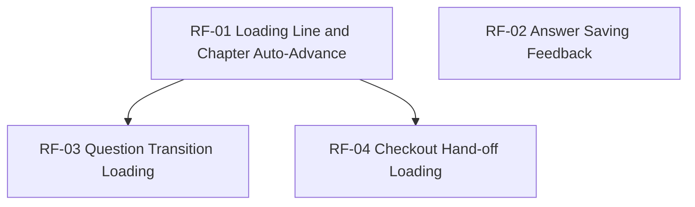

# Descubra Seu Estilo — Loading Feedback for the Gamified Questionnaire

## 1. Executive Summary

This PRD adds loading feedback to the screens of questionnaire version 2 of Descubra Seu Estilo, the style diagnosis published under `/diagnostico-estilo` of the Millena Barreto portfolio. Today the customer taps "Continuar" on every chapter badge, the "Próxima" button simply turns grey while an answer is being saved, one question replaces another with only a slide, and the passage from the last question to the Pix checkout has no visual sign that something is happening. Version 2 keeps its 15 steps, its 3 chapters, the R$ 9,90 Pix price and the diagnosis texts; this change only makes the waiting visible and gives the flow a steady rhythm.

The core change is on the chapter badge screen: the "Continuar" button is replaced by a loading line that fills in 2 seconds and then opens the next step on its own. The same loading line is reused where the flow changes screen: a short line between one question and the next, a "Salvando…" state on the "Próxima" button while the answer is sent, and a "Preparando…" screen between the end of the questionnaire and the Pix checkout.

The change applies only to questionnaire version 2. Version 1 stays exactly as it is, so the comparison between versions (completion comparison command) is not disturbed by anything other than the version 2 changes. Success is measured by the share of customers who start and reach the checkout, which must not fall more than 5 percentage points below version 1, and by the fixed waiting added to a full attempt, which must stay at or below 12 seconds.

## 2. Problem and Opportunity

### The Problem

**The chapter badge stops the flow until a button is tapped**
- At the end of each of the 3 chapters the customer sees a badge and a "Continuar" button, and nothing moves until she taps it.
- A customer who is distracted or holding the phone with one hand can stay on the badge screen without noticing that the quiz is waiting.
- The badge screen is the one moment designed as a reward, but the required tap makes it feel like one more form step.

**Answers are saved without visible feedback**
- Every choice is sent to the server, with up to 3 retries, but the only sign is the "Próxima" button staying disabled.
- A disabled button gives no reason: the customer cannot tell a save in progress from a broken button.
- On a slow mobile network the wait can last several seconds, and a customer who does not understand it may leave before the checkout.

**Moving between questions is abrupt**
- One question is swapped for the next with a 300 ms slide and no sign of progress between them.
- Over 15 steps the screens look alike and there is no rhythm, which is where a customer who has not paid yet is most likely to leave.

**The hand-off to payment has a blank wait**
- After "Concluir" the browser navigates to the completion page, and after "RECEBER MEU DIAGNÓSTICO" to the Pix checkout, each time while the old screen stays frozen.
- This is the most sensitive moment of the quiz, because the next screen asks for payment; a frozen screen looks like a failure.

### The Opportunity

A loading line that fills in 2 seconds turns the badge screen into a short, rewarding pause that moves on by itself, and removes a tap from the part of the quiz with the most drop-off risk. Reusing the same loading line between questions, and adding a "Salvando…" state to the button, shows the customer that the quiz is working at every wait, with one visual language instead of four. Limiting the change to version 2 keeps version 1 as a clean control, and the existing comparison command shows whether the extra waiting costs conversions.

## 3. Target Audience

### Primary Users

**Customer answering on her phone**
- Brazilian woman who reaches the quiz from Millena's Instagram on a smartphone (inferred).
- Often on a mobile network that can be slow, so saving an answer can take seconds (inferred).
- Wants to know that the quiz is working and not stuck, and does not want to tap extra buttons.

**Customer who prefers less movement or uses assistive technology**
- Has "reduce motion" switched on in the operating system, or uses a screen reader (inferred).
- Needs the loading state to be announced as text and not only drawn as an animation.
- Must never be trapped on a screen: every wait must end by itself.

**Millena Barreto (consultant and administrator)**
- Wants the quiz to feel polished and to keep selling at least as well as version 1.
- Reviews the loading texts ("Salvando…", "Preparando seu Pix…") before they go live.

### Behavioral Profile

- All three profiles use the quiz mostly on a smartphone and expect conversational Portuguese, with no technical wording.
- None of them should see a style name, a weight or a score while the quiz is loading.
- All value the refined, editorial visual identity of the Millena Barreto website.

## 4. Objectives

### Product Objectives

1. **Replace** the "Continuar" button of the chapter badge with a loading line that advances on its own in 2 seconds.
2. **Show** a visible loading state at every wait of version 2: saving an answer, changing question, and the hand-off to the checkout.
3. **Bound** the fixed waiting added to a full attempt, so the quiz does not become slower than the game feel justifies.
4. **Protect** customers who use reduced motion or a screen reader, so no one is trapped or left without feedback.
5. **Preserve** conversion: loading feedback must not make fewer customers reach the checkout.

### Success Metrics

| Objective | Metric | Measurement condition |
|---|---|---|
| 1. Replace | 100% of the 3 chapter badge screens of a version 2 attempt show no "Continuar" button and open the next step 2 s (tolerance +-200 ms) after they appear | End-to-end browser test on mobile (360 px) and desktop (1280 px) |
| 2. Show | 100% of the 3 waits (saving, question change, hand-off) show a loading state within 100 ms of the action that starts them | End-to-end browser test with the network throttled to 400 ms per request |
| 3. Bound | Total fixed waiting added to a complete version 2 attempt is at most 12 s (12 question changes x 0.5 s + 3 badge screens x 2 s = 12 s) (inferred) | Sum of the fixed delays in a full 15-step browser run, with reduce motion off |
| 4. Protect | 0 screens that wait for a tap when reduce motion is on; 100% of loading states announced by a status text | Browser test with reduce motion on; automated accessibility check of the status text |
| 5. Preserve | The share of version 2 attempts that start and reach the checkout is at most 5 percentage points below the version 1 share | Completion comparison command, after the first 100 attempts of version 2 with this change; the number is indicative while traffic is low |

## 5. User Stories

### RF-01. Loading Line and Chapter Auto-Advance
- As a customer, I want the chapter badge to move on by itself so that I do not need to tap a button after each chapter
- As a customer, I want to see a line filling up on the badge screen so that I know the next step is coming and how long it will take
- As a customer who prefers less movement, I want the line to appear without animation so that the screen stays calm
- As a customer using a screen reader, I want the wait to be announced as a status message so that I know the quiz is moving on
- As the system, I want to provide one reusable loading line so that every wait of the quiz looks and sounds the same

### RF-02. Answer Saving Feedback
- As a customer, I want the "Próxima" button to say that my answer is being saved so that I understand why I cannot tap it yet
- As a customer on a slow network, I want to keep seeing that something is happening so that I do not think the quiz is broken
- As a customer, I want the button to become available again as soon as my answer is saved so that I can move on at once
- As a customer in a look duel, I want the same saving feedback after I tap a look so that duels behave like the other questions

### RF-03. Question Transition Loading
- As a customer, I want a short loading line between one question and the next so that the quiz has a steady rhythm
- As a customer, I want to be able to go back without waiting so that correcting an answer is not slowed down
- As a customer who prefers less movement, I want no fixed pause between questions so that the quiz stays fast and calm

### RF-04. Checkout Hand-off Loading
- As a customer, I want a loading screen after "Concluir" so that I know my answers are being finished
- As a customer, I want a "Preparando seu Pix…" loading line after tapping "RECEBER MEU DIAGNÓSTICO" so that I know the payment screen is coming
- As a customer, I want a clear message and a way to try again if the next screen does not open so that I do not lose my answers

## 6. Functionalities

### RF-01. Loading Line and Chapter Auto-Advance

**Provides**
- A reusable loading line: a horizontal line that fills from left to right over a duration given by the caller, with a status text, and a static variant for reduced motion (used by RF-03, RF-04)

**Capabilities**
- Applies only to attempts on questionnaire version 2. In version 1 there are no chapters, so nothing changes.
- On each of the 3 chapter badge screens ("Selo Rotina", "Selo Ocasiões", "Selo Desejos") the "Continuar" button is removed.
- In its place the loading line fills linearly in 2 s (2000 ms), starting when the badge screen appears. When it is full, the screen moves on: to the next question after chapters 1 and 2, and to the end of the questionnaire after chapter 3.
- There is no way to skip or pause the wait: no button, no tap on the screen, no keyboard shortcut. The badge animation (at most 600 ms) and the badge texts do not change.
- The wait is a timer on the screen and does not depend on the network. It keeps running if the tab goes to the background (inferred).
- The badge screen is still shown once per chapter and per visit, and it is not shown after a page reload, as today.
- The loading line has a visible text under it: "Preparando a próxima etapa…" (inferred; draft for Millena's review).
- With "reduce motion" on, the line is drawn static and full, without animation; the screen still moves on after 2 s so that nobody is stuck (inferred).

**Experience**
- The customer finishes the last step of a chapter and taps "Próxima" (or "Concluir" on step 15). The badge, its title and its message appear as today, with the focus on the title.
- Under the message, where the "Continuar" button used to be, a line about 4 px tall and as wide as the message block fills from left to right in 2 s, with the text "Preparando a próxima etapa…" below it.
- When the line is full, the next question slides in as it does today (300 ms). On step 15 the customer goes on to the completion page (see RF-04).
- The line has `role="status"` semantics: a screen reader announces the text once when the screen appears. There is no numeric percentage.
- The colors follow the existing accent color; the line is never the only sign of state, because the text is always there.

### RF-02. Answer Saving Feedback

**Capabilities**
- Applies only to attempts on questionnaire version 2, for every kind of step: single and two-choice questions and look duels.
- While an answer is being sent to the server, the forward button ("Próxima", or "Concluir" on step 15) shows a small spinner and the text "Salvando…" instead of its normal text, and stays disabled.
- The state starts at the moment the choice is tapped and ends when the server confirms the answer. It covers the retry attempts (up to 3 retries after the first request, with waits of 0.5 s, 1.5 s and 3 s, as today).
- When the answer is confirmed, the button goes back to its normal text and becomes enabled in the same render.
- The button keeps its size while it shows "Salvando…" so that the layout does not jump (inferred).
- The text "Salvando…" is an `aria-live="polite"` message, so that a screen reader announces it once (inferred).
- With "reduce motion" on, the spinner is replaced by three static dots; the text stays (inferred).
- A tap on a second choice while a save is in flight keeps the state until the latest choice is saved, as today.

**Experience**
- The customer taps an alternative: the card is marked at once (as today) and the forward button changes to "Salvando…" with a spinner.
- On a fast connection (under 300 ms) the state is almost not visible. There is no minimum display time, so a fast save never delays the customer.
- On a slow connection the state stays visible for as long as the save lasts, including the retries, in which the existing message "Não conseguimos salvar sua resposta. Tentando de novo…" is also shown under the card.

**Error Handling**
- Network failure, first request: the button keeps "Salvando…" and the message "Não conseguimos salvar sua resposta. Tentando de novo…" appears; the request is retried up to 3 times.
- Failure after the last retry: the button goes back to its normal text, disabled, and the existing message "Sem conexão. Suas respostas já salvas estão seguras. Tente novamente." appears with the button "Tentar novamente".
- Answer rejected by the server (a 4xx response): the choice is restored to the last saved one and the existing message "Não foi possível salvar essa resposta. Escolha a alternativa de novo." appears.
- Attempt expired: the customer is sent to the registration page with the existing expired-session notice, and no loading state stays on.
- Questionnaire version changed while the page was open: the customer is sent to the new questionnaire with the existing notice, and no loading state stays on.

### RF-03. Question Transition Loading

**Consumes**
- The reusable loading line with its duration and reduced-motion variant (from RF-01)

**Capabilities**
- Applies only to attempts on questionnaire version 2.
- When the customer taps "Próxima" on a step that is not the last of a chapter (steps 1-4, 6-9 and 11-14, 12 changes in total) and its answer is already saved, the question disappears and the loading line fills in 500 ms (500 ms, tolerance +-100 ms) with the text "Carregando próxima pergunta…" (inferred; draft for Millena's review). Then the next question slides in (300 ms).
- The 500 ms wait is fixed and always happens, even when the next question is already available.
- During the 500 ms the customer cannot navigate: a second tap on "Próxima" or "Anterior" has no effect, so one tap never skips two questions.
- Going back with "Anterior" does not show the loading line: the previous question appears at once with the slide (inferred).
- On the last step of a chapter (steps 5, 10 and 15) there is no 500 ms line, because the chapter badge screen of RF-01 already shows its own loading line (inferred).
- With "reduce motion" on, there is no fixed wait: the next question appears at once and the loading line is not shown (inferred).
- The progress indicator ("Pergunta N de 15", "Capítulo N de 3" and the look progress) stays visible while the line is shown and updates to the next step when the next question appears.

**Experience**
- The customer taps "Próxima". The question and its alternatives are replaced by the loading line and the text "Carregando próxima pergunta…" in the same area, so the page height does not jump.
- After 500 ms the next question slides in and the focus moves to its title, as today.
- The status text is announced by a screen reader once per change.

### RF-04. Checkout Hand-off Loading

**Consumes**
- The reusable loading line with its duration and reduced-motion variant (from RF-01)

**Capabilities**
- Applies only to attempts on questionnaire version 2; the completion page and the checkout of version 1 attempts stay as they are.
- After the customer finishes step 15 and the chapter 3 badge screen moves on, the questionnaire page shows a loading screen with the text "Preparando seu diagnóstico…" (inferred; draft for Millena's review) and the loading line, until the completion page is rendered.
- The completion page shows "RECEBER MEU DIAGNÓSTICO". After the customer taps it, the page shows a loading screen with the text "Preparando seu Pix…" (inferred; draft for Millena's review) and the loading line, until the checkout page is rendered. The checkout keeps its own loading state while it creates the Pix charge.
- Both screens appear within 100 ms of the tap or of the end of the badge wait, and stay until the next page is ready. There is no minimum display time (inferred).
- The line of these screens has no fixed duration: it fills slowly toward 90% over 8 s and completes when the page is ready, so a long wait does not look finished (inferred).
- If the next page does not open within 15 s (15,000 ms), the loading screen is replaced by the message and the button of the error handling below.
- With "reduce motion" on, the line is static and the text stays visible while the page loads.

**Experience**
- The customer finishes the last chapter. The badge screen's line fills (2 s), then the screen shows "Preparando seu diagnóstico…" with the line; the completion page opens with the summary (15 of 15 answers, price R$ 9,90).
- The customer taps "RECEBER MEU DIAGNÓSTICO". The button is replaced by "Preparando seu Pix…" and the line, the checkout page opens and shows the Pix code and QR code.
- The status text of each screen is announced once by a screen reader. A double tap on the button creates no second navigation.

**Error Handling**
- The completion page does not open within 15 s (slow network): the message "Não conseguimos abrir a próxima etapa. Suas respostas estão salvas." appears with the button "Tentar novamente", which repeats the navigation.
- The checkout page does not open within 15 s: the same message appears with the button "Tentar novamente"; no charge is created by the retry beyond the single charge per attempt that the checkout already guarantees.
- The attempt expired meanwhile: the customer is sent to the registration page with the existing expired-session notice, and the loading screen disappears.
- The attempt turns out to have fewer than 15 answers: the customer is sent back to the questionnaire with the existing notice, and the loading screen disappears.

## 7. Out of Scope

**Versions and flows**
- Changes to questionnaire version 1: no auto-advance, no loading line, no new texts.
- Loading changes on the registration form, the checkout payment states, the PDF download and the "preparing your diagnosis" screen of the result page, which already have their own states.

**Behavior**
- A skip, pause or "back" control on the chapter badge screen.
- Sound, vibration or any other feedback besides the visual line and the status text.
- A numeric percentage or a time countdown on any loading line.
- Fake waiting longer than the values in Section 6; the only fixed waits are the 2 s of the badge screen and the 500 ms between questions.

**Product**
- New questions, new badges, new chapter names or changes in scoring.
- An admin screen to edit the loading texts or the timings: they are fixed in the code.
- A new analytics or tracking tool to measure the loading states; the existing completion comparison by version is the only measure.

## 8. Dependency Graph

### Dependency table

| # | Feature | Priority | Dependencies |
|---|---|---|---|
| RF-01 | Loading Line and Chapter Auto-Advance | 1 | None |
| RF-02 | Answer Saving Feedback | 2 | None |
| RF-03 | Question Transition Loading | 2 | RF-01 |
| RF-04 | Checkout Hand-off Loading | 2 | RF-01 |

All four features also depend on the existing questionnaire version 2 (chapters, badges, look progress, version routing), which is already implemented and is not part of this PRD.

### Execution Waves
Features within the same wave can be built in parallel. A wave starts only after every feature in earlier waves is complete.
- **Wave 1**: RF-01, RF-02
- **Wave 2**: RF-03, RF-04

### Priority legend

- **1 = Essential:** the product does not work without it.
- **2 = Important:** adds significant value.
- **3 = Desirable:** incremental improvement.

### Dependency diagram

## 9. Acceptance Criteria

### Per feature

#### RF-01. Loading Line and Chapter Auto-Advance
- Given a customer on version 2 who finishes step 5, when the chapter 1 badge screen appears, then it shows the badge "Selo Rotina", the message and a loading line, and has no "Continuar" button
- Given the badge screen of any chapter, when 2 s (+-200 ms) have passed since it appeared, then the next question opens on its own with the slide animation
- Given the badge screen of chapter 3 (step 15), when the 2 s have passed, then the customer goes on to the completion path and no further tap is needed
- Given the badge screen, when the customer taps the screen or presses Enter, Space or Esc, then nothing changes and the wait is not shortened
- Given "reduce motion" is on, when the badge screen appears, then the line is shown static and full, with no animation, and the screen still moves on after 2 s
- Given a screen reader, when the badge screen appears, then the text "Preparando a próxima etapa…" is announced once as a status
- Given a customer who reloads during the badge screen, when the page opens again, then the badge screen is not shown again and the questionnaire opens on the first unanswered step
- Given an attempt on version 1, when the customer finishes any step, then no loading line and no auto-advance appear

#### RF-02. Answer Saving Feedback
- Given a version 2 question, when the customer taps an alternative, then the forward button shows a spinner and "Salvando…" and stays disabled until the server confirms
- Given the server confirms the answer in 200 ms, when the confirmation arrives, then the button goes back to "Próxima" and is enabled in the same render, with no minimum display time
- Given a network throttled to 400 ms per request, when the customer taps an alternative, then "Salvando…" shows within 100 ms and stays until the save ends
- Given the first request fails, when the retries run (0.5 s, 1.5 s, 3 s), then "Salvando…" stays on and the message "Não conseguimos salvar sua resposta. Tentando de novo…" is shown under the card
- Given all retries fail, when the last one fails, then the button shows "Próxima" disabled and the message "Sem conexão. Suas respostas já salvas estão seguras. Tente novamente." appears with "Tentar novamente"
- Given a look duel, when the customer taps a look, then the same "Salvando…" state appears on the forward button
- Given the button shows "Salvando…", when compared with its normal state, then its width and height are the same, so the layout does not jump
- Given an attempt on version 1, when the customer taps an alternative, then the button stays as it is today

#### RF-03. Question Transition Loading
- Given a version 2 attempt on step 2 with the answer saved, when the customer taps "Próxima", then a loading line with "Carregando próxima pergunta…" fills in 500 ms (+-100 ms) and then step 3 slides in
- Given the 500 ms line is shown, when the customer taps "Próxima" or "Anterior" again, then nothing happens and the attempt does not skip a question
- Given a version 2 attempt on step 3, when the customer taps "Anterior", then step 2 appears at once with no loading line
- Given a version 2 attempt on step 5, when the customer taps "Próxima", then the chapter badge screen appears and no 500 ms line is shown before it
- Given a full version 2 run with "reduce motion" off, when the 12 question changes and 3 badge screens are added up, then the fixed waiting is 12 s at most
- Given "reduce motion" is on, when the customer taps "Próxima" on step 2, then step 3 appears at once and no loading line is shown
- Given an attempt on version 1, when the customer taps "Próxima", then the next question appears as it does today

#### RF-04. Checkout Hand-off Loading
- Given the chapter 3 badge screen has moved on, when the questionnaire page navigates, then a screen with "Preparando seu diagnóstico…" and the loading line shows within 100 ms and stays until the completion page is rendered
- Given the completion page of a version 2 attempt, when the customer taps "RECEBER MEU DIAGNÓSTICO", then "Preparando seu Pix…" and the loading line show within 100 ms and stay until the checkout page is rendered
- Given the customer double-taps "RECEBER MEU DIAGNÓSTICO", when the second tap arrives, then no second navigation starts
- Given the completion page does not open within 15 s, when the time runs out, then the message "Não conseguimos abrir a próxima etapa. Suas respostas estão salvas." appears with "Tentar novamente", which repeats the navigation
- Given the attempt expired during the wait, when the navigation resolves, then the customer is sent to the registration page with the existing expired-session notice and no loading screen stays on
- Given "reduce motion" is on, when either loading screen shows, then the line is static and the text is visible
- Given an attempt on version 1, when the customer reaches "Concluir" and the checkout button, then the screens are as they are today

### Cross-feature integration
- Given the loading line provided by RF-01, when RF-03 shows the 500 ms transition, then the line used is the same component and takes its duration (500 ms) and text ("Carregando próxima pergunta…") from RF-03
- Given the loading line provided by RF-01, when RF-04 shows "Preparando seu Pix…" while the checkout loads, then the line used is the same component and its reduced-motion variant is the static line when "reduce motion" is on
