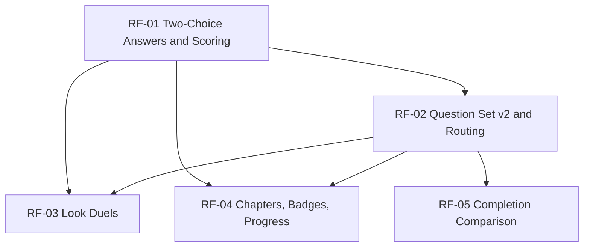

# Descubra Seu Estilo — Multi-Choice and Gamified Questionnaire

## 1. Executive Summary

This PRD describes a new version (version 2) of the questionnaire of Descubra Seu Estilo, the style diagnosis published under `/diagnostico-estilo` of the Millena Barreto portfolio. Today a customer answers 15 questions and picks exactly one of four alternatives in each. Version 2 keeps the 15 steps, the R$ 9,90 Pix price, the payment flow and the diagnosis texts, and changes how the customer answers: in 12 questions she can pick up to two alternatives, and the 3 remaining steps become "look duels" in which she picks one of two looks. The 15 steps are grouped in 3 chapters of 5 steps, with a badge at the end of each chapter and a progress bar that fills as a look is assembled.

The goal is a more truthful and more engaging quiz. Many customers identify with more than one style, and a single choice forces them to drop one; a first choice worth 2 points and an optional second choice worth 1 point captures that nuance. Chapters, badges, duels and the progress bar make the 5-minute questionnaire feel like a short game, with no extra step before the purchase. The questionnaire stays blind: the customer never sees a style name, a weight or a score while answering.

The change is released as a new, versioned question set. Customers who already started keep the original questionnaire until they finish; only new attempts use version 2. Millena keeps editing question and alternative texts in the existing admin panel. Success is measured against the current version: the share of customers who start and reach the checkout must not drop by more than 5 percentage points.

## 2. Problem and Opportunity

### The Problem

**A single choice hides mixed tastes**
- Many women recognise themselves in two alternatives of the same question and must discard one.
- The diagnosis already shows a secondary style, but only the sum of single choices feeds it, so the second-best option of each question is lost.
- A forced choice between two equally fitting alternatives makes the answer feel random and the result less personal.

**The questionnaire is uniform and can feel like a form**
- All 15 questions have the same layout: one question, four text cards, one tap.
- Nothing marks progress other than a bar and the label "Pergunta N de 15".
- A long run of identical screens is where a customer who has not paid yet is most likely to leave.

**The scoring and balance rules assume one choice per question**
- The scoring engine requires exactly 15 answers, each with one style and one weight.
- The balance rule (each style appears in exactly 10 of the 15 questions) and the tie-break (alternatives chosen in questions 11 to 15) are defined for single choice.
- Any new answering mode that ignores these rules would skew the results.

**A change must not break customers in progress**
- Attempts are restorable for 7 days and already store the questionnaire version they started on.
- Changing the rules under someone who is halfway through, or who already paid, would change answers or results that were already given.

### The Opportunity

A two-level choice answers the first problem: the first choice keeps the weight it has today (now 2 points) and the optional second choice adds a 1-point signal. Because the second choice is optional, a customer who answers only with her first choice gets the same ranking as today. Three chapters, badges, a look-shaped progress bar and three look duels answer the second problem without adding questions: the questionnaire keeps 15 steps, so the time to the checkout does not grow. The third problem is solved by redefining the scoring, balance and tie-break rules for version 2 and checking them at publish time, as the current engine already does. The fourth is solved by the existing versioning: each attempt keeps the version it started on, so version 1 keeps working until its attempts expire.

## 3. Target Audience

### Primary Users

**Customer who identifies with more than one style**
- Brazilian woman who reaches the quiz from Millena's Instagram on a smartphone (inferred).
- Often feels that two alternatives of the same question describe her and wants to say so.
- Wants a result that reflects her mix of styles, not only the single option she was forced to pick.

**Customer who answers fast on her phone**
- Answers in a few minutes, often in short sessions, and abandons screens that feel long or repetitive (inferred).
- Responds to visual choices and to small signs of progress (a chapter finished, a badge earned).
- Decides quickly between two looks, and does not want extra steps before paying.

**Millena Barreto (consultant and administrator)**
- Wants the new questionnaire to stay in her voice and wants to edit question and alternative texts without a developer.
- Must review the new texts, the chapter names and the badge names before they go live.
- Wants to know that the new quiz does not sell less than the current one.

### Behavioral Profile

- All three profiles use the quiz mostly on a smartphone and expect it to stay conversational, with no technical wording.
- None of them should see a style name, a weight or a score while answering.
- All value the refined, editorial visual identity of the Millena Barreto website.

## 4. Objectives

### Product Objectives

1. **Capture** mixed tastes by letting customers pick a second alternative in 12 of the 15 steps.
2. **Keep** the questionnaire as short as today: 15 steps and no new step before the checkout.
3. **Make** the questionnaire feel like a short game, with chapters, badges, a look-shaped progress bar and 3 look duels.
4. **Preserve** fair, deterministic scoring across the six styles under the new answer rules.
5. **Protect** every attempt that started before the release, so no customer changes questionnaire in the middle of an attempt.

### Success Metrics

| Objective | Metric | Measurement condition |
|---|---|---|
| 1. Capture | At least 50% of version 2 attempts that reach the checkout use the second choice in at least 3 of the 12 multi-choice questions (inferred) | Saved answers of version 2 attempts, first 100 completed attempts |
| 2. Keep | The share of attempts that start the questionnaire and reach the checkout is at most 5 percentage points below the version 1 share | Attempts per questionnaire version, compared over the first 100 attempts of version 2 and the last 100 attempts of version 1; the number is indicative while traffic is low |
| 3. Make a game | 100% of version 2 attempts that finish see 3 chapter screens, 3 badges and 3 duels, and the progress bar reaches 15 of 15 segments | End-to-end browser test on 3 style pairs, mobile (360 px) and desktop (1280 px) |
| 4. Preserve | 100% of scoring test cases pass for version 2, including the 5 tie-break paths; each style appears in exactly 9 of the 15 steps | Unit tests of the scoring engine; publish-time validation of the version 2 question set |
| 5. Protect | 0 attempts that started on version 1 are served version 2 data; 0 existing diagnoses change | Integration test with an attempt started before the release; comparison of stored diagnoses before and after the migration |

## 5. User Stories

### RF-01. Two-Choice Answers and Weighted Scoring
- As a customer, I want to pick a second alternative in a question so that my result also reflects the style that comes right after my first choice
- As a customer, I want to answer a question with only one alternative so that I do not have to pick a second one when none applies
- As a customer, I want to see which of my choices is the first and which is the second so that I know how my answer will be read
- As a customer, I want to change or remove a choice before moving on so that I can correct a mistaken tap
- As the system, I want to score the first choice with 2 points and the second with 1 point so that the ranking of styles follows the customer's preference order
- As the system, I want to save every change of choice immediately so that an interrupted attempt is restored exactly as left

### RF-02. Question Set Version 2 and Version Routing
- As a customer starting a new attempt, I want to receive the new questionnaire so that I answer the 15 steps in 3 chapters
- As a customer who already started before the release, I want to finish the questionnaire I started so that my answers keep their meaning
- As Millena, I want to edit the text of the questions and alternatives of version 2 in the admin panel so that the quiz stays in my voice
- As Millena, I want the system to refuse to publish a version 2 that breaks the balance rule so that no style gets fewer chances than another

### RF-03. Look Duels
- As a customer, I want to compare two looks side by side and tap the one that suits me so that the choice is quick and visual
- As a customer, I want the duel to work on a small screen so that I can answer it with one thumb
- As a customer using a screen reader, I want each look to have a neutral description so that I can choose without the style being named
- As the system, I want a duel choice to score 2 points for the chosen look's style so that duels count like a first choice

### RF-04. Chapters, Badges and Look Progress
- As a customer, I want to see which chapter I am in and how many steps are left so that I know how close I am to the end
- As a customer, I want to earn a badge when I finish a chapter so that the questionnaire feels like progress
- As a customer, I want a short message between chapters so that I get a pause and a sense of progress without seeing my result
- As a customer who prefers less movement, I want the animations switched off so that the screens stay calm

### RF-05. Completion Comparison by Questionnaire Version
- As Millena, I want to see how many attempts started and how many reached the checkout in each questionnaire version so that I can tell whether the new quiz sells as well as the old one
- As the system, I want every attempt to carry its questionnaire version so that the comparison needs no new tracking tool

## 6. Functionalities

### RF-01. Two-Choice Answers and Weighted Scoring

**Provides**
- Saved answers of an attempt: for each of the 15 steps, the first-choice alternative, the optional second-choice alternative and the questionnaire version (used by RF-02, RF-03, RF-04)
- Scoring result: points of each of the six styles, the predominant style, the secondary style and the tie-break level used (used by the diagnosis composition, unchanged)

**Core Scope**
- Up to 2 alternatives per question; first choice 2 points, second choice 1 point.
- Immediate saving of every selection change.
- Deterministic scoring with the tie-break described below.

**Full Scope additions**
- Visual hint that the second choice is optional (copy to be reviewed by Millena).

**Capabilities**
- Applies to the 12 regular questions of version 2. The 3 duels (RF-03) are single-choice steps scored by the same engine.
- A regular question shows 4 alternatives, each from a different style, so two choices of one question never give points to the same style.
- Points: a style receives 2 points per step where its alternative is the first choice (or the duel winner) and 1 point per step where it is the second choice, multiplied by the alternative weight. All weights stay 1 in version 2 (inferred).
- Range per attempt: 12 regular questions give 24 to 36 points and 3 duels give 6 points, so an attempt totals 30 to 42 points. Percentages in the diagnosis are still the points of each style divided by the total, rounded to whole numbers that sum to 100 (largest-remainder method, unchanged).
- Secondary style: because each style appears in 9 of the 15 steps, the leading style cannot take the first choice in at least 6 steps, so the secondary style always has at least 2 points.
- Tie-break, in this order: (1) more points in steps 11 to 15; (2) the fixed priority order already in use (Elegante, Tradicional, Romântico, Esportivo/Natural, Criativo, Dramático). The point sum replaces the count of chosen alternatives used in version 1 (inferred).
- Validation of an attempt: exactly 15 answered steps; in regular questions 1 or 2 different alternatives of that question; in duels exactly 1 of the 2 looks; every alternative belongs to the question it is saved for. An attempt with a missing step is not scored.
- Version 1 attempts keep the original scoring (one choice, 1 point, 15 answers); the engine selects the rules by the attempt's questionnaire version.
- The scoring engine remains a pure module with no database or network access, covered by unit tests: all choices on one style, balanced answers, only first choices, first and second choices, each tie-break level, weights greater than 1.

**Experience**
- Alternatives stay as cards at least 48 px tall, text at 16 px or larger.
- The first tap selects the card and marks it "1ª escolha". A tap on a second, different card marks it "2ª escolha". Points and styles are never shown (inferred labels, to be reviewed by Millena).
- Tapping the card marked "2ª escolha" removes it. Tapping the card marked "1ª escolha" while a second exists promotes the second to first. Tapping the only selected card removes it.
- A tap on a third card replaces the second choice (inferred).
- "Próxima" is enabled with 1 choice and also with 2. The text under the alternatives says that a second choice is optional (inferred copy).
- Selection states are conveyed by text and by shape, not only by color, and the group is operable by keyboard.

**Error Handling**
- Save fails: the selection stays on screen, with the message "Não conseguimos salvar sua resposta. Tentando de novo…", and the save is retried up to 3 times.
- Still failing: "Sem conexão. Suas respostas já salvas estão seguras. Tente novamente." with a retry button; advancing is allowed only after the change is saved.
- Invalid answer sent (an alternative of another question, the same alternative twice, a third choice): the server refuses it and the screen restores the last saved choice.
- Incomplete attempt at completion (fewer than 15 saved steps): the customer is sent back to the first unanswered step with "Faltou uma resposta. Vamos terminar?".

### RF-02. Question Set Version 2 and Version Routing

**Consumes**
- Answer format and scoring rules of version 2 (first choice, second choice, points) from RF-01

**Provides**
- Public question set of version 2: for each of the 15 steps its position, chapter number (1 to 3), type (regular question or duel), text and alternatives, never the style or the weight (used by RF-03, RF-04)
- Questionnaire version of each attempt and whether the attempt reached the checkout (used by RF-05)

**Capabilities**
- Version 2 has 15 steps in 3 chapters of 5 steps (steps 1-5, 6-10, 11-15). Steps 5, 10 and 15 are the duels, one at the end of each chapter (inferred).
- The 12 regular questions are 12 of the 15 questions of version 1, with the same texts and alternatives: version 1 questions 1, 5 and 14 are the ones replaced by duels (inferred). The order of the other 12 follows their order in version 1.
- Balance rule of version 2: each style appears in exactly 9 of the 15 steps. This holds because the 3 duels pair the styles that the three replaced questions did not show: Romântico against Dramático, Tradicional against Criativo and Esportivo/Natural against Elegante (inferred). Each style appears in exactly one duel.
- Publish-time validation of a version 2 set: 12 regular questions with 4 alternatives of 4 different styles, 3 duels with 2 styles, every style in exactly 9 steps, weights between 1 and 3.
- The on-screen order of the alternatives is shuffled per attempt with the seed already in use, so the same order is shown when the customer returns to a step. In duels the left/right position of the two looks is shuffled the same way.
- Attempt routing: a new attempt receives the active version (version 2 after the release). An attempt that already has answers keeps its version until it is completed or expires (7 days). Version 1 stays readable until no active attempt uses it.
- The customer's answers, the diagnosis already generated and the stored questionnaire version of past orders are never changed by the release.
- Admin panel (existing question editor): Millena edits the text of questions and of regular alternatives of version 2 and publishes it. Style mapping, weights, duel pairs, duel images, chapter assignment and step order are not editable (inferred).

**Experience**
- The customer sees no mention of versions. Returning within 7 days restores the attempt at the first unanswered step of its own version.
- The questionnaire title and description stay "Vamos descobrir o seu estilo?" and "Responda com sinceridade. Escolha a alternativa que mais representa você, não aquela que você acredita que deveria escolher." (the description may mention that up to 2 alternatives can be chosen; copy to be reviewed by Millena).
- Admin: an unbalanced draft cannot be published, and the message names the style that is out of balance.

**Error Handling**
- Active version has no published set: the questionnaire shows "Estamos ajustando o questionário. Volte em alguns minutos." and no attempt is created.
- Attempt references a version that no longer exists: the attempt is not served version 2 data; the customer is sent to the registration with "Sua sessão expirou. Vamos recomeçar rapidinho?".
- Publish of an unbalanced set refused: the admin message names the rule that failed and the live version stays active.
- Concurrent publish and answer: an answer saved while version 2 is being published is stored against the version the attempt already had.

### RF-03. Look Duels

**Consumes**
- Duel steps of version 2 (position, text, the two looks) from RF-02
- Answer saving and scoring rules (the duel winner counts as a 2-point first choice) from RF-01

**Capabilities**
- 3 duels, at steps 5, 10 and 15. Each shows 2 looks side by side (stacked on screens narrower than 480 px, inferred). Each look is the existing reference image of one style.
- Only the 6 style images that are already in the repository are used. No image is created, generated or downloaded for this feature. The images are served through next/image and are loaded with their real width and height.
- The customer picks exactly 1 look. The chosen style receives 2 points; the other look receives none.
- The browser never receives the style name or the style key of a look. The two looks are identified by neutral ids and neutral image addresses (inferred).
- Each look has a neutral alternative text, such as "Look de referência A" and "Look de referência B", that does not name the style (inferred).
- The question text of the duel is editable in the admin panel (default "Qual look combina mais com você?", inferred copy to be reviewed by Millena).

**Experience**
- Tapping a look selects it with a visible border and a checkmark; tapping the other look changes the choice. "Próxima" (or "Concluir" on step 15) is enabled only after a look is selected.
- Each look occupies at least 48 px in its smaller dimension and the images are shown whole, never cropped.
- The duel supports keyboard (radio-group semantics) and screen readers. The slide-and-fade transition of 300 ms between steps is disabled under reduced-motion settings.
- If a look image fails to load, the card shows a neutral block with "Look A" or "Look B" and stays selectable.

**Error Handling**
- Save fails: same messages and 3 retries as RF-01.
- Image missing or not loading: the duel remains answerable using the neutral blocks above, and no style name is revealed.
- Choice sent for a look that does not belong to the duel: the server refuses it and the screen restores the last saved choice.

### RF-04. Chapters, Badges and Look Progress

**Consumes**
- Chapter number and type of each step from RF-02
- Saved answers (number of answered steps) from RF-01

**Capabilities**
- 3 chapters of 5 steps. Draft names (inferred, reviewed by Millena): "Seu dia a dia", "Suas ocasiões" and "Seus desejos".
- Each chapter ends with a screen of at most 4 seconds of reading that shows the badge earned, a one-line message and a "Continuar" button. Draft badge names (inferred): "Selo Rotina", "Selo Ocasiões" and "Selo Desejos".
- A short encouragement line is shown between chapters (inferred), for example "Já estou vendo um traço do seu estilo…". It never reveals a style, a percentage or a score, and it is the same for every customer.
- The progress bar has 15 segments grouped in 3 chapters. Each answered step fills one segment; each finished chapter fills the group with the accent color and draws one piece of a look (3 pieces in total, drawn as inline icons, no new image files, inferred). The label "Pergunta N de 15" is kept.
- Chapter names, badge names, messages and icons are fixed in the code and are not editable in the admin panel.
- A returning customer within 7 days sees the progress bar and the badges already earned, restored from the saved answers.

**Experience**
- The chapter screen appears after the 5th step of a chapter is saved and the customer taps "Próxima". After the last step of chapter 3 the customer goes straight to the existing completion and checkout flow, preceded by the third badge.
- A badge animates in over 600 ms at most and is shown without animation under reduced-motion settings.
- The chapter screen and the progress bar are readable at 360 px width without horizontal scroll, and the information given by color is also given by text ("Capítulo 2 de 3").
- "Anterior" keeps working: going back to a previous chapter does not remove a badge already earned.

### RF-05. Completion Comparison by Questionnaire Version

**Consumes**
- Questionnaire version of each attempt and whether the attempt reached the checkout from RF-02

**Capabilities**
- The sales overview of the admin area shows, for each questionnaire version, the number of attempts started, the number that reached the checkout and the share between them.
- A version with fewer than 100 attempts is marked "poucos dados" (inferred) so the number is not read as conclusive.
- The figures come from data the attempts already store. No new tracking tool, event or per-chapter funnel is added.

**Experience**
- Two rows (version 1 and version 2) in the existing overview, with a difference in percentage points between them.
- When version 2 is more than 5 percentage points below version 1 the difference is shown with a warning label (inferred).

## 7. Out of Scope

**Answering modes**
- Sliders ("thermometer") and ordering of priorities as question types; both need their own scoring rule and are left for a later version.
- More than 2 choices per question, or "choose all that apply".
- Free-text answers and photo upload.

**Visual content**
- Creating, generating or downloading new images. Only the 6 style images already in the repository are used.
- Images in the regular questions; images appear only in the 3 duels.
- Reference photos for the pieces and accessories slots of the result (a separate pending item).

**Gamification**
- Prizes, discounts, coupons or points redeemable for anything.
- Rankings, leaderboards, comparison with other customers and sharing of badges on social networks.
- Sound, vibration and any animation that cannot be disabled under reduced-motion settings.
- Revealing a partial result, style name, percentage or score while the customer is answering.

**Product**
- Changes to the registration, consent, payment, Pix checkout, diagnosis texts, PDF, result screen and e-mail delivery.
- Changing the price or the number of questions (15).
- Migrating attempts that started on version 1 to version 2.
- Editing chapter names, badge names, messages, duel pairs and duel images in the admin panel.
- Per-chapter analytics, funnels by step, time-per-question tracking and external analytics tools.
- More than one admin account and any language other than Brazilian Portuguese.

## 8. Dependency Graph

### Part 1: Dependency table

| # | Feature | Priority | Dependencies |
|---|---|---|---|
| 1 | RF-01 Two-Choice Answers and Weighted Scoring | 1 | None |
| 2 | RF-02 Question Set Version 2 and Version Routing | 1 | RF-01 |
| 3 | RF-03 Look Duels | 2 | RF-01, RF-02 |
| 4 | RF-04 Chapters, Badges and Look Progress | 2 | RF-01, RF-02 |
| 5 | RF-05 Completion Comparison by Questionnaire Version | 2 | RF-02 |

All five features extend the mature questionnaire, scoring, checkout and admin modules that already exist; they do not depend on any other new feature.

### Execution Waves
Features within the same wave can be built in parallel. A wave starts only after every feature in earlier waves is complete.
- **Wave 1**: RF-01
- **Wave 2**: RF-02
- **Wave 3**: RF-03, RF-04, RF-05

### Priority legend
- **1 = Essential:** the product does not work without it.
- **2 = Important:** adds significant value.
- **3 = Desirable:** incremental improvement.

### Mermaid diagram

## 9. Acceptance Criteria

### Per feature

#### RF-01. Two-Choice Answers and Weighted Scoring
- Given a regular question, when the customer taps one card, then it is marked "1ª escolha" and "Próxima" is enabled
- Given a first choice, when the customer taps a different card, then that card is marked "2ª escolha" and the choice is saved before the next step is allowed
- Given a first and a second choice, when the customer taps the card marked "2ª escolha", then the second choice is removed and only the first remains
- Given a first and a second choice, when the customer taps a third card, then the third card becomes the second choice and the old second choice is cleared
- Given an attempt with 15 answers, when it is scored, then each first choice gives its style 2 points, each second choice gives its style 1 point, and the total is between 30 and 42
- Given an attempt answered only with first choices, when it is scored, then the ranking of the styles equals the ranking of the same answers scored as single choice with equal weights
- Given two styles tied in total points, when it is scored, then the style with more points in steps 11 to 15 wins; if still tied, the fixed order Elegante, Tradicional, Romântico, Esportivo/Natural, Criativo, Dramático decides
- Given any valid attempt of version 2, when it is scored, then the secondary style has at least 2 points
- Given an answer that repeats the same alternative as first and second choice, or an alternative of another question, when it is sent, then the server refuses it
- Given a version 1 attempt, when it is scored, then the original single-choice rules apply and the result is identical to the one before the release
- Given a failed save, when the 3 retries also fail, then "Sem conexão. Suas respostas já salvas estão seguras. Tente novamente." is shown and advancing is blocked
- Given an attempt with fewer than 15 saved steps, when the customer taps "Concluir", then the customer is sent to the first unanswered step

#### RF-02. Question Set Version 2 and Version Routing
- Given the release, when a new attempt starts, then it is served version 2 with 15 steps in 3 chapters of 5 steps
- Given an attempt with saved answers that started on version 1, when the customer returns, then the questionnaire is shown at the first unanswered question of version 1, with single choice and no chapters
- Given the version 2 question API response, when inspected, then no alternative, duel look or step contains a style key or weight
- Given a draft of version 2 with a style that appears in 8 or 10 steps, when Millena tries to publish it, then publishing is refused and the message names the style
- Given the version 2 set, when validated, then it has 12 regular questions of 4 alternatives from 4 different styles, 3 duels of 2 styles, and each style appears in exactly 9 steps
- Given Millena edits the text of a version 2 alternative and publishes, then new attempts show the new text and the style mapping and weight are unchanged
- Given the admin question editor for version 2, when Millena looks for duel pairs, duel images, chapter assignment or step order, then they cannot be edited
- Given diagnoses generated before the release, when the release is applied, then every stored diagnosis, answer and questionnaire version is unchanged
- Given the same attempt, when the customer leaves and returns, then the alternatives and the two looks of each duel appear in the same order as before
- Given no published set for the active version, when a customer opens the questionnaire, then "Estamos ajustando o questionário. Volte em alguns minutos." is shown and no attempt is created

#### RF-03. Look Duels
- Given the questionnaire of version 2, when the customer reaches steps 5, 10 and 15, then each shows 2 looks and exactly one can be selected
- Given a duel, when the customer taps a look, then it shows a border and a checkmark, "Próxima" (or "Concluir" on step 15) is enabled, and the choice is saved
- Given a duel choice, when the attempt is scored, then the chosen look's style receives 2 points and the other look's style receives 0
- Given the duel page, when its HTML and network responses are inspected, then no style name or style key appears in the image address, the alternative text or the response body
- Given a screen of 360 px width, when a duel is shown, then the two looks are stacked, fully visible and not cropped, with no horizontal scroll
- Given a look image that fails to load, when the duel is shown, then a neutral "Look A" or "Look B" block appears and the duel can still be answered
- Given reduced-motion settings, when the customer moves between steps, then no slide or fade animation runs
- Given a screen reader, when a duel is read, then each look is announced with a neutral description and a selected state

#### RF-04. Chapters, Badges and Look Progress
- Given the customer saves the 5th step of a chapter and taps "Próxima", when the chapter is complete, then a screen with the chapter badge, a one-line message and a "Continuar" button appears
- Given the encouragement line, when it is shown, then it contains no style name, percentage or score and is identical for every customer
- Given 7 answered steps, when the page is shown, then 7 of the 15 segments are filled, the first chapter group shows as complete and its look piece is drawn
- Given the customer goes back with "Anterior" to a previous chapter, when the page is shown, then the badges already earned remain
- Given a customer who returns within 7 days, when the questionnaire opens, then the progress bar and the earned badges match the saved answers
- Given a screen of 360 px width, when the chapter screen and the progress bar are shown, then there is no horizontal scroll and "Capítulo N de 3" is readable
- Given reduced-motion settings, when a badge is earned, then it appears without animation
- Given the last step of chapter 3, when the customer taps "Concluir", then the third badge is shown and the customer then goes to the existing completion and checkout flow

#### RF-05. Completion Comparison by Questionnaire Version
- Given 120 version 1 attempts of which 60 reached the checkout, when Millena opens the overview, then version 1 shows 120 started, 60 reached the checkout and 50%
- Given a version with fewer than 100 attempts, when it is shown, then it is marked "poucos dados"
- Given version 2 more than 5 percentage points below version 1, when the overview is shown, then the difference carries the warning label
- Given the overview, when its data source is inspected, then it uses only the data already stored by the attempts and adds no new tracking tool or event

### Cross-feature integration
- Given a customer who saves a first and a second choice through RF-01, when RF-02 serves the attempt again, then the stored first and second choices are restored and the first unanswered step is shown
- Given the version 2 question set from RF-02, when a duel step is served to RF-03, then it carries the two looks, the neutral ids and the position, and the duel choice is saved through the answer saving of RF-01
- Given a duel choice saved in RF-03, when RF-01 scores the attempt, then the chosen style has received exactly 2 points from that step
- Given the chapter number and type of each step from RF-02, when RF-04 renders the progress bar, then the 15 segments, the 3 chapter groups and the 3 duel steps match the question set
- Given the answers saved by RF-01, when RF-04 restores the screen for a returning customer, then the filled segments and earned badges equal the number of saved steps
- Given attempts of both versions served by RF-02, when RF-05 builds the overview, then each attempt is counted once, under the version it started on, and the checkout reach comes from the same attempt record
