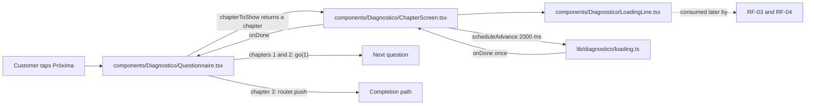

# RF-01. Loading Line and Chapter Auto-Advance: Technical Specification

PRD: docs/prd/PRD-Quiz-Loading-Feedback.md · Scope covered: full feature (no Core/Full split) · Complexity: simple

## 1. Technical Overview

**What.** The chapter badge screen of questionnaire version 2 stops waiting for a tap. The "Continuar" button is removed and a loading line fills in 2 s under the badge message; when it is full, the screen moves on by itself. The line is a new reusable component (`LoadingLine`) that RF-03 and RF-04 will consume.

**Why.** The badge screen is the only place of the quiz that blocks until a tap. A timer on the screen plus one shared visual component gives the flow a steady rhythm and gives the later features one loading language. Everything is client-side and derived from state the screen already has: no API, no storage.

**Scope.**

**Included:**
- Removal of the "Continuar" button and of the `onContinue` contract of `ChapterScreen`; new `onDone` contract fired once, 2000 ms after the screen mounts.
- The 2 s loading line with the visible text "Preparando a próxima etapa…" (draft copy for Millena's review), announced as a status.
- Reduced motion: the line is drawn static and full; the screen still moves on after 2 s.
- Output contract (Provides): the reusable loading line, used by RF-03 and RF-04. Its inputs are: a visible text (`label`), a fill duration in ms (`durationMs`), the fraction where the fill stops (`endAt`, 0 to 1, default 1) and the reduced-motion flag (`reduceMotion`). It renders a status text and a static variant for reduced motion.
- Shared loading module `lib/diagnostico/loading.ts`: the constant of the badge wait and a pure scheduling function, so the timer is unit-tested without a DOM.
- Update of the existing tests that assert the old button.

**Deferred:** none. The feature has no Core/Full split.

**Excluded:**
- The 500 ms line between questions (RF-03), the "Salvando…" button state (RF-02) and the screens after "Concluir" (RF-04). After the 2 s of chapter 3 the badge screen stays on display, with its full line, until the completion page opens: that wait is covered by RF-04.
- Questionnaire version 1: it has no chapters, so `ChapterScreen` is never rendered for it.
- Any control to skip, pause or extend the wait.

**Requirements / Business Rules** (PRD RF-01 Capabilities).
- The wait is `CHAPTER_ADVANCE_MS = 2000` ms, counted from the moment the badge screen mounts, by a timer on the screen. It does not depend on the network and keeps running if the tab goes to the background (inferred: a browser may delay a background timer, but it still fires).
- The callback fires exactly once per mounted badge screen. If the screen unmounts before 2 s (for example the customer leaves the page), the timer is cancelled.
- After the callback: chapters 1 and 2 open the next question with the existing 300 ms slide; chapter 3 goes to the completion path (`router.push`), as `leave()` does today.
- The badge is still shown once per chapter and per visit and never after a reload (existing `chapterToShow` and `chaptersSeen`; unchanged).
- The badge animation (at most 600 ms), the badge texts and the focus on the title do not change.
- No interactive element remains on the screen besides the title that can take the focus (`tabIndex={-1}`). A tap, Enter, Space or Esc does nothing.
- The loading line text is "Preparando a próxima etapa…". With reduced motion the line is static and full (`data-animated="false"`) and the timer is the same.

**Requirements / UX Flows** (PRD RF-01 Experience).
1. The customer finishes the last step of a chapter and taps "Próxima" (or "Concluir" on step 15). The badge screen appears as today (badge, title, message, focus on the title).
2. Where the button was, a line about 4 px tall and as wide as the message block fills left to right over 2 s. Under it the text "Preparando a próxima etapa…" is shown.
3. A screen reader announces the text once when the screen appears. There is no percentage.
4. When the line is full, the next question slides in and the focus moves to its title (existing `useEffect` on `index`), or, after chapter 3, the completion page is requested.
5. The line colors follow the accent color on a neutral track; the text is always present, so state is never carried by color alone.

**Error Handling.** The PRD defines none for RF-01 (not a critical feature). Failure cases found in the code:
- The page is left (browser back, link, tab closed) during the 2 s: the effect cleanup cancels the timer, so no callback runs on an unmounted screen. Nothing is logged.
- `router.push` after chapter 3 fails or is slow: the badge screen stays visible with the full line. The error and the loading screen belong to RF-04.
- React strict mode in development mounts the effect twice: the cleanup of the first run cancels its timer, so the callback still fires once.

## 2. Architecture Impact

**Affected components:**
- `components/Diagnostico/LoadingLine.tsx` (new)
- `components/Diagnostico/ChapterScreen.tsx` (modified)
- `components/Diagnostico/Questionnaire.tsx` (modified)
- `lib/diagnostico/loading.ts` (new)

**Diagram:**



**Patterns followed:**
- Client components in `components/Diagnostico/*.tsx` with a `"use client"` header, English identifiers and comments, Portuguese on-screen copy, and "Draft copy for Millena's review" comments for new operator-facing texts (observed in `Questionnaire.tsx`, `ChapterScreen.tsx`).
- Pure, side-effect-free helpers in `lib/diagnostico/*.ts` that are safe on server and browser, with the screen only wiring them (observed in `lib/diagnostico/questionnaire-state.ts`, `chapters.ts`).
- framer-motion with `useReducedMotion` passed down as a `reduceMotion` boolean, and a `data-animated` attribute that tests read (observed in `ChapterScreen.tsx`).
- Constants named with a unit suffix (`TRANSITION_MS`, `RETRY_DELAYS_MS`) (observed in `questionnaire-state.ts`).
- View tests with `renderToStaticMarkup` in a Node environment, one file per component, in `tests/unit/diagnostico/*.test.ts` with `@/` alias imports (observed in `chapter-screen-view.test.ts`, `look-progress-view.test.ts`; `vitest.config.mts` includes only `tests/unit/**/*.test.ts`).
- Status text through `role="status"` (observed in `PreparingRefresh.tsx` and the retry message in `Questionnaire.tsx`).

## 3. Technical Decisions

| Decision | Chosen Approach | Alternative Considered | Trade-off |
|---|---|---|---|
| Where the 2 s timer lives | In `ChapterScreen`, a `useEffect` on mount calling `scheduleAdvance` and returning its cancel function | In `Questionnaire`, started when `chapterOpen` is set | The screen owns the lifetime of its own timer and cleanup, but `Questionnaire` must pass a stable `onDone` (read through a ref so a re-render never restarts the timer) |
| How the timer is tested | A pure `scheduleAdvance(ms, callback)` in `lib/diagnostico/loading.ts`, tested with Vitest fake timers; the mounted behavior is proven by the browser script | jsdom and Testing Library to mount the component | No new dependency and no second Vitest environment (a dependency needs owner approval); the real mount and timing are only proven in the browser script |
| How the line animates | framer-motion `motion.div` with `initial={{ scaleX: 0 }}`, `animate={{ scaleX: endAt }}`, linear, `transformOrigin: left` | CSS `width` transition driven by a state flag | Same library and same `reduceMotion` pattern as the badge; `scaleX` avoids layout work; needs `style={{ originX: 0 }}` |
| Reduced motion | Static full line (`data-animated="false"`), timer unchanged | Hide the line and keep only the text | The PRD asks for a static, full line; nobody is left on a screen that waits for a tap |
| Component contract for the later features | `label`, `durationMs`, `endAt`, `reduceMotion` | A `complete` flag that jumps to 100% when work finishes | RF-04 ends its line by navigating away (the page unmounts), so no flag is needed now; adding it is a compatible change later |

**Assumptions** (everything marked `(inferred)` is open for review):
- The badge screen stays on display during the navigation after chapter 3 until RF-04 adds its loading screen `(inferred)`.
- The callback is read through a ref, so a re-render of `Questionnaire` never restarts the 2 s `(inferred)`.
- `endAt` is a fraction from 0 to 1 and the component clamps values outside it `(inferred)`.
- The 4 px height, the track color `neutral-200` and the fill color `accent` follow the existing progress bar of `LookProgress.tsx` (observed `bg-accent`, `bg-neutral-200`, `h-2` there; 4 px is from the PRD).
- The quiz v2 RF-04 criteria 1 and 8 (`docs/quiz-v2/STATUS.md`) mention the "Continuar" button. This feature supersedes that behavior on purpose. A new `verify-feature` run of that old feature against those two criteria would not pass; the tests below replace them.
- Test names under "Testing Strategy" are the names that this spec asks the implementer to create.

**Traceability.** PRD RF-01 Provides gives Section 1, Included (output contract) and Section 4. Capabilities give the Business Rules. Experience gives the UX Flows. There is no Consumes, Core Scope, Full Scope or Error Handling block. The 8 Section 9 per-feature criteria are mapped in Section 7. The two cross-feature criteria of Section 9 have RF-01 as provider, so Section 7 only points to the consumers.

## 4. Component Overview

**Frontend**

| File Path | New/Modified | Purpose | Key Responsibilities |
|---|---|---|---|
| `components/Diagnostico/LoadingLine.tsx` | New | The reusable loading line with its status text | Render a 4 px track and a fill that grows from `scaleX` 0 to `endAt` over `durationMs`; render `label` in a `role="status"` element; render the fill static and full with `data-animated="false"` when `reduceMotion` is true; clamp `endAt` to 0..1 |
| `components/Diagnostico/ChapterScreen.tsx` | Modified | The badge screen of a finished chapter | Drop the "Continuar" button and the `onContinue` prop; take `onDone`; on mount call `scheduleAdvance(CHAPTER_ADVANCE_MS, ...)` and cancel it on unmount; render `LoadingLine` with the label `CHAPTER_ADVANCE_LABEL`; keep the badge animation, the title focus and the message |
| `components/Diagnostico/Questionnaire.tsx` | Modified | The questionnaire screen | Rename `continueFromChapter` to the handler passed as `onDone` (same body: close the chapter screen, then `leave()`); keep it stable so the timer is never restarted |

**Shared logic**

| File Path | New/Modified | Purpose | Key Responsibilities |
|---|---|---|---|
| `lib/diagnostico/loading.ts` | New | Timings and texts of the loading feedback, safe on server and browser | Export `CHAPTER_ADVANCE_MS = 2000`, `CHAPTER_ADVANCE_LABEL = "Preparando a próxima etapa…"`, and `scheduleAdvance(ms, callback)` that returns a cancel function and calls `callback` at most once |

**Tests**

| File Path | New/Modified | Purpose | Key Responsibilities |
|---|---|---|---|
| `tests/unit/diagnostico/loading.test.ts` | New | The scheduling function and constants | Fire once after 2000 ms, never before; cancel before the time; cancel after firing is harmless |
| `tests/unit/diagnostico/loading-line-view.test.ts` | New | The loading line markup | Status role and text, no percentage, animated and static variants, `endAt` and clamping |
| `tests/unit/diagnostico/chapter-screen-view.test.ts` | Modified | The badge screen markup | Replace the "Continuar" assertions: no button, line and text present, still named by the badge, static line under reduced motion |

## 5. API Contracts

Skipped: the feature adds no endpoint, command or event. The only contracts are in-process: the props of `ChapterScreen` and `LoadingLine`, and the signature of `scheduleAdvance`.

```ts
// lib/diagnostico/loading.ts
export const CHAPTER_ADVANCE_MS = 2000;
export const CHAPTER_ADVANCE_LABEL = "Preparando a próxima etapa…";
export function scheduleAdvance(ms: number, callback: () => void): () => void; // returns cancel

// components/Diagnostico/LoadingLine.tsx
export default function LoadingLine(props: {
  label: string;
  durationMs: number;
  endAt?: number; // 0..1, default 1
  reduceMotion: boolean;
}): JSX.Element;

// components/Diagnostico/ChapterScreen.tsx (onContinue is removed)
export default function ChapterScreen(props: {
  chapter: Chapter;
  reduceMotion: boolean;
  onDone: () => void;
}): JSX.Element;
```

## 6. Data Model

Skipped: no table, column or stored value is added or changed. The chapter screen is still derived on the screen from the question set and the saved answers (see `lib/diagnostico/chapters.ts`).

## 7. Testing Strategy

**Acceptance tests.** Criteria numbered in the order of PRD Section 9, RF-01:

| # | Criterion (PRD Section 9) | Test | Proof |
|---|---|---|---|
| 1 | Finishing step 5 shows "Selo Rotina", the message and a loading line, and no "Continuar" button | `tests/unit/diagnostico/chapter-screen-view.test.ts` :: `shows the badge, the message and the loading line, with no button`; browser script step 1 | fake |
| 2 | After 2 s (+-200 ms) the next question opens on its own with the slide | `tests/unit/diagnostico/loading.test.ts` :: `scheduleAdvance calls back once after 2000 ms and not before`, `CHAPTER_ADVANCE_MS is 2000`; browser script step 2 | fake |
| 3 | After the chapter 3 badge (step 15), the customer goes to the completion path with no further tap | Browser script step 4 (the wiring `onDone` to `leave()` has no pure unit); `tests/unit/diagnostico/questionnaire-state.test.ts` :: `the last step shows the chapter 3 screen before completing` (existing, unchanged) | fake |
| 4 | A tap, Enter, Space or Esc on the badge screen changes nothing and does not shorten the wait | `chapter-screen-view.test.ts` :: `has no interactive element besides the focusable title`; browser script step 3 | fake |
| 5 | With reduced motion the line is static and full and the screen still moves on after 2 s | `chapter-screen-view.test.ts` :: `the loading line is static under reduced motion`, `loading-line-view.test.ts` :: `a static line is drawn full without animation`; browser script step 5 | fake |
| 6 | A screen reader announces "Preparando a próxima etapa…" once, as a status | `loading-line-view.test.ts` :: `the label is a status and shows no percentage`; browser script step 6 (accessibility tree) | fake |
| 7 | A reload during the badge screen does not show it again; the questionnaire opens on the first unanswered step | `questionnaire-state.test.ts` :: `a chapter screen already shown in this visit is not shown again` and `firstUnansweredIndex returns the first question without an answer` (existing, unchanged); browser script step 7 | fake |
| 8 | On version 1 no loading line and no auto-advance appear | `questionnaire-state.test.ts` :: `a set without chapters never shows a chapter screen` (existing, unchanged); browser script step 8 | fake |

New test functions to create, with the file that holds each:
- `tests/unit/diagnostico/loading.test.ts`: `CHAPTER_ADVANCE_MS is 2000`, `scheduleAdvance calls back once after 2000 ms and not before`, `scheduleAdvance cancel before the time prevents the callback`, `scheduleAdvance cancel after the callback is harmless`.
- `tests/unit/diagnostico/loading-line-view.test.ts`: `the label is a status and shows no percentage`, `an animated line grows to the end fraction`, `a static line is drawn full without animation`, `endAt is clamped to 0..1`.
- `tests/unit/diagnostico/chapter-screen-view.test.ts` (rewrites of the existing four tests): `shows the badge, the message and the loading line, with no button`, `is a region named by the badge, with a title that can take the focus and no Anterior` (kept), `has no style name, percentage or score` (kept; the label has no digits), `the loading line is static under reduced motion`, `has no interactive element besides the focusable title`.

**Live check:** not applicable. No criterion depends on a model provider or an agent.

**Verification script** (followed by `verify-feature` with `playwright-cli` against the running app). Start: local database with questionnaire version 2 published (`npm run quiz:publish -- 2`), a new attempt created through the registration form, viewport 360 x 640 unless stated.

1. Answer steps 1 to 5 and tap "Próxima" on step 5. Expect the "Selo Rotina" badge, its message and a thin line under it with the text "Preparando a próxima etapa…"; there is no "Continuar" button and no button of any kind. (Criterion 1)
2. Do not touch anything and watch for 2 s. Expect the line to fill left to right and the next question (step 6) to slide in on its own within about 2 s (1.8 s to 2.2 s); the progress shows "Pergunta 6 de 15". (Criterion 2)
3. Repeat to step 10 and, on the badge screen of chapter 2, click the screen, press Enter, Space and Esc. Expect nothing to change and the line to keep filling; step 11 opens at 2 s, not earlier. (Criterion 4)
4. Answer steps 11 to 15 and tap "Concluir". Expect the "Selo Desejos" badge with the line, and after 2 s the address changes to the completion page (`/diagnostico-estilo/concluido`) with no tap. Expect the badge screen to stay visible with a full line until that page opens. (Criterion 3)
5. With a new attempt, turn on reduced motion (`playwright-cli set-reduced-motion reduce`) and finish step 5. Expect the badge to appear with no animation, the line already full and still, the text visible, and the next question to open after about 2 s. (Criterion 5)
6. On a badge screen, read the accessibility tree. Expect one status element with "Preparando a próxima etapa…" and no progressbar value or percentage in the chapter screen. (Criterion 6)
7. On the badge screen of chapter 1, reload the page before 2 s. Expect no badge screen and the questionnaire on step 6 (the first unanswered step, as step 5 is saved); answering and advancing within chapter 2 behaves as before. (Criterion 7)
8. Restore version 1 as the published one (`UPDATE` of the two versions, as in the notes of the implementation) or use an existing version 1 attempt; finish any step. Expect no badge screen, no loading line and the single original progress bar. (Criterion 8) Restore version 2 afterwards.
9. At 1280 px width repeat step 1. Expect the line as wide as the message block, no horizontal scroll, and the text readable. (Beyond the criteria: layout.)

**Hand-off tests (cross-feature).** RF-01 is the provider of both cross-feature criteria of the PRD (the loading line used by RF-03 and by RF-04). Covered by the hand-off test of RF-03, implemented after this feature, and by the hand-off test of RF-04, implemented after this feature.

**Test data and fixtures.** No fixture: view tests build the component with `createElement` from the `CHAPTERS` constants; the timer test uses `vi.useFakeTimers()`. The browser script needs the local Supabase with version 2 published and a throwaway customer.

**Not tested here.** The mounted timer and the focus after the advance (they need a DOM; the browser script covers them). The network wait after chapter 3 (RF-04).
