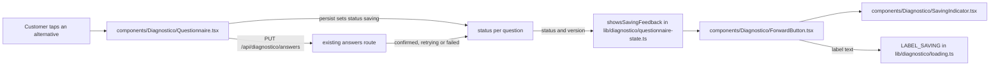

# RF-02. Answer Saving Feedback: Technical Specification

PRD: docs/prd/PRD-Quiz-Loading-Feedback.md · Scope covered: full feature (no Core/Full split) · Complexity: simple

## 1. Technical Overview

**What.** On questionnaire version 2, the forward button ("Próxima", or "Concluir" on step 15) shows a small spinner and the text "Salvando…" while the answer of the current step is being sent to the server, instead of only turning grey. It covers regular questions, two-choice questions and look duels, and it covers the retries of a failed request.

**Why.** The button is already disabled while a save is in flight, but nothing says why. On a slow mobile network the wait can last several seconds (4 requests with waits of 0.5 s, 1.5 s and 3 s). Showing the cause turns a silent wait into a visible one. No new data, request or rule is added: the screen already knows the save status of each question.

**Scope.**

**Included:**
- A pure rule that says when the feedback is shown: only on version 2 and only while the status of the current question is `saving` or `retrying` (not for `failed` or `rejected`).
- A presentational `ForwardButton` (label, spinner or three static dots, `aria-live` message, fixed size) that replaces the inline forward button of `Questionnaire`.
- A `SavingIndicator` (spinner, or three static dots under reduced motion).
- A screen-reader message "Salvando…" inside the existing `aria-live="polite"` region under the answers.
- The saving text constant in the shared loading module.
- Preservation, with tests, of the five failure scenarios of the PRD (they already exist in the code).

**Deferred:** none. The feature has no Core/Full split. It has no Consumes and no Provides.

**Excluded:**
- The 500 ms line between questions (RF-03) and the badge screen (RF-01).
- Any change to how the answer is sent, retried or confirmed (`send`, `persist`, `RETRY_DELAYS_MS`).
- Questionnaire version 1: its button stays as it is today.
- A minimum display time: a fast save shows the state only for as long as it lasts.

**Requirements / Business Rules** (PRD RF-02 Capabilities).
- Applies only when `initial.questionSet.version >= 2` `(inferred: the version number of the question set is the only version signal on the screen; the shipped value for the gamified set is 2)`.
- The state starts when a choice is tapped (the existing `persist` sets the status to `saving` at once) and ends when the server confirms the answer. It stays on during retries (`retrying`): up to 3 retries after the first request, waits of 0.5 s, 1.5 s and 3 s (existing `RETRY_DELAYS_MS`).
- While the state is on, the button shows the spinner and "Salvando…" instead of "Próxima" or "Concluir", and stays disabled (existing `forwardDisabled`, which already includes `pending`).
- When the answer is confirmed, the button returns to its normal text and becomes enabled in the same render: the code sets `saved` and clears the status in the same tick, and React batches both updates `(inferred: React 18 automatic batching, observed `react` 18 in the project)`.
- When the status is `failed` or `rejected` the button shows its normal text, disabled (not "Salvando…"), and the existing message stays below the answers.
- The button keeps its width and height in the three label states, so the layout does not jump.
- With reduced motion the spinner is replaced by three static dots; the text stays.
- A second tap while a save is in flight keeps the state until the latest choice is saved (existing `wanted` and `inFlight` logic).
- The button "Anterior" and the existing messages ("Não conseguimos salvar sua resposta. Tentando de novo…", "Sem conexão. Suas respostas já salvas estão seguras. Tente novamente.", "Não foi possível salvar essa resposta. Escolha a alternativa de novo.") do not change.

**Requirements / UX Flows** (PRD RF-02 Experience).
1. The customer taps an alternative. The card is marked at once and the forward button changes to the spinner and "Salvando…", disabled.
2. On a fast connection (under 300 ms) the state is hardly visible. There is no minimum time, so a fast save never delays the customer.
3. On a slow connection the state stays for as long as the save lasts, including the retries. During a retry the visible message "Não conseguimos salvar sua resposta. Tentando de novo…" also shows under the card.
4. When the answer is confirmed, the button shows "Próxima" (or "Concluir"), enabled.
5. A screen reader announces "Salvando…" once when the state starts, through the live region.

**Error Handling** (PRD RF-02 Error Handling: existing behavior that this feature must keep).
- Network failure on the first request: the button keeps "Salvando…" and the retry message is shown; up to 3 retries. Detection: the `fetch` throws or the response is 5xx (`send` in `Questionnaire.tsx`).
- Failure after the last retry: the status becomes `failed`; the button goes back to its normal text, disabled; the offline message and "Tentar novamente" show.
- A 4xx response: the choice is restored to the last saved one, the status becomes `rejected`, and the rejected message shows.
- Attempt expired (403): `router.replace(EXPIRED_PATH)`; the status is left as it was and the page is replaced, so no state stays on screen.
- Version changed under an open page (409 `VERSION_CHANGED`): `router.replace(VERSION_CHANGED_PATH)`; the same.
- Nothing new is logged. The feedback is pure presentation.

## 2. Architecture Impact

**Affected components:**
- `components/Diagnostico/ForwardButton.tsx` (new)
- `components/Diagnostico/SavingIndicator.tsx` (new)
- `components/Diagnostico/Questionnaire.tsx` (modified)
- `lib/diagnostico/questionnaire-state.ts` (modified)
- `lib/diagnostico/loading.ts` (new, or modified when RF-01 already created it)

**Diagram:**



**Patterns followed:**
- Status per question as a small string union and one save in flight per question (observed in `components/Diagnostico/Questionnaire.tsx`: `SaveStatus`, `inFlight`, `wanted`).
- Pure helpers in `lib/diagnostico/questionnaire-state.ts` tested in `tests/unit/diagnostico/questionnaire-state.test.ts` (`canAdvance`, `chapterToShow`).
- Small presentational client components in `components/Diagnostico/*.tsx` tested with `renderToStaticMarkup` (observed in `ChapterScreen.tsx` and `chapter-screen-view.test.ts`; `LookProgress.tsx` and `look-progress-view.test.ts`).
- `reduceMotion` as a boolean prop, read once with `useReducedMotion` in `Questionnaire.tsx`.
- Operator-facing texts as constants with a "Draft copy for Millena's review" comment (observed in `Questionnaire.tsx`).
- An `aria-live="polite"` region for status messages (observed under the answers in `Questionnaire.tsx`, and in `Checkout.tsx`).
- Tailwind utility classes and the shared `.btn` and `.btn-accent` classes (observed in `app/globals.css`).

## 3. Technical Decisions

| Decision | Chosen Approach | Alternative Considered | Trade-off |
|---|---|---|---|
| Where the label logic lives | A presentational `ForwardButton` that takes `saving` as a prop | Keep the inline `<button>` and add a conditional inside `Questionnaire` | One more small component, but it can be tested with `renderToStaticMarkup`; the saving state itself only exists after a tap and cannot be rendered statically from `Questionnaire` |
| When the feedback shows | A pure `showsSavingFeedback(version, status)` true for `saving` and `retrying` on version 2 | Reuse `pending` (`status !== undefined`) | `pending` is also true for `failed` and `rejected`, where the PRD wants the normal text, disabled |
| Stable button size | Stack the three labels in one grid cell and hide the ones not shown with `invisible`, so the button takes the width of the widest | A fixed `min-width` | The grid reserves the exact widest label whatever the font; the extra hidden text is `aria-hidden` |
| Screen-reader announcement | A `sr-only` "Salvando…" inside the existing `aria-live="polite"` region, shown only for `saving` | `aria-live` on the button itself | A text change inside a button is not reliably announced; the region already exists and is polite |
| Reduced motion | Three static dots in `SavingIndicator` | A spinner with a slower animation | Matches the PRD; the dots carry the "working" meaning without movement |

**Assumptions** (everything marked `(inferred)` is open for review):
- The version gate is `version >= 2` on `initial.questionSet.version` `(inferred)`.
- The spinner is a 16 px ring (`h-4 w-4`, `border-2`, `border-current`, `border-t-transparent`, `animate-spin`) `(inferred)`.
- `LABEL_SAVING = "Salvando…"` is a draft copy for Millena's review (PRD marks it `(inferred)`).
- `lib/diagnostico/loading.ts` is shared with RF-01. Whichever feature is implemented first creates it; the other adds its constants to it `(inferred)`.
- The two updates that end a save are batched into one render by React 18 `(inferred)`; the browser script checks it.
- The width test compares the three label states by their reserved markup (the hidden labels), because a Node render has no layout; the real size is checked in the browser script.

**Traceability.** PRD RF-02 Capabilities give the Business Rules, Experience gives the UX Flows, Error Handling gives the Error Handling section. The 8 Section 9 per-feature criteria are mapped in Section 7. RF-02 has no Consumes or Provides, so Section 9 has no cross-feature criterion for it.

## 4. Component Overview

**Frontend**

| File Path | New/Modified | Purpose | Key Responsibilities |
|---|---|---|---|
| `components/Diagnostico/ForwardButton.tsx` | New | The forward button of the questionnaire | Render the button with `btn btn-accent`; stack the labels "Próxima"/"Concluir" and `LABEL_SAVING` in one grid cell so the size is stable; show `SavingIndicator` and "Salvando…" when `saving`; keep the `disabled` and `onClick` contract of the old button |
| `components/Diagnostico/SavingIndicator.tsx` | New | The "working" mark inside the button | Render the spinner, or three static dots when `reduceMotion`; always `aria-hidden` |
| `components/Diagnostico/Questionnaire.tsx` | Modified | The questionnaire screen | Replace the inline forward button with `ForwardButton`; compute `saving` with `showsSavingFeedback`; add the `sr-only` "Salvando…" message to the live region while saving |

**Shared logic**

| File Path | New/Modified | Purpose | Key Responsibilities |
|---|---|---|---|
| `lib/diagnostico/questionnaire-state.ts` | Modified | Pure helpers of the questionnaire | Export `showsSavingFeedback(version, status)` and the `SaveStatus` type it needs (or accept the status as a string) |
| `lib/diagnostico/loading.ts` | New or modified | Texts and timings of the loading feedback | Export `LABEL_SAVING = "Salvando…"` |

**Tests**

| File Path | New/Modified | Purpose | Key Responsibilities |
|---|---|---|---|
| `tests/unit/diagnostico/questionnaire-state.test.ts` | Modified | Pure rule | Add the `showsSavingFeedback` cases |
| `tests/unit/diagnostico/forward-button-view.test.ts` | New | Button markup | Labels in each state, disabled, indicator variants, stable-size markup |
| `tests/unit/diagnostico/questionnaire-two-choice-view.test.ts` | Modified | Questionnaire markup | Add the version 1 and version 2 initial button text checks |

## 5. API Contracts

Skipped: the feature adds and changes no endpoint. The existing `PUT /api/diagnostico/answers` and its responses (200, 403, 409 `VERSION_CHANGED`, other 4xx, 5xx) are used as they are. The in-process contracts are:

```ts
// lib/diagnostico/questionnaire-state.ts
export function showsSavingFeedback(
  version: number,
  status: "saving" | "retrying" | "failed" | "rejected" | undefined,
): boolean; // true only when version >= 2 and status is "saving" or "retrying"

// lib/diagnostico/loading.ts
export const LABEL_SAVING = "Salvando…";

// components/Diagnostico/ForwardButton.tsx
export default function ForwardButton(props: {
  label: string;          // "Próxima" or "Concluir"
  saving: boolean;
  disabled: boolean;
  reduceMotion: boolean;
  onClick: () => void;
}): JSX.Element;

// components/Diagnostico/SavingIndicator.tsx
export default function SavingIndicator(props: { reduceMotion: boolean }): JSX.Element;
```

## 6. Data Model

Skipped: no table, column or stored value is added or changed. The save status of a question stays in the component state and is never stored.

## 7. Testing Strategy

**Acceptance tests.** Criteria numbered in the order of PRD Section 9, RF-02:

| # | Criterion (PRD Section 9) | Test | Proof |
|---|---|---|---|
| 1 | Tapping an alternative shows the spinner and "Salvando…" on the forward button, disabled until the server confirms | `tests/unit/diagnostico/forward-button-view.test.ts` :: `shows the spinner and "Salvando…" and is disabled while saving`; `questionnaire-state.test.ts` :: `showsSavingFeedback is true for saving and retrying on version 2`; browser script step 1 | fake |
| 2 | A 200 ms confirmation returns the button to "Próxima", enabled, in the same render, with no minimum display time | `forward-button-view.test.ts` :: `shows the normal label, enabled, when it is not saving`; `questionnaire-state.test.ts` :: `showsSavingFeedback is false once the status is cleared`; browser script step 2 | fake |
| 3 | With a network throttled to 400 ms, "Salvando…" shows within 100 ms and stays until the save ends | Browser script step 3 (timing needs a real browser) | fake |
| 4 | Retries (0.5 s, 1.5 s, 3 s) keep "Salvando…" on and show the retry message under the card | `questionnaire-state.test.ts` :: `showsSavingFeedback is true for saving and retrying on version 2`; browser script step 4 | fake |
| 5 | After the last retry fails, the button shows "Próxima" disabled, with the offline message and "Tentar novamente" | `questionnaire-state.test.ts` :: `showsSavingFeedback is false for failed and rejected`; `forward-button-view.test.ts` :: `shows the normal label, disabled, when not saving and not allowed`; browser script step 5 | fake |
| 6 | A look duel shows the same "Salvando…" state | Same `ForwardButton` and rule as criterion 1 (the duel and the questions share one forward button); browser script step 6 | fake |
| 7 | The button has the same width and height in the saving and normal states | `forward-button-view.test.ts` :: `reserves the width of every label so the size does not change`; browser script step 7 (measured size) | fake |
| 8 | On version 1 the button stays as today | `questionnaire-state.test.ts` :: `showsSavingFeedback is always false on version 1`; `questionnaire-two-choice-view.test.ts` :: `a version 1 question set keeps the plain forward button`; browser script step 8 | fake |

New test functions to create, with the file that holds each:
- `tests/unit/diagnostico/questionnaire-state.test.ts`: `showsSavingFeedback is true for saving and retrying on version 2`, `showsSavingFeedback is false for failed and rejected`, `showsSavingFeedback is false once the status is cleared`, `showsSavingFeedback is always false on version 1`.
- `tests/unit/diagnostico/forward-button-view.test.ts`: `shows the spinner and "Salvando…" and is disabled while saving`, `shows the normal label, enabled, when it is not saving`, `shows the normal label, disabled, when not saving and not allowed`, `reserves the width of every label so the size does not change`, `three static dots replace the spinner under reduced motion`, `the indicator is hidden from assistive technology`.
- `tests/unit/diagnostico/questionnaire-two-choice-view.test.ts`: `a version 1 question set keeps the plain forward button`, `a version 2 question set renders the forward button with its reserved labels`.

**Live check:** not applicable. No criterion depends on a model provider or an agent.

**Verification script** (followed by `verify-feature` with `playwright-cli` against the running app). Start: local database with questionnaire version 2 published (`npm run quiz:publish -- 2`), a new attempt created through the registration form, viewport 360 x 640. To slow or fail the save requests use a route on the answers endpoint (for example `playwright-cli run-code "async page => await page.route('**/api/diagnostico/answers', async route => { await new Promise(r => setTimeout(r, 1500)); await route.continue(); })"`) and `playwright-cli route "**/api/diagnostico/answers" --status=500` for failures; remove the route afterwards with `playwright-cli unroute`.

1. With the 1.5 s delay route active, open step 1 and tap an alternative. Expect the button to show a spinner and "Salvando…", and to be disabled, within about 100 ms. (Criterion 1)
2. Remove the route (normal speed) and tap an alternative on step 2. Expect the button to return to "Próxima", enabled, as soon as the answer is saved, with no extra pause after the confirmation. (Criterion 2)
3. With the 1.5 s delay route, tap an alternative and watch. Expect "Salvando…" to appear at once and to stay for the whole delay, then to turn into "Próxima". (Criterion 3)
4. With the 500 status route active, tap an alternative. Expect "Salvando…" to stay on while the message "Não conseguimos salvar sua resposta. Tentando de novo…" shows under the answers, for about 5 s (0.5 + 1.5 + 3 s). (Criterion 4)
5. Keep the failure route until the last retry fails. Expect the button to show "Próxima", greyed and not "Salvando…", and the message "Sem conexão. Suas respostas já salvas estão seguras. Tente novamente." with "Tentar novamente". Remove the route and tap "Tentar novamente": the button goes through "Salvando…" and then "Próxima" enabled. (Criterion 5)
6. Go to a look duel step (step 5) with the 1.5 s delay route and tap a look. Expect the same "Salvando…" state on the forward button. On step 15 expect "Concluir" in place of "Próxima" in the normal state. (Criterion 6)
7. On any step, measure the width and height of the forward button in the normal and in the saving state (`playwright-cli eval` on the button). Expect the same width and height in both, and no layout jump of the content below. (Criterion 7)
8. Publish version 1 again or use a version 1 attempt, tap an alternative with the delay route. Expect the button to stay "Próxima" and only turn grey, with no spinner. Restore version 2 afterwards. (Criterion 8)
9. Turn on reduced motion (`playwright-cli set-reduced-motion reduce`) and repeat step 1. Expect three static dots in place of the spinner and the text "Salvando…". Using a screen reader tree (`playwright-cli snapshot`), expect one "Salvando…" status text. (Beyond the criteria: reduced motion and announcement.)

**Hand-off tests (cross-feature).** None. RF-02 has no Consumes and no Provides, and PRD Section 9 has no cross-feature criterion for it.

**Test data and fixtures.** View tests build `ForwardButton` and `SavingIndicator` with `createElement`; the `Questionnaire` view tests reuse the `build()` helper and the `next/navigation` mock of `questionnaire-two-choice-view.test.ts`. The browser script needs the local Supabase with the right version published and a throwaway customer.

**Not tested here.** The real timings of the save and of the retries (the browser script covers them); the retry and error flow itself, which this feature does not change and which keeps its existing tests (`questionnaire-state.test.ts` :: retry delays, `answers-route.test.ts`).
