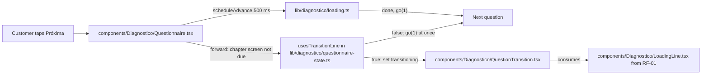

# RF-03. Question Transition Loading: Technical Specification

PRD: docs/prd/PRD-Quiz-Loading-Feedback.md · Scope covered: full feature (no Core/Full split) · Complexity: simple

## 1. Technical Overview

**What.** On questionnaire version 2, tapping "Próxima" on a saved step replaces the question with a loading line and the text "Carregando próxima pergunta…" for a fixed 500 ms, and then the next question slides in. It happens in 12 of the 15 steps; it does not happen on the last step of a chapter, on "Anterior", with reduced motion, or on version 1.

**Why.** Fifteen similar screens that swap with only a 300 ms slide have no rhythm. A short, fixed pause with a visible line gives the quiz a steady pace and uses the same loading language as the badge screen (RF-01). The change is client-side state of the existing screen: no API, no storage.

**Scope.**

**Included:**
- A pure rule, `usesTransitionLine`, that decides whether a forward move shows the line.
- A `transitioning` state in `Questionnaire` that swaps the question block for the line for 500 ms and then calls the existing `go(1)`; a lock that ignores a second tap.
- A `QuestionTransition` presentational component that renders the loading line with the RF-03 duration and text.
- Input contract (Consumes): the reusable loading line from RF-01 (a horizontal line filling over a duration, with a status text and a static variant for reduced motion; inputs `label`, `durationMs`, `endAt`, `reduceMotion`). The 500 ms timer reuses the pure `scheduleAdvance` that the spec of RF-01 puts in `lib/diagnostico/loading.ts` `(inferred: it is part of the RF-01 spec, not of the PRD Provides)`.
- The hand-off test of this contract (Section 7).

**Deferred:** none. The feature has no Core/Full split. RF-03 has no Provides.

**Excluded:**
- The badge screen and its 2 s line (RF-01), the "Salvando…" state (RF-02) and the screens after "Concluir" (RF-04).
- Any change to how an answer is saved, or to the 300 ms slide.
- Questionnaire version 1.
- A line when going back with "Anterior".

**Requirements / Business Rules** (PRD RF-03 Capabilities).
- Only when `initial.questionSet.version >= 2`, the same gate as RF-02 `(inferred)`.
- The line shows when the customer taps "Próxima" on a step that is not the last of its chapter (steps 1-4, 6-9 and 11-14: 12 changes) and its answer is already saved (the button is enabled only then, existing `forwardDisabled`).
- The step is the last of its chapter when the next step has a different `chapter` (or there is no next step) `(inferred: derived from the `chapter` field of each step, observed in `ChapterStep`)`. This rule is by position: it holds also when the badge screen was already shown in this visit and is skipped (going back to step 5 and forward again shows neither the badge nor the line).
- The wait is `QUESTION_TRANSITION_MS = 500` ms (tolerance +-100 ms), fixed, even when the next question is available at once.
- The text under the line is "Carregando próxima pergunta…" (draft copy for Millena's review).
- During the 500 ms a second tap on "Próxima" or "Anterior" has no effect: one tap never skips two questions.
- "Anterior" never shows the line: the previous question appears at once with the existing slide.
- With reduced motion there is no fixed wait and no line: the next question appears at once (`useReducedMotion` is true).
- The progress indicator ("Pergunta N de 15", "Capítulo N de 3", the look progress) stays visible and unchanged during the line, and moves to the next step when the next question appears.
- After the 500 ms the existing `go(1)` runs, so the slide (300 ms) and the focus on the title happen as today.

**Requirements / UX Flows** (PRD RF-03 Experience).
1. The customer taps "Próxima". The question and its alternatives are replaced, in the same area, by the loading line and "Carregando próxima pergunta…".
2. The area keeps the height of the question that left, so the page does not jump `(inferred: measured before the swap)`. The two buttons stay visible and disabled.
3. After 500 ms the next question slides in and the focus moves to its title.
4. A screen reader announces the line text once per change (the status role of the loading line).

**Error Handling.** The PRD defines none for RF-03 (not a critical feature). Failure cases found in the code:
- The screen unmounts during the 500 ms (browser back, link): the effect cleanup cancels the timer; nothing runs on an unmounted screen.
- A save fails or the attempt expires during the line: not possible, because the line starts only after the answer is saved; a save started by a later tap is blocked by the lock.
- React strict mode in development mounts effects twice: the cleanup cancels the first timer, so `go(1)` still runs once.

## 2. Architecture Impact

**Affected components:**
- `components/Diagnostico/QuestionTransition.tsx` (new)
- `components/Diagnostico/Questionnaire.tsx` (modified)
- `lib/diagnostico/questionnaire-state.ts` (modified)
- `lib/diagnostico/loading.ts` (modified; created by RF-01)

**Diagram:**



**Patterns followed:**
- Pure rules in `lib/diagnostico/questionnaire-state.ts` tested in `tests/unit/diagnostico/questionnaire-state.test.ts` (`chapterToShow`, `canAdvance`, `hasChapters`).
- One-shot guards with refs next to state in `Questionnaire.tsx` (`chaptersSeen`, `inFlight`, `navigated`).
- Presentational components in `components/Diagnostico/*.tsx` tested with `renderToStaticMarkup` (`ChapterScreen.tsx`, `look-progress-view.test.ts`).
- `useReducedMotion` read once in `Questionnaire.tsx` and passed as a boolean.
- Constants with a unit suffix (`TRANSITION_MS`, `RETRY_DELAYS_MS`) and "Draft copy for Millena's review" comments for operator-facing texts.
- Existing focus handling: the effect on `index` moves the focus to the question title after a navigation (`headingRef`, `navigated`).

## 3. Technical Decisions

| Decision | Chosen Approach | Alternative Considered | Trade-off |
|---|---|---|---|
| Where the 500 ms lives | `transitioning` state in `Questionnaire` and a `useEffect` that schedules the advance | A timer inside `QuestionTransition` | `go(1)` and the question block are owned by `Questionnaire`; a hook-free `QuestionTransition` can be called directly by the hand-off test |
| Double-tap protection | A `transitionLock` ref set in the click handler, plus the state | State only | State updates after the render, so two taps in one tick could both pass; the ref closes that gap |
| Keeping the layout stable | Measure the question block height before the swap and use it as `min-height` of the line area | Keep the question mounted and hidden under the line | No `inert` handling and no hidden interactive elements; needs one `ref` and a measurement |
| When the line applies | A pure `usesTransitionLine(version, steps, index, reduceMotion)` | Inline conditions in the click handler | Testable without a DOM; the by-position rule is explicit |
| Timer function | Reuse `scheduleAdvance` of RF-01 | A second timer helper | One cancellable timer for the quiz; RF-03 depends on a function the PRD does not list as RF-01's Provides |
| Hand-off proof | Call the hook-free `QuestionTransition()` and check that it returns the real `LoadingLine` element with 500 ms and the RF-03 text | Mock the line and spy on its props | Nothing is mocked; but the unit test proves the element and its props, not the animation, which the browser script proves |

**Assumptions** (everything marked `(inferred)` is open for review):
- The version gate is `version >= 2` `(inferred)`, as in RF-02.
- "Last step of a chapter" is derived from the `chapter` of the next step `(inferred)`.
- RF-03 reuses `scheduleAdvance` from the RF-01 spec `(inferred)`; if RF-01 is implemented without it, RF-03 needs its own cancellable timer.
- The two buttons stay visible and disabled during the line `(inferred)`.
- The focus rests on the page body during the line (the disabled button loses it) and returns to the title when the next question opens `(inferred)`.
- RF-01 is not implemented yet: `LoadingLine` and `loading.ts` are cited from its spec and may differ in names when it is built.

**Traceability.** PRD RF-03 Consumes gives the input contract in Section 1; Capabilities give the Business Rules; Experience gives the UX Flows. The 7 per-feature criteria and the 1 cross-feature criterion where RF-03 is the consumer are mapped in Section 7 (8 in total). The RF-04 cross-feature criterion is not RF-03's.

## 4. Component Overview

**Frontend**

| File Path | New/Modified | Purpose | Key Responsibilities |
|---|---|---|---|
| `components/Diagnostico/QuestionTransition.tsx` | New | The line shown between two questions | Hook-free; return the RF-01 `LoadingLine` with `QUESTION_TRANSITION_MS`, `QUESTION_TRANSITION_LABEL` and `reduceMotion={false}` (the line is never shown under reduced motion) |
| `components/Diagnostico/Questionnaire.tsx` | Modified | The questionnaire screen | Add the `transitioning` state and the lock; in `leave()` use `usesTransitionLine` to start the 500 ms or call `go(1)` at once; render `QuestionTransition` in place of the question block with the measured `min-height`; disable "Anterior" and "Próxima" while it shows; cancel the timer on unmount |

**Shared logic**

| File Path | New/Modified | Purpose | Key Responsibilities |
|---|---|---|---|
| `lib/diagnostico/questionnaire-state.ts` | Modified | Pure helpers of the questionnaire | Export `usesTransitionLine(version, steps, index, reduceMotion)` and `isLastStepOfChapter(steps, index)` |
| `lib/diagnostico/loading.ts` | Modified | Texts and timings of the loading feedback | Export `QUESTION_TRANSITION_MS = 500` and `QUESTION_TRANSITION_LABEL = "Carregando próxima pergunta…"` |

**Tests**

| File Path | New/Modified | Purpose | Key Responsibilities |
|---|---|---|---|
| `tests/unit/diagnostico/questionnaire-state.test.ts` | Modified | Pure rule | Add the `usesTransitionLine` and `isLastStepOfChapter` cases |
| `tests/unit/diagnostico/question-transition-view.test.ts` | New | The transition component and the hand-off | Constants, the returned element, and the RF-01 to RF-03 hand-off |

## 5. API Contracts

Skipped: the feature adds no endpoint, command or event. The in-process contracts are:

```ts
// lib/diagnostico/loading.ts
export const QUESTION_TRANSITION_MS = 500;
export const QUESTION_TRANSITION_LABEL = "Carregando próxima pergunta…";

// lib/diagnostico/questionnaire-state.ts
export function isLastStepOfChapter(steps: readonly ChapterStep[], index: number): boolean;
export function usesTransitionLine(
  version: number,
  steps: readonly ChapterStep[],
  index: number,
  reduceMotion: boolean,
): boolean; // true only on version >= 2, without reduced motion, when the step is not the last of its chapter

// components/Diagnostico/QuestionTransition.tsx (no hooks)
export default function QuestionTransition(): JSX.Element; // the RF-01 LoadingLine with the RF-03 props
```

## 6. Data Model

Skipped: no table, column or stored value is added or changed. The transition state exists only on the screen.

## 7. Testing Strategy

**Acceptance tests.** Criteria numbered in the order of PRD Section 9, RF-03; criterion 8 is the cross-feature one.

| # | Criterion (PRD Section 9) | Test | Proof |
|---|---|---|---|
| 1 | On step 2 with the answer saved, "Próxima" shows the line "Carregando próxima pergunta…" for 500 ms (+-100 ms) and then step 3 slides in | `tests/unit/diagnostico/questionnaire-state.test.ts` :: `usesTransitionLine is true on version 2 for a step inside a chapter`; `tests/unit/diagnostico/question-transition-view.test.ts` :: `QUESTION_TRANSITION_MS is 500`; browser script steps 1 and 2 | fake |
| 2 | During the line a second tap on "Próxima" or "Anterior" does nothing and no question is skipped | Browser script step 3 (a lock and a timer need a real DOM) | fake |
| 3 | On step 3, "Anterior" shows step 2 at once, with no line | Browser script step 4 (the rule `usesTransitionLine` is only consulted on the forward path in `leave()`, so there is no pure unit for "Anterior") | fake |
| 4 | On step 5, "Próxima" shows the badge screen and no 500 ms line before it | `questionnaire-state.test.ts` :: `usesTransitionLine is false on the last step of a chapter`, `isLastStepOfChapter is true for steps 5, 10 and 15 and false for the others`; browser script step 5 | fake |
| 5 | A full version 2 run with reduced motion off has at most 12 s of fixed waiting (12 x 0.5 s + 3 x 2 s) | `questionnaire-state.test.ts` :: `exactly 12 of the 15 steps use the transition line on version 2`; `question-transition-view.test.ts` :: `the fixed waiting of a full attempt is at most 12 s` (12 x `QUESTION_TRANSITION_MS` + 3 x `CHAPTER_ADVANCE_MS`); browser script step 6 | fake |
| 6 | With reduced motion on, step 3 appears at once and no line is shown | `questionnaire-state.test.ts` :: `usesTransitionLine is false under reduced motion`; browser script step 7 | fake |
| 7 | On version 1, "Próxima" shows the next question as today | `questionnaire-state.test.ts` :: `usesTransitionLine is always false on version 1`; browser script step 8 | fake |
| 8 | Cross-feature (RF-01 to RF-03): the loading line of RF-01 is the component used for the 500 ms, with the RF-03 duration and text | `tests/unit/diagnostico/question-transition-view.test.ts` :: `the RF-01 to RF-03 hand-off: the transition is the real loading line with 500 ms and its text` | fake |

New test functions to create, with the file that holds each:
- `tests/unit/diagnostico/questionnaire-state.test.ts`: `usesTransitionLine is true on version 2 for a step inside a chapter`, `usesTransitionLine is false on the last step of a chapter`, `usesTransitionLine is false under reduced motion`, `usesTransitionLine is always false on version 1`, `isLastStepOfChapter is true for steps 5, 10 and 15 and false for the others`, `exactly 12 of the 15 steps use the transition line on version 2`.
- `tests/unit/diagnostico/question-transition-view.test.ts`: `QUESTION_TRANSITION_MS is 500`, `the label is "Carregando próxima pergunta…"`, `the fixed waiting of a full attempt is at most 12 s`, `the RF-01 to RF-03 hand-off: the transition is the real loading line with 500 ms and its text`.

**Hand-off test (RF-03 is the consumer).** `question-transition-view.test.ts` :: `the RF-01 to RF-03 hand-off: the transition is the real loading line with 500 ms and its text`. It quotes the PRD criterion "Given the loading line provided by RF-01, when RF-03 shows the 500 ms transition, then the line used is the same component and takes its duration (500 ms) and text ("Carregando próxima pergunta…") from RF-03". It imports the real `LoadingLine` from RF-01 and the real `QuestionTransition` of RF-03, calls `QuestionTransition()` (it has no hooks) and asserts that the returned element's `type` is `LoadingLine` and that its `props` are `durationMs: 500`, `label: "Carregando próxima pergunta…"` and `reduceMotion: false`. It then renders it with `renderToStaticMarkup` and asserts the status text is in the markup. Nothing is mocked. It cannot run before RF-01 is implemented (the file would not import); the plan names RF-01 as a prerequisite.

**Live check:** not applicable. No criterion depends on a model provider or an agent.

**Verification script** (followed by `verify-feature` with `playwright-cli` against the running app). Start: local database with questionnaire version 2 published (`npm run quiz:publish -- 2`), a new attempt created through the registration form, viewport 360 x 640, reduced motion off.

1. Answer step 1 and tap "Próxima". Expect the question and its alternatives to be replaced by a thin line with the text "Carregando próxima pergunta…", and the page height not to jump. (Criterion 1)
2. Watch the line. Expect step 2 to slide in after about 0.5 s (0.4 s to 0.6 s), with "Pergunta 2 de 15"; the progress shows step 1 during the line and step 2 after it. (Criterion 1)
3. Answer step 2, tap "Próxima" twice quickly, and press "Anterior" during the line. Expect to land on step 3 only (not step 4), "Anterior" and "Próxima" greyed during the line. (Criterion 2)
4. On step 3 tap "Anterior". Expect step 2 at once with the slide and no line; its saved answer is selected. (Criterion 3)
5. Go to step 5, answer it and tap "Próxima". Expect the badge screen of RF-01 with no "Carregando próxima pergunta…" line before it; do the same on steps 10 and 15 ("Concluir"). Then go back to step 5 and forward again: expect neither the badge nor the line, only the slide. (Criterion 4)
6. Run steps 1 to 15 and add up the fixed waits (12 lines of about 0.5 s and 3 badge screens of 2 s). Expect about 12 s in total. (Criterion 5)
7. With a new attempt, turn on reduced motion (`playwright-cli set-reduced-motion reduce`) and tap "Próxima" on step 2. Expect step 3 at once, with no line and no wait. (Criterion 6)
8. Publish version 1 again or use a version 1 attempt and tap "Próxima" on step 2. Expect step 3 as today, with no line. Restore version 2 afterwards. (Criterion 7)
9. At 1280 px width repeat step 1. Expect the line inside the question column, no horizontal scroll, and the screen-reader tree showing one status text "Carregando próxima pergunta…". (Beyond the criteria: layout and announcement.)

**Test data and fixtures.** The pure tests build 15 steps with chapters 1 to 3 (5 each), as in `look-progress-view.test.ts`. The hand-off test imports the real RF-01 component. The browser script needs the local Supabase with the right version published and a throwaway customer.

**Not tested here.** The mounted timer, the lock and the focus after the line (the browser script covers them); the 2 s badge screen (RF-01) and the saving state (RF-02).
