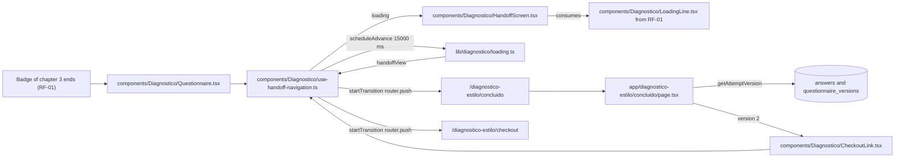

# RF-04. Checkout Hand-off Loading: Technical Specification

PRD: docs/prd/PRD-Quiz-Loading-Feedback.md · Scope covered: full feature (no Core/Full split) · Complexity: medium

## 1. Technical Overview

**What.** On questionnaire version 2, the two navigations that lead to payment show a loading screen instead of a frozen page: after the last chapter badge, "Preparando seu diagnóstico…" until the completion page renders; after "RECEBER MEU DIAGNÓSTICO", "Preparando seu Pix…" until the checkout page renders. Each screen uses the loading line of RF-01, filling slowly toward 90% over 8 s. If the next page does not open within 15 s, a message and "Tentar novamente" replace the loading screen.

**Why.** After "Concluir" the browser requests a server-rendered page (`force-dynamic`, with a database read in `resolveCheckoutAccess`) while the old screen stays frozen, and a frozen screen right before a payment looks like a failure. The code has no signal for "the navigation is still pending", so this feature adds one (`useTransition` around the navigation), a small hook, two presentational parts and a server-side version lookup so the completion page knows whether the attempt is on version 2.

**Scope.**

**Included:**
- Input contract (Consumes): the reusable loading line from RF-01 (a horizontal line filling over a duration and stopping at a fraction, with a status text and a static variant for reduced motion; inputs `label`, `durationMs`, `endAt`, `reduceMotion`). The 15 s limit reuses the pure `scheduleAdvance` that the spec of RF-01 puts in `lib/diagnostico/loading.ts` `(inferred: it is part of the RF-01 spec, not of the PRD Provides)`.
- A hook `useHandoffNavigation(path)` that runs `router.push` inside `useTransition`, locks a second tap, times out after 15 s and reports `idle`, `loading` or `failed`.
- A pure state rule `handoffView(pending, timedOut)`.
- `HandoffLoading` (hook-free: the RF-01 line with 8 s, 90% and a label) and `HandoffError` (the message and "Tentar novamente").
- `CheckoutLink`, a client component that replaces the "RECEBER MEU DIAGNÓSTICO" `<Link>` on the completion page for version 2 attempts.
- `getAttemptVersion(db, attemptId)`, a server read that gives the version number of the attempt, so the completion page knows whether to render `CheckoutLink` or the plain link.
- The wiring in `Questionnaire` for the move after the last chapter badge.
- The hand-off test of the RF-01 contract and a database test of `getAttemptVersion`.

**Deferred:** none. The feature has no Core/Full split. RF-04 has no Provides.

**Excluded:**
- The Pix charge creation and the checkout's own "Gerando seu Pix…" state (`Checkout.tsx`), which stay as they are.
- The badge screen and its 2 s line (RF-01), the "Salvando…" state (RF-02), the 500 ms line (RF-03).
- Questionnaire version 1: its completion page and checkout stay as today.
- Any change to `resolveCheckoutAccess` and to its redirects.

**Requirements / Business Rules** (PRD RF-04 Capabilities).
- Only for attempts on questionnaire version 2 (`version >= 2`, same gate as RF-02 and RF-03 `(inferred)`).
- First screen: after the chapter 3 badge ends (RF-01), the questionnaire page shows "Preparando seu diagnóstico…" and the line until the completion page is rendered.
- Second screen: after the customer taps "RECEBER MEU DIAGNÓSTICO" on the completion page, the page shows "Preparando seu Pix…" and the line until the checkout page is rendered. The checkout keeps its own loading state while it creates the charge.
- Both screens appear within 100 ms of the end of the badge wait or of the tap, with no minimum display time.
- The line has no fixed end: `HANDOFF_FILL_MS = 8000` toward `HANDOFF_FILL_TO = 0.9`, and it disappears when the next page replaces the screen.
- If the next page does not open within `HANDOFF_TIMEOUT_MS = 15000` ms, the loading screen is replaced by "Não conseguimos abrir a próxima etapa. Suas respostas estão salvas." and the button "Tentar novamente", which repeats the navigation.
- A second tap while the navigation is pending starts no second navigation.
- With reduced motion the line is the static variant and the text stays visible.
- Texts (drafts for Millena's review): "Preparando seu diagnóstico…", "Preparando seu Pix…" and the error message above.

**Requirements / UX Flows** (PRD RF-04 Experience).
1. The customer finishes the last chapter. The badge screen's line fills (2 s). The screen then shows "Preparando seu diagnóstico…" with the line; the completion page opens with the summary (15 of 15 answers, price R$ 9,90).
2. The customer taps "RECEBER MEU DIAGNÓSTICO". The button is replaced by "Preparando seu Pix…" and the line; the checkout page opens, showing the Pix code and QR code after its own loading.
3. Each status text is announced once by a screen reader (the status role of the loading line). A double tap creates no second navigation.

**Error Handling** (PRD RF-04 Error Handling).
- Completion page not opened within 15 s: message and "Tentar novamente" (repeat `router.push(COMPLETION_PATH)`). Detection: the timer started with the navigation fires while the transition is still pending.
- Checkout page not opened within 15 s: the same message and button (repeat `router.push(CHECKOUT_PATH)`). No charge is created by the retry beyond the single charge per attempt that `ensureCheckout` already guarantees (existing behavior).
- Attempt expired meanwhile: `resolveCheckoutAccess` redirects to `EXPIRED_PATH` with the expired-session notice; the route changes, the transition ends and the loading screen disappears (no new code).
- Fewer than 15 answers: `resolveCheckoutAccess` redirects to `INCOMPLETE_PATH` with the incomplete notice; same behavior (no new code).
- Nothing new is logged; the feature is presentation and navigation only.

## 2. Architecture Impact

**Affected components:**
- `components/Diagnostico/use-handoff-navigation.ts` (new)
- `components/Diagnostico/HandoffScreen.tsx` (new: `HandoffLoading` and `HandoffError`)
- `components/Diagnostico/CheckoutLink.tsx` (new)
- `components/Diagnostico/Questionnaire.tsx` (modified)
- `app/diagnostico-estilo/concluido/page.tsx` (modified)
- `lib/diagnostico/answers.ts` (modified)
- `lib/diagnostico/loading.ts` (modified; created by RF-01)

**Diagram:**



**Patterns followed:**
- Server pages that read the attempt through `getActiveAttemptId` and `getSupabaseAdmin()` and pass plain props to client components (observed in `app/diagnostico-estilo/perguntas/page.tsx`, `concluido/page.tsx`).
- Small server data helpers in `lib/diagnostico/answers.ts` with a typed `Db` client and a `fail(name, message)` error (observed: `getAttemptVersionId`, `getSavedChoices`).
- Paths as constants in `lib/diagnostico/paths.ts` (`COMPLETION_PATH`, `CHECKOUT_PATH`, `EXPIRED_PATH`, `INCOMPLETE_PATH`).
- Pure rules in `lib/diagnostico`, thin client components in `components/Diagnostico`, view tests with `renderToStaticMarkup` (`tests/unit/diagnostico/*.test.ts`), integration tests against the real local database with throwaway data (`tests/integration/diagnostico/chapters-handoff.test.ts`).
- `role="status"` for waiting states and `role="alert"` with a "Tentar novamente" button for failures (observed in `PreparingRefresh.tsx` and `Checkout.tsx`).
- Redirect-based guards (`redirect(...)` from `next/navigation` in the server pages) as the way expired and incomplete attempts leave the flow.
- Texts as constants with a "Draft copy for Millena's review" comment.

## 3. Technical Decisions

| Decision | Chosen Approach | Alternative Considered | Trade-off |
|---|---|---|---|
| Detecting "the next page is ready" | `startTransition(() => router.push(path))` inside `useTransition`; `isPending` stays true until the new route renders | `loading.tsx` in the route segments | `loading.tsx` shows for everyone, version 1 included, and cannot know the version; `isPending` is controlled per screen |
| Hand-off logic | A hook `useHandoffNavigation(path)` shared by the questionnaire and the completion page | The same code twice | One place for the lock, the 15 s limit and the retry |
| State rule | A pure `handoffView(pending, timedOut)` | State inside the hook only | Testable without a DOM |
| 15 s limit | `scheduleAdvance` from RF-01, cancelled when the navigation ends | A bare `setTimeout` | A cancellable one-shot is already planned; RF-04 depends on a function the PRD does not list in RF-01 Provides |
| Knowing the version on the completion page | New `getAttemptVersion` read in the server page, a prop to `CheckoutLink` | Read it on the client from a cookie or an API | The page already reads the attempt on the server and no new endpoint is needed; one extra small query |
| The checkout link | A client `CheckoutLink` with `href` kept and `preventDefault` on click | Keep `<Link>` and listen to its navigation | `Link` in Next 14.2 does not expose the pending state of its navigation |
| Hand-off proof | Call the hook-free `HandoffLoading()` and check it returns the real `LoadingLine` with 8 s and 0.9, and its static variant under reduced motion | Mock the line | Nothing is mocked; the animation itself is proven in the browser script |

**Assumptions** (everything marked `(inferred)` is open for review):
- `isPending` of `useTransition` stays true until the new route renders for `router.push` in the Next 14.2 App Router `(inferred; the browser script confirms it)`.
- The version gate is `version >= 2` `(inferred)`.
- The 15 s timer starts together with the navigation and is cancelled when `isPending` becomes false `(inferred)`.
- A retry repeats `router.push`; if the first navigation still completes in the background the page changes anyway `(inferred)`.
- The expired and incomplete cases need no new code because the destination page redirects `(inferred from `resolveCheckoutAccess` and the server pages)`.
- RF-01 is not implemented yet: `LoadingLine` (props `label`, `durationMs`, `endAt`, `reduceMotion`; static variant `data-animated="false"`) and `scheduleAdvance` are cited from its spec.
- The integration test pattern follows `tests/integration/diagnostico/chapters-handoff.test.ts` `(inferred: that file was not reopened for this spec)`.

**Traceability.** PRD RF-04 Consumes gives the input contract in Section 1; Capabilities give the Business Rules; Experience the UX Flows; Error Handling the Error Handling section. The 7 per-feature criteria and the 1 cross-feature criterion where RF-04 is the consumer are mapped in Section 7 (8 in total). The RF-03 cross-feature criterion is not RF-04's.

## 4. Component Overview

**Frontend**

| File Path | New/Modified | Purpose | Key Responsibilities |
|---|---|---|---|
| `components/Diagnostico/use-handoff-navigation.ts` | New | The navigation with a waiting state | Return `{ view, go }`; `go` ignores a second call while pending, runs `router.push(path)` in `startTransition`, starts the 15 s timer with `scheduleAdvance`, cancels it when the transition ends or the component unmounts; compute `view` with `handoffView` |
| `components/Diagnostico/HandoffScreen.tsx` | New | The two parts of the waiting screen | `HandoffLoading({ label, reduceMotion })` (no hooks): the RF-01 line with `HANDOFF_FILL_MS` and `HANDOFF_FILL_TO` and the label in a status; `HandoffError({ onRetry })`: the message in an alert and the "Tentar novamente" button |
| `components/Diagnostico/CheckoutLink.tsx` | New | The "RECEBER MEU DIAGNÓSTICO" action for version 2 | Render an `<a href>` styled as the current button; on click `preventDefault` and `go`; replace itself by `HandoffLoading` ("Preparando seu Pix…") or `HandoffError` according to `view` |
| `components/Diagnostico/Questionnaire.tsx` | Modified | The questionnaire screen | For version 2, replace the `router.push(COMPLETION_PATH)` in `leave()` by `go` of the hook; while `view` is `loading` render `HandoffLoading` ("Preparando seu diagnóstico…") in place of the section content, and `HandoffError` when `failed`; keep version 1 as it is |
| `app/diagnostico-estilo/concluido/page.tsx` | Modified | The completion page (server) | Read the attempt version with `getAttemptVersion`; render `CheckoutLink` for version 2 and the existing `<Link>` otherwise |

**Backend**

| File Path | New/Modified | Purpose | Key Responsibilities |
|---|---|---|---|
| `lib/diagnostico/answers.ts` | Modified | Attempt and answer reads | Add `getAttemptVersion(db, attemptId)`: the number of the version of the attempt (from its first answer), or `null` without answers |
| `lib/diagnostico/loading.ts` | Modified | Texts and timings of the loading feedback | Export `HANDOFF_FILL_MS`, `HANDOFF_FILL_TO`, `HANDOFF_TIMEOUT_MS`, the three texts and `handoffView` |

**Tests**

| File Path | New/Modified | Purpose | Key Responsibilities |
|---|---|---|---|
| `tests/unit/diagnostico/loading.test.ts` | Modified | Constants and the state rule | Add the hand-off constants and `handoffView` cases |
| `tests/unit/diagnostico/handoff-view.test.ts` | New | The hand-off parts and the RF-01 hand-off | Markup of the loading and error parts, the `CheckoutLink` markup, and the real-line hand-off test |
| `tests/integration/diagnostico/attempt-version.test.ts` | New | The version read | Real database: version of an attempt with no answers, with a version 2 answer, and after another version is published |

## 5. API Contracts

No HTTP endpoint is added or changed; the existing pages and `POST /api/diagnostico/checkout` are used as they are. The contracts are in-process:

```ts
// lib/diagnostico/answers.ts (server only)
export async function getAttemptVersion(db: Db, attemptId: string): Promise<number | null>;
// null when the attempt has no saved answer; otherwise questionnaire_versions.version of its first answer

// lib/diagnostico/loading.ts
export const HANDOFF_FILL_MS = 8000;
export const HANDOFF_FILL_TO = 0.9;
export const HANDOFF_TIMEOUT_MS = 15000;
export const HANDOFF_COMPLETION_LABEL = "Preparando seu diagnóstico…";
export const HANDOFF_CHECKOUT_LABEL = "Preparando seu Pix…";
export const HANDOFF_ERROR_MESSAGE = "Não conseguimos abrir a próxima etapa. Suas respostas estão salvas.";
export function handoffView(pending: boolean, timedOut: boolean): "idle" | "loading" | "failed";
// idle when not pending; loading when pending and not timed out; failed when pending and timed out

// components/Diagnostico/use-handoff-navigation.ts
export function useHandoffNavigation(path: string): { view: "idle" | "loading" | "failed"; go: () => void };

// components/Diagnostico/HandoffScreen.tsx
export function HandoffLoading(props: { label: string; reduceMotion: boolean }): JSX.Element; // no hooks
export function HandoffError(props: { onRetry: () => void }): JSX.Element;

// components/Diagnostico/CheckoutLink.tsx
export default function CheckoutLink(props: { reduceMotion?: boolean }): JSX.Element;
```

## 6. Data Model

No table, column, index or migration is added or changed. `getAttemptVersion` only reads existing data:

| Table | Column | Use |
|---|---|---|
| `answers` | `attempt_id`, `version_id` | The first answer of the attempt gives its version (as `getAttemptVersionId` does today) |
| `questionnaire_versions` | `id`, `version` | `version` (integer) is the number returned |

The read uses the service role client of the server pages. Nothing is written.

## 7. Testing Strategy

**Acceptance tests.** Criteria numbered in the order of PRD Section 9, RF-04; criterion 8 is the cross-feature one.

| # | Criterion (PRD Section 9) | Test | Proof |
|---|---|---|---|
| 1 | After the chapter 3 badge, "Preparando seu diagnóstico…" and the line show within 100 ms and stay until the completion page renders | `tests/unit/diagnostico/handoff-view.test.ts` :: `HandoffLoading shows the label as a status with the line`; `tests/unit/diagnostico/loading.test.ts` :: `handoffView is loading while pending and not timed out`; browser script steps 1 and 2 | fake |
| 2 | Tapping "RECEBER MEU DIAGNÓSTICO" shows "Preparando seu Pix…" and the line within 100 ms, until the checkout renders | `handoff-view.test.ts` :: `CheckoutLink renders a link to the checkout with the original look`; browser script step 3 | fake |
| 3 | A double tap on "RECEBER MEU DIAGNÓSTICO" starts no second navigation | Browser script step 4 (the lock needs a real DOM and a real navigation) | fake |
| 4 | If the completion page does not open within 15 s, the message and "Tentar novamente" appear and repeat the navigation | `loading.test.ts` :: `handoffView is failed once it timed out while pending`, `the hand-off constants are 8000, 0.9 and 15000`; `handoff-view.test.ts` :: `HandoffError shows the message and Tentar novamente`; browser script step 5 | fake |
| 5 | An attempt that expired during the wait goes to the registration page with the notice and no loading screen stays | Browser script step 6; existing `tests/integration/diagnostico/checkout-route.test.ts` for the expired-session redirect is unchanged `(inferred: file name taken from `docs/quiz-v2/STATUS.md`, function not reopened)` | fake |
| 6 | With reduced motion both loading screens show a static line and the text | `handoff-view.test.ts` :: `HandoffLoading is the static line under reduced motion`; browser script step 7 | fake |
| 7 | An attempt on version 1 reaches the completion page and the checkout as today | `tests/integration/diagnostico/attempt-version.test.ts` :: `an attempt without answers has no version`, `an attempt keeps version 1 after version 2 is published`; browser script step 8 | fake |
| 8 | Cross-feature (RF-01 to RF-04): the line used while the checkout loads is the RF-01 component, and its reduced-motion variant is the static line | `handoff-view.test.ts` :: `the RF-01 to RF-04 hand-off: the hand-off screen is the real loading line, static under reduced motion` | fake |

New test functions to create, with the file that holds each:
- `tests/unit/diagnostico/loading.test.ts` (file created by RF-01; RF-04 adds): `the hand-off constants are 8000, 0.9 and 15000`, `handoffView is idle when it is not pending`, `handoffView is loading while pending and not timed out`, `handoffView is failed once it timed out while pending`.
- `tests/unit/diagnostico/handoff-view.test.ts`: `HandoffLoading shows the label as a status with the line`, `HandoffLoading is the static line under reduced motion`, `HandoffError shows the message and Tentar novamente`, `CheckoutLink renders a link to the checkout with the original look`, `the RF-01 to RF-04 hand-off: the hand-off screen is the real loading line, static under reduced motion`. The file mocks `next/navigation` like `questionnaire-two-choice-view.test.ts`.
- `tests/integration/diagnostico/attempt-version.test.ts`: `an attempt without answers has no version`, `an attempt with a version 2 answer reports 2`, `an attempt keeps version 1 after version 2 is published`.

**Hand-off test (RF-04 is the consumer).** `tests/unit/diagnostico/handoff-view.test.ts` :: `the RF-01 to RF-04 hand-off: the hand-off screen is the real loading line, static under reduced motion`. It quotes the PRD criterion "Given the loading line provided by RF-01, when RF-04 shows "Preparando seu Pix…" while the checkout loads, then the line used is the same component and its reduced-motion variant is the static line when "reduce motion" is on". It imports the real `LoadingLine` from RF-01 and the real `HandoffLoading` of RF-04, calls `HandoffLoading({ label: HANDOFF_CHECKOUT_LABEL, reduceMotion: false })` (it has no hooks) and asserts that the returned element's `type` is `LoadingLine` with `durationMs: 8000`, `endAt: 0.9` and the label. It then renders it with `reduceMotion: true` through `renderToStaticMarkup` and asserts `data-animated="false"` and the visible text. Nothing is mocked. It cannot run before RF-01 is implemented; the plan names RF-01 as a prerequisite.

**Live check:** not applicable. No criterion depends on a model provider or an agent.

**Verification script** (followed by `verify-feature` with `playwright-cli` against the running app). Start: local database with questionnaire version 2 published (`npm run quiz:publish -- 2`), a new attempt created through the registration form, viewport 360 x 640, reduced motion off. To slow a navigation add a route on its server request, for example `playwright-cli run-code "async page => await page.route('**/diagnostico-estilo/concluido*', async route => { await new Promise(r => setTimeout(r, 3000)); await route.continue(); })"` (3 s) or 17000 ms for the time-out case; remove it with `playwright-cli unroute`.

1. Answer steps 1 to 15 with the 3 s delay route on the completion page. After the chapter 3 badge (2 s) expect "Preparando seu diagnóstico…" with a thin line, within about 0.1 s of the end of the badge wait. (Criterion 1)
2. Keep watching. Expect the line to keep filling slowly while the page loads, then the completion page ("Você está a um passo de descobrir sua essência!", "15 de 15 perguntas respondidas", R$ 9,90) to replace it. (Criterion 1)
3. On the completion page, with a 3 s delay route on `**/diagnostico-estilo/checkout*`, tap "RECEBER MEU DIAGNÓSTICO". Expect the button to be replaced at once by "Preparando seu Pix…" and the line, then the checkout page to open ("Gerando seu Pix…", then the Pix). (Criterion 2)
4. Repeat step 3 and tap the button twice quickly. Expect one loading screen and one checkout page, with no second navigation and no error. (Criterion 3)
5. Set the delay of the completion route to 17 s and repeat the badge of chapter 3. Expect "Preparando seu diagnóstico…" for 15 s and then "Não conseguimos abrir a próxima etapa. Suas respostas estão salvas." with "Tentar novamente". Remove the route and tap the button: expect the loading screen and then the completion page. Repeat for the checkout (17 s on `**/checkout*`). (Criterion 4)
6. Start the 3 s delay on the checkout route, tap "RECEBER MEU DIAGNÓSTICO", and clear the attempt cookie (`playwright-cli cookie-delete` of the attempt cookie) before it ends. Expect the registration page with the notice "Sua sessão expirou. Vamos recomeçar rapidinho?" and no loading screen left. Then, with a new attempt of fewer than 15 answers, open the completion path by address: expect the questionnaire with "Faltam algumas respostas para concluir." (Criterion 5)
7. Turn on reduced motion (`playwright-cli set-reduced-motion reduce`) and repeat steps 1 and 3. Expect the line to be drawn still, the text visible and the navigation to work. Check the accessibility tree (`playwright-cli snapshot`): one status text per screen. (Criterion 6)
8. Publish version 1 again or use a version 1 attempt, answer 15 questions, tap "Concluir" and then "RECEBER MEU DIAGNÓSTICO". Expect no "Preparando…" screen on either step, the plain link, and the checkout opening as today. Restore version 2 afterwards. (Criterion 7)
9. At 1280 px width repeat step 1. Expect the loading screen centered in the content column with no horizontal scroll. (Beyond the criteria: layout.)

**Test data and fixtures.** The unit view tests need no data. The integration test creates a throwaway customer, attempt and answers on version 1 and version 2 of the local database, removes them in `afterAll`, and must pass with version 1 and with version 2 published (the project's two-configuration rule). The browser script needs the local Supabase with the right version published and a throwaway customer.

**Not tested here.** The real 90% fill over 8 s and the pending state of the transition (browser script only); the checkout's own loading and the Pix charge (existing tests); the redirects of `resolveCheckoutAccess` (existing, unchanged).
