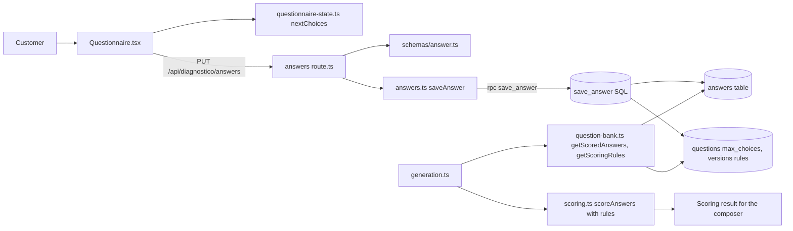

# RF-01. Two-Choice Answers and Weighted Scoring: Technical Specification

PRD: docs/prd/PRD-Quiz-Multipla-Escolha-Gamificado.md · Scope covered: Core + Full · Complexity: medium

## 1. Technical Overview

**What.** Customers can pick up to two alternatives in a question. The first choice scores 2 points and the optional second choice scores 1 point. The schema, the atomic save function, the answers route, the scoring engine and the questionnaire screen are extended so that one code path serves two kinds of questionnaire version: the current one (one choice, 1 point) and the future version 2 (up to two choices, 2 and 1 points, built by RF-02). This feature creates the rule columns and the engine; it does not create version 2 itself.

**Why.** Today `answers` holds one `alternative_id` per question, `save_answer` accepts one alternative, `scoreAnswers` expects exactly 15 answers with one weight each and the tie-break counts chosen alternatives. None of this can express a second choice. The rules must be data on the version and on the question (not `if (version === 2)` in the code) so that version 1 keeps scoring exactly as before and later versions need no code change.

**Scope.**

**Included:**
- Core feature functionality: up to 2 alternatives per question, 2 points for the first and 1 point for the second, immediate saving of every selection change, deterministic scoring with the tie-break below.
- Full Scope addition: a visible hint that the second choice is optional (copy to be reviewed by Millena).
- Integrated cross-cutting concern: the version 1 attempts keep their answers, their scoring and their screens unchanged (RF-02 routes attempts to versions, RF-01 guarantees the rules are backward compatible).
- Output contract (Provides), saved answers: for each of the 15 steps, the first-choice alternative, the optional second-choice alternative and the questionnaire version of the attempt. Used by RF-02, RF-03 and RF-04.
- Output contract (Provides), scoring result: points of each of the six styles, predominant style, secondary style and the tie-break level used. Consumed by the diagnosis composition, whose input shape does not change.
- Input contract (Consumes): none.

**Deferred:** none.

**Excluded:**
- Creating, seeding or publishing the version 2 question set, chapters, duel steps and their images (RF-02, RF-03, RF-04).
- Version routing of attempts (RF-02).
- A "remove the only choice" operation: the API has no delete (see Section 3).
- Changes to registration, checkout, payment, diagnosis texts, PDF and result screen.

### Requirements / Business Rules

- A question stores `max_choices` (1 or 2, default 1). A question with `max_choices = 1` accepts only a first choice; a question with `max_choices = 2` accepts a first choice and an optional second choice. In version 2 (RF-02) the 12 regular questions have 2 and the 3 duels have 1.
- A questionnaire version stores `first_choice_points` (default 1), `second_choice_points` (default 0) and `late_tiebreak_basis` (`'answers'` or `'points'`, default `'answers'`). Version 1 keeps the defaults. Version 2 (RF-02) uses 2, 1 and `'points'`.
- Points of a style = sum, over the choices that picked one of its alternatives, of (`first_choice_points` for a first choice, `second_choice_points` for a second choice) × the alternative weight. With the defaults this is exactly the weight, as today. All weights stay 1 in version 2 (PRD RF-01 Capabilities).
- A regular question shows 4 alternatives of 4 different styles, so a first and a second choice always belong to different styles.
- Range for version 2 (PRD): 12 regular questions give 24 to 36 points and 3 duels give 6 points, 30 to 42 in total. Percentages shown in the diagnosis keep the existing largest-remainder method over the points.
- Secondary style: because each style appears in 9 of the 15 steps, the leading style cannot hold the first choice in at least 6 steps, so those first choices go to the other five styles and the secondary style always has at least 2 points. This is proven by a property test, not enforced at run time.
- Tie-break, in this order: (1) the style with the higher value in steps 11 to 15, where the value is the count of chosen alternatives when `late_tiebreak_basis = 'answers'` (version 1) and the sum of points when it is `'points'` (version 2); (2) the fixed priority order already in use: Elegante, Tradicional, Romântico, Esportivo/Natural, Criativo, Dramático.
- Validation of an attempt before scoring: exactly 15 answered questions (distinct positions 1 to 15); each has one first choice and at most one second choice; the second choice has a different alternative and a different style than the first; a second choice exists only when `second_choice_points > 0`; each weight is an integer from 1 to 3.
- A saved answer is always the whole state of the question: the first choice and, optionally, the second. A save replaces the previous state. The question can be changed but not returned to "unanswered".

### Requirements / UX Flows

- Alternatives stay as cards at least 56 px tall (the current minimum), text 16 px or larger. The group keeps radio-group semantics, extended with a visible state text, so it works by keyboard.
- The first tap on a card selects it and marks it "1ª escolha". In a question with `maxChoices = 2`, a tap on a different card marks it "2ª escolha". Points and styles are never shown.
- Tapping the card marked "2ª escolha" removes the second choice. Tapping the card marked "1ª escolha" while a second exists promotes the second to first and clears the second. A tap on a third card replaces the second choice.
- Tapping the only selected card keeps it selected (inferred, see Section 3). The PRD Experience says it removes it, which the API cannot persist; this is the one point where the spec deviates from the PRD text.
- "Próxima" (or "Concluir") is enabled when the first choice is saved on the server, with or without a second. It stays disabled while a save is pending, failed or rejected, as today.
- Full Scope: under the alternatives of a question with `maxChoices = 2` the screen shows a line saying that a second choice is optional (draft copy: "Se mais de uma opção combina com você, escolha uma segunda. É opcional.", inferred, for Millena to review). Questions with `maxChoices = 1` show no such line and no "1ª escolha" label.
- Selection state is conveyed by text and shape ("1ª escolha", "2ª escolha", border), never by color alone.

### Error Handling

- Save fails (network or 5xx): the choice stays on screen, the message "Não conseguimos salvar sua resposta. Tentando de novo…" is shown and the save is retried 3 times (500 ms, 1500 ms, 3000 ms, as today).
- Still failing: "Sem conexão. Suas respostas já salvas estão seguras. Tente novamente." with a retry button; advancing is blocked until the change is saved. Nothing sensitive is logged (no body, no cookie).
- Invalid answer (an alternative of another question, the same alternative as first and second, a second choice on a question with `max_choices = 1`, a second choice without a first): the server answers 400 with `VALIDATION_ERROR`; the screen shows "Não foi possível salvar essa resposta. Escolha a alternativa de novo." and restores the last saved state of that question.
- Attempt cookie missing or expired, or the attempt expired: 403 and the existing redirect to the expired-session path with "Sua sessão expirou. Vamos recomeçar rapidinho?".
- Incomplete attempt at completion (fewer than 15 answered questions): the existing checkout guard (`getAnswerProgress.firstUnansweredPosition`) sends the customer back to the first unanswered question with "Faltou uma resposta. Vamos terminar?" (inferred copy).
- Concurrent saves of one question: the server serializes them with the existing advisory lock; the client keeps at most one request in flight per question and sends the latest state afterwards, so an older state never overwrites a newer one.
- Scoring input that breaks the validation above: `ScoringError("INVALID_ANSWERS")`, which `generation.ts` already turns into a generation error for human attention.

## 2. Architecture Impact

**Affected components:**
- `supabase/migrations/20260101000018_two_choice_answers.sql` (new): columns, constraint and the new `save_answer`.
- `lib/diagnostico/database.types.ts`: regenerated.
- `lib/diagnostico/scoring.ts`, `lib/diagnostico/question-types.ts`, `lib/diagnostico/question-bank.ts`, `lib/diagnostico/generation.ts`: scoring rules.
- `lib/diagnostico/answers.ts`, `lib/diagnostico/schemas/answer.ts`, `app/api/diagnostico/answers/route.ts`: save contract.
- `lib/diagnostico/questionnaire-state.ts`, `lib/diagnostico/questionnaire-page.ts`, `components/Diagnostico/Questionnaire.tsx`: screen.

**Diagram:**



**Patterns followed (observed):**
- Atomic save in SQL with `pg_advisory_xact_lock(hashtext(attempt))` and `raise exception '<CODE>' using errcode = 'P0001'`, mapped to an error class in TypeScript: `supabase/migrations/20260101000007_save_answer.sql`, `lib/diagnostico/answers.ts` (`AnswerError`).
- Zod body schemas with Portuguese messages in a `*_MESSAGES` constant: `lib/diagnostico/schemas/answer.ts`.
- Errors returned through `apiError(code, message, status, fields)` and logged without bodies: `app/api/diagnostico/answers/route.ts`.
- Pure scoring module with no database or network, fully unit tested: `lib/diagnostico/scoring.ts`, `tests/unit/diagnostico/scoring.test.ts`.
- Server-only data access with a typed `SupabaseClient<Database>`: `lib/diagnostico/answers.ts`, `lib/diagnostico/question-bank.ts`.
- Public question types never carry style or weight (columns are not even selected): `lib/diagnostico/question-bank.ts` (`getPublicQuestionSet`).
- Retry delays and pure helpers kept out of the client component: `lib/diagnostico/questionnaire-state.ts`.
- Access model "RLS on, no policies, service role on the server", with default privileges already granting `execute` on new functions to `service_role`: `supabase/migrations/20260101000016_grant_service_role.sql`.
- Integration tests run against the shared local Supabase with helpers (`adminClient`, `createCustomer`, `createAttempt`): `tests/integration/diagnostico/helpers.ts`.

## 3. Technical Decisions

| Decision | Chosen Approach | Alternative Considered | Trade-off |
|---|---|---|---|
| Where the second choice is stored | New nullable column `answers.second_alternative_id` on the existing row | One row per choice with a `rank` column | Readers that count rows (`getSavedAnswers`, `getAnswerProgress`, `checkout.ts`, `generation.ts`) keep working; the table is less normalized |
| Where the rules per version live | Columns: `questions.max_choices`, `questionnaire_versions.first_choice_points`, `second_choice_points`, `late_tiebreak_basis` | A fixed rule in code selected by version number | Four extra columns, but no code change for later versions and a backward compatible default |
| Shape of the save call | Same `PUT /api/diagnostico/answers` with `{questionId, alternativeId, secondAlternativeId?}`; each call replaces the whole answer of the question | A separate endpoint for the second choice | Idempotent calls; the client must send the complete state each time |
| Tie-break rule per version | `late_tiebreak_basis` column read into `rules.lateBasis` | Derive it from `second_choice_points > 0` | One more column, but the rule is explicit and not implied by another one |
| Scoring input | One `ScoredAnswer` per chosen alternative with an optional `rank` (default 1), plus `getScoringRules(db, attemptId)` | Change the return type of `getScoredAnswers` | Existing tests that build `ScoredAnswer` without `rank` keep passing; two reads instead of one |
| Removing the only choice | Not supported: the only selected card stays selected | Add a delete operation to the API | A question never returns to "unanswered", so the PRD sentence is not met literally; avoids a delete path and an "answered but empty" state |
| Order of overlapping saves | At most one in-flight `PUT` per question, then the latest state | Send every tap immediately and rely on a ticket to ignore old responses | Slightly later saving; removes the case where the server applies an older tap last |

**Assumptions (every inference is also marked in the text):**
- The migration number is `20260101000018` and the file is named `two_choice_answers` (inferred).
- Constraints on the version columns: `first_choice_points` between 1 and 5, `second_choice_points` between 0 and 5 and not greater than `first_choice_points` (inferred).
- `save_answer` is replaced, not overloaded: the old 3-parameter function is dropped and a 4-parameter one with `p_second uuid default null` is created, with the same revoke from `public, anon, authenticated`. `execute` for `service_role` comes from the default privileges of migration 16 (inferred; the migration test checks it).
- A second choice also requires that the version has `second_choice_points > 0` at scoring time. At save time only `max_choices` is checked, because RF-02 sets both together (inferred).
- Error code for the new rejections is `CHOICE_NOT_ALLOWED`, mapped to `fields.secondAlternativeId` in the 400 body (inferred).
- Tests that need a two-choice questionnaire create their own non-published fixture version, because the partial unique index allows a single published version and the test must not touch version 1. The first answer of an attempt on a fixture version is pinned by a direct `insert` into `answers` (service role), since `save_answer` only pins to a published version. Fixtures are deleted by their ids (inferred).
- For manual and browser checks only, a disposable per-session database can set `max_choices = 2` and the version 2 rules on version 1. This is never done on the shared database (inferred).
- Provide/consume with the screen: `PublicQuestionSet` questions gain `maxChoices: 1 | 2`. It reveals no style or weight (inferred).
- The label texts "1ª escolha", "2ª escolha" and the optional-hint line are drafts for Millena (inferred, PRD marks them for review).

**Traceability:** Provides → Section 1 Scope and Section 5; Core Scope and Full Scope → Section 1 Included; Capabilities → Business Rules; Experience → UX Flows; Error Handling → Error Handling; Section 9 per-feature criteria → Section 7 acceptance tests; Section 9 cross-feature criteria where RF-01 is the provider → pointers in Section 7. A structural decision with trade-offs (rules as data on the version) is a candidate for an ADR.

## 4. Component Overview

### Data

| File Path | New/Modified | Purpose | Key Responsibilities |
|---|---|---|---|
| `supabase/migrations/20260101000018_two_choice_answers.sql` | New | Schema for two choices and per-version rules | Add the four rule columns and `answers.second_alternative_id`; add the distinct-alternatives check; replace `save_answer` |
| `lib/diagnostico/database.types.ts` | Modified | Typed schema | Regenerated: new columns and the new `save_answer` arguments |

### Backend

| File Path | New/Modified | Purpose | Key Responsibilities |
|---|---|---|---|
| `lib/diagnostico/scoring.ts` | Modified | Scoring engine | `ScoringRules`, `DEFAULT_RULES` (version 1), `scoreAnswers(answers, rules?)`, per-question validation, tie-break by `lateBasis` |
| `lib/diagnostico/question-types.ts` | Modified | Shared types | `ScoredAnswer.rank?`, `PublicQuestionSet` question `maxChoices` |
| `lib/diagnostico/question-bank.ts` | Modified | Question and answer reads | `getScoredAnswers` returns one item per choice with `rank`; new `getScoringRules`; `getPublicQuestionSet` selects `max_choices` |
| `lib/diagnostico/generation.ts` | Modified | Diagnosis generation | Count distinct questions (not items) against `EXPECTED_ANSWERS`; pass the rules to `scoreAnswers` |
| `lib/diagnostico/answers.ts` | Modified | Answer persistence | `saveAnswer(..., secondAlternativeId?)`; `SavedChoice`; new `getSavedChoices`; `CHOICE_NOT_ALLOWED` |
| `lib/diagnostico/schemas/answer.ts` | Modified | Body validation | Optional nullable `secondAlternativeId`; new message |
| `app/api/diagnostico/answers/route.ts` | Modified | HTTP entry | Pass the second choice; map `CHOICE_NOT_ALLOWED` to a 400 on `secondAlternativeId` |

### Frontend

| File Path | New/Modified | Purpose | Key Responsibilities |
|---|---|---|---|
| `lib/diagnostico/questionnaire-state.ts` | Modified | Pure screen helpers | `SavedChoice` type, `nextChoices(current, tapped, maxChoices)`, `canAdvance` over choices |
| `lib/diagnostico/questionnaire-page.ts` | Modified | Server loader | Load saved choices (`getSavedChoices`) and compute the start index |
| `components/Diagnostico/Questionnaire.tsx` | Modified | Questionnaire screen | Two-level selection with "1ª/2ª escolha" labels, optional hint, one in-flight save per question |

### Tests

| File Path | New/Modified | Purpose | Key Responsibilities |
|---|---|---|---|
| `tests/unit/diagnostico/scoring-two-choice.test.ts` | New | Engine rules | Points, ranges, tie-break by points, secondary ≥ 2 property, default rules equal version 1 |
| `tests/unit/diagnostico/questionnaire-state.test.ts` | Modified | Tap logic | `nextChoices` cases, `canAdvance` |
| `tests/unit/diagnostico/questionnaire-two-choice-view.test.ts` | New | Static markup | Labels, hint, single-choice question unchanged |
| `tests/unit/diagnostico/answer-schema.test.ts` | Modified | Body schema | `secondAlternativeId` cases |
| `tests/integration/diagnostico/two-choice-sql.test.ts` | New | `save_answer` | Valid and invalid saves, replace semantics, version 1 compatibility |
| `tests/integration/diagnostico/answers-route.test.ts` | Modified | Route | 200 and 400 paths with the second choice |
| `tests/integration/diagnostico/answers-lib.test.ts` | Modified | Library | `getSavedChoices`, progress unaffected by second choices |
| `tests/integration/diagnostico/schema.test.ts` | Modified | Schema | Columns, defaults and constraints |
| `tests/integration/diagnostico/helpers.ts` | Modified | Fixtures | `createTwoChoiceFixture`, `pinAttemptToVersion`, cleanup by id |

## 5. API Contracts

### `PUT /api/diagnostico/answers` (modified)

The attempt is identified only by the signed cookie. The body replaces the whole answer of one question.

Request:

| Field | Type | Validation |
|---|---|---|
| `questionId` | string | UUID, required |
| `alternativeId` | string | UUID, required (the first choice) |
| `secondAlternativeId` | string or null | UUID, optional; `null` or absent clears the second choice |

```json
{
  "questionId": "6b1f1b5c-0c5e-4f3e-9d0b-1c2f3a4b5c6d",
  "alternativeId": "0a1b2c3d-4e5f-4a6b-8c7d-9e0f1a2b3c4d",
  "secondAlternativeId": "7d6c5b4a-3f2e-4d1c-9b8a-0f1e2d3c4b5a"
}
```

Success, `200`:

```json
{ "answeredCount": 7 }
```

`answeredCount` is the number of answered questions (rows), not of choices. A body without `secondAlternativeId` behaves exactly as today.

Errors (the project's existing `apiError` body):

| Status | Code | When |
|---|---|---|
| 400 | `VALIDATION_ERROR` | Malformed body, an alternative of another question (`fields.alternativeId`), or `CHOICE_NOT_ALLOWED` (`fields.secondAlternativeId`: same alternative twice, second on a question with `max_choices = 1`) |
| 400 | `VALIDATION_ERROR` | `VERSION_MISMATCH`: the question belongs to another version than the attempt's (`fields.alternativeId`, as today) |
| 403 | `FORBIDDEN` | Missing, tampered or expired cookie, or expired attempt: "Sua sessão expirou." |
| 500 | `INTERNAL_ERROR` / `CONFIG_ERROR` | Unexpected failure, as today |

```json
{
  "error": {
    "code": "VALIDATION_ERROR",
    "message": "Dados inválidos.",
    "fields": { "secondAlternativeId": ["Segunda escolha inválida para esta pergunta."] }
  }
}
```

(The exact envelope is the one returned by `apiError` today; the example shows the new field only.)

### Public functions and SQL (Provides)

- `saveAnswer(db, attemptId, questionId, alternativeId, secondAlternativeId?) → Promise<number>` returns the answered question count. Throws `AnswerError` with `ATTEMPT_NOT_FOUND`, `ALTERNATIVE_MISMATCH`, `VERSION_MISMATCH` or `CHOICE_NOT_ALLOWED`.
- `getSavedChoices(db, attemptId) → Promise<Record<string, { first: string; second: string | null }>>`: saved answers by question id (used by RF-02, RF-03, RF-04 and the screen). `getSavedAnswers` keeps returning the first choice only.
- `getScoredAnswers(db, attemptId) → Promise<ScoredAnswer[]>`, one item per choice: `{ questionPosition, style, weight, rank }`.
- `getScoringRules(db, attemptId) → Promise<ScoringRules>`: `{ firstPoints, secondPoints, lateBasis }` of the version stored on the attempt's answers.
- `scoreAnswers(answers, rules = DEFAULT_RULES) → ScoringResult`: `{ points, predominant, secondary, tieBreaks }`. Output shape unchanged.
- SQL `save_answer(p_attempt uuid, p_question uuid, p_alternative uuid, p_second uuid default null) returns integer`. Raises `ATTEMPT_NOT_FOUND`, `ALTERNATIVE_MISMATCH`, `VERSION_MISMATCH`, `CHOICE_NOT_ALLOWED`.

## 6. Data Model

Migration `supabase/migrations/20260101000018_two_choice_answers.sql` (follows the project's conventions: snake_case, `smallint` for small counts, constraints named in the table, functions revoked from `public, anon, authenticated`).

```sql
alter table public.questionnaire_versions
  add column first_choice_points smallint not null default 1
    check (first_choice_points between 1 and 5),
  add column second_choice_points smallint not null default 0
    check (second_choice_points between 0 and 5),
  add column late_tiebreak_basis text not null default 'answers'
    check (late_tiebreak_basis in ('answers', 'points')),
  add constraint questionnaire_second_not_above_first
    check (second_choice_points <= first_choice_points);

alter table public.questions
  add column max_choices smallint not null default 1
    check (max_choices in (1, 2));

alter table public.answers
  add column second_alternative_id uuid
    references public.alternatives(id) on delete restrict,
  add constraint answers_second_differs
    check (second_alternative_id is null or second_alternative_id <> alternative_id);

drop function public.save_answer(uuid, uuid, uuid);
-- create function public.save_answer(p_attempt uuid, p_question uuid, p_alternative uuid, p_second uuid default null)
--   same checks as migration 7, plus:
--   if p_second is not null:
--     the question must have max_choices = 2          else CHOICE_NOT_ALLOWED
--     p_second <> p_alternative                        else CHOICE_NOT_ALLOWED
--     p_second must belong to p_question               else ALTERNATIVE_MISMATCH
--   the upsert sets second_alternative_id = p_second (null clears it)
revoke all on function public.save_answer(uuid, uuid, uuid, uuid) from public, anon, authenticated;
```

- Existing rows: every version keeps the defaults (1, 0, `'answers'`), every question keeps `max_choices = 1`, every answer has `second_alternative_id` null. No data migration and no rewrite of past answers.
- Indexes: none added. `answers_attempt_idx` and `unique (attempt_id, question_id)` still cover all reads; `second_alternative_id` is not queried on its own.
- Relationships: `answers.second_alternative_id → alternatives.id` with `on delete restrict`, like `alternative_id`. Erasing a customer still cascades from `purchase_attempts → answers`.
- That the second alternative belongs to the same question is enforced by the function (the access model has no other write path), and checked by `two-choice-sql.test.ts`.
- Applying the migration follows the project's rule: only `supabase migration up`, never `db reset`.

## 7. Testing Strategy

### Acceptance tests

Criteria are numbered in the order of PRD Section 9, RF-01.

| # | Criterion (PRD Section 9, RF-01) | Test | Proof |
|---|---|---|---|
| 1 | One tap marks "1ª escolha" and enables "Próxima" | `tests/unit/diagnostico/questionnaire-state.test.ts` › `nextChoices: a first tap selects the first choice`; `canAdvance` enabled with a saved first choice; `tests/unit/diagnostico/questionnaire-two-choice-view.test.ts` › `a saved first choice shows "1ª escolha"`; verification script steps 1 and 2 | fake |
| 2 | A different card becomes "2ª escolha" and is saved before advancing | `questionnaire-state.test.ts` › `nextChoices: a tap on a different card sets the second choice`; `tests/integration/diagnostico/answers-route.test.ts` › `saves a second choice and returns the answered count`; `two-choice-sql.test.ts` › `saves a first and a second choice in one row`; script steps 3 and 4 | fake |
| 3 | Tapping "2ª escolha" removes it | `questionnaire-state.test.ts` › `nextChoices: tapping the second choice clears it`; `answers-route.test.ts` › `a null secondAlternativeId clears the second choice`; script step 5 | fake |
| 4 | A third card becomes the second and the old second is cleared | `questionnaire-state.test.ts` › `nextChoices: a third card replaces the second choice`; `two-choice-sql.test.ts` › `a new second alternative replaces the previous one`; script step 6 | fake |
| 5 | Scoring: 2 points per first choice, 1 per second, total 30 to 42 | `tests/unit/diagnostico/scoring-two-choice.test.ts` › `first choice gives 2 points and second gives 1`; `an attempt of 12 two-choice questions and 3 duels totals between 30 and 42` | fake |
| 6 | Only first choices rank like single choice | `scoring-two-choice.test.ts` › `an attempt with only first choices ranks like the same answers scored as single choice` | fake |
| 7 | Tie-break by points in steps 11 to 15, then the fixed order | `scoring-two-choice.test.ts` › `a tie is broken by points in steps 11 to 15`; `a tie still equal falls to the fixed order`; `the answers basis keeps counting chosen alternatives` | fake |
| 8 | The secondary style has at least 2 points | `scoring-two-choice.test.ts` › `the secondary style always has at least 2 points` (seeded random attempts over the version 2 structure, 5000 cases, plus the 30 style pairs) | fake |
| 9 | Repeated alternative or alternative of another question is refused | `two-choice-sql.test.ts` › `refuses the same alternative as first and second choice`; `refuses a second alternative of another question`; `refuses a second choice on a single-choice question`; `answers-route.test.ts` › `answers 400 on the second choice rejections` | fake |
| 10 | A version 1 attempt scores as before | `scoring-two-choice.test.ts` › `default rules give the same result as the version 1 engine for 1000 random attempts`; existing `scoring.test.ts` unchanged; `tests/integration/diagnostico/generation-handoff.test.ts` (existing) still passes | fake |
| 11 | Failed save: after 3 retries the offline message blocks advancing | Verification script step 8 (network blocked); `questionnaire-state.test.ts` › `retry delays stay 500, 1500 and 3000 ms` | fake |
| 12 | An attempt with fewer than 15 saved steps is sent to the first unanswered one | `tests/integration/diagnostico/answers-lib.test.ts` › `second choices do not change the first unanswered position`; `tests/integration/diagnostico/checkout-route.test.ts` › `an incomplete attempt is refused and points to the first unanswered question` (existing, extended) | fake |

Also covered (not a numbered criterion): `schema.test.ts` › `the rule columns have the version 1 defaults`, `answers_second_differs rejects equal alternatives`; `answer-schema.test.ts` › `accepts a null or absent secondAlternativeId and rejects a non-UUID`; `generation.test.ts` (existing) › a two-choice attempt is counted as 15 questions, not as 15 to 30 answers.

### Live checks

Live check: not applicable. No criterion depends on a model provider or an agent; the feature uses only the local database and the application code.

### Verification script

Prerequisite: a **disposable per-session database** with all migrations applied and the dev server on the session's port (never the shared database). In that database, make version 1 behave like version 2 for the check:
`update public.questions set max_choices = 2;`
`update public.questionnaire_versions set first_choice_points = 2, second_choice_points = 1, late_tiebreak_basis = 'points' where version = 1;`
Register a test customer and open the questionnaire (mobile viewport 360 px, then desktop 1280 px).

| Step | Start state | Action | Expected result (what the user sees) | Criterion |
|---|---|---|---|---|
| 1 | Question 1, nothing selected | Open the questionnaire | The four cards, the line "Se mais de uma opção combina com você, escolha uma segunda. É opcional." and "Próxima" disabled | 1 |
| 2 | Same | Tap card A | Card A shows a border and the text "1ª escolha"; "Próxima" becomes enabled once the save finishes | 1 |
| 3 | Card A selected | Tap card B | Card B shows "2ª escolha"; card A keeps "1ª escolha" | 2 |
| 4 | A and B selected | Reload the page | The same two cards come back with the same labels, on question 1 or the first unanswered one | 2 |
| 5 | A "1ª", B "2ª" | Tap card B | Card B loses its label; A keeps "1ª escolha"; "Próxima" stays enabled | 3 |
| 6 | A "1ª", B "2ª" | Tap card C | C shows "2ª escolha"; B shows no label | 4 |
| 7 | A "1ª", C "2ª" | Tap card A | C becomes "1ª escolha" and A shows no label (promotion) | 2, 4 |
| 8 | Question 2, one card selected | Block the network, tap another card | After the retries: "Sem conexão. Suas respostas já salvas estão seguras. Tente novamente." with a retry button, and "Próxima" disabled; re-enable the network and tap the retry button: the message disappears | 11 |
| 9 | A question whose `max_choices` is set back to 1 in the disposable database | Open it, tap two different cards | Only the last tapped card is selected, no "1ª/2ª escolha" label and no hint line | 1 (single-choice unchanged) |
| 10 | Answers saved for 14 of 15 questions | Open the completion path directly | The customer is sent back to the unanswered question | 12 |

Beyond the happy path, also check: keyboard only (Tab, Space/Enter select and change the choices), the reduced-motion setting, the 360 px width without horizontal scroll, and that no style name or point value appears anywhere in the page text or in the network responses.

### Hand-off tests (cross-feature)

RF-01 consumes nothing, so it owns no hand-off test. As the provider it points to the consumers:
- Covered by the hand-off test of RF-02, implemented after this feature: restoring a saved first and second choice and showing the first unanswered step.
- Covered by the hand-off test of RF-03, implemented after this feature: a duel choice saved through the answer saving of RF-01 and scored with exactly 2 points.
- Covered by the hand-off test of RF-04, implemented after this feature: the progress bar and badges restored from the saved answers.

### Test data and fixtures

- `tests/integration/diagnostico/helpers.ts` gains `createTwoChoiceFixture(db)`: a non-published version (version number above all existing ones, inferred) with rules 2, 1, `'points'`, 3 questions of 4 alternatives from 4 styles with `max_choices = 2` and 1 question with `max_choices = 1`; `pinAttemptToVersion(db, attemptId, fixture)` inserts the first answer directly; `cleanupFixture(db, fixture)` deletes by id. Version 1 is never modified.
- Unit tests build their attempts in code: a table of the styles shown at each of the 15 steps for the version 2 structure (12 questions with 4 styles, 3 duels with 2 styles) taken from PRD RF-02 Capabilities, and a seeded pseudo-random generator.

### Not tested here

- The version 2 question set, its balance and its publication (RF-02).
- Duel steps (RF-03) and chapters, badges and the progress bar (RF-04).
- The real Pix, e-mail and PDF flows: unchanged by this feature, covered by the existing integration suite which must keep passing.
