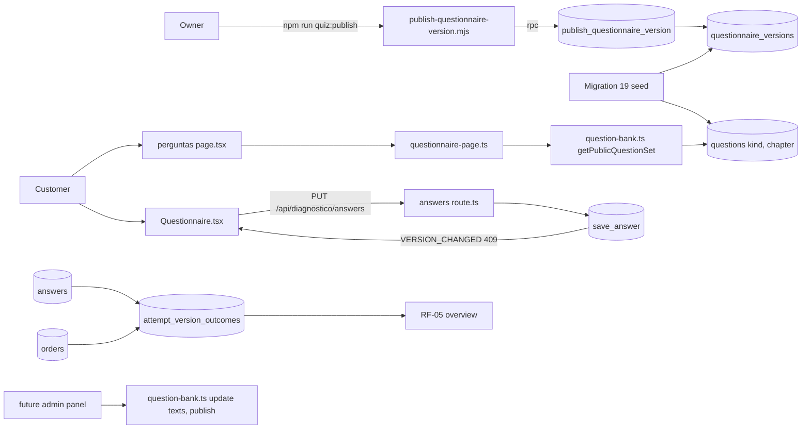

# RF-02. Question Set Version 2 and Version Routing: Technical Specification

PRD: docs/prd/PRD-Quiz-Multipla-Escolha-Gamificado.md · Scope covered: full feature (no Core/Full split) · Complexity: medium

## 1. Technical Overview

**What.** Creates version 2 of the questionnaire as data (12 regular questions, 3 look duels, 3 chapters of 5 steps, every style in exactly 9 steps), the rules that validate it, the atomic publication of a version, the routing guarantee that an attempt stays on the version it started on, and the view that tells RF-05 which version each attempt used. Version 2 is created as a **draft**: it goes live only when the owner runs the publish script, after Millena reviews the texts.

**Why.** The database already pins an attempt to the version of its first saved answer and scores from stored ids, but it has no way to describe a duel or a chapter, no validation for the new structure, no publish operation (the original RF-03 left it to the admin editor RF-12, which is not implemented) and no clear behavior for a customer who has the old questionnaire open when the new one is published. This feature adds exactly those pieces and nothing of the new screens (duel look, chapters, badges: RF-03, RF-04).

**Scope.**

**Included:**
- Core feature functionality: version 2 draft seed, v2 validation rules, publish operation and script, text-edit functions for drafts, version routing, "no published version" page, `VERSION_CHANGED` handling.
- Integrated cross-cutting concerns: versioned question sets shared with RF-01 (answers, rules per version), RF-03 (duel steps), RF-04 (chapters) and RF-05 (version outcomes); the six style keys and the tie-break shared with RF-01.
- Input contract (Consumes, RF-01): the answer format (first and optional second choice per question) and the scoring rules per version (`max_choices`, `first_choice_points`, `second_choice_points`, `late_tiebreak_basis`).
- Output contract (Provides): the public question set of version 2 (for each step: position, chapter 1 to 3, kind `choice` or `duel`, `maxChoices`, text, alternatives; never style or weight) for RF-03 and RF-04; the questionnaire version of each attempt and whether it reached the checkout for RF-05 (view `attempt_version_outcomes`).

**Deferred:** none.

**Excluded:**
- Any admin screen. The admin panel is not part of this work; the edit and publish functions are written so that the future panel (original RF-12) can call them.
- The look-duel screen and its images (RF-03), chapters, badges and the look-shaped progress bar (RF-04), the overview of completion by version (RF-05).
- Changing, deleting or migrating version 1, its attempts or any stored diagnosis.
- Cloning a published version into a new draft to change texts that are already live (original RF-12).

### Requirements / Business Rules

- Version 2 has 15 steps in 3 chapters of 5 steps (steps 1-5, 6-10, 11-15). Steps 5, 10 and 15 are duels (`kind = 'duel'`, `max_choices = 1`, 2 alternatives). The other 12 are regular questions (`kind = 'choice'`, `max_choices = 2`, 4 alternatives of 4 different styles).
- The 12 regular questions are the version 1 questions 2, 3, 4, 6, 7, 8, 9, 10, 11, 12, 13 and 15, with identical text, alternatives, styles and weights, placed at steps 1, 2, 3, 4, 6, 7, 8, 9, 11, 12, 13 and 14 in that order. Version 1 questions 1, 5 and 14 are not carried over.
- Duels: step 5 Esportivo/Natural × Elegante, step 10 Tradicional × Criativo, step 15 Romântico × Dramático. Each look is an alternative with `weight = 1`, texts "Look A" and "Look B", and the style of the look. The question text of every duel is the draft "Qual look combina mais com você?" (to be reviewed by Millena).
- Balance rule: each style appears in exactly 9 of the 15 steps, and each style appears in exactly one duel.
- Version 2 rules (from RF-01): `first_choice_points = 2`, `second_choice_points = 1`, `late_tiebreak_basis = 'points'`.
- Validation of a version 2 set (publish time and tests): 12 `choice` questions with 4 alternatives of 4 different styles; 3 `duel` questions with 2 alternatives of 2 different styles; each style in exactly 9 steps; duels at steps 5, 10 and 15; 5 steps per chapter; weights integers from 1 to 3. Validation of a version 1 set is unchanged (15 questions × 4 alternatives, imbalance at most 2).
- Publishing a version archives the currently published one and publishes the target in one transaction, so there is never zero or two published versions. A version that fails validation is not published and the live version stays active. A published version is never edited.
- Editing texts: only versions in `draft` can be edited, and only the text of a question and of an alternative. Style, weight, order, chapter, `kind` and `max_choices` cannot be changed through these functions. Texts must be non-empty and at most 300 characters (inferred).
- Routing: an attempt without answers receives the published version when it loads the questionnaire. The first saved answer pins the attempt to the version of its question; every later answer must belong to that version, even if it is archived. Answers, scoring and diagnoses of finished and in-progress attempts are never rewritten.
- `attempt_version_outcomes` has one row per attempt that has at least 1 answer: `attempt_id`, `version_id`, `version`, `started_at` (time of the first answer), `reached_checkout` (an order exists for the attempt).

### Requirements / UX Flows

- A new customer sees "Pergunta 1 de 15" and the first regular question of version 2; at the duel steps she sees the duel question and its two options (the look screen itself is RF-03; until then a duel is answerable as a two-card choice with the texts "Look A" and "Look B").
- A customer returning within 7 days to an attempt that has answers sees her own version, restored at its first unanswered step, with no mention of versions.
- A customer who has the questionnaire open, with no answers yet, when version 2 is published: on her first tap the screen reloads on version 2, from step 1, with the notice "Atualizamos o questionário. Vamos começar de novo?" (draft copy for Millena's review).
- No published version: the questionnaire page shows "Estamos ajustando o questionário. Volte em alguns minutos." and no answer can be saved.
- The questionnaire title and description are unchanged; the description may mention that up to 2 alternatives can be chosen (copy owned by RF-01 and reviewed by Millena).
- Publish script output: the version number published, the version archived, or the validation message naming the rule and the style that failed.

### Error Handling

- Active version has no published set: the page shows the maintenance message above, the answers route answers `503 UNAVAILABLE` ("Estamos ajustando o questionário. Volte em alguns minutos."), and the condition is logged without personal data.
- First answer on a version that is no longer published (the customer's page is older than the publication): the answers route answers `409 VERSION_CHANGED`; the screen refreshes and shows the notice above. Nothing is saved.
- Answer for a question of another version than the attempt's pinned one: `400 VALIDATION_ERROR` (existing behavior, `VERSION_MISMATCH`), unchanged.
- Attempt references a version that no longer exists (should not happen: versions are never deleted): the page redirects to the expired-session path with "Sua sessão expirou. Vamos recomeçar rapidinho?".
- Publish of a set that breaks a rule: the function raises `INVALID_SET: <rule>: <detail>` (for example `INVALID_SET: STYLE_BALANCE: romantico appears in 8 steps, expected 9`), nothing changes, the script exits with a non-zero code and prints the message.
- Publish of a version that is already published or does not exist: `VERSION_ALREADY_PUBLISHED` or `VERSION_NOT_FOUND`, nothing changes.
- Publish racing with an answer save: both take the attempt lock or the version row lock, so an answer is stored either against the version the attempt already had or rejected with `VERSION_CHANGED`; never against two versions.
- Edit of a version that is not a draft, or with an empty or over-long text: `VERSION_NOT_DRAFT` or `INVALID_TEXT`, nothing changes.

## 2. Architecture Impact

**Affected components:**
- `supabase/migrations/20260101000019_questionnaire_v2.sql` (new), `lib/diagnostico/database.types.ts`.
- `lib/diagnostico/question-types.ts`, `lib/diagnostico/question-set-rules.ts`, `lib/diagnostico/question-bank.ts`.
- `lib/diagnostico/answers.ts`, `app/api/diagnostico/answers/route.ts`, `lib/diagnostico/questionnaire-page.ts`, `app/diagnostico-estilo/perguntas/page.tsx`, `components/Diagnostico/Questionnaire.tsx`.
- `scripts/publish-questionnaire-version.mjs` (new), `package.json` (npm script `quiz:publish`).

**Diagram:**



**Patterns followed (observed):**
- Versioned question sets stored with the answers, scored from the stored ids: `lib/diagnostico/question-bank.ts` (`getScoredAnswers`), `supabase/migrations/20260101000007_save_answer.sql`.
- Seed as a migration in a `do $seed$` block that does nothing when the version already exists: `supabase/migrations/20260101000006_seed_questionnaire_v1.sql`.
- Pure validation rules returning issue lists, reused by a future editor: `lib/diagnostico/question-set-rules.ts` (`validateQuestionSet`, `QuestionSetIssue`).
- SQL functions with `raise exception '<CODE>' using errcode = 'P0001'` mapped to TypeScript error classes: `answers.ts` (`AnswerError`), `question-bank.ts` (`QuestionBankError`).
- Public types never carry style or weight, and the columns are not selected: `getPublicQuestionSet`.
- Seeded shuffle with `shuffleWithSeed(items, `${seed}:${questionId}`)`: `lib/diagnostico/seeded-shuffle.ts`.
- Access model "RLS on, no policies, anon and authenticated revoked, service role on the server": migrations 4 and 16.
- Serial integration tests that flip a version status and restore it in `finally`, with fixtures deleted by id: `tests/integration/diagnostico/question-bank.test.ts` (`setStatus`), `fileParallelism: false` in `vitest.integration.config.mts`.
- Node scripts in `scripts/*.mjs` loading env with `@next/env`: `scripts/dev.mjs`.

## 3. Technical Decisions

| Decision | Chosen Approach | Alternative Considered | Trade-off |
|---|---|---|---|
| How version 2 enters the system | Seed migration creates version 2 as `draft`; a separate publish step makes it live | Seed directly as published; build the admin editor now | The owner must run one command after review; no unreviewed text goes live and no admin screen is needed |
| Publish operation | SQL function `publish_questionnaire_version(uuid)` validates and swaps the published version atomically; a library function pre-checks with the TypeScript rules for readable messages; an `.mjs` script calls the SQL function | Library function only, run through the script | The structural rules exist in SQL (authoritative) and in TypeScript (messages, editor, tests); a test checks that both agree. Needed because the repository has no TypeScript runner for scripts |
| Duels and chapters in the schema | `questions.kind` and `questions.chapter`; a duel is a question with 2 alternatives | A separate duels table | RF-01 saving, scoring and answer reads work unchanged |
| Texts of version 2 | Copied by SQL from the version 1 rows, by position | A second JSON source file | One source of truth for the texts; the migration depends on version 1 existing (it fails loudly if not) |
| Customer with an old page open | `409 VERSION_CHANGED` on the first answer, then the screen refreshes with a notice | Show the generic rejection message | One extra response code and a notice, no stuck screen |
| Data for RF-05 | View `attempt_version_outcomes` | A library function with joins in TypeScript | A migration object to maintain; the definition of "started" and "reached checkout" is in one place |
| Editing live texts | Only drafts are editable | Edit published versions in place | A live correction needs a new draft version (original RF-12); published versions never change under attempts |

**Assumptions (every inference is also marked in the text):**
- Migration name `20260101000019_questionnaire_v2.sql`, after migration 18 of RF-01 (inferred).
- Text limit of 300 characters for an edited question or alternative (inferred).
- The validation profile is chosen from the set itself: a set with any `kind = 'duel'` question uses the version 2 profile, otherwise the version 1 profile (inferred).
- `save_answer` is recreated (same signature as in RF-01) to raise `VERSION_CHANGED` when the first answer targets a version that is not published, and keeps `VERSION_MISMATCH` for an attempt already pinned to another version (inferred).
- The answers route answers `503 UNAVAILABLE` when no version is published (inferred).
- A published version can be republished only if it is archived or draft; this also allows rolling back to version 1 (inferred, useful and costless).
- "Started" means at least 1 saved answer; an attempt whose order was detached by an erasure (RF-09) no longer exists, so it leaves the view (inferred).
- Draft copy for Millena: the duel question text and the notice "Atualizamos o questionário. Vamos começar de novo?" (inferred).
- Do not publish version 2 before RF-03 (look duel screen) and RF-04 (chapters) are implemented; until then a duel works as a plain two-card choice (inferred release order).
- Existing integration tests that assume the published version is version 1 are changed to load version 1 by its number; they still assert the same things about version 1 (inferred, explained in the plan).

**Traceability:** Consumes → Scope and migration; Provides → Scope, Section 5 and the view; Capabilities → Business Rules; Experience → UX Flows; Error Handling → Error Handling; Section 9 per-feature criteria → Section 7 acceptance tests; the cross-feature criterion where RF-02 consumes from RF-01 → the hand-off test; criteria where RF-02 provides to RF-03, RF-04 and RF-05 → pointers.

## 4. Component Overview

### Data

| File Path | New/Modified | Purpose | Key Responsibilities |
|---|---|---|---|
| `supabase/migrations/20260101000019_questionnaire_v2.sql` | New | Version 2 and routing support | `questions.kind` and `chapter`; seed of version 2 as draft; `publish_questionnaire_version`; `save_answer` raising `VERSION_CHANGED`; view `attempt_version_outcomes` |
| `lib/diagnostico/database.types.ts` | Modified | Typed schema | Regenerated: new columns, the function and the view |

### Backend

| File Path | New/Modified | Purpose | Key Responsibilities |
|---|---|---|---|
| `lib/diagnostico/question-types.ts` | Modified | Shared types | `kind`, `chapter`, `maxChoices` on public and editable questions; version rule fields on the editable set |
| `lib/diagnostico/question-set-rules.ts` | Modified | Pure validation | Version 2 profile (12 + 3 duels, 9 per style, chapters, duel positions); profile chosen from the set; new issue codes |
| `lib/diagnostico/question-bank.ts` | Modified | Question bank | Select the new columns; `publishQuestionnaireVersion`; `updateQuestionText`, `updateAlternativeText`; new `QuestionBankError` codes |
| `lib/diagnostico/answers.ts` | Modified | Answer persistence | Map `VERSION_CHANGED` to `AnswerError` |
| `app/api/diagnostico/answers/route.ts` | Modified | HTTP entry | `409 VERSION_CHANGED`; `503 UNAVAILABLE` |
| `lib/diagnostico/questionnaire-page.ts` | Modified | Server loader | Return an "unavailable" state instead of throwing when no version is published |
| `app/diagnostico-estilo/perguntas/page.tsx` | Modified | Page | Render the maintenance message |
| `scripts/publish-questionnaire-version.mjs` | New | Owner command | Load env, call the publish function for a version number, print the result, exit non-zero on failure |
| `package.json` | Modified | Commands | `quiz:publish` script |

### Frontend

| File Path | New/Modified | Purpose | Key Responsibilities |
|---|---|---|---|
| `components/Diagnostico/Questionnaire.tsx` | Modified | Questionnaire screen | On `VERSION_CHANGED`, refresh the page and show the notice; accept `unavailable` |

### Tests

| File Path | New/Modified | Purpose | Key Responsibilities |
|---|---|---|---|
| `tests/unit/diagnostico/question-set-rules.test.ts` | Modified | Rules | Version 2 profile cases; version 1 cases unchanged |
| `tests/integration/diagnostico/questionnaire-v2.test.ts` | New | Seed, publish, edit, routing, privacy of the public set | Acceptance criteria 1 to 10 |
| `tests/integration/diagnostico/two-choice-handoff.test.ts` | New | Hand-off RF-01 → RF-02 | Saved choices restored by the loader |
| `tests/integration/diagnostico/attempt-version-outcomes.test.ts` | New | The view | Columns, counts, version of the first answer |
| `tests/integration/diagnostico/answers-route.test.ts` | Modified | Route | `409` and `503` |
| `tests/integration/diagnostico/question-bank.test.ts` | Modified | Existing version 1 tests | Load version 1 by number instead of the published one |
| `tests/integration/diagnostico/helpers.ts` | Modified | Fixtures | `publishVersionTemporarily` (publish and restore) |

## 5. API Contracts

### `PUT /api/diagnostico/answers` (modified by RF-02)

Request and success are those of RF-01. New responses:

| Status | Code | When |
|---|---|---|
| 409 | `VERSION_CHANGED` | The question belongs to a version that is not published and the attempt has no answers yet |
| 503 | `UNAVAILABLE` | No version is published |

```json
{ "error": { "code": "VERSION_CHANGED", "message": "O questionário foi atualizado." } }
```

The exact envelope is the one `apiError` returns today; the example shows the new code only. A pinned attempt answering an archived version keeps getting `200`.

### Public question set (Provides, for RF-03 and RF-04)

`getPublicQuestionSet(db, seed, versionId?) → PublicQuestionSet`:

```json
{
  "versionId": "…",
  "version": 2,
  "questions": [
    {
      "id": "…", "position": 5, "chapter": 1, "kind": "duel", "maxChoices": 1,
      "text": "Qual look combina mais com você?",
      "alternatives": [{ "id": "…", "text": "Look B" }, { "id": "…", "text": "Look A" }]
    }
  ]
}
```

No alternative carries a style or a weight. The order of alternatives is the seeded shuffle, stable for the same attempt.

### Library and SQL functions

- `publishQuestionnaireVersion(db, versionId) → Promise<{ published: number; archived: number | null }>`: validates the loaded set with the profile of the set, then calls the SQL function. Throws `QuestionBankError` with `INVALID_SET` (carrying the issue list), `VERSION_NOT_FOUND` or `VERSION_ALREADY_PUBLISHED`.
- `updateQuestionText(db, questionId, text)` and `updateAlternativeText(db, alternativeId, text)`: only on `draft` versions; throw `VERSION_NOT_DRAFT` or `INVALID_TEXT`.
- SQL `publish_questionnaire_version(p_version uuid) returns void`: raises `VERSION_NOT_FOUND`, `VERSION_ALREADY_PUBLISHED` or `INVALID_SET: <rule>: <detail>`; revoked from `public, anon, authenticated`.
- SQL `save_answer(…)` (signature of RF-01): additionally raises `VERSION_CHANGED`.
- Script: `npm run quiz:publish -- 2` publishes version 2 and prints `published version 2, archived version 1`.

### Attempt outcomes (Provides, for RF-05)

View `public.attempt_version_outcomes`: `attempt_id uuid`, `version_id uuid`, `version integer`, `started_at timestamptz`, `reached_checkout boolean`.

## 6. Data Model

Migration `supabase/migrations/20260101000019_questionnaire_v2.sql`.

```sql
alter table public.questions
  add column kind text not null default 'choice' check (kind in ('choice', 'duel')),
  add column chapter smallint check (chapter between 1 and 3),
  add constraint questions_duel_single_choice check (kind <> 'duel' or max_choices = 1);

-- Seed (do $seed$ block, does nothing if version 2 exists, fails if version 1 is missing):
--   insert version 2: status 'draft', first_choice_points 2, second_choice_points 1, late_tiebreak_basis 'points'
--   regular questions: copy of version 1 positions {2,3,4,6,7,8,9,10,11,12,13,15}
--     to positions {1,2,3,4,6,7,8,9,11,12,13,14}, chapter = ceil(position / 5), max_choices 2,
--     with their alternatives (position, text, style, weight)
--   duels: positions 5 (esportivo_natural, elegante), 10 (tradicional, criativo), 15 (romantico, dramatico),
--     kind 'duel', max_choices 1, chapter 1, 2, 3, text 'Qual look combina mais com você?',
--     alternatives 'Look A' (position 1) and 'Look B' (position 2), weight 1

create function public.publish_questionnaire_version(p_version uuid) returns void
language plpgsql as $$
  -- lock questionnaire_versions; VERSION_NOT_FOUND; VERSION_ALREADY_PUBLISHED
  -- validate the structure (version 2 profile when any duel exists, otherwise 15 x 4 with imbalance <= 2)
  --   else raise 'INVALID_SET: <rule>: <detail>'
  -- update the published version to 'archived'; update the target to 'published', published_at = now()
$$;

-- save_answer: recreated with the signature of RF-01; raises VERSION_CHANGED when the first answer
-- of an attempt targets a version that is not published; VERSION_MISMATCH stays for a pinned attempt.

create view public.attempt_version_outcomes with (security_invoker = true) as
select pa.id as attempt_id, qv.id as version_id, qv.version, f.started_at,
       exists (select 1 from public.orders o where o.attempt_id = pa.id) as reached_checkout
from public.purchase_attempts pa
join lateral (
  select a.version_id, min(a.answered_at) as started_at
  from public.answers a where a.attempt_id = pa.id
  group by a.version_id order by min(a.answered_at) limit 1
) f on true
join public.questionnaire_versions qv on qv.id = f.version_id;

revoke all on public.attempt_version_outcomes from public, anon, authenticated;
revoke all on function public.publish_questionnaire_version(uuid) from public, anon, authenticated;
```

- Existing rows: every question gets `kind = 'choice'` and `chapter = null`; version 1 and its attempts are untouched. The unique index of one published version and `unique (version_id, position)` still apply.
- Indexes: none added; the view uses `answers_attempt_idx` and `orders_attempt_idx`.
- The migration is applied with `supabase migration up` only; it comes after migration 18 (RF-01).

## 7. Testing Strategy

### Acceptance tests

| # | Criterion (PRD Section 9, RF-02) | Test | Proof |
|---|---|---|---|
| 1 | After the release a new attempt is served version 2 with 15 steps in 3 chapters of 5 | `tests/integration/diagnostico/questionnaire-v2.test.ts` › `a new attempt is served version 2 with 15 steps in 3 chapters of 5` (uses `publishVersionTemporarily`); script steps 1 and 2 | fake |
| 2 | An attempt with answers on version 1 keeps version 1, single choice, no chapters | `questionnaire-v2.test.ts` › `an attempt with answers keeps its own version after the release`; script step 4 | fake |
| 3 | The public response has no style key or weight | `questionnaire-v2.test.ts` › `the public set of version 2 has no style or weight`; `question-bank.test.ts` › `public question set contains no style or weight` (existing) | fake |
| 4 | A draft with a style in 8 or 10 steps cannot be published and the message names the style | `question-set-rules.test.ts` › `version 2 profile rejects a style that appears in 8 steps and names it`; `questionnaire-v2.test.ts` › `publishing an unbalanced draft is refused and the live version stays` | fake |
| 5 | Version 2 has 12 regular × 4 styles, 3 duels × 2 styles, each style in exactly 9 steps | `questionnaire-v2.test.ts` › `the seeded version 2 has 12 questions, 3 duels and 9 steps per style`; `question-set-rules.test.ts` › `the version 2 profile accepts the seeded structure`; `the SQL and TypeScript validators agree on valid and broken fixtures` | fake |
| 6 | Millena edits the text of an alternative and publishes: new attempts see the text, mapping unchanged | `questionnaire-v2.test.ts` › `an edited alternative text is shown after publishing and its style and weight are unchanged` | fake |
| 7 | Duel pairs, images, chapters and step order cannot be edited | `questionnaire-v2.test.ts` › `the edit functions change text only and refuse a published version`; `there is no function that changes style, weight, kind, chapter or position` (checks the exported API) | fake |
| 8 | Diagnoses generated before the release are unchanged | `questionnaire-v2.test.ts` › `publishing version 2 does not change a stored version 1 result or its scoring input`; the before/after comparison of the plan, step 12 | fake |
| 9 | The same attempt sees the same order of alternatives and looks | `questionnaire-v2.test.ts` › `the order of alternatives and duel looks is stable for the same attempt` | fake |
| 10 | No published set: the maintenance message and no attempt created | `questionnaire-v2.test.ts` › `the loader reports unavailable when no version is published`; `tests/integration/diagnostico/answers-route.test.ts` › `answers 503 when no version is published`; script step 5 | fake |

Also covered: `answers-route.test.ts` › `answers 409 VERSION_CHANGED for a first answer on an unpublished version`, `a pinned attempt keeps saving on an archived version`; `attempt-version-outcomes.test.ts` › `one row per attempt with answers, the version of its first answer and reached_checkout from the orders`; `questionnaire-v2.test.ts` › `publishing twice, an unknown version and a draft with an empty text fail with their codes`, `publishing is atomic: exactly one version is published afterwards`, `version 1 can be published again as a rollback`.

### Live checks

Live check: not applicable. No criterion depends on a model provider or an agent; the feature uses the local database and the application code.

### Verification script

Prerequisite: a **disposable per-session database** with all migrations applied (version 1 published, version 2 draft) and the dev server on the session's port. Register test customers with different e-mails. Mobile (360 px) and desktop (1280 px).

| Step | Start state | Action | Expected result (what the user sees) | Criterion |
|---|---|---|---|---|
| 1 | Version 2 published with `npm run quiz:publish -- 2`; a new customer | Open the questionnaire | "Pergunta 1 de 15" and a question with four alternatives (the text of the original question 2: "Qual conjunto de roupas mais chama sua atenção?") | 1 |
| 2 | Same | Answer steps 1 to 4 and go to step 5 | "Pergunta 5 de 15" with "Qual look combina mais com você?" and two options "Look A" and "Look B"; no style name anywhere | 1, 3 |
| 3 | Version 1 published; customer B opens the questionnaire and does not answer | Run `npm run quiz:publish -- 2`, then tap an alternative in customer B's open page | The page reloads on "Pergunta 1 de 15" of version 2 with "Atualizamos o questionário. Vamos começar de novo?" | 1, Error Handling |
| 4 | Version 1 published; customer C answers 3 questions (single choice) | Publish version 2, then reload customer C's page | The original question 4 of version 1 ("Qual característica você mais valoriza nas roupas?"), "Pergunta 4 de 15", one choice only | 2 |
| 5 | In the database, set every version to `archived` | Reload the questionnaire | "Estamos ajustando o questionário. Volte em alguns minutos." and no alternatives | 10 |
| 6 | Version 2 published | Reload the same attempt twice | The same order of alternatives at every step | 9 |

Also check: `npm run quiz:publish -- 2` on an already published version prints a clear message and exits with a non-zero code; keyboard only; no horizontal scroll at 360 px.

### Hand-off tests (cross-feature)

- RF-01 → RF-02 (PRD: "Given a customer who saves a first and a second choice through RF-01, when RF-02 serves the attempt again, then the stored first and second choices are restored and the first unanswered step is shown"): `tests/integration/diagnostico/two-choice-handoff.test.ts` › `a saved first and second choice are restored by the loader and the first unanswered step is shown`. It saves choices through `saveAnswer` of RF-01 on a two-choice fixture version, then calls `loadQuestionnaire` and asserts the restored choices and `startIndex`, without mocking the contract.
- RF-02 → RF-03 (duel served and saved through RF-01): covered by the hand-off test of RF-03, implemented after this feature.
- RF-02 → RF-04 (chapters and types drive the progress bar): covered by the hand-off test of RF-04, implemented after this feature.
- RF-02 → RF-05 (versions of both kinds counted once): covered by the hand-off test of RF-05, implemented after this feature.

### Test data and fixtures

- Integration tests use the seeded version 2 draft for read tests, and clone-by-insert fixtures with unique version numbers for edit and publish tests, deleted by id. `publishVersionTemporarily(db, versionId, fn)` publishes, runs `fn` and restores the previous published version in `finally`; files run serially, as in `question-bank.test.ts`.
- Unit tests build version 2 sets in code from a table of the styles shown at each of the 15 steps.

### Not tested here

- The look-duel screen, images, chapter screens and badges (RF-03, RF-04); the overview of completion (RF-05).
- An admin screen (not part of this work); its future calls are the functions tested above.
