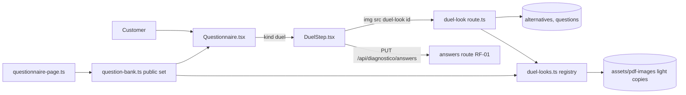

# RF-03. Look Duels: Technical Specification

PRD: docs/prd/PRD-Quiz-Multipla-Escolha-Gamificado.md · Scope covered: full feature (no Core/Full split) · Complexity: simple

## 1. Technical Overview

**What.** The three duel steps of questionnaire version 2 (steps 5, 10 and 15) show two looks side by side. The customer taps one; that look's style receives 2 points through the answer saving and scoring of RF-01. The browser never receives a style name or key: the looks are delivered by a route identified only by the alternative id, which returns a light copy of an image that already exists in the repository.

**Why.** The original images carry the style in their file name (`romantico.png`) and two of them weigh 2.4 MB and 3.3 MB; using their addresses on the screen would reveal the style on the network and load 5.7 MB in one duel on a phone. A route that maps the alternative to its style on the server, and serves the 35 KB to 216 KB light copies already kept for the PDF, solves both problems. The duel itself needs no new data: RF-02 stores it as a question with `kind = 'duel'`, `max_choices = 1` and two alternatives.

**Scope.**

**Included:**
- Core feature functionality: duel screen, look route, image dimensions in the public question set, neutral texts, fallback, accessibility.
- Integrated cross-cutting concerns: the questionnaire stays blind (no style, weight or file name reaches the browser, RF-02 and RF-01); the 7-day restore of an attempt shows the saved duel choice (RF-01).
- Input contract (Consumes, RF-02): the duel steps of the public question set: position, `kind = 'duel'`, question text, the two alternatives with neutral ids and the texts "Look A" and "Look B".
- Input contract (Consumes, RF-01): answer saving (the duel choice is a first choice with no second choice) and the scoring rule that gives the chosen look's style 2 points.
- Output contract (Provides): none.

**Deferred:** none.

**Excluded:**
- Creating, generating or downloading any image. Only the 6 existing style images are used (through their light copies in `assets/pdf-images/`).
- Images in regular questions, the slots of pieces and accessories, and chapter screens or badges (RF-04).
- The structure of version 2 and its publication (RF-02) and the scoring rules (RF-01).

### Requirements / Business Rules

- There are 3 duels, at steps 5, 10 and 15 of version 2 (RF-02). Each shows 2 looks; each look is the existing reference image of one style: step 5 Esportivo/Natural × Elegante, step 10 Tradicional × Criativo, step 15 Romântico × Dramático.
- The customer picks exactly 1 look. The chosen look's style receives 2 points; the other receives none (RF-01: first choice, `first_choice_points = 2`).
- The browser never receives the style name or the style key of a look. A look is identified by the id of its alternative and by neutral texts. Nothing in the image address, the response headers or body, the markup or the alternative text names the style.
- The looks are delivered from the light copies in `assets/pdf-images/` (`esportivo_natural.jpg`, `tradicional.jpg`, `elegante.jpg`, `romantico.jpg`, `criativo.jpg`, `dramatico.jpg`), 35 KB to 216 KB each. A duel therefore loads at most about 340 KB of images.
- Each image is shown whole, never cropped, with the aspect ratio of its file reserved before it loads (width and height come from the registry below).
- Alternative text of a look: "Look de referência A" and "Look de referência B" (inferred). Visible caption: "Look A" and "Look B" (inferred).
- The question text of a duel is the one stored in the question (draft default "Qual look combina mais com você?", to be reviewed by Millena, RF-02).
- The position of the two looks (which is on the left or on top) follows the seeded order of RF-02, so it is stable for the same attempt.

### Requirements / UX Flows

- The duel appears as a normal step: "Pergunta N de 15", the progress bar, the question text, the two looks, and "Anterior" and "Próxima" (or "Concluir" on step 15).
- Tapping a look selects it: a visible border and a checkmark. Tapping the other look changes the choice. Tapping the selected look again does nothing. "Próxima" (or "Concluir") is enabled only after the choice is saved on the server.
- Layout: the two looks are stacked on screens narrower than 480 px and side by side from 480 px (inferred). Each look has a touch area of at least 48 px in its smaller dimension. Both fit in the viewport width with no horizontal scroll at 360 px.
- The group works by keyboard with radio-group semantics (Tab to the group, arrow keys to change, Space to select) and is announced to screen readers as a group with two options, each with its neutral description and its selected state.
- The slide-and-fade transition of 300 ms between steps is disabled under reduced-motion settings (existing behavior).
- Returning to a duel already answered shows the saved look selected.
- If a look image fails to load, that card shows a neutral block with the caption "Look A" or "Look B" and stays selectable.

### Error Handling

- Save fails: the same messages and the 3 retries (500 ms, 1500 ms, 3000 ms) as the other steps.
- Choice sent for a look that does not belong to the duel: the server refuses it (400, RF-01) and the screen restores the last saved choice.
- Look image missing or not loading (404 from the route, network failure): the card shows the neutral block; no style name appears; the duel stays answerable. The route logs only the alternative id, never a style or a file name.
- The route receives an id that is not a UUID, or the alternative of a regular question: 404 with a generic body; nothing about styles is revealed.

## 2. Architecture Impact

**Affected components:**
- `app/api/diagnostico/duel-look/[alternativeId]/route.ts` (new), `lib/diagnostico/duel-looks.ts` (new).
- `lib/diagnostico/question-bank.ts`, `lib/diagnostico/question-types.ts`.
- `components/Diagnostico/DuelStep.tsx` (new), `components/Diagnostico/Questionnaire.tsx`.
- `next.config.mjs`.

**Diagram:**



**Patterns followed (observed):**
- Image registry with the real intrinsic size, checked against the files by a unit test: `lib/diagnostico/style-images.ts`, `tests/unit/diagnostico/style-images.test.ts`.
- Light image copies kept outside `public/` and traced into the routes that read them: `assets/pdf-images/`, `outputFileTracingIncludes` in `next.config.mjs`.
- Public types never carry style or weight: `getPublicQuestionSet` in `lib/diagnostico/question-bank.ts`.
- Route handlers with `export const dynamic = "force-dynamic"`, the project's `apiError` envelope and logs without personal data: `app/api/diagnostico/answers/route.ts`, `lib/diagnostico/errors.ts`.
- Saving with a per-question ticket, retries and the same failure messages: `components/Diagnostico/Questionnaire.tsx`.
- Pure helpers in `lib/diagnostico/questionnaire-state.ts` and static-markup component tests with `renderToStaticMarkup`: `tests/unit/diagnostico/result-view-images.test.ts`.
- Cards with `min-h`, `focus-within:ring`, `sr-only` radio inputs and `motion` honoring `useReducedMotion`: `Questionnaire.tsx`.
- Security headers on every `/api/*` route: `next.config.mjs`.

## 3. Technical Decisions

| Decision | Chosen Approach | Alternative Considered | Trade-off |
|---|---|---|---|
| How the looks reach the browser without the style | Route `GET /api/diagnostico/duel-look/<alternativeId>` that reads the alternative's style on the server and returns the light copy | Original images through `next/image` with an opaque address; neutral-named copies in `public/` | Images are not processed by the Next optimizer (they are already light); one more route to maintain; no duplicate files and no style in any address |
| Which file is served | The light copy from `assets/pdf-images/` | The originals from `public/assets/diagnostic/` | Slightly lower resolution than the originals, enough for a card; 340 KB instead of up to 5.7 MB |
| Image dimensions in the public set | Server reads the style of duel alternatives only to look up width and height; the style is not copied into the result | Fixed 3:4 box with letterboxing | The "style column is not even selected" pattern has one exception, limited to duels and covered by a test; images keep their true proportion |
| Where the screen code lives | New `DuelStep.tsx`, chosen by `Questionnaire.tsx` when `kind = 'duel'` | Duel markup inside `Questionnaire.tsx` | One extra component; avoids conflicts with RF-01, RF-02 and RF-04, which also change `Questionnaire.tsx` |
| Selection model | Single choice through the existing save call with no second choice | A dedicated duel endpoint | No new save path; scoring is already correct |

**Assumptions (every inference is also marked in the text):**
- Light copies are used and registered by style in `duel-looks.ts` with the sizes 765×1360 (esportivo_natural, romantico, dramatico), 564×1002 (criativo), 800×999 (elegante) and 500×750 (tradicional), as read from the files (observed); a test keeps them in sync.
- Layout breakpoint at 480 px, the captions "Look A" and "Look B", the alt texts "Look de referência A" and "Look de referência B" (inferred).
- The route needs no attempt cookie: the id is a UUID and the response is only an image. It rate-limits nothing (inferred).
- The route returns `ETag` equal to the alternative id (inferred) and `Cache-Control: public, max-age=31536000, immutable`, because a published alternative never changes its style.
- `loading` is eager for both images of a duel, as they are always in view (inferred). `next/image` is used with `unoptimized`.
- Only duel alternatives get an `image` field in the public set; regular alternatives are unchanged (inferred).
- The route is added to `outputFileTracingIncludes` with `./assets/pdf-images/**/*` (inferred, same reason as the PDF routes).

**Traceability:** Consumes (RF-02, RF-01) → Scope and hand-off tests; Capabilities → Business Rules; Experience → UX Flows; Error Handling → Error Handling; Section 9 per-feature criteria → acceptance tests; the two cross-feature criteria where RF-03 is the consumer → hand-off tests.

## 4. Component Overview

### Backend

| File Path | New/Modified | Purpose | Key Responsibilities |
|---|---|---|---|
| `lib/diagnostico/duel-looks.ts` | New | Look registry | `DUEL_LOOKS` by style with file name, width and height; `duelLookPath(alternativeId)`; reading the file bytes |
| `app/api/diagnostico/duel-look/[alternativeId]/route.ts` | New | Look delivery | Validate the id, read the duel alternative's style, return the image with cache headers, 404 otherwise |
| `lib/diagnostico/question-bank.ts` | Modified | Public question set | Add `image` to duel alternatives without exposing the style |
| `lib/diagnostico/question-types.ts` | Modified | Shared types | `image?: { src; width; height }` on public alternatives |
| `next.config.mjs` | Modified | Production tracing | Trace `assets/pdf-images` into the new route |

### Frontend

| File Path | New/Modified | Purpose | Key Responsibilities |
|---|---|---|---|
| `components/Diagnostico/DuelStep.tsx` | New | Duel screen | Two looks as a radio group, selected state, captions, image fallback, layout |
| `components/Diagnostico/Questionnaire.tsx` | Modified | Questionnaire screen | Render `DuelStep` for `kind = 'duel'` using the same save, retry and message logic |

### Tests

| File Path | New/Modified | Purpose | Key Responsibilities |
|---|---|---|---|
| `tests/unit/diagnostico/duel-looks.test.ts` | New | Registry | Six styles, files exist, sizes match the files, no duplicate address |
| `tests/unit/diagnostico/duel-step-view.test.ts` | New | Markup | Radio group, captions, alt texts, no style text, neutral block without an image |
| `tests/integration/diagnostico/duel-look-route.test.ts` | New | Route | Bytes, headers, 404 cases, no style in any response |
| `tests/integration/diagnostico/duel-public-set.test.ts` | New | Public set | `image` on the 6 duel alternatives, nothing revealing in the JSON |
| `tests/integration/diagnostico/duel-handoff.test.ts` | New | Hand-offs | Duel served from RF-02 and saved through RF-01; scored with 2 points |

## 5. API Contracts

### `GET /api/diagnostico/duel-look/[alternativeId]` (new)

Input: `alternativeId`, a UUID in the path.

Success `200`: the bytes of the light copy.

| Header | Value |
|---|---|
| `Content-Type` | `image/jpeg` |
| `Content-Length` | size of the file |
| `Cache-Control` | `public, max-age=31536000, immutable` |
| `ETag` | the alternative id |

No `Content-Disposition`, no file name and no style in any header.

Errors, with the project's `apiError` envelope:

| Status | Code | When |
|---|---|---|
| 404 | `NOT_FOUND` | Not a UUID, an unknown alternative, or an alternative of a regular question |
| 500 | `INTERNAL_ERROR` | The file cannot be read |

```json
{ "error": { "code": "NOT_FOUND", "message": "Imagem não encontrada." } }
```

(The exact envelope is the one `apiError` returns today.)

### Public question set (Consumes from RF-02, extended here)

A duel alternative in `getPublicQuestionSet`:

```json
{
  "id": "0a1b2c3d-4e5f-4a6b-8c7d-9e0f1a2b3c4d",
  "text": "Look A",
  "image": { "src": "/api/diagnostico/duel-look/0a1b2c3d-4e5f-4a6b-8c7d-9e0f1a2b3c4d", "width": 765, "height": 1360 }
}
```

Regular alternatives have no `image`. The set contains no style, weight or file name.

### Answer saving (Consumes from RF-01)

`PUT /api/diagnostico/answers` with `{ "questionId": "…", "alternativeId": "…" }` (no `secondAlternativeId`) saves the duel choice. The contract is the one of RF-01.

## 6. Data Model

No storage change. The duel uses the columns and rows created by RF-01 (`max_choices`, `second_alternative_id`) and RF-02 (`questions.kind`, `questions.chapter`, the three seeded duel questions and their alternatives). The style of each look is the existing `alternatives.style` of the duel alternative.

## 7. Testing Strategy

### Acceptance tests

| # | Criterion (PRD Section 9, RF-03) | Test | Proof |
|---|---|---|---|
| 1 | Steps 5, 10 and 15 each show 2 looks and exactly one can be selected | `tests/integration/diagnostico/duel-public-set.test.ts` › `version 2 has three duels with two looks each, at steps 5, 10 and 15`; `tests/unit/diagnostico/duel-step-view.test.ts` › `a duel renders a radio group with two options`; script steps 1 and 2 | fake |
| 2 | Tapping a look shows border and checkmark, enables the forward button, and saves | `duel-step-view.test.ts` › `the selected look shows the checkmark and the checked state`; script steps 2 and 3 (the save is also covered by RF-01 `answers-route.test.ts` › `saves a first choice`) | fake |
| 3 | The chosen look's style gets 2 points, the other 0 | `tests/integration/diagnostico/duel-handoff.test.ts` › `a duel choice gives exactly 2 points to the chosen style and 0 to the other` | fake |
| 4 | No style name or key in the image address, alt text or response body | `duel-public-set.test.ts` › `the public set has no style key, weight or file name`; `tests/integration/diagnostico/duel-look-route.test.ts` › `no response header or body names a style`; `duel-step-view.test.ts` › `the markup has no style name`; script step 5 | fake |
| 5 | At 360 px the looks are stacked, fully visible, uncropped, no horizontal scroll | `duel-step-view.test.ts` › `the looks are stacked below 480 px and the image keeps its ratio without object-cover`; script step 2 | fake |
| 6 | A look that fails to load shows a neutral block and the duel can still be answered | `duel-step-view.test.ts` › `a look without an image shows the neutral block and stays selectable`; script step 6 | fake |
| 7 | Reduced motion: no slide or fade between steps | Existing `Questionnaire.tsx` behavior (`useReducedMotion`), script step 7 | fake |
| 8 | A screen reader announces each look with a neutral description and its selected state | `duel-step-view.test.ts` › `each look has the neutral alt text and a radio input with its name`; script step 4 (accessibility tree) | fake |

Also covered: `duel-looks.test.ts` › `every style has a light copy with the size of its file`; `duel-look-route.test.ts` › `returns the bytes of the light copy with cache headers`, `answers 404 for a non-UUID id, an unknown alternative and a regular-question alternative`, `two different duel alternatives return different images`.

### Live checks

Live check: not applicable. No criterion depends on a model provider or an agent.

### Verification script

Prerequisite: a **disposable per-session database** with all migrations applied (including RF-01 and RF-02), version 2 published with `npm run quiz:publish -- 2`, and the dev server on the session's port. Register a test customer. Check at 360 px and at 1280 px.

| Step | Start state | Action | Expected result (what the user sees) | Criterion |
|---|---|---|---|---|
| 1 | Questions 1 to 4 answered | Press "Próxima" to reach step 5 | "Pergunta 5 de 15", the duel question text and two looks, each with a caption "Look A" or "Look B"; "Próxima" disabled | 1 |
| 2 | Same | Look at the layout | At 360 px the looks are one above the other, both fully visible, uncropped, with no horizontal scroll; at 1280 px they are side by side | 1, 5 |
| 3 | Same | Tap the first look, then the second | The tapped look shows a border and a checkmark; the other shows none; "Próxima" becomes enabled once saved; after a reload the last look tapped is still selected | 2 |
| 4 | Same | Use the keyboard only (Tab, arrows, Space) and read the page's accessibility tree | The looks are two options of one group named by the question; each is named "Look de referência A" or "B" and reports selected or not | 1, 8 |
| 5 | Same | Open the browser network panel and the page source | No address, header, text or attribute contains a style name (esportivo, tradicional, elegante, romantico, criativo, dramatico) | 4 |
| 6 | Same | Block the request to `/api/diagnostico/duel-look/…` and reload | Each look shows a grey block with its caption instead of the image; both can still be selected and saved | 6 |
| 7 | Reduced motion enabled in the browser | Move to the next step | The step changes with no slide or fade | 7 |
| 8 | Steps 10 and 15 reached | Repeat steps 1 to 3 | Step 10 shows two looks, step 15 shows two looks, and "Concluir" is enabled after a choice | 1 |

### Hand-off tests (cross-feature)

- RF-02 → RF-03 (PRD: "Given the version 2 question set from RF-02, when a duel step is served to RF-03, then it carries the two looks, the neutral ids and the position, and the duel choice is saved through the answer saving of RF-01"): `tests/integration/diagnostico/duel-handoff.test.ts` › `a duel step of the real version 2 carries its two looks and the choice is saved through saveAnswer`. It loads the seeded version 2 through `getPublicQuestionSet`, takes a duel step, asserts the neutral ids, the position and the `image` entries, saves the choice with RF-01's `saveAnswer` and reads it back, without mocking either contract.
- RF-01 → RF-03 (PRD: "Given a duel choice saved in RF-03, when RF-01 scores the attempt, then the chosen style has received exactly 2 points from that step"): `duel-handoff.test.ts` › `a duel choice gives exactly 2 points to the chosen style and 0 to the other`. It saves answers for all 15 steps of a version 2 attempt including one duel, runs `scoreAnswers` with the rules of the version, and compares the points with and without the duel step.

### Test data and fixtures

- The tests use the seeded version 2 (a draft, read through its version id) and attempts created with the existing helpers; customers are deleted by id. Tests that need version 2 published use `publishVersionTemporarily` from RF-02.
- The image tests read the real light copies from `assets/pdf-images/`; nothing is generated.

### Not tested here

- Scoring rules and the tie-break (RF-01), version publication and routing (RF-02), chapters and badges (RF-04).
- Visual quality of the photos, which belongs to the owner.
