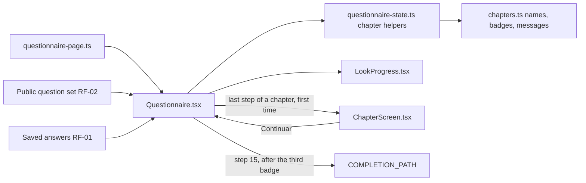

# RF-04. Chapters, Badges and Look Progress: Technical Specification

PRD: docs/prd/PRD-Quiz-Multipla-Escolha-Gamificado.md · Scope covered: full feature (no Core/Full split) · Complexity: simple

## 1. Technical Overview

**What.** The 15 steps of questionnaire version 2 are presented as 3 chapters of 5 steps. The single progress bar becomes 15 segments in 3 groups; each finished chapter fills its group in the accent color and draws one piece of a look (3 pieces in total). At the end of each chapter a screen shows the chapter badge, a one-line message and a "Continuar" button. Everything is derived on the screen from data that already exists (the chapter of each step from RF-02 and the saved answers from RF-01): nothing is stored.

**Why.** The questionnaire is 15 identical screens; the only sign of progress is a bar and "Pergunta N de 15". Chapters, badges and a visible look being assembled give the customer small, frequent moments of progress without adding a step before the checkout. Deriving the state from the saved answers keeps the feature free of new tables, routes and migrations, and makes a returning customer see exactly what she has earned.

**Scope.**

**Included:**
- Core feature functionality: chapter grouping, segmented progress bar with look pieces, chapter screen with badge, the third badge before the checkout, restoration for a returning customer.
- Integrated cross-cutting concerns: the questionnaire stays blind (the encouragement line and all texts are the same for every customer and never name a style, a percentage or a score); reduced-motion setting (existing) and keyboard and screen-reader use; version 1 attempts keep the original bar.
- Input contract (Consumes, RF-02): for each step of the public question set, its position, chapter number (1 to 3) and kind (`choice` or `duel`).
- Input contract (Consumes, RF-01): the saved answers of the attempt (which questions already have a saved first choice).
- Output contract (Provides): none.

**Deferred:** none.

**Excluded:**
- Storing which chapter screens the customer has seen (the screen is not shown again after a reload, by design).
- Editing chapter names, badge names, messages and icons in the admin panel: they are fixed in the code.
- New image files: the look pieces are inline icons drawn in code.
- Sound, vibration, rankings, sharing and any prize.
- The structure of version 2 (RF-02), the duel screen (RF-03) and the two-choice answering (RF-01).

### Requirements / Business Rules

- There are 3 chapters of 5 steps: steps 1-5, 6-10 and 11-15. The chapter of a step comes from the public question set (RF-02), not from arithmetic on its position.
- Draft names (inferred, for Millena's review): chapter 1 "Seu dia a dia", chapter 2 "Suas ocasiões", chapter 3 "Seus desejos"; badges "Selo Rotina", "Selo Ocasiões" and "Selo Desejos".
- A chapter is **complete** when all 5 of its steps have a saved answer. A badge is **earned** when its chapter is complete.
- The progress bar has 15 segments grouped by chapter. A segment is filled when its step has a saved answer. The current step is marked. A group of 5 filled segments is shown as complete in the accent color and its look piece (piece 1 top, piece 2 bottom, piece 3 accessory, inferred) is drawn; an incomplete group shows its piece as an outline.
- The label "Pergunta N de 15" is kept, and "Capítulo N de 3" is shown next to it (N is the chapter of the current step).
- The chapter screen shows the badge, a one-line message and a "Continuar" button. Draft messages (inferred): chapter 1 "Capítulo 1 completo! Já estou vendo um traço do seu estilo…", chapter 2 "Capítulo 2 completo! Falta só mais um.", chapter 3 "Capítulo 3 completo! Seu diagnóstico está quase pronto." They are the same for every customer and contain no style name, percentage or score.
- The chapter screen is shown **once per chapter and per visit to the page**: when the customer advances from the last step of a chapter for the first time in this visit. Going back with "Anterior" and advancing again does not show it again; reloading the page does not show it either.
- After step 15, "Concluir" shows the chapter 3 screen and only then goes to the completion page (`COMPLETION_PATH`).
- Earned badges already shown never disappear: going back to an earlier chapter keeps them.
- Version 1 attempts (steps without a chapter) keep the original single bar, with no chapter label, no badges and no chapter screens.
- Chapter names, badge names, messages and icons live in the code (`lib/diagnostico/chapters.ts`), not in the database.

### Requirements / UX Flows

- Customer answers step 5 (saved) and taps "Próxima": the chapter 1 screen appears with "Selo Rotina", its message and "Continuar"; the bar already shows 5 filled segments and the first group complete.
- "Continuar" moves to step 6 with the existing slide-and-fade transition of 300 ms, and the focus goes to the question heading.
- A badge animates in over 600 ms at most; with the reduced-motion setting it appears at once with no animation.
- The chapter screen has no "Anterior" button (inferred); it is a pause, not a step. Its title receives the focus when it opens, and it is exposed as a region named by the badge.
- A returning customer within 7 days opens the questionnaire at the first unanswered step with the bar and the earned badges restored from her saved answers, and no chapter screen.
- Layout: the segmented bar and the chapter label fit at 360 px with no horizontal scroll; the chapter screen is centered, with the badge, the message and the button reachable without scrolling on a 640 px high screen (inferred).
- State is never conveyed by color alone: segments carry an accessible name ("Passo 3, respondido", "Passo 6, atual", "Passo 9, pendente") and the groups are labeled with the chapter name and whether it is complete.

### Error Handling

Not a critical feature (no data is created, changed or lost here), so there are no failure scenarios beyond:
- If the question set has no chapter for a step (version 1 or incomplete data), the original bar is used and no chapter screen is shown.
- If saving an answer fails, the existing messages and retries apply (RF-01); the chapter screen is only offered after the last step of a chapter is **saved**, so a failed save never lets the customer pass a chapter.

## 2. Architecture Impact

**Affected components:**
- `lib/diagnostico/chapters.ts` (new), `lib/diagnostico/questionnaire-state.ts`.
- `components/Diagnostico/ChapterScreen.tsx` (new), `components/Diagnostico/LookProgress.tsx` (new), `components/Diagnostico/Questionnaire.tsx`.

**Diagram:**

**Patterns followed (observed):**
- Pure screen helpers kept out of the client component and unit tested: `lib/diagnostico/questionnaire-state.ts`, `tests/unit/diagnostico/questionnaire-state.test.ts`.
- Reduced-motion handling with `useReducedMotion` and a duration of 0: `components/Diagnostico/Questionnaire.tsx`.
- Progress bar with `role="progressbar"` and ARIA values, headings that receive focus after navigation, `aria-live` regions for status: `Questionnaire.tsx`.
- Tailwind theme tokens (`accent`, `primary`, `secondary`, `font-primary`) and no extra fonts or colors: `Questionnaire.tsx`, `tests/unit/diagnostico/design-tokens.test.ts`.
- Static-markup component tests with `renderToStaticMarkup` and mocks of `next/navigation`: `tests/unit/diagnostico/result-view-images.test.ts`.
- Texts in Portuguese in the component or a constants module, code and comments in English.
- Every screen works on a phone first (360 px) and has a browser verification script in the spec.

## 3. Technical Decisions

| Decision | Chosen Approach | Alternative Considered | Trade-off |
|---|---|---|---|
| When the chapter screen is shown | Once per chapter and per visit, never on reload | Every time the last step of a chapter is passed; storing "seen" in the database | A returning customer is not shown the screen again; nothing is stored, so no migration or route |
| Source of the chapter state | Derived on the screen from the chapter of each step (RF-02) and the saved answers (RF-01) | A progress table written on each answer | The state cannot drift from the answers; recomputed on each render (15 steps, negligible) |
| Where the code lives | Two new components (`ChapterScreen`, `LookProgress`) and pure helpers; `Questionnaire.tsx` only wires them | All inside `Questionnaire.tsx` | More files; smaller changes in a file also touched by RF-01, RF-02 and RF-03 |
| Look pieces | Inline SVG icons in the component | Image files | The three drawings are code to review; no new image file |
| Names, badges and messages | Constants in `lib/diagnostico/chapters.ts` | Rows editable in the admin panel | A text change needs a code change; no admin screen is needed now |

**Assumptions (every inference is also marked in the text):**
- Piece 1 is a top, piece 2 a bottom and piece 3 an accessory; the three drawings are simple inline SVGs reviewed by Millena (inferred).
- The draft messages of the three chapter screens, "Continuar", and the labels "Capítulo N de 3" and "Passo N, respondido/atual/pendente" (inferred).
- The chapter screen has no "Anterior" button, and its title takes the focus (inferred).
- A badge animates over 600 ms at most; reduced motion removes the animation (PRD).
- Segment "current" is the step being shown; "filled" is a saved answer, so going back keeps the later segments filled (inferred).
- The `progressbar` role keeps `aria-valuenow` as the current question and `aria-valuemax` as 15 (inferred, unchanged from today).
- The 640 px high screen for the chapter screen is a design target, not a PRD number (inferred).
- Implementation order: this feature changes `Questionnaire.tsx`, which RF-01, RF-02 and RF-03 also change, so it is implemented after them (inferred release order).

**Traceability:** Consumes (RF-02 chapter and kind, RF-01 saved answers) → Scope and hand-off tests; Capabilities → Business Rules; Experience → UX Flows; Section 9 per-feature criteria → acceptance tests; the two cross-feature criteria where RF-04 is the consumer → hand-off tests.

## 4. Component Overview

### Frontend

| File Path | New/Modified | Purpose | Key Responsibilities |
|---|---|---|---|
| `lib/diagnostico/chapters.ts` | New | Chapter content | `CHAPTERS`: number, name, badge name and message for each of the 3 chapters; `chapterFor(number)` |
| `lib/diagnostico/questionnaire-state.ts` | Modified | Pure helpers | `segmentStates(steps, savedIds, currentIndex)`, `earnedChapters(steps, savedIds)`, `chapterToShow(steps, savedIds, fromIndex, seen)`, `hasChapters(steps)` |
| `components/Diagnostico/LookProgress.tsx` | New | Progress display | 15 segments in 3 groups, the 3 look pieces, "Capítulo N de 3" and accessible names |
| `components/Diagnostico/ChapterScreen.tsx` | New | Chapter pause | Badge, message, "Continuar", focus on the title, animation off under reduced motion |
| `components/Diagnostico/Questionnaire.tsx` | Modified | Questionnaire screen | Keep the set of chapter screens already shown in this visit, show `ChapterScreen` before moving on, send the last "Concluir" through the third badge, fall back to the old bar without chapters |

### Tests

| File Path | New/Modified | Purpose | Key Responsibilities |
|---|---|---|---|
| `tests/unit/diagnostico/chapters.test.ts` | New | Constants | Three chapters, names, badges, messages without style words |
| `tests/unit/diagnostico/questionnaire-state.test.ts` | Modified | Helpers | Segment states, earned chapters, when to show a chapter screen |
| `tests/unit/diagnostico/look-progress-view.test.ts` | New | Progress markup | Segments, groups, pieces, accessible names, version 1 fallback |
| `tests/unit/diagnostico/chapter-screen-view.test.ts` | New | Chapter screen markup | Badge, message, button, no style or score, no animation class under reduced motion |
| `tests/integration/diagnostico/chapters-handoff.test.ts` | New | Hand-offs | Chapters of the real version 2; progress restored from real saved answers |

## 5. API Contracts

Not applicable: no endpoint, command or event is added or changed. The feature consumes the public question set of RF-02 (`chapter`, `kind`, `position` of each step) and the saved answers of RF-01 (`getSavedChoices`) already available to the questionnaire screen, as declared in their specs.

## 6. Data Model

No storage change. Chapters and badges are derived from `questions.chapter` (RF-02) and from the rows of `answers` (RF-01); nothing is written.

## 7. Testing Strategy

### Acceptance tests

| # | Criterion (PRD Section 9, RF-04) | Test | Proof |
|---|---|---|---|
| 1 | After the 5th step of a chapter is saved and "Próxima" is tapped, a screen with the badge, a one-line message and "Continuar" appears | `tests/unit/diagnostico/questionnaire-state.test.ts` › `chapterToShow returns the chapter when advancing from its last step for the first time`; `tests/unit/diagnostico/chapter-screen-view.test.ts` › `shows the badge, the message and the Continuar button`; script steps 1 and 2 | fake |
| 2 | The encouragement line has no style name, percentage or score and is identical for every customer | `tests/unit/diagnostico/chapters.test.ts` › `no chapter message names a style, a percentage or a score`; `the messages are constants, the same for any input` | fake |
| 3 | With 7 answered steps, 7 of 15 segments are filled, the first group is complete and its piece is drawn | `questionnaire-state.test.ts` › `segmentStates marks the saved steps as answered`; `look-progress-view.test.ts` › `7 saved steps give 7 filled segments, the first group complete and its piece drawn`; script step 4 | fake |
| 4 | Going back keeps the badges already earned | `questionnaire-state.test.ts` › `earnedChapters does not depend on the current step`; script step 3 | fake |
| 5 | A returning customer sees the bar and badges matching the saved answers | `tests/integration/diagnostico/chapters-handoff.test.ts` › `the progress and the earned badges of a returning customer match her saved answers`; script step 4 | fake |
| 6 | At 360 px the chapter screen and the bar have no horizontal scroll and "Capítulo N de 3" is readable | `look-progress-view.test.ts` › `shows Capítulo N de 3 as text`; script step 5 | fake |
| 7 | Under reduced motion a badge appears without animation | `chapter-screen-view.test.ts` › `no animation is applied when reduced motion is set`; script step 6 | fake |
| 8 | At the last step of chapter 3, "Concluir" shows the third badge and then goes to the checkout flow | `questionnaire-state.test.ts` › `the last step shows the chapter 3 screen before completing`; script step 7 | fake |

Also covered: `look-progress-view.test.ts` › `a question set without chapters renders the original single bar`, `the segments have accessible names and the groups carry the chapter name`; `questionnaire-state.test.ts` › `a chapter screen already shown in this visit is not shown again`, `going back and advancing again does not repeat the chapter screen`; `chapters.test.ts` › `there are exactly 3 chapters with names and badges as in the PRD`.

### Live checks

Live check: not applicable. No criterion depends on a model provider or an agent.

### Verification script

Prerequisite: a **disposable per-session database** with all migrations applied (including RF-01 and RF-02), version 2 published with `npm run quiz:publish -- 2`, RF-03 implemented, and the dev server on the session's port. Register a test customer. Check at 360 px and at 1280 px.

| Step | Start state | Action | Expected result (what the user sees) | Criterion |
|---|---|---|---|---|
| 1 | New customer, steps 1 to 4 answered, on step 5 | Answer step 5 (a duel), wait for the save, tap "Próxima" | A screen with "Selo Rotina", the line "Capítulo 1 completo! Já estou vendo um traço do seu estilo…" and a "Continuar" button | 1, 2 |
| 2 | Same | Look at the text on the screen | No style name, percentage or score appears | 2 |
| 3 | Same | Tap "Continuar" | Step 6: "Pergunta 6 de 15" and "Capítulo 2 de 3"; 5 filled segments in the first group, which is complete in the accent color with the first look piece drawn; the other pieces are outlines | 1, 3 |
| 4 | Same | Tap "Anterior" to step 5, then "Próxima" | No chapter screen appears again; step 6 shows the same bar | 4 |
| 5 | Steps 6 and 7 answered, on step 8 | Reload the page | The page opens on step 8 with 7 filled segments, the first group complete, no chapter screen | 3, 5 |
| 6 | At 360 px | Look at the bar and the chapter screen | "Capítulo N de 3" is readable, nothing is cut off and there is no horizontal scroll | 6 |
| 7 | Reduced motion enabled in the browser, steps 8 to 10 answered | Tap "Próxima" at step 10 | The "Selo Ocasiões" screen appears at once with no animation | 7 |
| 8 | Steps 11 to 15 answered | Tap "Concluir" | The "Selo Desejos" screen appears; tapping "Continuar" leads to the completion page | 8 |
| 9 | An attempt pinned to version 1 (in a database where version 1 is still published) | Open the questionnaire | The original single bar and "Pergunta N de 15" only: no chapters, no pieces, no chapter screens | 3 (fallback) |

Also check: keyboard only (the "Continuar" button and the focus on the chapter title), the accessible names of the segments in the accessibility tree, and that going back to chapter 1 keeps the first piece drawn.

### Hand-off tests (cross-feature)

- RF-02 → RF-04 (PRD: "Given the chapter number and type of each step from RF-02, when RF-04 renders the progress bar, then the 15 segments, the 3 chapter groups and the 3 duel steps match the question set"): `tests/integration/diagnostico/chapters-handoff.test.ts` › `the progress built from the real version 2 has 15 segments, 3 groups of 5 and 3 duel steps`. It loads the seeded version 2 through `getPublicQuestionSet`, builds the segments with the helpers and asserts the counts against the question set, without mocking the contract.
- RF-01 → RF-04 (PRD: "Given the answers saved by RF-01, when RF-04 restores the screen for a returning customer, then the filled segments and earned badges equal the number of saved steps"): `chapters-handoff.test.ts` › `the progress and the earned badges of a returning customer match her saved answers`. It saves answers with RF-01's `saveAnswer` for 7 and then 10 steps, reads them with `getSavedChoices` and asserts 7 filled segments and 1 badge, then 10 and 2 badges.

### Test data and fixtures

- Unit tests build steps in code (15 steps with chapter numbers and kinds) and a set of saved question ids.
- Integration tests use the seeded version 2 read through its version id, attempts from the existing helpers and `saveAnswer`; customers are deleted by id. Tests that need version 2 published use `publishVersionTemporarily` (RF-02).

### Not tested here

- Saving, scoring and version routing (RF-01, RF-02), the duel screen (RF-03).
- The visual quality of the three drawings, which Millena reviews.
