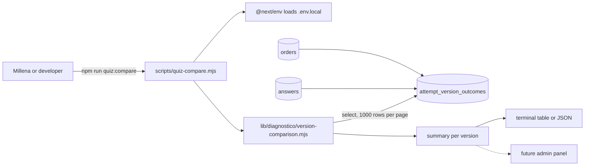

# RF-05. Completion Comparison by Questionnaire Version: Technical Specification

PRD: docs/prd/PRD-Quiz-Multipla-Escolha-Gamificado.md · Scope covered: full feature (no Core/Full split) · Complexity: simple

## 1. Technical Overview

**What.** A command, `npm run quiz:compare`, that prints for each questionnaire version the number of attempts started, the number that reached the checkout and the share between them, plus the difference in percentage points against version 1. A version with fewer than 100 attempts is marked "poucos dados"; a version more than 5 points below version 1 carries a warning label. The calculation rules live in one shared module, `lib/diagnostico/version-comparison.mjs`, so the future admin panel can reuse them. The data is read from the view `attempt_version_outcomes` created by RF-02; nothing is stored, tracked or written.

**Why.** Version 2 is only worth keeping if it sells as well as version 1 (PRD success criterion: completion within 5 percentage points). The original RF-12 admin panel does not exist and will only come later, so the numbers need a way to be read today that does not create the first admin authentication of the project. Putting the rules in a plain ESM module (the repository has no TypeScript runner for scripts, and `tsconfig.json` has `allowJs: true`) gives one copy of the rules for the script, the tests and the future panel.

**Scope.**

**Included:**
- Core feature functionality: counting started attempts and checkout reach per version, rate, "poucos dados", difference against version 1, warning label, optional period filter, terminal table and JSON output.
- Integrated cross-cutting concerns: the questionnaire version pinned per attempt and the single definition of "started" and "reached the checkout" (RF-02, view `attempt_version_outcomes`); no personal data in the output; the service role key is never printed (global rule).
- Input contract (Consumes, RF-02): view `attempt_version_outcomes` with `attempt_id`, `version_id`, `version`, `started_at`, `reached_checkout`; one row per attempt that has at least 1 answer.
- Output contract (Provides): none to other features. The module exports `summarizeVersions` for the future admin panel (not a PRD contract).

**Deferred:** none.

**Excluded:**
- The admin panel and its overview page (the user said the panel is future work); no route, page or authentication is added.
- Any new tracking tool, event, table, column or per-chapter funnel (PRD).
- Statistical significance tests: "poucos dados" is a fixed count threshold, not a confidence interval.
- Revenue or paid-order figures: the PRD compares reaching the checkout only.
- Attempts with no answer (they have no version, so the view does not list them).

### Requirements / Business Rules

- Rows: one per questionnaire version that has at least 1 attempt in the period, ordered by version ascending. A version with no attempts is not shown.
- `started` = number of rows of the version (one per attempt with at least 1 answer, under the version it started on). `reachedCheckout` = number of those rows with `reached_checkout = true`.
- `ratePercent` = `reachedCheckout / started × 100`, shown with 1 decimal and a decimal comma in the table (`50,0%`).
- "Poucos dados" (PRD, inferred label): a version with fewer than 100 attempts (`MIN_ATTEMPTS = 100`); exactly 100 is not marked.
- Baseline: version 1. `differencePoints` of version N = `ratePercent(N) − ratePercent(1)`, computed from the unrounded rates and shown with 1 decimal and a sign (`-10,0 pp`). Version 1 itself and any version when version 1 has no attempts in the period show "—".
- Warning (PRD, inferred label "ATENÇÃO"): `differencePoints < -5` (`WARNING_DROP_POINTS = 5`), so exactly 5 points below is not a warning. The warning uses the unrounded difference.
- Period: `--since AAAA-MM-DD` counts only attempts whose `started_at` is on or after the start of that day in Brazil time (`AAAA-MM-DDT00:00:00-03:00`, inferred). Without it every attempt counts (PRD example: 120 started, 60 reached the checkout, 50%). The first line of the output always states the period ("desde o início" or "desde AAAA-MM-DD").
- Sources: only the view `attempt_version_outcomes`. The command runs `select` and nothing else.
- The thresholds and the labels are named constants of the module.

### Requirements / UX Flows

Terminal use by Millena or the developer:

- `npm run quiz:compare` prints the table for all attempts.
- `npm run quiz:compare -- --since 2026-12-01` prints the table for the period.
- `npm run quiz:compare -- --json` prints the same figures as JSON (inferred).
- Example output (inferred wording, for Millena's review):

```text
Comparação de versões do questionário (desde 2026-12-01)

Versão  Iniciadas  Chegaram ao checkout  Taxa    Diferença vs v1
1       120        60                    50,0%   —
2       80         32                    40,0%   -10,0 pp  ATENÇÃO  (poucos dados)
```

- With no attempt in the period: `Nenhuma tentativa no período.` and exit code 0.

### Error Handling

Not a critical feature (read only, no data is created, changed or lost), so no failure recovery is needed beyond a clear message and a non-zero exit code:

| Case | Detection | Response | Exit code |
|---|---|---|---|
| `SUPABASE_URL` or `SUPABASE_SERVICE_ROLE_KEY` missing | Check of the loaded environment before any request | `Variável de ambiente ausente: <NAME>` naming the variable only | 1 |
| `--since` not a real `AAAA-MM-DD` date (for example `2026-13-01` or `ontem`) | `parseSince` | `Data inválida em --since: use AAAA-MM-DD` | 1 |
| Unknown argument | Argument parser | One usage line: `Uso: npm run quiz:compare -- [--since AAAA-MM-DD] [--json]` | 1 |
| The read fails (network, view missing because migration 019 is not applied, permission) | Error returned by the client | `Não foi possível ler os dados: <message of the error>` (never the key); a missing view is the case of an unapplied RF-02 migration | 2 |

The key and any attempt id are never printed or logged: the output has only aggregated figures.

## 2. Architecture Impact

**Affected components:**
- `lib/diagnostico/version-comparison.mjs` (new), `scripts/quiz-compare.mjs` (new), `package.json` (npm script `quiz:compare`).
- Reads (no change): the view `attempt_version_outcomes` of RF-02.

**Diagram:**



**Patterns followed (observed):**
- Operational scripts as plain `.mjs` that load `.env.local` with `@next/env`: `scripts/dev.mjs` (the repository has no TypeScript script runner).
- `allowJs: true` in `tsconfig.json`, so a TypeScript file can import the `.mjs` module.
- Service-role access only on the server side, variables `SUPABASE_URL` and `SUPABASE_SERVICE_ROLE_KEY` read by `lib/diagnostico/env.ts`.
- `@supabase/supabase-js` already a dependency (`package.json`).
- Pure logic in `lib/diagnostico/` with vitest unit tests (`tests/unit/**/*.test.ts`) and a serial integration suite against the local database (`vitest.integration.config.mts`, `fileParallelism: false`).
- npm commands for operator tasks (`db:types`, `quiz:publish` in RF-02): `package.json`.
- Code and comments in English, customer-facing and operator texts in Portuguese.

## 3. Technical Decisions

| Decision | Chosen Approach | Alternative Considered | Trade-off |
|---|---|---|---|
| Where the comparison appears | Terminal command `npm run quiz:compare` | A protected page under `/admin`; only the function and tests | Millena needs a terminal until the panel exists; no admin authentication is created |
| Where the rules live | A shared ESM module `version-comparison.mjs` with JSDoc types | TypeScript plus a duplicate in the script and an agreement test; rules computed in SQL | JSDoc instead of TypeScript types; one copy of the rules, no migration for a threshold change |
| Versions shown and baseline | Every version with attempts, each compared with version 1 | Only versions 1 and 2; each version against the previous one | A future version 3 appears with no code change; the comparison always answers "is it worse than the original?" |
| Database access | `supabase-js` with the service role, view read in pages of 1000 rows, aggregation in the module | An aggregating SQL function; a direct Postgres connection | Reads one row per attempt (small volume for this product); no second migration and no new dependency |
| Period | Optional `--since AAAA-MM-DD`, default all attempts | No filter; automatic cut at the publication date of version 2 | The operator decides the period; the default matches the PRD example |

**Assumptions (every inference is also marked in the text):**
- The "poucos dados" label, the "ATENÇÃO" warning label and all output wording are drafts for Millena's review (inferred; PRD marks the labels as inferred).
- Rate with 1 decimal and a decimal comma; the difference with a sign and "pp" (inferred).
- The warning is for a difference strictly below -5 points, from the unrounded rates (inferred reading of "more than 5 percentage points below").
- When version 1 has no attempts in the period, differences and warnings are not produced (inferred).
- `--since` is read as the start of the day in Brazil time, UTC-03:00 (inferred; Brazil has no daylight saving time since 2019).
- The JSON output rounds rates and differences to 1 decimal and lists one object per version (inferred).
- Exit codes 0, 1 and 2 as in the Error Handling table (inferred).
- The view's pages are read in a stable order (`attempt_id`) so no row is skipped or repeated between pages (inferred).
- The command is run by the owner on a machine that has the project's `.env.local` (global rule: real keys come from the main checkout, never from the repository).
- RF-02 is not implemented yet: the migration `20260101000019_questionnaire_v2.sql` with the view must be applied before this feature (see the plan prerequisites).

**Traceability:** Consumes (RF-02 version and checkout reach) → Scope and Section 5; Capabilities → Business Rules; Experience → UX Flows; Section 9 per-feature criteria → acceptance tests; the cross-feature criterion where RF-05 is the consumer → hand-off test.

## 4. Component Overview

### Backend and scripts

| File Path | New/Modified | Purpose | Key Responsibilities |
|---|---|---|---|
| `lib/diagnostico/version-comparison.mjs` | New | Shared rules | Constants `MIN_ATTEMPTS`, `WARNING_DROP_POINTS`, `BASELINE_VERSION`, `PAGE_SIZE`; `parseSince`, `readOutcomeRows`, `summarizeVersions`, `formatTable`, `formatJson` |
| `scripts/quiz-compare.mjs` | New | Command | Parse arguments, load `.env.local`, check the variables, create the client, call the module, print, set the exit code |
| `package.json` | Modified | Commands | `quiz:compare` script |

### Tests

| File Path | New/Modified | Purpose | Key Responsibilities |
|---|---|---|---|
| `tests/unit/diagnostico/version-comparison.test.ts` | New | Rules | Rate, "poucos dados", difference, warning, period parsing, paging, formats |
| `tests/unit/diagnostico/quiz-compare-script.test.ts` | New | Command | Read-only source check, missing variables, invalid date and argument, no key in the output |
| `tests/integration/diagnostico/version-comparison-handoff.test.ts` | New | Hand-off | Real view rows from attempts of both versions summarized once per attempt |

## 5. API Contracts

No HTTP endpoint is added. The contracts are the command and the public functions of the module.

### Command

`npm run quiz:compare -- [--since AAAA-MM-DD] [--json]`

- Reads: `SUPABASE_URL`, `SUPABASE_SERVICE_ROLE_KEY` (from `.env.local`), never printed.
- Output: the table of Section 1 on standard output, or the JSON below with `--json`. Errors go to standard error with the exit codes of the Error Handling table.

`--json` example:

```json
{
  "since": "2026-12-01",
  "versions": [
    { "version": 1, "started": 120, "reachedCheckout": 60, "ratePercent": 50.0, "fewData": false, "differencePoints": null, "warning": false },
    { "version": 2, "started": 80, "reachedCheckout": 32, "ratePercent": 40.0, "fewData": true, "differencePoints": -10.0, "warning": true }
  ]
}
```

### Consumes (RF-02): view `attempt_version_outcomes`

`attempt_id uuid`, `version_id uuid`, `version integer`, `started_at timestamptz`, `reached_checkout boolean`. Only the service role can read it (the view is revoked from `anon` and `authenticated` by RF-02).

### Module functions

```text
parseSince(value: string | undefined): string | null     // ISO timestamp, or null for "all"; throws on an invalid date
readOutcomeRows(client, { since }): Promise<OutcomeRow[]> // select in pages of PAGE_SIZE, ordered by attempt_id
summarizeVersions(rows: OutcomeRow[]): VersionSummary[]   // one entry per version, ascending
formatTable(summary: VersionSummary[], since: string | null): string
formatJson(summary: VersionSummary[], since: string | null): string
// OutcomeRow = { attempt_id, version, started_at, reached_checkout }
// VersionSummary = { version, started, reachedCheckout, ratePercent, fewData, differencePoints | null, warning }
```

## 6. Data Model

No storage change. No migration, table, column, index or constraint is added. The feature only reads the view `attempt_version_outcomes`, whose definition belongs to RF-02.

## 7. Testing Strategy

### Acceptance tests

| # | Criterion (PRD Section 9, RF-05) | Test | Proof |
|---|---|---|---|
| 1 | 120 version 1 attempts, 60 at the checkout: version 1 shows 120 started, 60 reached the checkout and 50% | `tests/unit/diagnostico/version-comparison.test.ts` › `120 started and 60 at the checkout give 50.0%`; `formatTable shows 120, 60 and 50,0% for version 1` | fake |
| 2 | A version with fewer than 100 attempts is marked "poucos dados" | `version-comparison.test.ts` › `a version with 99 attempts is marked fewData`; `a version with exactly 100 attempts is not marked`; `formatTable prints poucos dados for a marked version` | fake |
| 3 | Version 2 more than 5 points below version 1 carries the warning label | `version-comparison.test.ts` › `version 2 ten points below version 1 gets the warning`; `exactly 5 points below is not a warning`; `no difference and no warning when version 1 has no attempts`; `the warning uses the unrounded difference` | fake |
| 4 | The data source is only the data already stored: no new tracking tool or event | `tests/unit/diagnostico/quiz-compare-script.test.ts` › `the module and the script only select from attempt_version_outcomes`; `neither file calls insert, update, delete, upsert, rpc or fetch` | fake |

Also covered: `version-comparison.test.ts` › `parseSince turns AAAA-MM-DD into the start of the day in Brazil time`, `parseSince rejects 2026-13-01 and ontem`, `parseSince returns null when the option is absent`, `readOutcomeRows reads every page until a short page`, `readOutcomeRows applies the period as a lower bound on started_at`, `the versions are listed in ascending order and a version without attempts is not listed`, `formatJson rounds to one decimal`, `formatTable states the period on its first line`; `quiz-compare-script.test.ts` › `a missing SUPABASE_SERVICE_ROLE_KEY exits with 1 and names only the variable`, `an invalid --since exits with 1`, `an unknown argument prints the usage line and exits with 1`, `no output line contains the key value`.

### Live checks

Live check: not applicable. No criterion depends on a model provider or an agent, and the feature reads only the project's own database.

### Verification script

Verification script: not applicable. No criterion depends on the DOM: the feature has no screen. Also check by hand once the RF-02 migration is applied, against a disposable per-session database: run `npm run quiz:compare`, then `npm run quiz:compare -- --since <today>` and `npm run quiz:compare -- --json`, and confirm that the figures match a manual count of the answered attempts and the orders in the database, and that the output contains no key and no attempt id.

### Hand-off tests (cross-feature)

- RF-02 → RF-05 (PRD: "Given attempts of both versions served by RF-02, when RF-05 builds the overview, then each attempt is counted once, under the version it started on, and the checkout reach comes from the same attempt record"): `tests/integration/diagnostico/version-comparison-handoff.test.ts` › `each attempt is counted once under the version it started on, with its checkout reach`. It creates attempts through the real answer saving and routing of RF-02 (version 1 as published, then version 2 published with `publishVersionTemporarily`), gives some attempts several answers and creates an order for some of them with the existing test helpers, reads the real view through `readOutcomeRows`, and asserts that the figures of `summarizeVersions` grew by exactly the known counts (before and after, because the integration database is shared) without mocking the contract.

### Test data and fixtures

- Unit tests build arrays of rows in code (for example 120 rows of version 1 with 60 reaching the checkout) and a fake client whose `select` returns pages.
- The script tests run the script as a child process with a controlled environment and a temporary working directory (so no `.env.local` is loaded).
- The integration test uses the existing helpers for attempts and orders, deletes only the customers and attempts it created, and never touches data of another session.

### Not tested here

- The view definition and its permissions (RF-02).
- The future admin panel that will call `summarizeVersions`.
- Statistical significance of the difference (out of scope).
